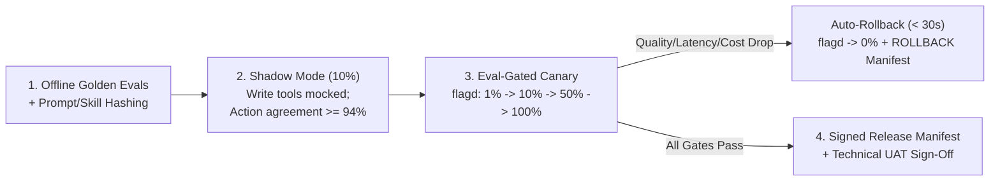

# Lecture 43: Complete Notes — Progressive Autonomy (`OpenFeature`/`flagd`) & Safe Releases

> **Goal:** Ship model migrations, prompt updates, and agent autonomy safely using the Progressive Autonomy Ladder, `OpenFeature` + `flagd` runtime flags, side-effect-free shadow mode, evaluation-gated canaries with `< 30s` automated rollback, signed release manifests, and Technical UAT.

---

## End-to-End Safe Release Pipeline

---

## Chapter 1: The Progressive Autonomy Ladder
- Climb trust in four rungs: **Rung 1 Shadow Mode** (0% user impact) $\rightarrow$ **Rung 2 Human-Approved Copilot** $\rightarrow$ **Rung 3 Scoped Autonomous** (strict dollar/reversibility/rate bounds) $\rightarrow$ **Rung 4 Expanded Production**.
- Graduate each rung using measured evidence (action agreement rate, unedited approval rate, SLO compliance).

## Chapter 2: OpenFeature & `flagd` for AI Runtime Control
- **OpenFeature** gives vendor-neutral flag calls (`getStringValue`, `getBooleanValue`, `getNumberValue`); **`flagd`** hot-reloads JSON targeting rules in `< 1s` without code redeploys.
- Control `active_model`, `prompt_version`, `autonomy_mode`, `shadow_enabled`, and numeric caps (`max_auto_refund_usd`). Always fail safe to baseline + `human_approved`.

## Chapter 3: Shadow Mode & Dark Launches
- Mirror sampled live traffic asynchronously to candidate models/prompts with **0 ms added user latency**.
- **Never execute write tools twice**: allow/replay reads, mock mutating tools via a dry-run proxy, and compare action equivalence, schema validity, latency, and cost.

## Chapter 4: Evaluation-Gated Canary Rollouts
- Shift traffic `1% -> 10% -> 50% -> 100%` only when **minimum sample counts + soak windows + 4 live eval gates** pass (task success, schema/policy safety, `p95` latency, CPST).
- Protect VIP/regulated tenants during early `1%`/`10%` stages via `flagd` targeting rules.

## Chapter 5: Versioning Prompts, Models & Skills + Release Manifests
- Capture **git commit + pinned model ID + prompt SHA-256 + skill versions + `flagd` snapshot + eval proof** in an **HMAC/Cosign-signed Release Manifest**.
- Stamp `release.id` on every OTel root span so regressions trace straight back to the exact bundle.

## Chapter 6: Automated Rollback & Incident Recovery
- Wire a rolling-window circuit breaker directly to `flagd` so degraded canaries revert to `0%` in **< 30 seconds**, downgrade autonomy to `human_approved`, and emit a signed `ROLLBACK` manifest.
- Follow the 6-step **Model Migration Playbook** and quarantine failing traces into golden CI evals.

## Chapter 7: Technical UAT & Customer Handover Sign-Off
- Run scripted live UAT covering happy paths, autonomy dollar caps, live `flagd` kill-switch, `<30s` canary rollback, and hard budgets before handing over runbooks and dashboards.

---

## Release Gate Checklist
- [x] `OpenFeature` + `flagd` JSON targeting routes baseline vs. canary cohorts deterministically.
- [x] Shadow mode runs candidate comparison with write tools dry-run mocked.
- [x] Injecting a degraded canary model triggers automatic `flagd` rollback to baseline within `< 30s`.
- [x] Signed release manifest (`HMAC-SHA256`) records exact model, prompt hash, skill versions, `flagd` state, and rollback/promotion status.

