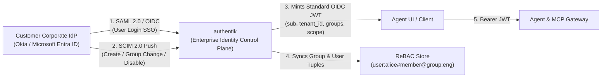

# Chapter 02 — OIDC, SAML & SCIM Provisioning

> **Lecture 44 · Chapter 02 of 07** · Level: 🔴 Expert · Phase 10 — Quality, FinOps, Identity & Security
> **Source:** `FDE S19` · **Roadmap Reference:** [`roadmap-v1.md`](../../roadmap-v1.md#lecture-44--enterprise-identity--agent-authorization-oidc-saml-scim-authentik-rebac)

---

## 1. Intuition: Logging In vs. Knowing Who Still Works Here

Enterprise identity rests on **three distinct protocols**, and confusing them is one of the most common enterprise integration mistakes:
1. **OIDC (OpenID Connect)** & **SAML 2.0** handle **Authentication (*"Who are you right now at login time?"*)**.
2. **SCIM 2.0 (System for Cross-domain Identity Management)** handles **Lifecycle Sync (*"Did Alice get promoted to Finance, or fired 10 minutes ago?"*)**.

Why is SCIM critical for AI agents? Suppose Alice is fired at 10:00 AM in Workday/Okta. Without SCIM, your agent platform only finds out the next time she tries to log in—meaning **background agent jobs, delegated sessions, or ReBAC group memberships could stay active for hours or days**. With SCIM 2.0, Okta pushes a deactivation request to `authentik` in seconds, which immediately strips her ReBAC tuples.

---

## 2. Side-by-Side Comparison: OIDC vs. SAML vs. SCIM

| Protocol | Format & Transport | Primary Job | Where It Lives in AI Architecture |
| :--- | :--- | :--- | :--- |
| **OIDC (OpenID Connect)** | JSON / JWTs over OAuth 2.0 HTTPS | Modern **Authentication** for web apps, SPAs, CLIs, and APIs | Issues signed `id_token` + `access_token` (`sub`, `tenant_id`, `groups`, `scope`) to your Agent UI & MCP Gateway |
| **SAML 2.0** | Signed XML assertions over HTTP POST | Legacy/Enterprise **SSO Federation** (Okta, Entra ID, Ping) | Connects customer's corporate IdP to your **`authentik` Identity Broker** |
| **SCIM 2.0** | REST JSON (`POST /Users`, `PATCH /Groups`) | **Automated Provisioning & De-provisioning** | Syncs org charts, departments, and revocations from Okta/Entra $\rightarrow$ `authentik` $\rightarrow$ ReBAC tuple store |

---

## 3. How SAML, OIDC, and SCIM Flow Together



### Why You Bridge SAML $\rightarrow$ OIDC Once at `authentik`
Enterprise customers insist on SAML 2.0; modern MCP servers and TypeScript/Python microservices want lightweight JSON JWTs. Putting **`authentik`** in front as an **Identity Broker** lets customers plug in SAML 2.0 *once*, while every downstream agent and MCP server only ever speaks clean **OIDC JWTs**.

---

## 4. Concrete SCIM 2.0 De-Provisioning Payload

When HR terminates Alice in Okta, Okta sends a `PATCH` request to `authentik`'s SCIM endpoint within seconds:

```http
PATCH /scim/v2/Users/usr_alice_9182
Authorization: Bearer <scim_sync_token>
Content-Type: application/scim+json

{
  "schemas": ["urn:ietf:params:scim:api:messages:2.0:PatchOp"],
  "Operations": [
    {
      "op": "replace",
      "path": "active",
      "value": false
    }
  ]
}
```

Your webhook/sync handler receives `"active": false` and calls `rebac.removeUser("user:alice")` + revokes active OBO tokens—shutting down all agent access immediately.

---

## 5. Anatomy & Validation of an Enterprise OIDC JWT

```json
{
  "iss": "https://auth.acme-ai.internal/application/o/agent-gateway/",
  "sub": "usr_alice_9182",
  "aud": "mcp-gateway",
  "exp": 1795686564,
  "iat": 1795682964,
  "email": "alice@acme.com",
  "tenant_id": "tenant_acme",
  "groups": ["engineering", "support_tier2"],
  "scope": "openid profile mcp:tools.read mcp:kb.search"
}
```

### Mandatory Gateway Verification Checklist
1. **Signature & `alg`:** Verify RS256/ES256/HS256 signature against the IdP's JWKS public key; **explicitly reject `alg: "none"`**.
2. **`iss` (Issuer):** Must match your exact trusted `authentik` provider URL.
3. **`aud` (Audience):** Must match `"mcp-gateway"`—blocks cross-service token replay.
4. **`exp` (Expiration):** Reject if `now >= exp`. Keep access token TTL short (5–15 min).

---

## 6. Chapter Summary
- **OIDC** issues modern JWTs; **SAML 2.0** federates corporate IdPs into `authentik`; **SCIM 2.0** pushes real-time group changes and offboarding (`"active": false`).
- Every gateway must cryptographically validate **`alg`, signature, `iss`, `aud`, and `exp`** before trusting `sub` or `tenant_id`.

---
**Next:** [Chapter 03 — Deploying `authentik` as the Identity Control Plane](./03_Deploying_authentik_as_the_Identity_Control_Plane.md)

