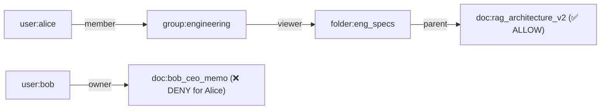

# Chapter 06 — RBAC vs. ReBAC (Relationship-Based Access Control)

> **Lecture 44 · Chapter 06 of 07** · Level: 🔴 Expert · Phase 10 — Quality, FinOps, Identity & Security
> **Source:** `FDE S19` · **Roadmap Reference:** [`roadmap-v1.md`](../../roadmap-v1.md#lecture-44--enterprise-identity--agent-authorization-oidc-saml-scim-authentik-rebac)
> **External Reference:** [OpenFGA / Zanzibar Concepts](https://openfga.dev/docs/concepts)

---

## 1. Intuition: Why Job Titles ("RBAC") Fail for Documents & Tools

Suppose Alice and Bob both have the exact same job title in Okta: **`role = "Account_Executive"`**.
- Alice owns the **Acme Corp** deal (`doc:acme_renewal_contract`).
- Bob owns the **Globex** deal (`doc:globex_renewal_contract`).

If your AI agent uses **RBAC** (`if user.role == "Account_Executive": allow read_document`), then **Alice's agent can read Bob's private Globex contract**—and an indirect prompt injection in an email can exfiltrate every deal in the company!

Why? Because **RBAC only knows *who you are* (`role`), not *how you relate to a specific document or ticket***.
**ReBAC (Relationship-Based Access Control)**—pioneered by Google **Zanzibar** and implemented in **OpenFGA** / **SpiceDB**—models permissions as a **relationship graph of tuples**.

---

## 2. RBAC vs. ABAC vs. ReBAC

| Model | Core Question | Best For | Where It Breaks in AI |
| :--- | :--- | :--- | :--- |
| **RBAC** | *"Does user have role `support_tier2`?"* | Coarse tool gating (`can_use_jira_tool`) | Cannot express per-doc ownership or nested folder sharing |
| **ABAC** | *"Does `user.dept == doc.dept`?"* | Static attribute rules (`tenant_id == doc.tenant_id`) | Struggles with ad-hoc sharing (`alice shared doc X with carol`) |
| **ReBAC (Zanzibar)** | *"Is there a valid path from `user:alice` to `doc:X` with relation `viewer`?"* | **Ownership, group membership, folder inheritance, and sharing** | Requires syncing user/group tuples from `authentik` / SCIM |

---

## 3. Step-by-Step Zanzibar Graph Trace

Every permission fact is a 3-part tuple: **`(user, relation, object)`**.

```text
user:alice#owner@doc:alice_q3_plan
user:alice#member@group:engineering
group:engineering#viewer@folder:eng_specs
folder:eng_specs#parent@doc:rag_architecture_v2
user:bob#owner@doc:bob_ceo_memo
```



### Trace 1: `Check("user:alice", "viewer", "doc:rag_architecture_v2")` $\rightarrow$ `true`
1. Direct check on `doc:rag_architecture_v2` for `user:alice`? None.
2. Parent folder check: `folder:eng_specs#parent@doc:rag_architecture_v2` exists $\rightarrow$ recurse `Check("user:alice", "viewer", "folder:eng_specs")`.
3. Group check: `user:alice#member@group:engineering` exists $\rightarrow$ recurse `Check("group:engineering", "viewer", "folder:eng_specs")` $\rightarrow$ **Direct match! Returns `true`**.

### Trace 2: `Check("user:alice", "viewer", "doc:bob_ceo_memo")` $\rightarrow$ `false`
1. Direct check for `user:alice`? None.
2. Parent folders? None.
3. Groups (`group:engineering`)? No path to `doc:bob_ceo_memo`.
4. **Returns `false` $\rightarrow$ `403 Forbidden`!**

---

## 4. Enforcing ReBAC at BOTH Retrieval and Tool Execution

1. **Before RAG Vector Retrieval:** Never pull Bob's secret chunks into the LLM's context window and *"tell the LLM not to repeat them"*. Filter vector search results against `ReBAC` **before** building the prompt!
2. **Before Every MCP Tool Call:** Every `read_document`, `update_jira`, or `issue_refund` call must pass `ReBAC.check(jwt.sub, requiredRelation, resourceId)`.

---

## 5. Chapter Summary
- **RBAC** gates coarse roles; **ReBAC (Zanzibar/OpenFGA)** resolves fine-grained ownership, group membership, and folder inheritance in milliseconds.
- Enforce ReBAC **before RAG prompt assembly** and **before every MCP tool call** so unauthorized data never reaches the LLM or user.

---
**Next:** [Chapter 07 — Enterprise-Managed Authorization & Gateway Policies](./07_Enterprise_Managed_Authorization_and_Gateway_Policies.md)

