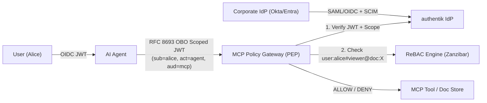

# Lecture 44: Complete Notes — Enterprise Identity (`OIDC`, `SAML`, `SCIM`, `authentik`) & `ReBAC`

> **Goal:** Eliminate shared god-mode service accounts by enforcing delegated user identity (`OIDC`, `SAML`, `SCIM`, `authentik`, OAuth Token Exchange) and fine-grained `ReBAC` + gateway policies in front of every MCP tool and RAG retrieval.

---

## End-to-End Enterprise Agent Identity Architecture

---

## Chapter Summaries

1. **Why Shared Service Accounts Break Agent Security:** Shared keys cause the **Confused Deputy Problem**, destroy user-to-tool audit attribution, and break offboarding. Enforce `User Permissions ∩ Scoped Agent Token`.
2. **OIDC, SAML & SCIM Provisioning:** **OIDC** issues modern JWTs (`iss`, `aud`, `exp`, `sub`); **SAML 2.0** integrates legacy corporate IdPs; **SCIM 2.0** automates real-time user/group provisioning and de-provisioning (`"active": false`).
3. **Deploying `authentik`:** Acts as a self-hostable Identity Control Plane bridging SAML $\rightarrow$ OIDC, injecting `tenant_id` / `groups` via Property Mappings, and configured via declarative Blueprints.
4. **Delegated Credentials & Attribution:** **OAuth 2.0 Token Exchange (RFC 8693 / On-Behalf-Of)** down-scopes `aud`, `scope`, and `exp` while preserving both **`sub` (human)** and **`act` (agent)**.
5. **MCP Authorization Specification:** Standardizes remote MCP servers on **OAuth 2.1 + PKCE (`S256`) + Protected Resource Metadata (`RFC 9728`) + Resource Indicators (`RFC 8707`)**.
6. **RBAC vs. ReBAC:** RBAC checks coarse roles; **ReBAC (Zanzibar/OpenFGA)** checks relationship graphs (`user:alice#member@group:eng` $\rightarrow$ `viewer@doc:X`) at both RAG retrieval and tool execution boundaries.
7. **Gateway Policy Enforcement:** A fail-closed Policy Enforcement Point verifies JWT, scopes, and ReBAC deterministically—blocking cross-user access even under indirect prompt injection.

---

## Release Gate Checklist
- [x] Gateway verifies signed OIDC/OBO JWT (`iss`, `aud`, `exp`, `sub`, `act`, `scope`).
- [x] ReBAC graph resolves direct ownership, group membership, and folder inheritance.
- [x] Agent acting for User A is deterministically blocked (`403`) from reading/modifying User B's resources, even via indirect prompt injection.

