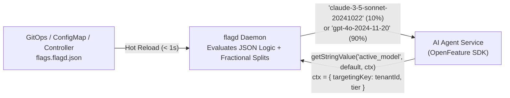
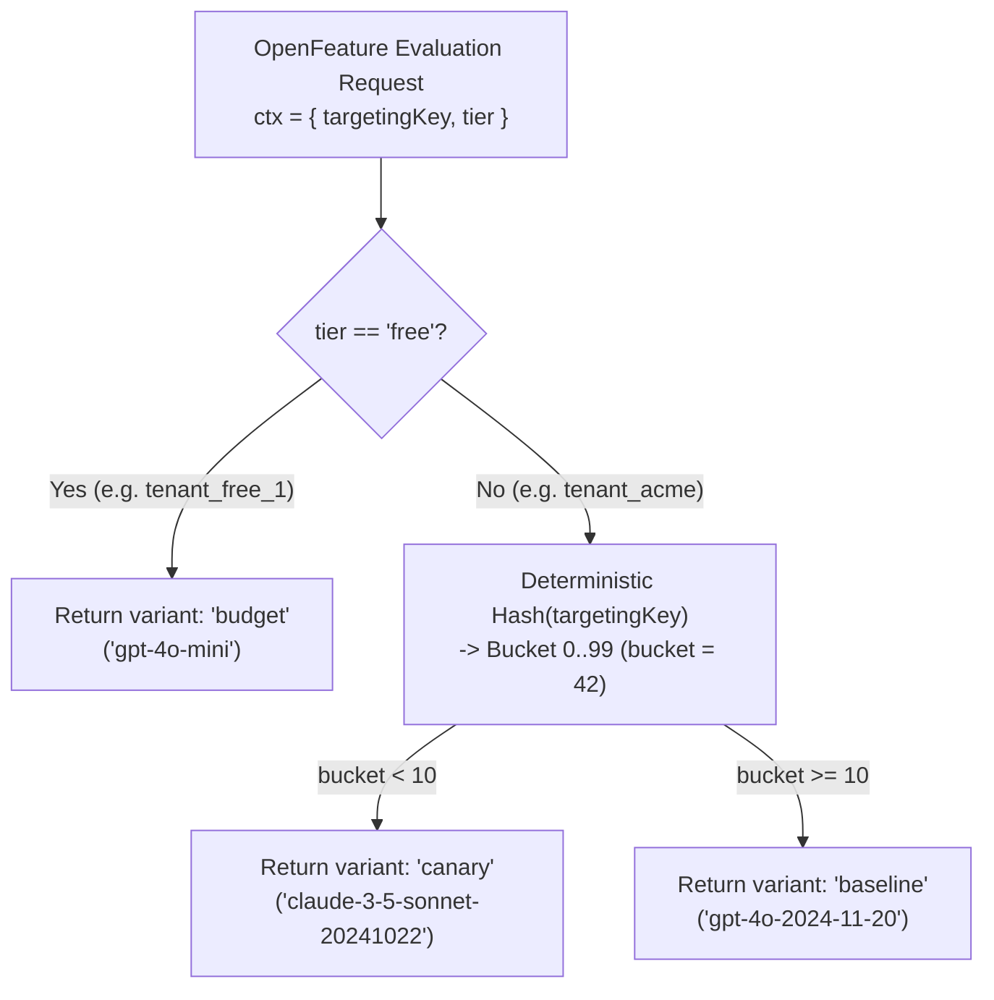

# Chapter 02 — OpenFeature & `flagd` for AI Runtime Control

> **Lecture 44 · Chapter 02 of 07** · Level: 🟠 Advanced · Phase 10 — Quality, FinOps, Identity & Security
> **Source:** `FDE S18` · **Roadmap Reference:** [`roadmap-v1.md`](../../roadmap-v1.md#lecture-43--progressive-autonomy-feature-flags-openfeatureflagd--safe-releases) · [OpenFeature Specification](https://openfeature.dev/) · [flagd Documentation](https://flagd.dev/)
> **Roadmap topics:** Why code deploys are too slow for AI incidents · OpenFeature vendor-neutral SDK + `flagd` daemon · typed AI runtime flags · `flags.flagd.json` targeting & fractional splits · deterministic `targetingKey` stickiness & fail-safe defaults.

---

## 02.0 What this chapter is for

Imagine your agent uses `gpt-4o-2024-11-20`, hardcoded in `src/config.ts`. At 2:15 PM on Friday, you need to:
- Shift `10%` of traffic to `claude-3-5-sonnet-20241022`, OR
- Drop `tenant_acme` from `autonomous` back to `human_approved` because they reported an edge case, OR
- Route free-tier users to `gpt-4o-mini` to protect your gross margin.

If any of those requires **editing code → running CI → building a Docker image → rolling Kubernetes pods**, your reaction time is **15–45 minutes**. During an AI outage or runaway loop, 30 minutes is an eternity.

**OpenFeature + `flagd`** separates **code deployments** (slow, heavy) from **AI runtime configuration** (instant, `< 1 second`, zero pod restarts).

By the end of this chapter you should be able to:

1. Explain the architectural split between **OpenFeature** (the CNCF SDK interface) and **`flagd`** (the evaluation daemon).
2. Design **typed AI runtime flags** (`String`, `Number`, `Boolean`) for models, prompts, autonomy rungs, and dollar caps.
3. Trace a **`flags.flagd.json`** targeting rule step-by-step for tier overrides and fractional canary splits.
4. Enforce **session stickiness** (`targetingKey`) and **fail-safe conservative defaults** when `flagd` is unreachable.

---

## 02.1 How OpenFeature & `flagd` Fit Together

Think of **OpenFeature** like **OpenTelemetry** (Lecture 43):
- **OpenFeature** is the **CNCF vendor-neutral SDK interface** in your application (`client.getStringValue(...)`). Your code never locks into LaunchDarkly, Split, or Statsig.
- **`flagd`** is the **lightweight, open-source evaluation daemon** (running as a Kubernetes sidecar or standalone service) that watches a declarative `flags.flagd.json` file (from GitOps, ConfigMap, HTTP, or S3) and evaluates rules locally in microseconds.



---

## 02.2 Typed AI Flags: More Than Just Booleans

Traditional feature flags are often simple `true/false` toggles. AI runtime control uses **typed flags** across six core levers:

| Flag Key | Type | Example Variants | Runtime Control Purpose |
| :--- | :---: | :--- | :--- |
| `active_model` | `String` | `"gpt-4o-2024-11-20"`, `"claude-3-5-sonnet-20241022"`, `"gpt-4o-mini"` | Instant model routing & migration |
| `prompt_version` | `String` | `"2.4.0"`, `"2.5.0-rc1"` | Switch system prompt template without redeploy |
| `autonomy_mode` | `String` | `"shadow"`, `"human_approved"`, `"autonomous"` | Step tenants up/down the autonomy ladder |
| `shadow_enabled` | `Boolean` | `true` / `false` | Toggle background dark-launch mirroring |
| `canary_weight_pct` | `Number` | `0`, `1`, `10`, `50`, `100` | Dial canary traffic smoothly or zero it out instantly |
| `max_auto_refund_usd` | `Number` | `25`, `75` | Tune Rung 3 monetary guardrail in real time |

---

## 02.3 Concrete `flags.flagd.json` Walkthrough

```json
{
  "$schema": "https://flagd.dev/schema/v0/flags.json",
  "flags": {
    "active_model": {
      "state": "ENABLED",
      "variants": {
        "baseline": "gpt-4o-2024-11-20",
        "canary": "claude-3-5-sonnet-20241022",
        "budget": "gpt-4o-mini"
      },
      "defaultVariant": "baseline",
      "targeting": {
        "if": [
          { "==": [{ "var": "tier" }, "free"] },
          "budget",
          {
            "fractional": [
              ["baseline", 90],
              ["canary", 10]
            ]
          }
        ]
      }
    }
  }
}
```

### Step-by-Step Evaluation Trace



1. **Request A (`{ targetingKey: "tenant_free_1", tier: "free" }`):** Matches `tier == "free"` → immediately returns `"gpt-4o-mini"`.
2. **Request B (`{ targetingKey: "tenant_acme", tier: "enterprise" }`):** Enters `fractional`. `flagd` hashes `targetingKey` (`"tenant_acme"`) into bucket `42` (`42 >= 10`) → returns `"gpt-4o-2024-11-20"`.
3. **Why deterministic hashing matters:** Every turn from `"tenant_acme"` hashes to `42`—so Turn 1, Turn 2, and Turn 3 stay on the **exact same model**, preserving prefix prompt-cache hits and consistent tone!

---

## 02.4 Stickiness & Fail-Safe Defaults

> [!IMPORTANT]
> **Two Golden Rules of AI Feature Flags:**
> 1. **Sticky `targetingKey`:** Always use `tenantId` or `sessionId` (never a random UUID per turn) so multi-turn conversations never flip models or prompts mid-chat.
> 2. **Fail-Safe Defaults:** Always pass the **safest, most conservative** default to OpenFeature (`getStringValue("autonomy_mode", "human_approved", ctx)`). If `flagd` is ever unreachable, the agent degrades safely to human approval—never to `autonomous`!

---

## 02.5 Common Mistakes

| # | Common Mistake | Why It Hurts | What To Do Instead |
| :---: | :--- | :--- | :--- |
| **1** | **Hardcoding models, prompts, or thresholds in app code** | Incident mitigation takes 20–45 minutes of CI/CD pod restarts | Externalize runtime levers into **OpenFeature + `flagd`** |
| **2** | **Using `Math.random()` or per-turn UUIDs as `targetingKey`** | Multi-turn chats flip between `gpt-4o` and `claude` mid-conversation, breaking prompt caches | Pass **`sessionId` or `tenantId`** as `targetingKey` |
| **3** | **Passing `"autonomous"` as the OpenFeature fallback default** | If `flagd` restarts or times out, every tenant silently becomes autonomous | Always pass the **most conservative default** (`"human_approved"` / `0` canary) |
| **4** | **Calling vendor-specific flag SDKs directly in business logic** | Locks your agent codebase to one SaaS flag vendor | Program against the **OpenFeature** standard interface |

---

## 02.6 Key Takeaways

1. **OpenFeature** provides the vendor-neutral SDK contract; **`flagd`** evaluates declarative JSON targeting rules in microseconds with `< 1s` hot-reload.
2. Control **model selection, prompt version, autonomy rung, canary percentage, and dollar caps** at runtime without pod restarts.
3. Use deterministic **`targetingKey` hashing** for session stickiness and always configure **fail-safe conservative defaults**.

---

### Navigation

- **Next:** [Chapter 04 — Evaluation-Gated Canary Rollouts](./04_Evaluation_Gated_Canary_Rollouts.md)
- **Previous:** [Chapter 01 — The Progressive Autonomy Ladder](./01_The_Progressive_Autonomy_Ladder.md)
- **Back to index:** [../index.md](../index.md)
