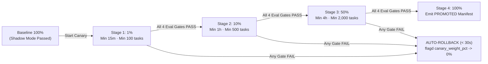
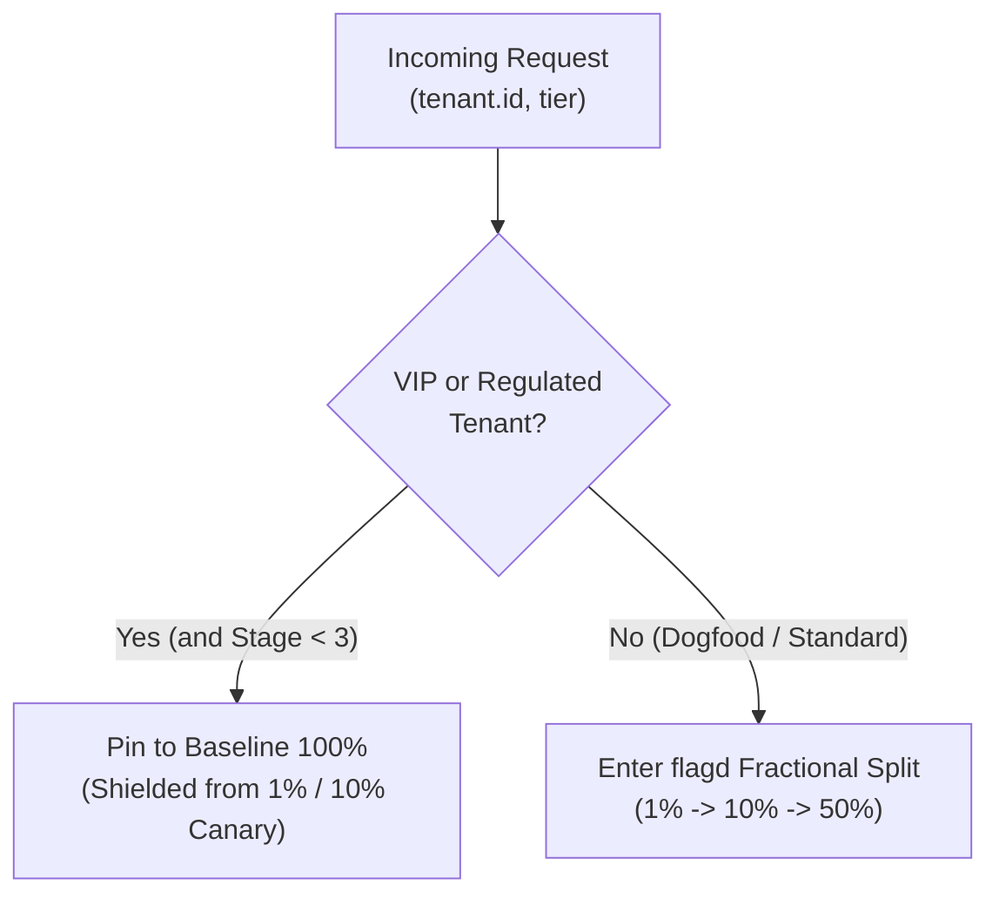

# Chapter 04 — Evaluation-Gated Canary Rollouts

> **Lecture 44 · Chapter 04 of 07** · Level: 🟠 Advanced · Phase 10 — Quality, FinOps, Identity & Security
> **Source:** `FDE S18` · **Roadmap Reference:** [`roadmap-v1.md`](../../roadmap-v1.md#lecture-43--progressive-autonomy-feature-flags-openfeatureflagd--safe-releases)
> **Roadmap topics:** Why time-based canaries fail for AI · staged `1% -> 10% -> 50% -> 100%` state machine · minimum soak time AND minimum sample size · four live eval gates · shielding VIP/regulated cohorts.

---

## 04.0 What this chapter is for

In traditional web backends, a canary rollout works like this:
*"Send `5%` of traffic to `v2`. Wait 30 minutes. If CPU is normal and HTTP `500`s are `0%`, promote to `50%`."*

In AI agents, **a broken model or prompt still returns `HTTP 200 OK`**! It just hallucinates policy rules, fails JSON schemas on nested objects, or loops 6 times burning `5x` tokens.

An **Evaluation-Gated Canary** replaces blind timers with **metric-verified stage gates** (`1% -> 10% -> 50% -> 100%`). Promotion happens *only* when live AI quality, safety, latency, and cost metrics hold—and any breach triggers instant rollback to `0%`.

By the end of this chapter you should be able to:

1. Explain why **time-only canaries** miss silent AI quality and cost regressions.
2. Design a **4-stage canary state machine** (`1% -> 10% -> 50% -> 100%`) with automated rollback.
3. Explain why promotion gates require **both minimum soak time AND minimum sample size (`n`)**.
4. Configure the **four live evaluation gates** and **VIP cohort protection** in `flagd`.

---

## 04.1 The Staged Canary State Machine

---

## 04.2 Why You Need BOTH Minimum Samples AND Minimum Soak Time

A common mistake is checking only traffic percentage without sample size or soak duration:
- **Too few samples:** If `1%` traffic only receives `4` requests and `1` user asks an out-of-scope question, your success rate looks like `75%`—causing false rollbacks. Conversely, `4/4` (`100%`) is statistically meaningless!
- **Too short a soak:** A model provider's rate limit, token-bucket exhaustion, or prompt-cache eviction bug might only show up after 30 minutes of sustained traffic.

Always require **both** `elapsed_minutes >= min_soak` **and** `sample_count >= min_samples` before promoting—while keeping **fast-trip circuit breakers** armed if `n >= 20` and failure rate spikes severely!

| Canary Stage | Traffic Weight | Min Soak Time | Min Samples (`n`) | Promotion / Rollback Rule |
| :---: | :---: | :---: | :---: | :--- |
| **Stage 1** | `1%` | `15 min` | `100` tasks | `success >= 90%`, `schema_fail <= 3%`, `0` policy violations |
| **Stage 2** | `10%` | `1 hour` | `500` tasks | `success >= 93%`, `p95 <= 1.25x baseline` |
| **Stage 3** | `50%` | `4 hours` | `2,000` tasks | `cpst <= 1.20x baseline`, `sampled_faithfulness >= 0.88` |
| **Stage 4** | `100%` | — | — | Emit signed `PROMOTED` manifest; monitor SLOs |

---

## 04.3 The Four Live Eval Gates & Cohort Protection

At every stage, your canary controller queries OpenObserve for the canary cohort vs. baseline:

| Gate | Exact Condition | What Regression It Catches |
| :--- | :--- | :--- |
| **1. Task Success** | `canary.task_success >= baseline.task_success - 0.02` | Accuracy, grounding, or tool-selection drops |
| **2. Schema & Policy Safety** | `canary.schema_fail <= 0.03` AND `policy_violations == 0` | Broken JSON outputs or guardrail/PII leaks |
| **3. Latency (`p95`)** | `canary.p95_ms <= baseline.p95_ms * 1.25` | Slow reasoning loops or throttled endpoints |
| **4. FinOps Cost (`CPST`)** | `canary.cpst_usd <= baseline.cpst_usd * 1.20` | Token bloat, lost prompt-cache hits, or excessive retries |

### Shielding VIP & Regulated Tenants

> [!TIP]
> **Protect high-sensitivity accounts in `flags.flagd.json`.** Run Stage 1 (`1%`) and Stage 2 (`10%`) exclusively on internal dogfooding accounts and standard opt-in tenants. VIP/regulated accounts only enter at Stage 3 (`50%`) or after Stage 4 (`100%`) promotion.

---

## 04.4 Common Mistakes

| # | Common Mistake | Why It Hurts | What To Do Instead |
| :---: | :--- | :--- | :--- |
| **1** | **Promoting canaries based only on HTTP 200 and CPU** | Broken prompts return `200 OK` while failing tasks or burning `3x` tokens | Gate promotion on **Task Success, Schema/Policy, `p95` Latency, and CPST** |
| **2** | **Promoting after `5` minutes with `n = 8` requests** | Statistically noisy; ships regressions or causes false rollbacks | Require **both `min_soak` AND `min_samples`** before advancing stages |
| **3** | **Exposing VIP/regulated tenants to the `1%` canary** | First-hour prompt bugs hit your highest-value customer | Exclude `vip`/`regulated` tiers in `flagd` during Stages 1 and 2 |
| **4** | **Checking only quality and ignoring CPST during canary** | A prompt that boosts accuracy by `1%` while doubling token spend destroys margins | Enforce **`canary.cpst_usd <= baseline.cpst_usd * 1.20`** as a hard gate |

---

## 04.5 Key Takeaways

1. **Evaluation-gated canaries** advance `1% -> 10% -> 50% -> 100%` only when live AI quality, safety, latency, and CPST gates pass.
2. Enforce **both minimum soak duration and minimum sample size** before promotion, while keeping **fast circuit breakers** active.
3. Shield sensitive enterprise tenants from early `1%` / `10%` canary cohorts via `flagd` targeting rules.

---

### Navigation

- **Next:** [Chapter 05 — Versioning Prompts, Models & Skills + Release Manifests](./05_Versioning_Prompts_Models_Skills_and_Release_Manifests.md)
- **Previous:** [Chapter 02 — OpenFeature & `flagd` for AI Runtime Control](./02_OpenFeature_and_flagd_for_AI_Runtime_Control.md)
- **Back to index:** [../index.md](../index.md)
