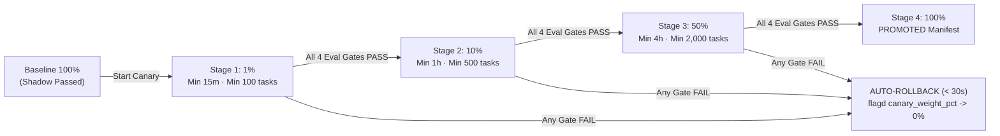

# Chapter 04 — Evaluation-Gated Canary Rollouts

> **Lecture 44 · Chapter 04 of 07** · Level: 🟠 Advanced · Phase 10 — Quality, FinOps, Identity & Security
> **Source:** `FDE S18` · **Roadmap Reference:** [`roadmap-v1.md`](../../roadmap-v1.md#lecture-43--progressive-autonomy-feature-flags-openfeatureflagd--safe-releases)

---

## 1. Why "Time-Based" Canaries Don't Work for AI

In traditional web backends, a canary rollout works like this:
*"Send 5% of traffic to `v2`. Wait 30 minutes. If CPU is normal and HTTP 500s are 0%, promote to 50%."*

In AI agents, **a broken model or prompt still returns `HTTP 200 OK`**! It just hallucinates policy rules, fails JSON schemas on nested objects, or loops 6 times burning 5x tokens.
An **Evaluation-Gated Canary** replaces blind timers with **metric-verified stage gates** (`1% -> 10% -> 50% -> 100%`). Promotion happens *only* when live AI quality, latency, and cost metrics hold—and any breach triggers instant rollback to `0%`.

---

## 2. The Staged Canary State Machine

---

## 3. Why You Need BOTH Minimum Samples AND Minimum Soak Time

A common beginner mistake is checking only percentage without sample size:
- **Too few samples:** If `1%` traffic only receives `4` requests and `1` user asks an out-of-scope question, your success rate looks like `75%`—causing false rollbacks. Conversely, `4/4` (`100%`) is statistically meaningless!
- **Too short a soak:** A model provider's rate limit or cache-eviction bug might only show up after 30 minutes of sustained traffic.

Always require **both** `elapsed_minutes >= min_soak` **and** `sample_count >= min_samples` before promoting (while still allowing **fast-trip circuit breakers** if `n >= 20` and failure rate spikes badly!).

| Canary Stage | Traffic Weight | Min Soak Time | Min Samples (`n`) | Promotion / Rollback Rule |
| :---: | :---: | :---: | :---: | :--- |
| **Stage 1** | `1%` | `15 min` | `100` tasks | `success >= 90%`, `schema_fail <= 3%`, `0` policy violations |
| **Stage 2** | `10%` | `1 hour` | `500` tasks | `success >= 93%`, `p95 <= 1.25x baseline` |
| **Stage 3** | `50%` | `4 hours` | `2,000` tasks | `cpst <= 1.20x baseline`, `sampled_faithfulness >= 0.88` |
| **Stage 4** | `100%` | — | — | Emit signed `PROMOTED` manifest; monitor SLOs |

---

## 4. The Four Live Eval Gates Checked at Every Stage

| Gate | Exact Condition | What Regression It Catches |
| :--- | :--- | :--- |
| **1. Task Success** | `canary.task_success >= baseline.task_success - 0.02` | Accuracy or tool-selection drops |
| **2. Schema & Policy Safety** | `canary.schema_fail <= 0.03` AND `policy_violations == 0` | Broken JSON outputs or guardrail leaks |
| **3. Latency (`p95`)** | `canary.p95_ms <= baseline.p95_ms * 1.25` | Slow reasoning loops or throttled endpoints |
| **4. FinOps Cost (`CPST`)** | `canary.cpst_usd <= baseline.cpst_usd * 1.20` | Token bloat, lost prompt-cache hits, or excessive retries |

---

## 5. Cohort Protection: Shield VIP & Regulated Tenants

In `flags.flagd.json`, exclude regulated/VIP tenants during **Stage 1 (`1%`)** and **Stage 2 (`10%`)**:
- Stage 1–2 run on internal dogfooding accounts + standard opt-in tenants.
- VIP enterprise accounts only enter at Stage 3 (`50%`) or after Stage 4 (`100%`) promotion—unless they explicitly opt into a beta cohort.

---

## 6. Chapter Summary
- **Evaluation-gated canaries** advance `1% -> 10% -> 50% -> 100%` only when live AI quality, safety, latency, and CPST gates pass.
- Enforce **both minimum soak duration and minimum sample size** before promotion, while keeping **fast circuit breakers** active.
- Shield sensitive enterprise tenants from early `1%` / `10%` canary cohorts via `flagd` targeting rules.

---
**Next:** [Chapter 05 — Versioning Prompts, Models & Skills + Release Manifests](./05_Versioning_Prompts_Models_Skills_and_Release_Manifests.md)

