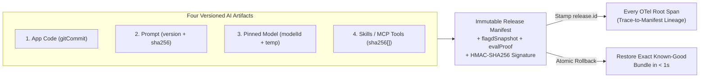
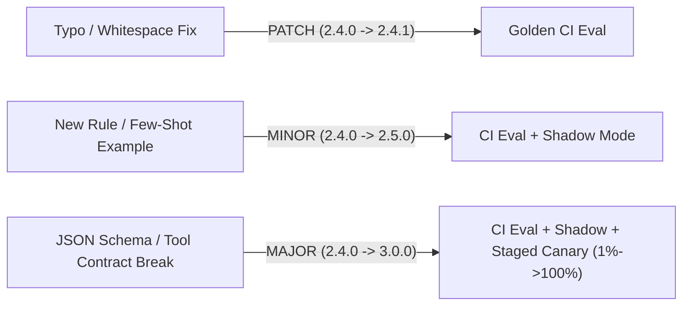

# Chapter 05 — Versioning Prompts, Models & Skills + Release Manifests

> **Lecture 44 · Chapter 05 of 07** · Level: 🟠 Advanced · Phase 10 — Quality, FinOps, Identity & Security
> **Source:** `FDE S18` · **Roadmap Reference:** [`roadmap-v1.md`](../../roadmap-v1.md#lecture-43--progressive-autonomy-feature-flags-openfeatureflagd--safe-releases)
> **Roadmap topics:** Four independent AI release artifacts · immutable signed Release Manifests · HMAC/Cosign tamper evidence · `release.id` OTel trace lineage · semantic versioning for prompts and skills.

---

## 05.0 What this chapter is for

In traditional software, `git commit SHA` tells you everything running in production. In AI agents, **four independent artifacts** change on different schedules—and changing *any* one of them alters system behavior:

1. **Application Code (`gitCommit`):** Agent loop, retry logic, schema/Z3 validators.
2. **Prompts (`prompt.sha256`):** System prompt, few-shot examples, tool descriptions.
3. **Model Snapshots (`modelId`):** `gpt-4o-2024-11-20`, `claude-3-5-sonnet-20241022`, or quantized vLLM image digest.
4. **Skills & MCP Tools (`skills[]`):** External tool schemas, `SKILL.md` instructions, or RAG index snapshot ID.

If someone edits a prompt in a web UI, upgrades an MCP server, and switches the model in `flagd` without recording a unified snapshot, **you cannot reproduce yesterday's working system during an outage**.

By the end of this chapter you should be able to:

1. Explain why `git_sha` alone cannot reproduce an AI agent release.
2. Structure an **immutable, cryptographically signed Release Manifest** binding all four artifacts, `flagd` weights, and eval proof.
3. Verify manifest integrity with **HMAC-SHA256** and link production OTel spans via **`release.id`**.
4. Apply **Semantic Versioning (`PATCH`, `MINOR`, `MAJOR`)** to prompts and MCP skills.

---

## 05.1 The Immutable Signed Release Manifest

A **Release Manifest** is an immutable JSON document (signed with HMAC-SHA256 or Ed25519/Cosign) emitted whenever a release is promoted or rolled back.



```json
{
  "manifestVersion": "1.0",
  "releaseId": "rel_2026_11_26_004",
  "createdAt": "2026-11-26T09:15:00.000Z",
  "environment": "prod",
  "status": "PROMOTED",
  "artifacts": {
    "gitCommit": "a8f31c9",
    "model": {
      "provider": "openai",
      "modelId": "gpt-4o-2024-11-20",
      "temperature": 0.0
    },
    "prompt": {
      "name": "support_triage_system",
      "version": "2.4.0",
      "sha256": "e3b0c44298fc1c149afbf4c8996fb92427ae41e4649b934ca495991b7852b855"
    },
    "skills": [
      { "name": "kb_vector_search", "version": "1.3.2", "sha256": "9f86d081..." },
      { "name": "refund_tool", "version": "1.1.0", "sha256": "4b227777..." }
    ]
  },
  "flagdSnapshot": {
    "active_model": "baseline",
    "autonomy_mode": "human_approved",
    "canary_weight": 0
  },
  "evalProof": {
    "goldenSuitePassRate": 0.962,
    "shadowAgreementRate": 0.948,
    "cpstUsd": 0.0114
  },
  "signature": {
    "algorithm": "HMAC-SHA256",
    "keyId": "release-signer-v1",
    "digest": "7c4a8d09ca3762af61e59520943dc26494f8941b"
  }
}
```

---

## 05.2 Why Cryptographic Signing & Trace Lineage Matter

1. **Tamper Evidence:** Signing the canonical JSON payload (`HMAC-SHA256` or Cosign) guarantees nobody edited the prompt or bumped `canary_weight` in production without leaving a verified audit trail:
   ```typescript
   const expectedDigest = createHmac("sha256", signingSecret)
     .update(JSON.stringify(unsignedManifest))
     .digest("hex");
   if (manifest.signature.digest !== expectedDigest) {
     throw new Error("Tampered release manifest!");
   }
   ```
2. **Instant "Known-Good" Rollback:** Rolling back isn't guessing *"which prompt went with `gpt-4o-2024-11-20`?"*—you simply restore **`rel_2026_11_26_003`**, which atomically reverts model, prompt hash, skill versions, and `flagd` weights together.
3. **Trace-to-Manifest Lineage:** Stamp `release.id = "rel_2026_11_26_004"` onto every OTel root span (`invoke_agent`) so OpenObserve can group error spikes and CPST jumps by exact release bundle.

> [!IMPORTANT]
> **Never edit prompts in a production database or CMS without bumping `prompt.sha256` and emitting a new Release Manifest.** Unversioned prompt edits break reproducibility and invalidate your eval proof.

---

## 05.3 Semantic Versioning Rules for Prompts & Skills



| Change Type | Version Bump | Example | Required Rollout Gate |
| :--- | :---: | :--- | :--- |
| **Typo / whitespace fix** | `PATCH` (`2.4.0 → 2.4.1`) | Clarifying punctuation | Golden CI eval |
| **New instruction / few-shot example** | `MINOR` (`2.4.0 → 2.5.0`) | Adding refund edge-case rule | CI eval + Shadow mode |
| **Output JSON schema / tool contract break** | `MAJOR` (`2.4.0 → 3.0.0`) | Renaming required output fields | CI eval + Shadow + Staged Canary (`1% → 10% → 50% → 100%`) |

---

## 05.4 Common Mistakes

| # | Common Mistake | Why It Hurts | What To Do Instead |
| :---: | :--- | :--- | :--- |
| **1** | **Versioning only `gitCommit` and ignoring prompts/skills** | Prompt or MCP tool changes silently alter production behavior with no audit trail | Hash **code, prompt, pinned model, and skills[]** into one Release Manifest |
| **2** | **Hot-editing prompts in a web playground in prod** | Breaks reproducibility and bypasses CI evals and signing | Treat prompts as **Git-versioned artifacts** deployed via signed manifests |
| **3** | **Omitting `release.id` from OTel spans** | SREs see an error spike in OpenObserve but don't know which bundle caused it | Stamp **`release.id`** on every root `invoke_agent` span |
| **4** | **Rolling back only the model without reverting the prompt** | An Anthropic-tuned prompt breaks on OpenAI (or vice versa) | Roll back to an entire **known-good Release Manifest** atomically |

---

## 05.5 Key Takeaways

1. AI releases depend on **four versioned artifacts**: code commit, prompt hash, pinned model ID, and skill/tool versions.
2. Capture all four + eval proof + `flagd` weights inside a **signed, immutable Release Manifest**, and stamp `release.id` on every OTel span.
3. Rollbacks restore an entire **verified manifest**, never a single half-matched parameter.

---

### Navigation

- **Next:** [Chapter 06 — Automated Rollback & Incident Recovery](./06_Automated_Rollback_and_Incident_Recovery.md)
- **Previous:** [Chapter 04 — Evaluation-Gated Canary Rollouts](./04_Evaluation_Gated_Canary_Rollouts.md)
- **Back to index:** [../index.md](../index.md)
