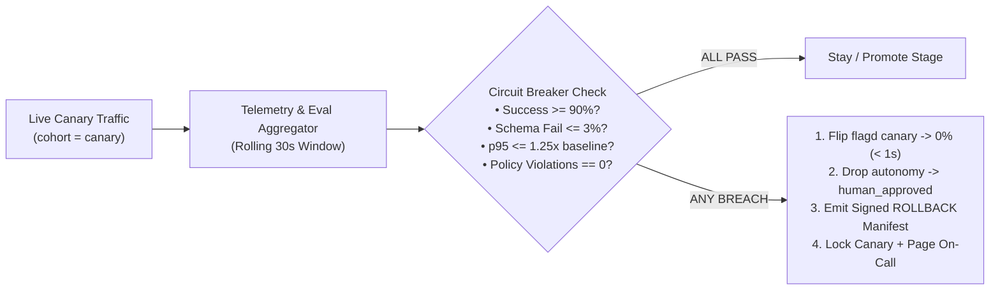
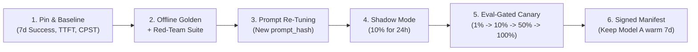

# Chapter 06 — Automated Rollback & Incident Recovery

> **Lecture 44 · Chapter 06 of 07** · Level: 🟠 Advanced · Phase 10 — Quality, FinOps, Identity & Security
> **Source:** `FDE S18` · **Roadmap Reference:** [`roadmap-v1.md`](../../roadmap-v1.md#lecture-43--progressive-autonomy-feature-flags-openfeatureflagd--safe-releases)
> **Roadmap topics:** 30-second automated rollback vs. 30-minute human response · closed-loop `flagd` circuit breaker · four mandatory rollback triggers · 6-step Model Migration Playbook · post-incident quarantine & side-effect audit.

---

## 06.0 What this chapter is for

When a canary deployment starts hallucinating, timing out, or burning `5x` tokens, **humans are too slow**:
- It takes `5–10` minutes for an engineer to notice Slack/PagerDuty, open a laptop, log into VPN, identify *which* change caused it, and merge a Git revert.
- In `10` minutes at `100` req/sec, **60,000 requests** hit the broken canary!

**Automated Rollback** connects your live telemetry/eval loop directly to `flagd` so a degraded canary triggers **self-healing rollback to the baseline manifest in `< 30 seconds`**—zero human intervention required.

By the end of this chapter you should be able to:

1. Architect a **closed-loop automated rollback pipeline** wired from OpenObserve metrics to `flagd`.
2. Configure the **four mandatory rollback triggers** and two-stage autonomy downgrade.
3. Execute the **6-step Model Migration Playbook** when moving from Model A to Model B.
4. Run a **post-incident recovery checklist** (trace quarantine, write-tool side-effect audit, `canary_locked`).

---

## 06.1 The Closed-Loop Rollback Architecture



### Four Mandatory Automated Rollback Triggers

| Trigger | Threshold Example | Why It Must Auto-Rollback Immediately |
| :--- | :--- | :--- |
| **1. Canary Success Collapse** | `task_success < 90%` (min `n >= 20` runs) | Canary is actively failing user tasks |
| **2. Schema / JSON Breakage** | `schema_fail_rate > 3%` | Downstream parsers/tools are crashing on malformed outputs |
| **3. Latency / Timeout Spike** | `p95_latency > 1.25x baseline` or `> 3,000 ms` | Upstream provider throttled or model entered infinite reasoning loop |
| **4. Policy / Safety Breach** | `policy_violations >= 1` | **Zero-tolerance** — even `1` PII leak or unauthorized write triggers instant halt |

> [!IMPORTANT]
> **Two-Stage Safety Net:** On rollback, don't just revert `active_model` back to the baseline—also **downgrade `autonomy_mode` from `autonomous` → `human_approved`** if the incident involved tool-execution errors.

### Concrete Rollback Event Output (`< 30s` SLA)

```json
{
  "rolledBack": true,
  "reason": "Canary taskSuccessRate 40.0% < 90.0%",
  "rollbackElapsedMs": 420,
  "postRollbackFlagd": {
    "canaryWeightPct": 0,
    "autonomyMode": "human_approved",
    "canaryLocked": true
  }
}
```

---

## 06.2 Model Migration Playbook (Step-by-Step)

When migrating from **Model A** (e.g., `gpt-4o-2024-11-20`) to **Model B** (e.g., `claude-3-5-sonnet-20241022` or a self-hosted quantized Llama), never swap the model string blindly:



1. **Pin & Baseline:** Record Model A's 7-day `task_success`, `p95 TTFT`, `CPST`, and `schema_fail_rate`.
2. **Offline Golden Suite:** Run Model B against your golden dataset + adversarial red-team set (must pass `>= baseline`).
3. **Prompt Re-Tuning:** Never assume a prompt tuned for OpenAI works identically on Anthropic or Llama—adjust XML/JSON formatting and stop sequences, then version as a new `prompt_hash`.
4. **Shadow Mode (`10%` for `24h`):** Verify action equivalence `>= 94%` with mocked write tools.
5. **Eval-Gated Canary (`1% -> 10% -> 50% -> 100%`):** Automated rollback armed with `< 30s` `flagd` circuit breaker.
6. **Signed Manifest & Decommission:** Emit `PROMOTED` manifest; keep Model A warm in `flagd` for `7` days for instant 1-click fallback.

---

## 06.3 Incident Recovery & Post-Incident Checklist

Once `flagd` auto-reverts within `30` seconds and the bleeding stops:
1. **Verify Recovery:** Confirm OpenObserve `task_success` and `p95` return to baseline within `2` minutes.
2. **Quarantine Failing Traces:** Export the failing canary `trace_id`s and add PII-scrubbed reproductions to your golden eval suite so CI catches this regression permanently.
3. **Audit Partial Side Effects:** If the canary ran in Rung 3 (`autonomous`), query audit logs for all write tool calls during the canary window and compensate/refund affected tenants.
4. **Keep Canary Locked:** Require manual engineering sign-off (`canary_locked = true`) before re-enabling the flag so a flapping script can't re-trigger the broken canary.

---

## 06.4 Common Mistakes

| # | Common Mistake | Why It Hurts | What To Do Instead |
| :---: | :--- | :--- | :--- |
| **1** | **Waiting for a human to notice Slack alerts and run `git revert`** | Thousands of users hit the broken model during the 20–30 minute response | Wire **automated `< 30s` `flagd` rollback** to live telemetry gates |
| **2** | **Swapping Model A → Model B with the exact same prompt** | Different model families format JSON, XML, and refusals differently | **Re-tune and re-version the prompt** (`prompt_hash`) before Shadow Mode |
| **3** | **Allowing an auto-scheduler to re-enable a rolled-back canary** | Causes a "flapping" incident that repeatedly breaks users | Set **`canary_locked = true`** on rollback until an engineer clears it |
| **4** | **Forgetting to audit write-tool side effects after rollback** | Autonomous bad refunds or CRM edits remain corrupted in the database | Query **user-to-tool audit logs** for the canary window and remediate |

---

## 06.5 Key Takeaways

1. **Automated rollback** cuts incident blast radius from 30 minutes to **`< 30 seconds`** by wiring live eval metrics directly to `flagd`.
2. Trigger instant rollback on **task-success drops, schema failures, latency spikes, or any policy violation**.
3. Always follow the **6-step Model Migration Playbook** (Baseline → Offline Eval → Prompt Tune → Shadow → Eval-Gated Canary → Signed Manifest) and lock canaries after rollback.

---

### Navigation

- **Next:** [Chapter 07 — Technical UAT & Customer Handover Sign-Off](./07_Technical_UAT_and_Customer_Handover_SignOff.md)
- **Previous:** [Chapter 05 — Versioning Prompts, Models & Skills + Release Manifests](./05_Versioning_Prompts_Models_Skills_and_Release_Manifests.md)
- **Back to index:** [../index.md](../index.md)
