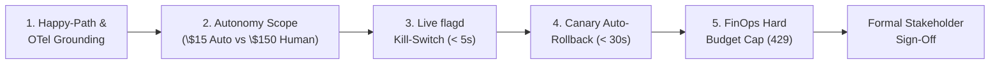
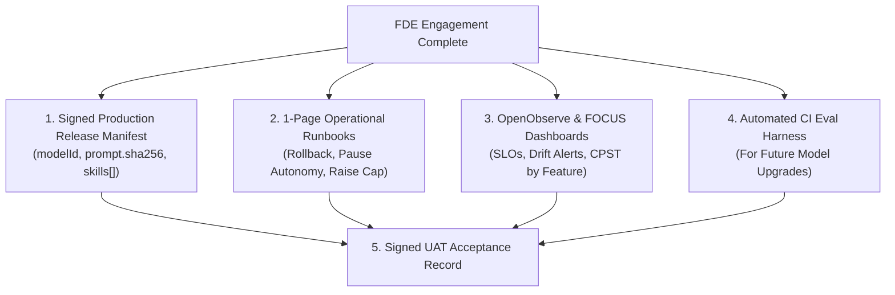

# Chapter 07 — Technical UAT & Customer Handover Sign-Off

> **Lecture 44 · Chapter 07 of 07** · Level: 🟠 Advanced · Phase 10 — Quality, FinOps, Identity & Security
> **Source:** `FDE S18` · **Roadmap Reference:** [`roadmap-v1.md`](../../roadmap-v1.md#lecture-43--progressive-autonomy-feature-flags-openfeatureflagd--safe-releases)
> **Roadmap topics:** Technical UAT for probabilistic AI systems · the 5-pillar live UAT demonstration script · Customer Handover Package · formal stakeholder sign-off record.

---

## 07.0 What this chapter is for

Passing unit tests and developer evals proves *your code runs*. **Technical User Acceptance Testing (UAT)** proves to the **enterprise customer, security team, and operations team** that the AI system is safe, predictable, observable, and supportable before full production handover.

Unlike traditional UAT (*"Does clicking Submit save the form?"*), AI Technical UAT tests **probabilistic edge cases, autonomy boundaries, live kill-switches, automated rollbacks, and hard financial limits**.

By the end of this chapter you should be able to:

1. Explain how **AI Technical UAT** differs from traditional functional UAT.
2. Execute the **5-Pillar AI Technical UAT Script** live in front of customer stakeholders.
3. Assemble a complete **Customer Handover Package** (manifests, runbooks, dashboards, CI eval harness) so the customer can operate the system independently.
4. Draft a **formal UAT Sign-Off Record** covering Product, Security, and SRE approvals.

---

## 07.1 The 5-Pillar AI Technical UAT Script

Run these scripted scenarios live with the customer's engineering, security, and ops stakeholders watching the OpenObserve dashboard and `flagd` console:



| UAT Scenario | Live Test Action | Expected Verifiable Outcome |
| :--- | :--- | :--- |
| **1. Happy-Path & Grounding** | Run 10 real customer domain queries | Accurate answers with valid citations; OTel trace links `tenant.id -> feature.id -> model -> tool` |
| **2. Progressive Autonomy Scope** | Trigger a `\$15` refund vs. a `\$150` refund | `\$15` auto-executes (Rung 3); `\$150` pauses for **Human Approval** (Rung 2) |
| **3. Instant `flagd` Kill-Switch** | Flip `autonomy_mode` to `human_approved` or `shadow` live | Takes effect in **`< 5s`** with **zero pod restarts** |
| **4. Automated Canary Rollback** | Inject a degraded canary (high failure/latency) | Controller auto-reverts `flagd` to baseline within **`< 30s`** and emits signed `ROLLBACK` manifest |
| **5. FinOps Hard Budget Cap** | Drive test tenant spend past `80%` then `100%` | Emits `WARN` at `80%` and `BLOCK (429)` at `100%`; FOCUS row matches `x_TraceId` |

> [!TIP]
> **Rehearse the failure scenarios, not just the happy path.** Enterprise CISOs and SREs gain far more confidence watching your `flagd` kill-switch and `< 30s` rollback work live than watching 10 pretty chat responses.

---

## 07.2 Customer Handover Package (What You Leave Behind)

A Forward-Deployed Engineer (FDE) engagement isn't done until the customer's own team can operate, upgrade, and debug the system without you:



1. **Signed Production Release Manifest:** Exact `modelId`, `prompt.sha256`, `skills[]`, and `flagd` config currently live in production.
2. **Runbooks & Incident Playbooks:** Concise 1-page guides for *"How to roll back a model in `flagd`"*, *"How to pause autonomous mode"*, and *"How to raise a tenant budget cap"*.
3. **Observability & FinOps Dashboards:** Pre-built OpenObserve views for Task Success SLO, `p95 TTFT`, Drift Alerts, and FOCUS CPST by feature.
4. **Regression Eval Harness:** Automated CI script so the customer can safely test future model upgrades using the exact same shadow → canary pipeline.
5. **Formal UAT Sign-Off Record:** Signed off by Product Owner, Security/Compliance Lead, and SRE Lead:
   ```markdown
   - [x] Release Manifest ID: `rel_2026_11_26_004` (HMAC-SHA256 Verified)
   - [x] Live Kill-Switch Verified (`autonomous -> human_approved` in < 5s)
   - [x] Canary Auto-Rollback Verified (`< 30s` on degraded model injection)
   - [x] FinOps Budget Cap Verified (`WARN` at 80%, `429` at 100%)
   - [x] Signed Off By: Product Owner · Security Lead · Customer SRE
   ```

---

## 07.3 Common Mistakes

| # | Common Mistake | Why It Hurts | What To Do Instead |
| :---: | :--- | :--- | :--- |
| **1** | **Demoing only happy-path prompts during UAT** | Security and SREs block go-live because failure modes are unproven | Run the **5-pillar UAT script** including kill-switch, rollback, and `429` budget cap |
| **2** | **Leaving without operational runbooks or CI evals** | Customer can't safely upgrade models or handle a 2:00 AM incident | Hand over **1-page runbooks, OpenObserve dashboards, and the CI eval harness** |
| **3** | **Skipping formal written sign-off** | Scope creep and unclear operational ownership after handover | Capture **written UAT sign-off** from Product, Security, and SRE leads |

---

## 07.4 Key Takeaways

1. **Technical UAT** validates live operational guarantees—autonomy boundaries, `< 5s` kill-switches, `< 30s` canary rollback, and hard budgets—not just happy-path prompts.
2. Complete handover requires a **signed release manifest, operational runbooks, dashboards, CI eval harness, and formal stakeholder sign-off**.

---

### Navigation

- **Previous:** [Chapter 06 — Automated Rollback & Incident Recovery](./06_Automated_Rollback_and_Incident_Recovery.md)
- **Back to index:** [../index.md](../index.md) · **Complete Guide:** [Lecture 44 Complete Notes](./Lecture_44_Complete_Notes.md)
