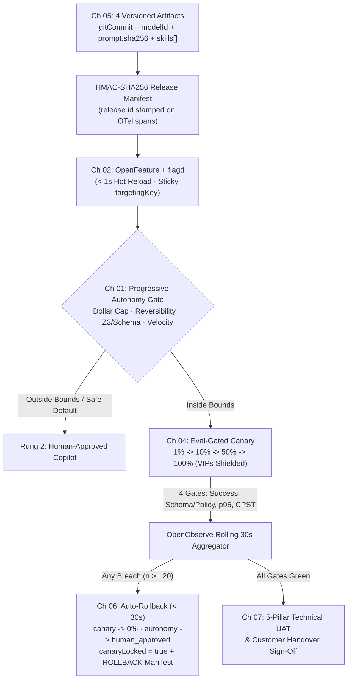

# Lecture 44 — Complete Notes
## Progressive Autonomy (`OpenFeature` / `flagd`) & Safe Releases

> **Phase:** 10 · Quality, FinOps, Identity & Security · **Level:** 🟠 Advanced
> **Core Goal:** Turn AI trust and model/prompt rollouts into a deterministic engineering state machine—climbing the **Progressive Autonomy Ladder**, controlling runtime behavior in `< 1s` via **OpenFeature + `flagd`**, advancing **Evaluation-Gated Canaries**, signing **Release Manifests**, triggering **`< 30s` Automated Rollback**, and passing **5-Pillar Technical UAT**.

---

## 1. Executive Summary

**Thesis:** Shipping probabilistic AI agents straight to autonomous production or relying on time-based canaries and code-deploy rollbacks exposes users to massive blast radius; safe AI releases require **4-rung Progressive Autonomy**, **OpenFeature + `flagd` runtime control**, **eval-gated canaries (`1% -> 10% -> 50% -> 100%`)**, **HMAC-signed Release Manifests**, and **`< 30s` closed-loop rollback**.

**The lecture in five sentences:**
1. **The Progressive Autonomy Ladder** builds trust step-by-step (**Shadow Mode** $\rightarrow$ **Human-Approved Copilot** $\rightarrow$ **Scoped Autonomous** $\rightarrow$ **Expanded Production**) using objective metrics and deterministic scope bounds (monetary cap, reversibility, verifier, velocity).
2. **OpenFeature + `flagd`** decouples slow code deploys from `< 1s` runtime control over `active_model`, `prompt_version`, `autonomy_mode`, `canary_weight_pct`, and `max_auto_refund_usd` using sticky `targetingKey` hashing and conservative fallback defaults.
3. **Evaluation-Gated Canaries** replace blind timers with four live OpenObserve gates (Task Success, Schema/Policy Safety, `p95` Latency, CPST), requiring **both** minimum soak time and minimum sample size while shielding VIP/regulated cohorts.
4. **Signed Release Manifests** bind all four independent AI artifacts (`gitCommit`, `modelId`, `prompt.sha256`, `skills[]`) plus `flagdSnapshot` and `evalProof` under an `HMAC-SHA256` signature stamped onto OTel spans via `release.id`.
5. **Automated Rollback** reverts degraded canaries to `0%` in `< 30s` (locking the canary and downgrading autonomy to `human_approved`), and **5-Pillar Technical UAT** proves kill-switches, rollbacks, and hard budgets live before customer handover.

| Chapter | Topic | Core Artifact / Takeaway | File |
| :---: | :--- | :--- | :--- |
| **01** | The Progressive Autonomy Ladder | 4 rungs (Shadow $\rightarrow$ Copilot $\rightarrow$ Scoped $\rightarrow$ Expanded) + 4 scope bounds | [01_The_Progressive_Autonomy_Ladder.md](./01_The_Progressive_Autonomy_Ladder.md) |
| **02** | OpenFeature & `flagd` Control | Vendor-neutral SDK + `flags.flagd.json` + sticky `targetingKey` | [02_OpenFeature_and_flagd_for_AI_Runtime_Control.md](./02_OpenFeature_and_flagd_for_AI_Runtime_Control.md) |
| **04** | Evaluation-Gated Canary Rollouts | `1%->10%->50%->100%` + `min_soak` & `min_samples` + 4 live eval gates | [04_Evaluation_Gated_Canary_Rollouts.md](./04_Evaluation_Gated_Canary_Rollouts.md) |
| **05** | Versioning & Release Manifests | `gitCommit + modelId + prompt.sha256 + skills[]` signed with HMAC | [05_Versioning_Prompts_Models_Skills_and_Release_Manifests.md](./05_Versioning_Prompts_Models_Skills_and_Release_Manifests.md) |
| **06** | Automated Rollback & Recovery | `< 30s` circuit breaker + 6-step Model Migration Playbook | [06_Automated_Rollback_and_Incident_Recovery.md](./06_Automated_Rollback_and_Incident_Recovery.md) |
| **07** | Technical UAT & Handover Sign-Off | 5-pillar live UAT script + handover package + stakeholder sign-off | [07_Technical_UAT_and_Customer_Handover_SignOff.md](./07_Technical_UAT_and_Customer_Handover_SignOff.md) |

---

## 2. Master Architecture Diagram

---

## 3. Chapter-by-Chapter Short Revision Notes

### 3.1 Chapter 01 — The Progressive Autonomy Ladder
AI agents are probabilistic interns: shipping straight from staging to full autonomy turns a `2%` hallucination rate into hundreds of bad mutations. Climb four rungs using measured production evidence:

| Rung | Execution | Blast Radius | Graduation Metric |
| :--- | :--- | :---: | :--- |
| **1. Shadow Mode** | Human only; agent logs silently | **Zero** | Action Agreement `>= 92%`, `0` policy violations |
| **2. Human-Approved** | Human clicks `Approve`/`Edit` | **Low** | Unedited Approval `>= 95%`, review `< 15s` |
| **3. Scoped Autonomous** | Auto-executes inside strict bounds | **Bounded** | 30-Day SLOs green, `0` policy breaches |
| **4. Expanded Production** | Broad cohorts + `< 30s` rollback | **Controlled** | Error budget healthy + signed manifest |

- **Four machine-enforceable scope bounds (in code/`flagd`, never prompt-only):** (1) **Monetary Cap** (`amount <= $25`), (2) **Reversibility** (allowlist safe writes; escalate `delete_user`/`wire_payout`), (3) **Verifier / Confidence** (schema + Z3/OPA + `>= 0.90`), (4) **Velocity Cap** (`< 3` auto-refunds/user/24h).

> 📖 **Need depth?** Read [Chapter 01 — The Progressive Autonomy Ladder](./01_The_Progressive_Autonomy_Ladder.md)

### 3.2 Chapter 02 — OpenFeature & `flagd` for AI Runtime Control
Code-deploy incident mitigations take `15–45` minutes; **OpenFeature** (vendor-neutral CNCF SDK) + **`flagd`** (local evaluation daemon watching `flags.flagd.json`) changes models, prompts, and caps in **`< 1s` with zero pod restarts**. Use typed flags: `active_model`, `prompt_version`, `autonomy_mode` (`String`), `shadow_enabled` (`Boolean`), `canary_weight_pct`, and `max_auto_refund_usd` (`Number`).
- **Two golden rules:** (1) Pass `tenantId` or `sessionId` as `targetingKey` (deterministic hashing keeps multi-turn chats sticky on one model, preserving prompt-cache hits); (2) Always pass the **most conservative default** (`"human_approved"`, `0` canary) so a `flagd` outage never defaults to `"autonomous"`.

> 📖 **Need depth?** Read [Chapter 02 — OpenFeature & `flagd` for AI Runtime Control](./02_OpenFeature_and_flagd_for_AI_Runtime_Control.md)

### 3.3 Chapter 04 — Evaluation-Gated Canary Rollouts
Broken AI models still return `HTTP 200 OK` while failing tasks or burning `3x` tokens, so time-based canaries fail. Advance `1% (15m, n>=100)` $\rightarrow$ `10% (1h, n>=500)` $\rightarrow$ `50% (4h, n>=2,000)` $\rightarrow$ `100%` only when **both** `min_soak` and `min_samples` are met and all **4 live OpenObserve gates** pass:
1. **Task Success:** `canary >= baseline - 0.02`
2. **Schema & Policy Safety:** `schema_fail <= 0.03` AND `policy_violations == 0`
3. **Latency (`p95`):** `canary <= baseline * 1.25`
4. **FinOps (`CPST`):** `canary <= baseline * 1.20`
- **Cohort protection:** Exclude `vip` / `regulated` tiers in `flags.flagd.json` during Stages 1 and 2 (`1%`/`10%`).

> 📖 **Need depth?** Read [Chapter 04 — Evaluation-Gated Canary Rollouts](./04_Evaluation_Gated_Canary_Rollouts.md)

### 3.4 Chapter 05 — Versioning Prompts, Models & Skills + Release Manifests
`gitCommit` alone cannot reproduce an AI release because **four independent artifacts** evolve separately: **App Code (`gitCommit`)**, **Prompts (`version + sha256`)**, **Pinned Model (`modelId + temperature`)**, and **Skills / MCP Tools (`skills[]`)**. Bind all four + `flagdSnapshot` + `evalProof` into an **immutable `HMAC-SHA256` (or Cosign) signed Release Manifest**, and stamp `release.id` onto every OTel root span.
- **Prompt/Skill SemVer:** `PATCH` (typo) $\rightarrow$ Golden CI eval; `MINOR` (new rule/few-shot) $\rightarrow$ CI eval + Shadow; `MAJOR` (JSON schema/tool contract break) $\rightarrow$ CI + Shadow + Staged Canary (`1% -> 100%`).

> 📖 **Need depth?** Read [Chapter 05 — Versioning Prompts, Models & Skills + Release Manifests](./05_Versioning_Prompts_Models_Skills_and_Release_Manifests.md)

### 3.5 Chapter 06 — Automated Rollback & Incident Recovery
At `100` req/s, a 10-minute human response exposes `60,000` requests to a broken canary. Wire OpenObserve's rolling `30s` aggregator directly to `flagd` for **`< 30s` automated rollback** on any of 4 triggers: `task_success < 90%` (`n >= 20`), `schema_fail > 3%`, `p95 > 1.25x baseline` (or `> 3,000 ms`), or `policy_violations >= 1`. On breach: flip `canaryWeightPct -> 0`, downgrade `autonomyMode -> "human_approved"`, set `canaryLocked = true` (prevents flapping), and emit a signed `ROLLBACK` manifest.
- **6-step Model Migration Playbook:** (1) Pin & Baseline (7d) $\rightarrow$ (2) Offline Golden + Red-Team $\rightarrow$ (3) Re-tune & re-hash Prompt $\rightarrow$ (4) Shadow Mode (`10%`, `24h`) $\rightarrow$ (5) Eval-Gated Canary $\rightarrow$ (6) Signed Manifest (keep old model warm `7d`). Afterwards, quarantine failing `trace_id`s and audit write-tool side effects.

> 📖 **Need depth?** Read [Chapter 06 — Automated Rollback & Incident Recovery](./06_Automated_Rollback_and_Incident_Recovery.md)

### 3.6 Chapter 07 — Technical UAT & Customer Handover Sign-Off
AI Technical UAT proves live operational guarantees to Product, Security, and SRE leads via the **5-Pillar Live UAT Script**: (1) Happy-path + OTel grounding (`tenant.id -> model -> tool`), (2) Autonomy scope (`$15` auto vs. `$150` human approval), (3) Live `flagd` kill-switch (`< 5s`, zero restarts), (4) Automated canary rollback (`< 30s` on injected failure), (5) FinOps budget cap (`WARN` at `80%`, `429` at `100%`).
- **Handover package:** Signed Production Release Manifest, 1-page operational runbooks, OpenObserve/FOCUS dashboards, CI eval harness, and formal written UAT Sign-Off Record.

> 📖 **Need depth?** Read [Chapter 07 — Technical UAT & Customer Handover Sign-Off](./07_Technical_UAT_and_Customer_Handover_SignOff.md)

---

## 4. Cheat Sheet & Common Traps

### Quick Reference
| Area | Target / Rule | Chapter |
| :--- | :--- | :---: |
| **Autonomy Ladder** | Shadow $\rightarrow$ Copilot $\rightarrow$ Scoped $\rightarrow$ Expanded | [01](./01_The_Progressive_Autonomy_Ladder.md) |
| **OpenFeature + `flagd`** | Sticky `targetingKey`; conservative fallback (`human_approved`) | [02](./02_OpenFeature_and_flagd_for_AI_Runtime_Control.md) |
| **Canary Gates** | `min_soak` + `min_samples` + 4 gates (Success, Schema, `p95`, CPST) | [04](./04_Evaluation_Gated_Canary_Rollouts.md) |
| **Release Manifest** | Sign `gitCommit + modelId + prompt.sha256 + skills[]` + `release.id` | [05](./05_Versioning_Prompts_Models_Skills_and_Release_Manifests.md) |
| **Auto-Rollback** | `< 30s` revert + `human_approved` + `canaryLocked = true` | [06](./06_Automated_Rollback_and_Incident_Recovery.md) |
| **Technical UAT** | Live demo of kill-switch (`< 5s`), rollback (`< 30s`), `429` budget | [07](./07_Technical_UAT_and_Customer_Handover_SignOff.md) |

### Common Release Traps
- **Skipping Shadow Mode after `98%` CI evals:** Live messy HTML, new languages, and edge-case DB states still break Day-1 autonomy.
- **Random UUID `targetingKey`:** Flips models mid-conversation, breaking prompt-cache hits and tone consistency.
- **Promoting canaries on `HTTP 200` + timer only:** Broken prompts return `200 OK` while failing tasks or doubling CPST.
- **Rolling back `active_model` without `prompt.sha256`:** An Anthropic-tuned prompt breaks when reverted to OpenAI; always restore the whole **Release Manifest**.
- **Swapping Model A $\rightarrow$ Model B without prompt re-tuning:** Different model families format JSON, XML, and refusals differently.
- **Demoing only happy paths in UAT:** Security and SREs require live proof of the kill-switch, `< 30s` rollback, and `429` budget cap before sign-off.

---

## 5. Self-Check Questions (Release Gate Prep)

1. Why must Rung 3 scope boundaries (monetary cap, reversibility, verifier, velocity) be enforced in deterministic code/`flagd` rather than system-prompt instructions, and why is Rung 1 (Shadow Mode) mandatory even after `98%` CI evals?
   *Hint:* Prompts are probabilistic and injectable; Shadow Mode catches real-world edge cases (e.g., already-replaced orders) at `$0` blast radius.
2. Why does `flags.flagd.json` require a sticky `targetingKey` (`tenantId`/`sessionId`) and a conservative OpenFeature fallback default (`"human_approved"`)?
   *Hint:* Sticky hashing keeps multi-turn chats on one model (preserving prefix caches); conservative defaults ensure `flagd` outages never auto-approve writes.
3. Why do evaluation-gated canaries require **both** `min_soak` and `min_samples`, and what four live metrics must pass before promoting `1% -> 10% -> 50% -> 100%`?
   *Hint:* Avoids small-`n` noise and catches rate-limit/cache-eviction bugs over time; gates = Task Success, Schema/Policy, `p95` Latency, and CPST.
4. Why is `gitCommit` insufficient to reproduce an AI release, and what happens if you roll back `active_model` without reverting `prompt.sha256`?
   *Hint:* Four artifacts evolve independently (`gitCommit`, `prompt`, `modelId`, `skills[]`); mismatched prompts break JSON/refusal behavior.
5. Walk through the `< 30s` automated rollback sequence (including `canaryLocked` and post-incident write-tool audit) and list the 5 pillars of live Technical UAT.
   *Hint:* Revert `canary->0%`, downgrade `autonomy->human_approved`, lock canary, emit `ROLLBACK` manifest, quarantine traces & audit writes; UAT = Happy-path, Autonomy cap, Kill-switch, Auto-rollback, Hard budget.
