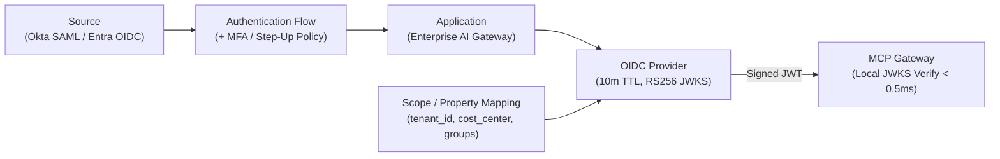
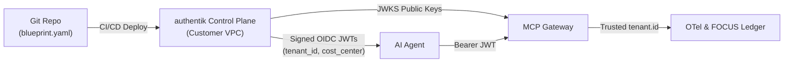

# Chapter 03 — Deploying `authentik` as the Identity Control Plane

> **Lecture 45 · Chapter 03 of 07** · Level: 🔴 Expert · Phase 10 — Quality, FinOps, Identity & Security
> **Source:** `FDE S19` · **Roadmap Reference:** [`roadmap-v1.md`](../../roadmap-v1.md#lecture-44--enterprise-identity--agent-authorization-oidc-saml-scim-authentik-rebac) · [authentik Documentation](https://docs.goauthentik.io/)
> **Roadmap topics:** Self-hostable Identity Control Plane (`authentik`) · Sources, Providers, Applications, Scope Mappings, and Flows · injecting FinOps claims (`tenant_id`, `cost_center`, `tier`) into JWTs · Infrastructure-as-Code with `authentik` Blueprints.

---

## 03.0 What this chapter is for

When building an enterprise AI platform, you need an **Identity Provider (IdP)** that you can self-host inside a customer's VPC (for data residency and sovereignty), configure declaratively via Terraform or Blueprints, and connect to *any* corporate directory (Okta, Microsoft Entra ID, Google Workspace, Active Directory).

**`authentik`** is a modern, open-source Identity Control Plane that provides:
- **OIDC / OAuth 2.1 Provider:** Mints RS256/ES256 JWTs with custom Property Mapping claims (`tenant_id`, `tier`, `groups`).
- **SAML 2.0 Federation:** Acts as a Service Provider to customer Okta/Entra IdPs and translates them into clean OIDC tokens for your agents.
- **SCIM 2.0 Server & Client:** Syncs users and groups in real time.
- **Flows & Policies:** Visual/declarative MFA, device posture, and step-up authentication before granting sensitive agent scopes.

By the end of this chapter you should be able to:

1. Map **`authentik` objects** (Source, Provider, Application, Scope Mapping, Flow) to an enterprise AI gateway.
2. Write a **Python Property Mapping** to embed verified `tenant_id` and `cost_center` claims into JWTs.
3. Explain how local **JWKS verification (`< 0.5 ms`)** eliminates per-request LDAP lookups and unifies Identity with Lecture 43 FinOps.
4. Deploy OIDC providers reproducibly using **`authentik` Blueprints YAML** instead of manual UI clicks.

---

## 03.1 Core `authentik` Concepts Mapped to AI Gateways

| `authentik` Object | What It Does | AI Platform Mapping |
| :--- | :--- | :--- |
| **Source** (SAML / OIDC / LDAP) | Upstream corporate login source | Customer's Okta / Entra ID |
| **Provider** (OAuth2/OIDC) | Defines signing keys, token TTL, `aud`, and redirect URIs | `"mcp-gateway-oidc-provider"` |
| **Application** | User-facing app bound to a Provider + access policy | `"Acme AI Copilot"` |
| **Scope Mapping (Property Mapping)** | Injects custom claims into the JWT | Adds `tenant_id`, `cost_center`, `tier`, `groups` |
| **Flow** | Login, MFA, or consent steps | Requires WebAuthn/MFA before issuing `mcp:refunds.write` scope |



---

## 03.2 Custom Scope & Claim Mapping in `authentik`

In `authentik`, a **Scope Mapping** lets you inject enterprise attributes directly into the OIDC token so downstream gateways don't have to query LDAP on every request:

```python
# authentik Property Mapping for custom scope: "ai:context"
return {
    "tenant_id": request.user.attributes.get("tenant_id", "default"),
    "cost_center": request.user.attributes.get("cost_center", "unassigned"),
    "tier": request.user.attributes.get("tier", "standard"),
    "groups": [group.name for group in request.user.ak_groups.all()],
}
```

### Resulting JWT Claim Benefits
1. **Zero Extra Latency:** Your MCP Gateway verifies the JWT signature locally using `authentik`'s cached JWKS endpoint (`GET /application/o/ai-gateway/jwks/`, `< 0.5 ms`) and immediately knows `sub`, `tenant_id`, `cost_center`, and `groups`.
2. **Unified with Lecture 43 (FinOps):** Those exact JWT claims populate your OpenTelemetry `tenant.id` and `cost_center` attributes—making it impossible for a client to spoof another tenant's billing ID!

---

## 03.3 Infrastructure-as-Code with `authentik` Blueprints

Never click through an admin UI in production and hope you remember the settings across staging, prod, and customer VPCs. Define your OIDC provider, scopes, and policies declaratively in an **`authentik` Blueprint YAML**:

```yaml
version: 1
metadata:
  name: ai-mcp-gateway-blueprint
entries:
  - model: authentik_providers_oauth2.oauth2provider
    id: mcp-oidc-provider
    attrs:
      name: mcp-gateway-oidc
      client_type: confidential
      authorization_flow: !Find [authentik_flows.flow, [slug, default-provider-authorization-implicit-consent]]
      access_token_validity: minutes=10
      sub_mode: user_uuid
      include_claims_in_id_token: true
  - model: authentik_core.application
    attrs:
      name: Enterprise AI Gateway
      slug: ai-gateway
      provider: !KeyOf mcp-oidc-provider
```



> [!TIP]
> **Set `sub_mode: user_uuid` in your `authentik` provider.** Email addresses can change when employees marry or switch domains; immutable UUIDs keep your ReBAC tuples and audit logs consistent forever.

---

## 03.4 Common Mistakes

| # | Common Mistake | Why It Hurts | What To Do Instead |
| :---: | :--- | :--- | :--- |
| **1** | **Configuring `authentik` manually via ClickOps in prod** | Staging and customer VPC environments drift out of sync | Store all providers, scopes, and flows in **Git-versioned Blueprints** |
| **2** | **Using `email` as the JWT `sub` claim** | Changing an employee's email breaks all their ReBAC permissions | Set **`sub_mode: user_uuid`** for immutable user identifiers |
| **3** | **Trusting client-sent `X-Tenant-Id` headers for FinOps** | Any user can spoof another customer's `tenant_id` in requests | Derive `tenant_id` and `cost_center` from **`authentik` Scope Mappings** inside the signed JWT |
| **4** | **Querying the IdP `/userinfo` endpoint on every tool call** | Adds 50–150 ms per MCP call and creates an IdP bottleneck | Verify JWTs **locally via cached JWKS** (`< 0.5 ms`) |

---

## 03.5 Key Takeaways

1. **`authentik`** serves as a self-hostable enterprise Identity Control Plane bridging SAML/Okta/Entra to OIDC JWTs and SCIM lifecycle sync.
2. Use **Scope Mappings** to embed verified `tenant_id`, `cost_center`, and `groups` in short-lived (`10`-minute) JWTs, unifying Identity and FinOps.
3. Manage providers declaratively via **`authentik` Blueprints** and `sub_mode: user_uuid` for repeatable VPC deployments.

---

### Navigation

- **Next:** [Chapter 04 — Delegated Credentials & User-to-Tool Attribution](./04_Delegated_Credentials_and_User_to_Tool_Attribution.md)
- **Previous:** [Chapter 02 — OIDC, SAML & SCIM Provisioning](./02_OIDC_SAML_and_SCIM_Provisioning.md)
- **Back to index:** [../index.md](../index.md)
