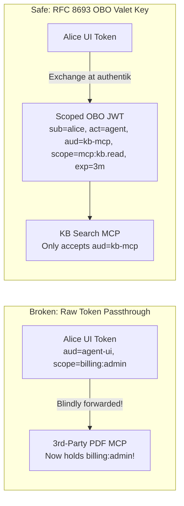
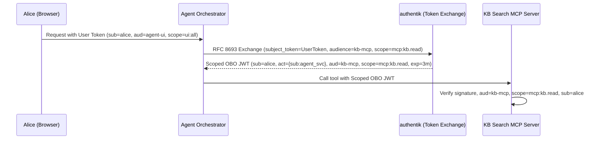

# Chapter 04 — Delegated Credentials & User-to-Tool Attribution

> **Lecture 45 · Chapter 04 of 07** · Level: 🔴 Expert · Phase 10 — Quality, FinOps, Identity & Security
> **Source:** `FDE S19` · **Roadmap Reference:** [`roadmap-v1.md`](../../roadmap-v1.md#lecture-44--enterprise-identity--agent-authorization-oidc-saml-scim-authentik-rebac)
> **Roadmap topics:** The Valet Key pattern · why raw token forwarding breaks least privilege and `aud` · OAuth 2.0 Token Exchange (RFC 8693 / On-Behalf-Of) · `sub` + `act` claim attribution · task-scoped delegation for async background agents.

---

## 04.0 What this chapter is for

When you hand your car to a hotel valet, you don't hand them your house keys, your passport, and your full master key fob that opens the trunk and glovebox. You hand them a **valet key**:
- It proves **the car belongs to you** (user attribution),
- It **only** starts the engine and drives short distances (narrow scope),
- And it expires when you check out (short TTL).

In multi-hop AI architectures (**User → Agent Orchestrator → MCP Gateway → Downstream Jira/SQL Tool**), **OAuth 2.0 Token Exchange (RFC 8693 / On-Behalf-Of)** is the digital valet key!

By the end of this chapter you should be able to:

1. Explain why **forwarding a user's broad UI token** to every downstream MCP server is a security anti-pattern.
2. Trace an **RFC 8693 On-Behalf-Of (OBO) Token Exchange** sequence from browser to MCP server.
3. Read an OBO JWT's **`sub` (human)**, **`act.sub` (agent)**, **`aud` (target server)**, and **`scope`** claims.
4. Design **task-scoped delegation grants** for long-running asynchronous background agents without storing raw refresh tokens in agent memory.

---

## 04.1 Why You Don't Forward the User's Raw Token Everywhere

Suppose Alice logs into the Agent Web UI with a broad token (`scope: "ui:all billing:admin email:send"`). If the Agent Orchestrator blindly forwards that exact raw token to a third-party PDF Summarizer MCP server:
- A compromised MCP server now holds Alice's **`billing:admin`** token!
- Worse, `aud` (audience) validation breaks because the UI token was minted for `aud: "agent-ui"`, not `aud: "pdf-mcp"`.



### Solution: RFC 8693 Token Exchange Sequence



---

## 04.2 Anatomy of an On-Behalf-Of (OBO) Token

Notice the **`act` (actor)** claim defined by RFC 8693:

```json
{
  "sub": "usr_alice_9182",
  "act": {
    "sub": "svc_triage_agent_v2"
  },
  "aud": "kb-mcp",
  "scope": "mcp:kb.read",
  "tenant_id": "tenant_acme",
  "exp": 1795683144
}
```

### Why `sub` + `act` Gives Perfect User-to-Tool Attribution
- **`sub` (`usr_alice_9182`):** Tells the downstream tool *whose permissions to enforce* (`alice`, never `admin`).
- **`act.sub` (`svc_triage_agent_v2`):** Tells the audit log *which software agent executed the call on Alice's behalf*.
- **`scope` (`mcp:kb.read`):** Down-scoped! Even if Alice is an admin in Jira, **this** agent run can *only* read KB articles—it cannot delete Jira projects.
- **`exp` (`3` minutes):** Short-lived so leaked tokens expire almost immediately.

### Concrete RFC 8693 HTTP Token Exchange Request

```http
POST /application/o/token/
Content-Type: application/x-www-form-urlencoded

grant_type=urn:ietf:params:oauth:grant-type:token-exchange
&subject_token=<alice_broad_ui_jwt>
&subject_token_type=urn:ietf:params:oauth:token-type:access_token
&audience=https://mcp.acme.internal
&scope=mcp:kb.read
```

---

## 04.3 Long-Running Background Agents (Async Tasks)

What if an agent runs a 20-minute deep research job after Alice closes her browser tab?
- **Never** store Alice's long-lived refresh token inside the LLM prompt, conversation state, or agent memory.
- Instead, the gateway mints a **task-scoped delegation grant** bound to `(sub=alice, task_id=t_99, allowed_tools=["kb.search"])` with a strict TTL (e.g., `30` minutes) and **instant revocation** if Alice's SCIM account is disabled.

> [!IMPORTANT]
> **Never pass tokens inside LLM tool arguments or prompts.** The Agent Orchestrator injects the `Authorization: Bearer <OBO_JWT>` header *outside* the LLM context window so the model can neither read nor leak credentials.

---

## 04.4 Common Mistakes

| # | Common Mistake | Why It Hurts | What To Do Instead |
| :---: | :--- | :--- | :--- |
| **1** | **Forwarding the user's broad UI token to MCP servers** | Leaks unrelated scopes (`billing:admin`) and fails `aud` checks | Use **RFC 8693 Token Exchange** to mint narrow, audience-bound OBO tokens |
| **2** | **Dropping the `act` (actor) claim during delegation** | Audit logs can't distinguish Alice clicking a button vs. an autonomous agent | Preserve **`sub` (human)** and **`act.sub` (agent)** in every OBO JWT |
| **3** | **Storing user refresh tokens in agent memory / prompts** | Prompt injection or state dumps exfiltrate long-lived credentials | Keep tokens out of LLM context; use **short-lived task-scoped grants** |
| **4** | **Minting OBO tokens with 24-hour expiration** | Increases blast radius if a downstream MCP server is compromised | Keep OBO token TTL **`1–5` minutes** |

---

## 04.5 Key Takeaways

1. Never forward broad user tokens directly to every MCP server, and never replace user identity with a shared service key.
2. Use **OAuth 2.0 Token Exchange (RFC 8693 / On-Behalf-Of)** to down-scope `aud`, `scope`, and `exp` while preserving both **`sub` (human)** and **`act` (agent)** for audit logs.
3. For async background jobs, use **task-scoped delegation grants** tied to SCIM revocation—never raw refresh tokens in agent memory.

---

### Navigation

- **Next:** [Chapter 05 — MCP Authorization Specification](./05_MCP_Authorization_Specification.md)
- **Previous:** [Chapter 03 — Deploying `authentik` as the Identity Control Plane](./03_Deploying_authentik_as_the_Identity_Control_Plane.md)
- **Back to index:** [../index.md](../index.md)
