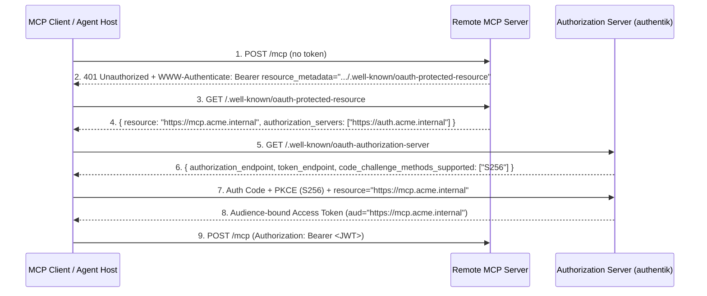

# Chapter 05 — MCP Authorization Specification

> **Lecture 45 · Chapter 05 of 07** · Level: 🔴 Expert · Phase 10 — Quality, FinOps, Identity & Security
> **Source:** `FDE S19` · **Roadmap Reference:** [`roadmap-v1.md`](../../roadmap-v1.md#lecture-44--enterprise-identity--agent-authorization-oidc-saml-scim-authentik-rebac)
> **External Reference:** [MCP Authorization Specification](https://modelcontextprotocol.io/specification/draft/basic/authorization)

---

## 1. Why Remote MCP Needed a Standard Auth Spec

Local `stdio` MCP servers lived on a developer's laptop with API keys in `.env`. As soon as enterprises moved to **remote HTTP/SSE MCP servers** (e.g., `https://mcp.acme.internal/jira`), every MCP client (Claude Desktop, Cursor, custom web agents) needed a **zero-hardcoding, standard protocol** to discover:
- *"Which Authorization Server (`authentik`, Okta) protects this MCP server?"*
- *"How do I get a token without embedding static client secrets in a desktop app?"*
- *"How do we stop a compromised MCP server from replaying my token at another server?"*

The **MCP Authorization Specification** solves all three using **OAuth 2.1 + PKCE + Protected Resource Metadata (RFC 9728) + Resource Indicators (RFC 8707)**.

---

## 2. Step-by-Step MCP OAuth 2.1 Discovery & Auth Flow

---

## 3. How PKCE (`S256`) Protects Desktop & CLI MCP Clients

Desktop/CLI MCP clients cannot safely store a static `client_secret` (anyone can inspect the binary). **PKCE (Proof Key for Code Exchange)** fixes this in 3 steps:
1. Client generates a random secret `code_verifier` in memory and hashes it: `code_challenge = SHA256(code_verifier)`.
2. Client sends `code_challenge` to `authentik` during browser login and gets back an authorization `code`.
3. Client exchanges `code` + the original `code_verifier` at `/token`. Even if malware intercepts the redirect `code`, it cannot exchange it without `code_verifier`!

---

## 4. Four Mandatory Pillars of the MCP Auth Spec

| Pillar | Standard | Security Guarantee |
| :--- | :--- | :--- |
| **1. Protected Resource Metadata** | `RFC 9728` | MCP server declares its canonical `resource` URI and trusted `authorization_servers` |
| **2. OAuth 2.1 + PKCE (`S256`)** | `OAuth 2.1` | Bans insecure Implicit flow and static-secret-free code interception |
| **3. Resource Indicators (`resource=`)** | `RFC 8707` | Binds JWT `aud` strictly to `"https://mcp.acme.internal"`, blocking cross-server token replay |
| **4. Dynamic Client Registration / Client Metadata** | `RFC 7591` | Enables automated client onboarding (or pre-registered Enterprise-Managed IDs) |

---

## 5. Common Pitfalls vs. Production Fixes

| Pitfall | What Goes Wrong | Production Fix |
| :--- | :--- | :--- |
| **Token passthrough without `aud` check** | A compromised Weather MCP server replays Alice's token to the Payroll MCP server | Always pass `resource=` (`RFC 8707`) and reject JWTs where `aud !== serverResourceUri` |
| **Open Dynamic Client Registration in Enterprise** | Any external script registers an OAuth app against your IdP | Use **Enterprise-Managed Authorization** (pre-registered clients + `authentik` Conditional Access) |
| **Tokens in URL query strings** (`?access_token=...`) | Leaks secrets into Nginx/OpenObserve access logs | Accept tokens **only** in `Authorization: Bearer <JWT>` headers |

---

## 6. Chapter Summary
- Remote MCP servers standardize on **OAuth 2.1 + PKCE (`S256`) + Protected Resource Metadata (`RFC 9728`) + Resource Indicators (`RFC 8707`)**.
- Always enforce strict **`aud` audience binding** so tokens cannot be replayed across different MCP servers.

---
**Next:** [Chapter 06 — RBAC vs. ReBAC (Relationship-Based Access Control)](./06_RBAC_vs_ReBAC_Relationship_Based_Access_Control.md)

