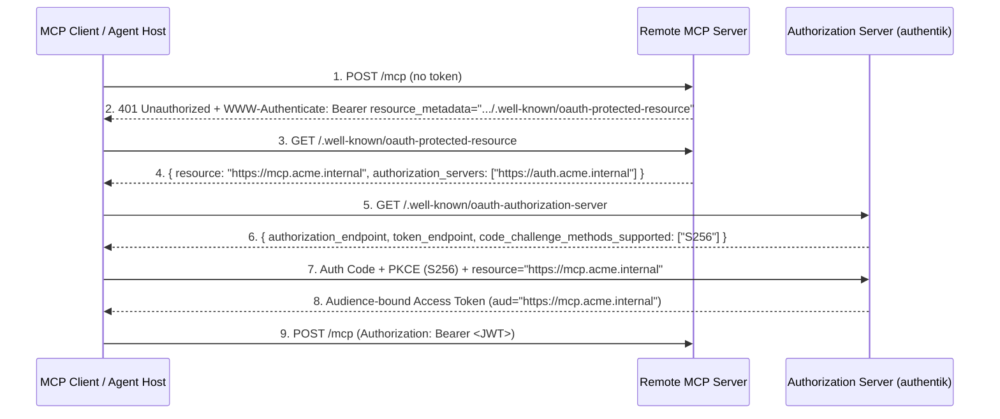
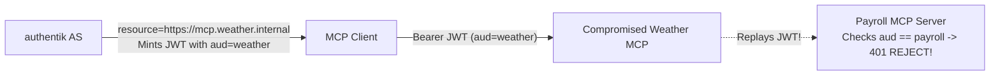

# Chapter 05 — MCP Authorization Specification

> **Lecture 45 · Chapter 05 of 07** · Level: 🔴 Expert · Phase 10 — Quality, FinOps, Identity & Security
> **Source:** `FDE S19` · **Roadmap Reference:** [`roadmap-v1.md`](../../roadmap-v1.md#lecture-44--enterprise-identity--agent-authorization-oidc-saml-scim-authentik-rebac) · [MCP Authorization Specification](https://modelcontextprotocol.io/specification/draft/basic/authorization)
> **Roadmap topics:** Remote HTTP/SSE MCP authorization · OAuth 2.1 + PKCE (`S256`) · Protected Resource Metadata (RFC 9728) · Resource Indicators (RFC 8707) against cross-server token replay · Enterprise-Managed Authorization vs. open DCR.

---

## 05.0 What this chapter is for

Local `stdio` MCP servers lived on a developer's laptop with static API keys in `.env`. As soon as enterprises moved to **remote HTTP/SSE MCP servers** (e.g., `https://mcp.acme.internal/jira`), every MCP client (Claude Desktop, Cursor, custom web agents) needed a **zero-hardcoding, standard protocol** to discover:
- *"Which Authorization Server (`authentik`, Okta) protects this MCP server?"*
- *"How do I get a token without embedding static client secrets in a desktop app?"*
- *"How do we stop a compromised MCP server from replaying my token at another server?"*

The **MCP Authorization Specification** solves all three using **OAuth 2.1 + PKCE + Protected Resource Metadata (RFC 9728) + Resource Indicators (RFC 8707)**.

By the end of this chapter you should be able to:

1. Trace the **9-step MCP OAuth 2.1 discovery and authentication flow** (`401` → `RFC 9728` → `AS metadata` → `PKCE` → `Bearer`).
2. Explain how **PKCE (`S256`)** protects desktop and CLI MCP clients without static `client_secret`s.
3. Prevent **cross-server token replay** using **Resource Indicators (`resource=`, RFC 8707)** and strict `aud` validation.
4. Choose **Enterprise-Managed pre-registered clients** over open Dynamic Client Registration (DCR) in corporate environments.

---

## 05.1 Step-by-Step MCP OAuth 2.1 Discovery & Auth Flow

---

## 05.2 How PKCE (`S256`) & Resource Indicators Work Together

Desktop and CLI MCP clients cannot safely store a static `client_secret` (anyone can inspect the binary). **PKCE (Proof Key for Code Exchange)** fixes this in 3 steps:
1. Client generates a random secret `code_verifier` in memory and hashes it: `code_challenge = SHA256(code_verifier)`.
2. Client sends `code_challenge` + `resource="https://mcp.acme.internal"` to `authentik` during browser login and gets back an authorization `code`.
3. Client exchanges `code` + the original `code_verifier` at `/token`. Even if malware intercepts the redirect `code`, it cannot exchange it without `code_verifier`.

### Blocking Cross-Server Token Replay (`RFC 8707`)

> [!IMPORTANT]
> **Never skip `aud` validation on an MCP server.** If Weather MCP and Payroll MCP share the same `authentik` issuer and neither checks `aud`, a compromised Weather MCP server can replay Alice's token straight into Payroll!

---

## 05.3 Four Mandatory Pillars of the MCP Auth Spec

| Pillar | Standard | Security Guarantee |
| :--- | :--- | :--- |
| **1. Protected Resource Metadata** | `RFC 9728` | MCP server declares its canonical `resource` URI and trusted `authorization_servers` |
| **2. OAuth 2.1 + PKCE (`S256`)** | `OAuth 2.1` | Bans insecure Implicit flow and protects public clients from code interception |
| **3. Resource Indicators (`resource=`)** | `RFC 8707` | Binds JWT `aud` strictly to `"https://mcp.acme.internal"`, blocking cross-server replay |
| **4. Client Registration / Metadata** | `RFC 7591` | Enables automated client onboarding (or pre-registered Enterprise-Managed IDs) |

---

## 05.4 Common Mistakes

| # | Common Mistake | Why It Hurts | What To Do Instead |
| :---: | :--- | :--- | :--- |
| **1** | **Token passthrough without `aud` check** | A compromised Weather MCP server replays Alice's token to the Payroll MCP server | Always pass `resource=` (`RFC 8707`) and reject JWTs where `aud !== serverResourceUri` |
| **2** | **Leaving open Dynamic Client Registration (`RFC 7591`) enabled in prod** | Any external script can register an OAuth app against your corporate IdP | Use **Enterprise-Managed Authorization** (pre-registered clients + `authentik` policies) |
| **3** | **Passing tokens in URL query strings** (`?access_token=...`) | Leaks bearer credentials into Nginx, proxy, and OpenObserve access logs | Accept tokens **only** in `Authorization: Bearer <JWT>` headers |
| **4** | **Using OAuth 2.0 Implicit flow or `plain` PKCE** | Exposes access tokens in browser history or allows code interception | Enforce **OAuth 2.1 Authorization Code + PKCE `S256`** |

---

## 05.5 Key Takeaways

1. Remote MCP servers standardize on **OAuth 2.1 + PKCE (`S256`) + Protected Resource Metadata (`RFC 9728`) + Resource Indicators (`RFC 8707`)**.
2. Always enforce strict **`aud` audience binding** so tokens minted for one MCP server cannot be replayed at another.
3. In enterprise deployments, pair MCP Auth with **pre-registered clients and `authentik` Conditional Access** rather than open Dynamic Client Registration.

---

### Navigation

- **Next:** [Chapter 06 — RBAC vs. ReBAC (Relationship-Based Access Control)](./06_RBAC_vs_ReBAC_Relationship_Based_Access_Control.md)
- **Previous:** [Chapter 04 — Delegated Credentials & User-to-Tool Attribution](./04_Delegated_Credentials_and_User_to_Tool_Attribution.md)
- **Back to index:** [../index.md](../index.md)
