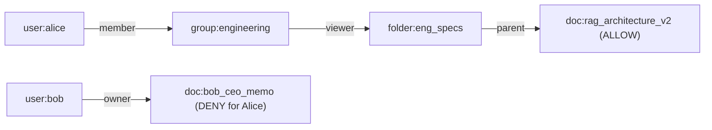
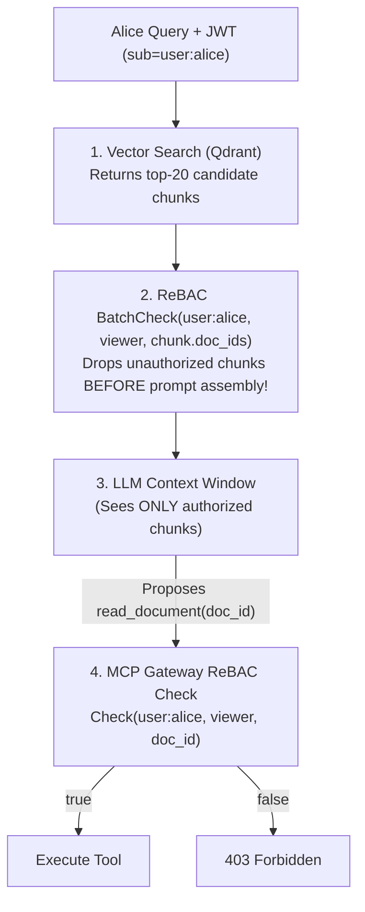

# Chapter 06 — RBAC vs. ReBAC (Relationship-Based Access Control)

> **Lecture 45 · Chapter 06 of 07** · Level: 🔴 Expert · Phase 10 — Quality, FinOps, Identity & Security
> **Source:** `FDE S19` · **Roadmap Reference:** [`roadmap-v1.md`](../../roadmap-v1.md#lecture-44--enterprise-identity--agent-authorization-oidc-saml-scim-authentik-rebac) · [OpenFGA / Zanzibar Concepts](https://openfga.dev/docs/concepts)
> **Roadmap topics:** Why RBAC fails for documents and tickets · RBAC vs. ABAC vs. ReBAC · Zanzibar / OpenFGA `(user, relation, object)` relationship tuples · graph traversal worked traces · enforcing ReBAC before RAG retrieval AND before tool execution.

---

## 06.0 What this chapter is for

Suppose Alice and Bob both have the exact same job title in Okta: **`role = "Account_Executive"`**.
- Alice owns the **Acme Corp** deal (`doc:acme_renewal_contract`).
- Bob owns the **Globex** deal (`doc:globex_renewal_contract`).

If your AI agent uses **RBAC** (`if user.role == "Account_Executive": allow read_document`), then **Alice's agent can read Bob's private Globex contract**—and an indirect prompt injection in an email can exfiltrate every deal in the company!

Why? Because **RBAC only knows *who you are* (`role`), not *how you relate to a specific document, folder, or ticket***. **ReBAC (Relationship-Based Access Control)**—pioneered by Google **Zanzibar** and implemented in **OpenFGA** and **SpiceDB**—models permissions as a **relationship graph of tuples**.

By the end of this chapter you should be able to:

1. Explain why **RBAC** and **ABAC** break on per-document ownership, nested folders, and ad-hoc sharing.
2. Write and read **Zanzibar / OpenFGA relationship tuples** (`user`, `relation`, `object`).
3. Trace a multi-hop **ReBAC graph check** (`user -> group -> folder -> doc`) step-by-step.
4. Enforce ReBAC at **both RAG vector retrieval** (pre-prompt filtering) and **every MCP tool call**.

---

## 06.1 RBAC vs. ABAC vs. ReBAC

| Model | Core Question | Best For | Where It Breaks in AI |
| :--- | :--- | :--- | :--- |
| **RBAC** | *"Does user have role `support_tier2`?"* | Coarse tool gating (`can_use_jira_tool`) | Cannot express per-doc ownership or nested folder sharing |
| **ABAC** | *"Does `user.dept == doc.dept`?"* | Static attribute rules (`tenant_id == doc.tenant_id`) | Struggles with ad-hoc sharing (`alice shared doc X with carol`) |
| **ReBAC (Zanzibar)** | *"Is there a valid path from `user:alice` to `doc:X` with relation `viewer`?"* | **Ownership, group membership, folder inheritance, and sharing** | Requires syncing user/group tuples from `authentik` / SCIM |

---

## 06.2 Step-by-Step Zanzibar Graph Trace

Every permission fact is a 3-part tuple: **`(user, relation, object)`**.

```text
user:alice#owner@doc:alice_q3_plan
user:alice#member@group:engineering
group:engineering#viewer@folder:eng_specs
folder:eng_specs#parent@doc:rag_architecture_v2
user:bob#owner@doc:bob_ceo_memo
```



### Worked Trace 1: `Check("user:alice", "viewer", "doc:rag_architecture_v2")` → `true`
1. Direct check on `doc:rag_architecture_v2` for `user:alice`? None.
2. Parent folder check: `folder:eng_specs#parent@doc:rag_architecture_v2` exists → recurse `Check("user:alice", "viewer", "folder:eng_specs")`.
3. Group check: `user:alice#member@group:engineering` exists → recurse `Check("group:engineering", "viewer", "folder:eng_specs")` → **Direct match! Returns `true`**.

### Worked Trace 2: `Check("user:alice", "viewer", "doc:bob_ceo_memo")` → `false`
1. Direct check for `user:alice`? None.
2. Parent folders? None.
3. Groups (`group:engineering`)? No path to `doc:bob_ceo_memo`.
4. **Returns `false` → `403 Forbidden`!**

---

## 06.3 Enforcing ReBAC at BOTH Retrieval and Tool Execution



> [!WARNING]
> **Never pull unauthorized RAG chunks into the LLM prompt and *"instruct the LLM not to reveal them"*.** Once a secret chunk enters the context window, prompt injection or clever questioning can extract it. Always filter via ReBAC **before** building the prompt!

---

## 06.4 Common Mistakes

| # | Common Mistake | Why It Hurts | What To Do Instead |
| :---: | :--- | :--- | :--- |
| **1** | **Using RBAC roles alone to gate documents** | Two Account Executives can read each other's confidential deals | Combine RBAC for coarse tool access with **ReBAC for per-object ownership** |
| **2** | **Filtering RAG results *after* the LLM generates an answer** | Unauthorized chunks already entered the prompt and can leak via paraphrasing | Run **`ReBAC.batchCheck()` before prompt assembly** |
| **3** | **Forgetting to delete ReBAC tuples when SCIM disables a user** | Offboarded employees or stale background jobs retain graph paths | Sync **SCIM de-provisioning events** directly to OpenFGA tuple deletions |
| **4** | **Storing permissions inside vector DB metadata without sync** | Stale metadata lets revoked users keep retrieving cached embeddings | Query a live **Zanzibar/OpenFGA store** (sub-10ms) as the single source of truth |

---

## 06.5 Key Takeaways

1. **RBAC** gates coarse roles; **ReBAC (Zanzibar/OpenFGA)** resolves fine-grained ownership, group membership, and folder inheritance in milliseconds.
2. Model permissions as **`(user, relation, object)`** tuples kept in sync with `authentik` and SCIM.
3. Enforce ReBAC **before RAG prompt assembly** and **before every MCP tool call** so unauthorized data never reaches the LLM or user.

---

### Navigation

- **Next:** [Chapter 07 — Enterprise-Managed Authorization & Gateway Policies](./07_Enterprise_Managed_Authorization_and_Gateway_Policies.md)
- **Previous:** [Chapter 05 — MCP Authorization Specification](./05_MCP_Authorization_Specification.md)
- **Back to index:** [../index.md](../index.md)
