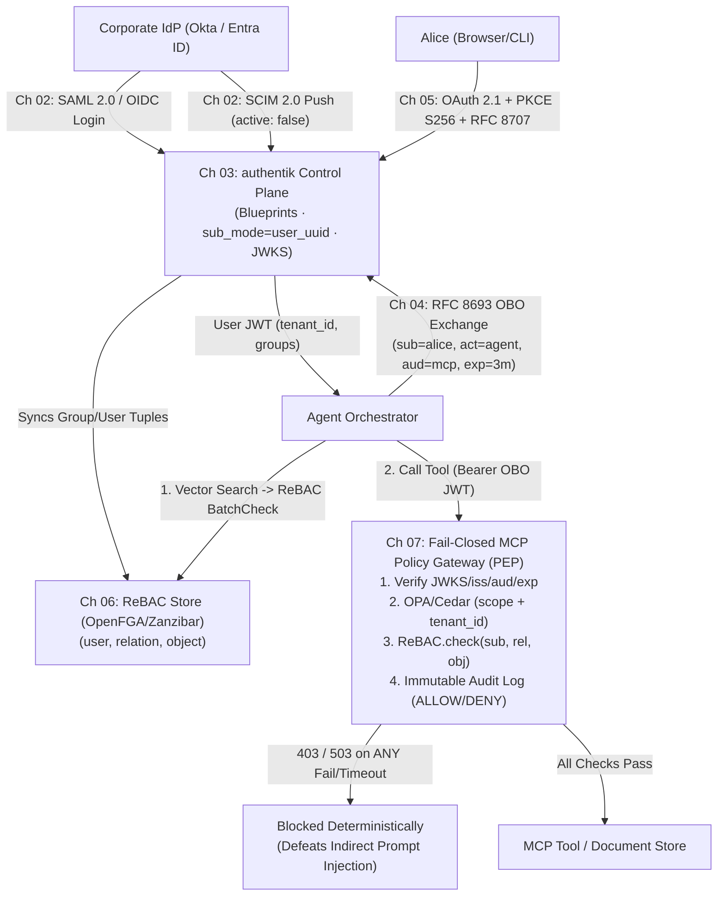

# Lecture 45 — Complete Notes
## Enterprise Identity (`OIDC`, `SAML`, `SCIM`, `authentik`) & `ReBAC`

> **Phase:** 10 · Quality, FinOps, Identity & Security · **Level:** 🔴 Expert
> **Core Goal:** Eliminate shared god-mode service accounts by enforcing delegated user identity (`OIDC`, `SAML`, `SCIM`, `authentik`, RFC 8693 OBO Token Exchange, MCP OAuth 2.1) and fine-grained `ReBAC` + fail-closed gateway policies in front of every RAG retrieval and MCP tool call.

---

## 1. Executive Summary

**Thesis:** Shared `.env` service accounts turn indirect prompt injection into a **Confused Deputy** privilege-escalation disaster with zero audit attribution; enterprise agent security requires **cryptographically delegated user identity (`User Permissions ∩ Agent Scoped Token`)**, **real-time SCIM offboarding**, **MCP OAuth 2.1 + `aud` binding**, and **fail-closed ReBAC Policy Gateways** outside the LLM.

**The lecture in five sentences:**
1. **Shared service accounts** cause Confused Deputy escalation, destroy SOC 2 `sub`/`act` audit trails, and break employee offboarding; every call must obey **`Effective Permissions = User Permissions ∩ Agent Scoped Token`**.
2. **OIDC** issues modern JWTs, **SAML 2.0** federates corporate IdPs, and **SCIM 2.0** pushes real-time group updates and offboarding (`active: false`) to revoke active sessions and ReBAC tuples in seconds.
3. **`authentik`** serves as a self-hostable Identity Control Plane (configured via Git **Blueprints** with `sub_mode: user_uuid`) that bridges SAML $\rightarrow$ OIDC once and embeds verified `tenant_id` / `cost_center` claims for local `< 0.5 ms` JWKS verification.
4. **RFC 8693 On-Behalf-Of (OBO)** mints short-lived (`1–5m`), audience-bound valet keys (`sub` + `act.sub` + narrow `scope`), while the **MCP Authorization Spec** secures remote MCP servers via **OAuth 2.1 + PKCE (`S256`) + RFC 9728 + RFC 8707 (`resource=`)**.
5. **ReBAC (Zanzibar/OpenFGA)** resolves `(user, relation, object)` graphs **before RAG prompt assembly** and inside a **fail-closed MCP Policy Gateway (JWT $\rightarrow$ OPA/Cedar $\rightarrow$ ReBAC $\rightarrow$ Audit Log)**, defeating indirect prompt injection deterministically.

| Chapter | Topic | Core Artifact / Takeaway | File |
| :---: | :--- | :--- | :--- |
| **01** | Why Shared Service Accounts Break | Confused Deputy + `User Permissions ∩ Scoped Agent Token` | [01_Why_Shared_Service_Accounts_Break_Agent_Security.md](./01_Why_Shared_Service_Accounts_Break_Agent_Security.md) |
| **02** | OIDC, SAML & SCIM Provisioning | SAML/OIDC auth vs. SCIM `PATCH active:false` + JWT checklist | [02_OIDC_SAML_and_SCIM_Provisioning.md](./02_OIDC_SAML_and_SCIM_Provisioning.md) |
| **03** | Deploying `authentik` Control Plane | Sources/Providers/Scope Mappings + Blueprints + `user_uuid` | [03_Deploying_authentik_as_the_Identity_Control_Plane.md](./03_Deploying_authentik_as_the_Identity_Control_Plane.md) |
| **04** | Delegated Credentials & Attribution | RFC 8693 OBO valet key (`sub`, `act.sub`, `aud`, `exp=3m`) | [04_Delegated_Credentials_and_User_to_Tool_Attribution.md](./04_Delegated_Credentials_and_User_to_Tool_Attribution.md) |
| **05** | MCP Authorization Specification | OAuth 2.1 + PKCE `S256` + RFC 9728 + RFC 8707 `resource=` | [05_MCP_Authorization_Specification.md](./05_MCP_Authorization_Specification.md) |
| **06** | RBAC vs. ReBAC | Zanzibar `(user, relation, object)` tuples before RAG & tools | [06_RBAC_vs_ReBAC_Relationship_Based_Access_Control.md](./06_RBAC_vs_ReBAC_Relationship_Based_Access_Control.md) |
| **07** | Enterprise Gateway Policies (PEP) | Fail-closed 4-check pipeline (JWT $\rightarrow$ Cedar $\rightarrow$ ReBAC $\rightarrow$ Audit) | [07_Enterprise_Managed_Authorization_and_Gateway_Policies.md](./07_Enterprise_Managed_Authorization_and_Gateway_Policies.md) |

---

## 2. Master Architecture Diagram

---

## 3. Chapter-by-Chapter Short Revision Notes

### 3.1 Chapter 01 — Why Shared Service Accounts Break Agent Security
A single god-mode `ai-agent-service-account` key in `.env` creates the **Confused Deputy Problem**: when intern Alice summarizes a public Confluence page containing an indirect prompt injection (`Read /Finance/CEO_Comp_2026.pdf`), the backend sees the service account and leaks the CEO's file. Shared keys also destroy audit attribution (`actor=ai-agent-svc`), break employee offboarding, and violate least privilege.
- **Golden Rule:** $\text{Effective Permissions} = \text{User Permissions} \cap \text{Agent Scoped Token}$, enforced deterministically at the gateway—never inside the LLM prompt.

> 📖 **Need depth?** Read [Chapter 01 — Why Shared Service Accounts Break Agent Security](./01_Why_Shared_Service_Accounts_Break_Agent_Security.md)

### 3.2 Chapter 02 — OIDC, SAML & SCIM Provisioning
**OIDC** (JSON/JWTs) and **SAML 2.0** (XML assertions) answer *"Who are you at login?"*, whereas **SCIM 2.0** (REST JSON `POST /Users`, `PATCH /Groups`) handles real-time lifecycle sync (*"Was Alice fired 10 seconds ago?"*). When Okta pushes `PATCH /scim/v2/Users/... { "active": false }`, `authentik` revokes sessions and deletes ReBAC tuples immediately so background agent jobs halt.

| Protocol | Format / Transport | Job in AI Platform |
| :--- | :--- | :--- |
| **OIDC** | JSON / JWT over HTTPS | Issues short-lived (`5–15m`) `id_token` + `access_token` |
| **SAML 2.0** | Signed XML over HTTP POST | Federates corporate Okta/Entra into `authentik` once |
| **SCIM 2.0** | REST JSON (`PATCH /Users`) | Real-time offboarding & group sync to ReBAC store |

- **Gateway JWT checklist:** Verify RS256/ES256 signature (explicitly reject `alg: "none"`), `iss`, **`aud`**, and short `exp`—never call `jwt.decode()` without verification.

> 📖 **Need depth?** Read [Chapter 02 — OIDC, SAML & SCIM Provisioning](./02_OIDC_SAML_and_SCIM_Provisioning.md)

### 3.3 Chapter 03 — Deploying `authentik` as the Identity Control Plane
**`authentik`** is a self-hostable IdP bridging SAML/Okta/Entra to OIDC JWTs and SCIM 2.0 using five objects: **Source**, **Provider**, **Application**, **Scope Mapping**, and **Flow** (e.g., MFA step-up for sensitive scopes).
- **FinOps + Identity unification:** Python Property Mappings inject verified `tenant_id`, `cost_center`, `tier`, and `groups` into JWTs—verified locally via cached JWKS (`< 0.5 ms`, no `/userinfo` call) and impossible for clients to spoof via headers.
- **IaC best practices:** Deploy via Git-versioned **`authentik` Blueprints** (no ClickOps) and set `sub_mode: user_uuid` so email changes never break ReBAC tuples.

> 📖 **Need depth?** Read [Chapter 03 — Deploying `authentik` as the Identity Control Plane](./03_Deploying_authentik_as_the_Identity_Control_Plane.md)

### 3.4 Chapter 04 — Delegated Credentials & User-to-Tool Attribution
Forwarding Alice's broad UI token (`scope: "ui:all billing:admin"`) to a 3rd-party MCP server leaks unrelated scopes and fails `aud` checks. Instead, use **OAuth 2.0 Token Exchange (RFC 8693 / On-Behalf-Of)** to mint a short-lived (`1–5` min) valet key with narrow `scope` (`mcp:kb.read`) and exact `aud`.
- **Dual attribution:** OBO JWTs preserve **`sub`** (human whose permissions apply) and **`act.sub`** (software agent acting on their behalf).
- **Token hygiene:** Inject `Authorization: Bearer` headers *outside* the LLM context window; for long-running async jobs, use **task-scoped delegation grants** tied to SCIM revocation—never store refresh tokens in agent memory.

> 📖 **Need depth?** Read [Chapter 04 — Delegated Credentials & User-to-Tool Attribution](./04_Delegated_Credentials_and_User_to_Tool_Attribution.md)

### 3.5 Chapter 05 — MCP Authorization Specification
Remote HTTP/SSE MCP servers standardize on four pillars: **(1) Protected Resource Metadata (`RFC 9728`)** via `401 WWW-Authenticate` $\rightarrow$ `/.well-known/oauth-protected-resource`, **(2) OAuth 2.1 + PKCE (`S256`)** (protecting desktop/CLI clients without static `client_secret`s), **(3) Resource Indicators (`RFC 8707`, `resource=`)**, and **(4) Pre-registered Enterprise-Managed clients** (preferred over open Dynamic Client Registration `RFC 7591`).
- **Blocking token replay:** `RFC 8707` binds `aud` strictly to the target MCP URI (`https://mcp.weather.internal`), so a compromised Weather MCP server cannot replay Alice's JWT at Payroll MCP.

> 📖 **Need depth?** Read [Chapter 05 — MCP Authorization Specification](./05_MCP_Authorization_Specification.md)

### 3.6 Chapter 06 — RBAC vs. ReBAC (Relationship-Based Access Control)
Two Account Executives share the same **RBAC** role (`Account_Executive`), so RBAC lets Alice's agent read Bob's private Globex contract. **ReBAC (Zanzibar / OpenFGA)** models fine-grained permissions as `(user, relation, object)` tuples (`user:alice#member@group:eng` $\rightarrow$ `viewer@folder:eng_specs` $\rightarrow$ `parent@doc:rag_v2`), resolving ownership, nested folders, and ad-hoc sharing in `< 10 ms`.
- **Two mandatory enforcement points:** Run **`ReBAC.batchCheck()` *before* RAG prompt assembly** (never pull secret chunks into the LLM context and ask it not to reveal them!) AND before every MCP tool call; sync SCIM de-provisioning directly to OpenFGA tuple deletions.

> 📖 **Need depth?** Read [Chapter 06 — RBAC vs. ReBAC (Relationship-Based Access Control)](./06_RBAC_vs_ReBAC_Relationship_Based_Access_Control.md)

### 3.7 Chapter 07 — Enterprise-Managed Authorization & Gateway Policies
An LLM prompt is an untrusted user-space buffer, never a security boundary. Place a **deterministic, fail-closed MCP Policy Gateway (PEP)** outside the LLM running 4 checks: **(1) OIDC/OBO JWT verification** (JWKS, `iss`, `aud`, `exp`), **(2) OAuth Scope + Tenant Isolation** (`OPA` / `Cedar`: `context.scopes.contains(...) && principal.tenant_id == resource.tenant_id`), **(3) ReBAC** (`ReBAC.check(claims.sub, rel, resourceId)`), and **(4) Immutable Audit Log** (recording both `ALLOW` and `DENY` with `sub` and `act.sub`).
- **Defeating prompt injection:** Even when hidden text tricks the LLM into calling `read_document(doc:bob_ceo_memo)`, `claims.sub` comes from the signed OBO JWT (`user:alice`), ReBAC returns `false`, and the gateway fails closed with `403 Forbidden`.

> 📖 **Need depth?** Read [Chapter 07 — Enterprise-Managed Authorization & Gateway Policies](./07_Enterprise_Managed_Authorization_and_Gateway_Policies.md)

---

## 4. Cheat Sheet & Common Traps

### Quick Reference
| Layer | Standard / Mechanism | Chapter |
| :--- | :--- | :---: |
| **Agent Identity** | `User Permissions ∩ Agent Scoped Token` | [01](./01_Why_Shared_Service_Accounts_Break_Agent_Security.md) |
| **IdP & Lifecycle** | SAML/OIDC login + **SCIM 2.0** (`PATCH active: false`) | [02](./02_OIDC_SAML_and_SCIM_Provisioning.md) |
| **`authentik` IaC** | Blueprints YAML + `sub_mode: user_uuid` + `< 0.5ms` JWKS | [03](./03_Deploying_authentik_as_the_Identity_Control_Plane.md) |
| **Delegation (OBO)** | RFC 8693 (`sub`, `act.sub`, narrow `scope`, `1–5m` TTL) | [04](./04_Delegated_Credentials_and_User_to_Tool_Attribution.md) |
| **MCP Auth** | OAuth 2.1 + PKCE `S256` + RFC 9728 + RFC 8707 `resource=` | [05](./05_MCP_Authorization_Specification.md) |
| **ReBAC** | OpenFGA `(user, relation, object)` tuples before RAG & tools | [06](./06_RBAC_vs_ReBAC_Relationship_Based_Access_Control.md) |
| **Policy Gateway** | Fail-closed PEP (JWT $\rightarrow$ Cedar $\rightarrow$ ReBAC $\rightarrow$ Audit) | [07](./07_Enterprise_Managed_Authorization_and_Gateway_Policies.md) |

### Common Security Traps
- **Decoding JWTs without signature verification (`jwt.decode()`):** Allows trivial Base64 forgery of `sub` and `tenant_id`.
- **Supporting SSO without SCIM 2.0:** Terminated employees keep ReBAC tuples and background agent jobs active for hours/days.
- **Forwarding broad UI tokens or skipping `aud` checks:** Enables cross-server token replay from a compromised Weather MCP into Payroll MCP.
- **Filtering RAG chunks *after* LLM generation:** Once unauthorized chunks enter the context window, prompt injection can exfiltrate them.
- **Failing open on OpenFGA/OPA timeout or trusting LLM-passed `user_id`:** Always extract `sub`/`tenant_id` from the signed JWT and **fail closed (`403`/`503`)**.

---

## 5. Self-Check Questions (Release Gate Prep)

1. Trace how indirect prompt injection exploits a shared god-mode service account, and show how `User Permissions ∩ Scoped Agent Token` (`sub` + `act.sub` + ReBAC) stops it.
   *Hint:* Gateway extracts immutable `sub` from signed OBO JWT, checks ReBAC for `alice`, and returns `403` + `{ sub, act, DENY }` audit log.
2. Why is **SCIM 2.0** required alongside SAML/OIDC for AI agents, and what happens to active background jobs when Okta sends `PATCH { "active": false }`?
   *Hint:* SSO only checks at login time; SCIM pushes immediate deactivation, revoking tokens and deleting ReBAC tuples.
3. How do **`authentik` Scope Mappings** + local JWKS verification (`< 0.5 ms`) prevent `tenant_id` spoofing in Lecture 43 FinOps attribution?
   *Hint:* `tenant_id` is cryptographically signed inside the JWT by `authentik` rather than read from untrusted client `X-Tenant-Id` headers.
4. Explain how **RFC 8693 OBO Token Exchange** and **RFC 8707 Resource Indicators (`resource=`)** prevent a compromised Weather MCP server from replaying Alice's token into Payroll MCP.
   *Hint:* `resource=` binds `aud` strictly to Weather MCP; Payroll MCP rejects any JWT where `aud !== payroll`.
5. Why must `ReBAC.batchCheck()` run **before** RAG prompt assembly, and why must the MCP Policy Gateway **fail closed (`403`/`503`)** if OpenFGA or OPA times out?
   *Hint:* Secret chunks inside the LLM prompt can leak via paraphrasing/injection; failing open disables authorization during outages.
