# 📚 Chapter Index — FDE & GenAI Mastery

> **What this file is:** the chapter index for every lecture that has notes written. Each section lists the lecture's chapters with a number, a title, a one-line summary and a direct link to the file in that lecture's `notes/` folder — plus links to the lecture's `code/` and `Assignment/task.md`.

> **What this file is not:** the curriculum plan. For the topic list, goal, build task, gate and progress tracker of each lecture, use **[README.md](./README.md)** and **[roadmap.md](./roadmap.md)** — they are the single source of truth, so no topic is duplicated here.

**Repository navigation:** [README](./README.md) · [Roadmap](./roadmap.md) · [Progress Tracker (Appendix D)](./roadmap.md#-appendix-d--progress-tracker)

## 📖 Quick Navigation

| | Lecture | Chapters | Consolidated Notes | Code | Assignment |
| :---: | :--- | :---: | :---: | :---: | :---: |
| 📚 | [Lecture 01 — Introduction to FDE and AI History](#-lecture-01-introduction-to-fde-and-ai-history) | 8 | ✅ | ✅ | ✅ |
| 📚 | [Lecture 02 — LLM Foundations](#-lecture-02-llm-foundations) | 8 | ✅ | ✅ | ✅ |
| 📚 | [Lecture 03 — Attention and Decoding](#-lecture-03-attention-and-decoding) | 9 | ✅ | ✅ | ✅ |
| 📚 | [Lecture 04 — LLM APIs and Multi-SDK](#-lecture-04-llm-apis-and-multi-sdk) | 9 | ✅ | ✅ | ✅ |
| 📚 | [Lecture 05 — Prompt Engineering](#-lecture-05-prompt-engineering) | 9 | ✅ | ✅ | ✅ |
| 📚 | [Lecture 06 — Chatbots and Context](#-lecture-06-chatbots-and-context) | 8 | ✅ | ✅ | ✅ |
| 📚 | [Lecture 07 — AI Streaming](#-lecture-07-ai-streaming) | 9 | ✅ | ✅ | ✅ |
| 📚 | [Lecture 08 — Tool Calling](#-lecture-08-tool-calling) | 8 | ✅ | ✅ | ✅ |
| 📚 | [Lecture 09 — AI Agents and HITL](#-lecture-09-ai-agents-and-hitl) | 9 | ✅ | ✅ | ✅ |
| 📚 | [Lecture 10 — Structured Outputs](#-lecture-10-structured-outputs) | 9 | ✅ | ✅ | ✅ |
| 📚 | [Lecture 11 — Agent SDK from Scratch](#-lecture-11-agent-sdk-from-scratch) | 8 | ✅ | ✅ | ✅ |
| 📚 | [Lecture 12 — Vector Embeddings](#-lecture-12-vector-embeddings) | 7 | — | ✅ | ✅ |
| 📚 | [Lecture 13 — Semantic Search Project](#-lecture-13-semantic-search-project) | 6 | ✅ | ✅ | ✅ |
| 📚 | [Lecture 14 — Vector Search and Storage](#-lecture-14-vector-search-and-storage) | 8 | ✅ | ✅ | ✅ |
| 📚 | [Lecture 15 — Vector Databases and ANN](#-lecture-15-vector-databases-and-ann) | 5 | ✅ | ✅ | ✅ |
| 📚 | [Lecture 16 — RAG](#-lecture-16-rag) | 9 | — | ✅ | ✅ |
| 📚 | [Lecture 17 — Advanced RAG](#-lecture-17-advanced-rag) | 8 | ✅ | ✅ | ✅ |
| 📚 | [Lecture 18 — Vectorless RAG and LLM Wiki](#-lecture-18-vectorless-rag-and-llm-wiki) | 7 | ✅ | ✅ | ✅ |
| 📚 | [Lecture 19 — Agent Memory Systems](#-lecture-19-agent-memory-systems) | 8 | ✅ | ✅ | ✅ |
| 📚 | [Lecture 20 — Graph Databases and GraphRAG](#-lecture-20-graph-databases-and-graphrag) | 8 | ✅ | ✅ | ✅ |
| 📚 | [Lecture 21 — MCP Core](#-lecture-21-mcp-core) | 8 | ✅ | ✅ | ✅ |
| 📚 | [Lecture 22 — MCP Resources Prompts and Gateway](#-lecture-22-mcp-resources-prompts-and-gateway) | 9 | ✅ | ✅ | ✅ |
| 📚 | [Lecture 23 — Claude Skills](#-lecture-23-claude-skills) | 6 | ✅ | ✅ | ✅ |
| 📚 | [Lecture 24 — Multimodal AI](#-lecture-24-multimodal-ai) | 10 | ✅ | ✅ | ✅ |
| 📚 | [Lecture 25 — vLLM and PagedAttention](#-lecture-25-vllm-and-pagedattention) | 8 | ✅ | ✅ | ✅ |

--

## 📚 Lecture 01 — Introduction to FDE and AI History

**8 chapters** + 1 consolidated document
**Folder:** [📂 ./Lecture 01 - Introduction to FDE and AI History/](./Lecture%2001%20-%20Introduction%20to%20FDE%20and%20AI%20History/) · [📄 Roadmap](./roadmap.md)

| # | Chapter | One-line summary | Notes |
| :---: | :--- | :--- | :--- |
| **01** | **The FDE Role and Requirement Discovery** | Why "we want a chatbot" is a proposed solution rather than a requirement; the 50k-query case study; the discovery workflow; primary vs guardrail metrics; the one-page discovery brief | [📄 Chapter 01](./Lecture%2001%20-%20Introduction%20to%20FDE%20and%20AI%20History/notes/01_The_FDE_Role_and_Requirement_Discovery.md) |
| **02** | **From Vague Request to Grounded Production System** | The three failed attempts (rules → ML classifier → naïve LLM); the grounded architecture around an application boundary; the lifecycle of a write request; the six production engineering considerations | [📄 Chapter 02](./Lecture%2001%20-%20Introduction%20to%20FDE%20and%20AI%20History/notes/02_From_Vague_Request_to_Grounded_Production_System.md) |
| **03** | **AI Foundations and Rule Based Systems** | Turing (1950) and the Imitation Game; McCarthy coining "AI" at Dartmouth (1956); deterministic vs cognitive computing; expert systems (fact base + rule base + inference engine); ELIZA (1966); the combinatorial explosion | [📄 Chapter 03](./Lecture%2001%20-%20Introduction%20to%20FDE%20and%20AI%20History/notes/03_AI_Foundations_and_Rule_Based_Systems.md) |
| **04** | **Machine Learning and Deep Learning Foundations** | $Y = f(X; \Theta)$; training vs inference; prompting vs training vs fine-tuning; supervised, unsupervised and self-supervised learning; the feature-engineering bottleneck; representation learning; CNN vs RNN vs Transformer | [📄 Chapter 04](./Lecture%2001%20-%20Introduction%20to%20FDE%20and%20AI%20History/notes/04_Machine_Learning_and_Deep_Learning_Foundations.md) |
| **05** | **Natural Language Challenges and Statistical Language Models** | The six linguistic challenges (polysemy, word order, negation, coreference, sarcasm, productivity); the chain rule; frequency counting; n-grams and the Markov assumption; sparsity, smoothing and perplexity; Zipf's law and OOV | [📄 Chapter 05](./Lecture%2001%20-%20Introduction%20to%20FDE%20and%20AI%20History/notes/05_Natural_Language_Challenges_and_Statistical_Language_Models.md) |
| **06** | **Neural Language Models and the Rnn Bottleneck** | Embeddings; the RNN recurrence; the information bottleneck and long-range decay; vanishing gradients; LSTM/GRU gating; encoder–decoder and the fixed-size context vector; teacher forcing and exposure bias | [📄 Chapter 06](./Lecture%2001%20-%20Introduction%20to%20FDE%20and%20AI%20History/notes/06_Neural_Language_Models_and_the_RNN_Bottleneck.md) |
| **07** | **Attention Transformers and Modern Llms** | *Attention Is All You Need*: Q/K/V, scaled dot-product attention and the $\sqrt{d_k}$ argument; multi-head attention; the full encoder–decoder; positional encodings; the complexity table; training methodology, ablations and BLEU; decoder-only GPT; KV cache, GQA, FlashAttention and RoPE | [📄 Chapter 07](./Lecture%2001%20-%20Introduction%20to%20FDE%20and%20AI%20History/notes/07_Attention_Transformers_and_Modern_LLMs.md) |
| **08** | **Production AI Stack and Evolutionary Matrix** | The six-row evolutionary matrix; the bottleneck chain; the **grounded · observable · secure · actionable** stack; the six mandatory production criteria; the NFR checklist; the FDE mindset and the 20 fundamental takeaways | [📄 Chapter 08](./Lecture%2001%20-%20Introduction%20to%20FDE%20and%20AI%20History/notes/08_Production_AI_Stack_and_Evolutionary_Matrix.md) |

### 📄 Consolidated notes

A single document combining all 8 chapters — executive summary, cheat sheet, decision tables, misconceptions, glossary and self-check questions, with links back into the chapters for detail:

👉 **[Lecture_01_Complete_Notes.md](./Lecture%2001%20-%20Introduction%20to%20FDE%20and%20AI%20History/notes/Lecture_01_Complete_Notes.md)**

### 🧩 Lecture artefacts

| Artefact | Link | Status |
| :--- | :--- | :---: |
| Lecture workspace README (objectives · level · source mapping · checklist) | [📄 README.md](./Lecture%2001%20-%20Introduction%20to%20FDE%20and%20AI%20History/README.md) | ✅ |
| Assignment — chapter-wise questions, build tasks and completion gate | [📝 Assignment/task.md](./Lecture%2001%20-%20Introduction%20to%20FDE%20and%20AI%20History/Assignment/task.md) | ✅ |

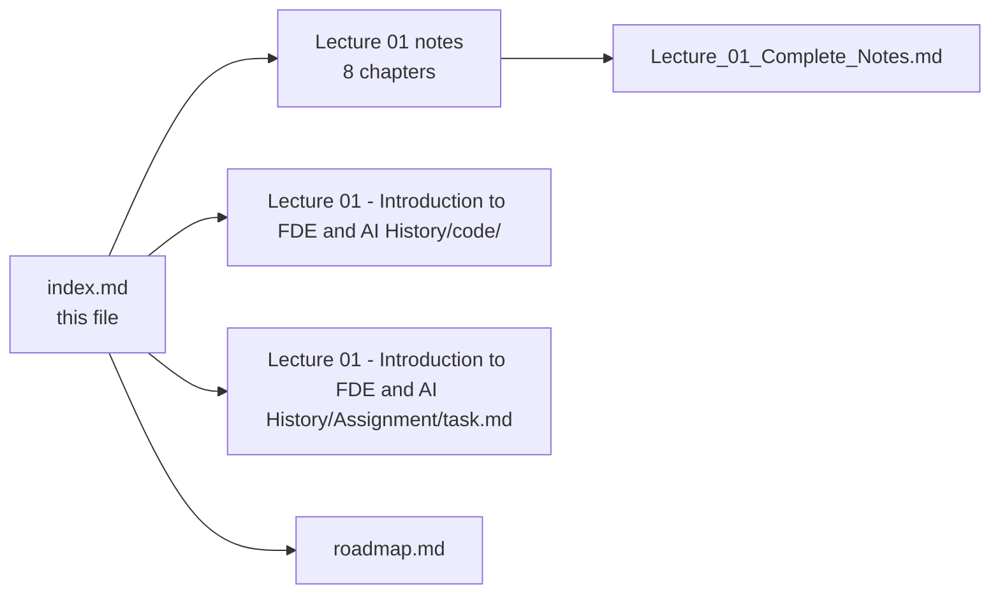

--

## 📚 Lecture 02 — LLM Foundations

**8 chapters** + 1 consolidated document
**Folder:** [📂 ./Lecture 02 - LLM Foundations/](./Lecture%2002%20-%20LLM%20Foundations/) · [📄 Roadmap](./roadmap.md)

| # | Chapter | One-line summary | Notes |
| :---: | :--- | :--- | :--- |
| **01** | **What an LLM is and Next Token Prediction** | The one core task $P(t_n \mid t_1 \dots t_{n-1})$; GPT (the engine) vs ChatGPT (the car); the context-narrowing prompt experiment; the autoregressive loop and its per-token cost model; why emergent capability is a side effect of learning to predict | [📄 Chapter 01](./Lecture%2002%20-%20LLM%20Foundations/notes/01_What_an_LLM_Is_and_Next_Token_Prediction.md) |
| **02** | **The Text Pipeline and Why Token Ids Are Labels** | Why text must become numbers; raw text → tokens → token IDs as three distinct objects; the roll-number analogy (IDs are labels, not measurements); the forward pipeline, the streaming reverse pipeline and the seven pipeline invariants | [📄 Chapter 02](./Lecture%2002%20-%20LLM%20Foundations/notes/02_The_Text_Pipeline_and_Why_Token_IDs_Are_Labels.md) |
| **03** | **Tokenization Strategies Word Character Subword** | Word level: vocabulary explosion and `<UNK>` information destruction; character level: sequence-length explosion and $O(N^2)$ attention cost; byte level as the shipped extreme; subword as the equilibrium; vocabulary-size trade-offs and the multilingual token tax | [📄 Chapter 03](./Lecture%2002%20-%20LLM%20Foundations/notes/03_Tokenization_Strategies_Word_Character_Subword.md) |
| **04** | **BPE Wordpiece Sentencepiece and Vocabulary** | BPE trained by hand (count → merge → repeat); training versus encoding; WordPiece's `##` and likelihood-based merges; Unigram and SentencePiece's `▁`; byte-level BPE; vocabulary anatomy (base, merged, special, template, reserved); **why "strawberry" is hard** | [📄 Chapter 04](./Lecture%2002%20-%20LLM%20Foundations/notes/04_BPE_WordPiece_SentencePiece_and_Vocabulary.md) |
| **05** | **Tokenizers in Practice Tiktoken and Model Comparison** | `gpt2` / `cl100k_base` / `o200k_base` and the Llama, Gemini, Claude and Mistral families; local token counting with `tiktoken` (and when it is only an estimate); the per-request cost formula; the six-part context-window budget; token accounting inside a retrieval pipeline | [📄 Chapter 05](./Lecture%2002%20-%20LLM%20Foundations/notes/05_Tokenizers_in_Practice_tiktoken_and_Model_Comparison.md) |
| **06** | **Embeddings Dense Vectors and Similarity** | The embedding lookup as a table read ($W_{\text{emb}} \in \mathbb{R}^{\lvert V\rvert \times d_{\text{model}}}$); why one-hot vectors fail; dot product vs cosine vs Euclidean; word arithmetic and its limits; static vs contextual embeddings and the `bank` problem; token embeddings vs retrieval embeddings | [📄 Chapter 06](./Lecture%2002%20-%20LLM%20Foundations/notes/06_Embeddings_Dense_Vectors_and_Similarity.md) |
| **07** | **Positional Encodings and Word Order** | Permutation invariance (`"Dog bites man"` vs `"Man bites dog"`); the additive formula $\mathbf{X}_{\text{in}} = \mathbf{E} + \mathbf{P}$; sinusoidal encodings and the linear-offset property; learned absolute, **RoPE** and **ALiBi**; the `"The cat sat on the mat"` trace; "lost in the middle" and prompt layout | [📄 Chapter 07](./Lecture%2002%20-%20LLM%20Foundations/notes/07_Positional_Encodings_and_Word_Order.md) |
| **08** | **Context Windows Training vs Inference and the Complete Pipeline** | Capacity versus attention quality; the three costs of long sequences; truncation strategies; the training phase (free next-token labels, cross-entropy, pre-training → SFT → preference tuning); the inference phase (prefill, decode, KV cache); the master end-to-end pipeline and the FDE checklist | [📄 Chapter 08](./Lecture%2002%20-%20LLM%20Foundations/notes/08_Context_Windows_Training_vs_Inference_and_the_Complete_Pipeline.md) |

### 📄 Consolidated notes

A single document combining all 8 chapters — executive summary, cheat sheet, decision tables, misconceptions, glossary and self-check questions, with links back into the chapters for detail:

👉 **[Lecture_02_Complete_Notes.md](./Lecture%2002%20-%20LLM%20Foundations/notes/Lecture_02_Complete_Notes.md)**

### 🧩 Lecture artefacts

| Artefact | Link | Status |
| :--- | :--- | :---: |
| Lecture workspace README (objectives · level · source mapping · checklist) | [📄 README.md](./Lecture%2002%20-%20LLM%20Foundations/README.md) | ✅ |
| Basic Code — the lecture's runnable codebase | [📂 code/Basic Code](./Lecture%2002%20-%20LLM%20Foundations/code/Basic%20Code/) | ✅ |
| Assignment — chapter-wise questions, build tasks and completion gate | [📝 Assignment/task.md](./Lecture%2002%20-%20LLM%20Foundations/Assignment/task.md) | ✅ |


--

## 📚 Lecture 03 — Attention and Decoding

**9 chapters** + 1 consolidated document
**Folder:** [📂 ./Lecture 03 - Attention and Decoding/](./Lecture%2003%20-%20Attention%20and%20Decoding/) · [📄 Roadmap](./roadmap.md)

| # | Chapter | One-line summary | Notes |
| :---: | :--- | :--- | :--- |
| **01** | **Why Attention from Static Vectors to Dynamic Context** | The problem attention solves — a static embedding lookup can never be context-dependent (`bank`, `it`, `his`); attention as a **differentiable soft database lookup**; self vs cross attention and the four modes; the $O(1)$ path-length argument against RNNs; why an attention row **is** a probability distribution; and what attention does *not* do | [📄 Chapter 01](./Lecture%2003%20-%20Attention%20and%20Decoding/notes/01_Why_Attention_From_Static_Vectors_to_Dynamic_Context.md) |
| **02** | **Queries Keys Values the Attention Search Engine** | One token vector, three projections — **Query** (what I look for), **Key** (what I am findable as), **Value** (what I contribute); the shapes and the parameter cost $3d_{\text{model}}^2$ (independent of $N$); the $N \times N$ score matrix $QK^{T}$; why $W_Q$ must differ from $W_K$; and the **KV cache** (why $Q$ is not in it) | [📄 Chapter 02](./Lecture%2003%20-%20Attention%20and%20Decoding/notes/02_Queries_Keys_Values_The_Attention_Search_Engine.md) |
| **03** | **Scaled Dot Product Attention by Hand** | $\text{softmax}\!\left(\frac{QK^{T}}{\sqrt{d_k}}\right)V$ symbol by symbol; the five steps **score → scale → mask → softmax → mix**; the lecture's worked trace for `"on"`; *why* $1/\sqrt{d_k}$ (a variance argument **and** a gradient argument); the causal mask and why it is $-Infinity$ rather than $0$; numerical stability via the row maximum; the $N^2$ cost model | [📄 Chapter 03](./Lecture%2003%20-%20Attention%20and%20Decoding/notes/03_Scaled_Dot_Product_Attention_by_Hand.md) |
| **04** | **Multi Head Attention and Head Specialisation** | Why one attention pattern is not enough; $\text{Concat}(\text{head}_1 \dots \text{head}_h)W^{O}$; $d_{\text{head}} = d_{\text{model}}/h$ and why multi-head is **nearly free** (identical projections and identical mixing FLOPs); what heads specialise in (and why a head's weights are *not* an explanation); **MQA/GQA** and the KV-cache saving | [📄 Chapter 04](./Lecture%2003%20-%20Attention%20and%20Decoding/notes/04_Multi_Head_Attention_and_Head_Specialisation.md) |
| **05** | **The Transformer Block and the Residual Stream** | **A Transformer is not attention** — six operations: LayerNorm → multi-head attention → residual → LayerNorm → FFN → residual; pre-LN vs post-LN and RMSNorm; the **residual stream** as a shared memory bus; why the FFN is the only place new features are computed; and where the parameters actually live (**FFN ≈ two-thirds**) | [📄 Chapter 05](./Lecture%2003%20-%20Attention%20and%20Decoding/notes/05_The_Transformer_Block_and_the_Residual_Stream.md) |
| **06** | **Encoder Decoder vs Decoder Only and Why GPT** | The three families differ in exactly **one** place — the mask; the 2017 encoder + decoder + cross-attention; the three attention modes; the **five reasons** GPT is decoder-only; what decoder-only gave up and where it went; prefix-LM; and the training/inference asymmetry that makes serving expensive | [📄 Chapter 06](./Lecture%2003%20-%20Attention%20and%20Decoding/notes/06_Encoder_Decoder_vs_Decoder_Only_and_Why_GPT.md) |
| **07** | **Logits the Lm Head and Softmax** | $H_{\text{final}} \rightarrow W_{\text{lm}} \rightarrow$ logits $\rightarrow$ softmax $\rightarrow$ distribution; what logits **are not** (unnormalised scores in log-space, not probabilities); the LM head's shape and weight tying; the three softmax properties (**shift invariance · scale sensitivity · ranking preservation**); log probabilities; and logit bias / vocabulary masking as constrained decoding | [📄 Chapter 07](./Lecture%2003%20-%20Attention%20and%20Decoding/notes/07_Logits_the_LM_Head_and_Softmax.md) |
| **08** | **Decoding Strategies and Sampling Controls** | The model **proposes**, the decoder **selects**; greedy, beam and sampling; **temperature** (dividing the logits — it changes the gaps, never the ranking); top-k, top-p (nucleus) and min-p; penalties, stop conditions and length limits; the **fixed order of operations**; determinism and seeds; why ChatGPT streams; and parameter recipes per task | [📄 Chapter 08](./Lecture%2003%20-%20Attention%20and%20Decoding/notes/08_Decoding_Strategies_and_Sampling_Controls.md) |
| **09** | **Position Masking and Attention Geometry** | Why self-attention is permutation invariant; sinusoidal encodings and the **linear-offset property**; the four positional schemes compared; **RoPE** (rotation instead of addition) and context extension; **ALiBi** (a distance penalty, no positional vector); the geometry of masks — one mechanism, **two axes**; and the runtime consequences: "lost in the middle", chunk order, advertised vs usable context | [📄 Chapter 09](./Lecture%2003%20-%20Attention%20and%20Decoding/notes/09_Position_Masking_and_Attention_Geometry.md) |

### 📄 Consolidated notes

A single document combining all 9 chapters — executive summary, cheat sheet, decision tables, misconceptions, glossary and self-check questions, with links back into the chapters for detail:

👉 **[Lecture_03_Complete_Notes.md](./Lecture%2003%20-%20Attention%20and%20Decoding/notes/Lecture_03_Complete_Notes.md)**

### 🧩 Lecture artefacts

| Artefact | Link | Status |
| :--- | :--- | :---: |
| Lecture workspace README (objectives · level · source mapping · checklist) | [📄 README.md](./Lecture%2003%20-%20Attention%20and%20Decoding/README.md) | ✅ |
| Basic Code — the lecture's runnable codebase | [📂 code/Basic Code](./Lecture%2003%20-%20Attention%20and%20Decoding/code/Basic%20Code/) | ✅ |
| Assignment — chapter-wise questions, build tasks and completion gate | [📝 Assignment/task.md](./Lecture%2003%20-%20Attention%20and%20Decoding/Assignment/task.md) | ✅ |

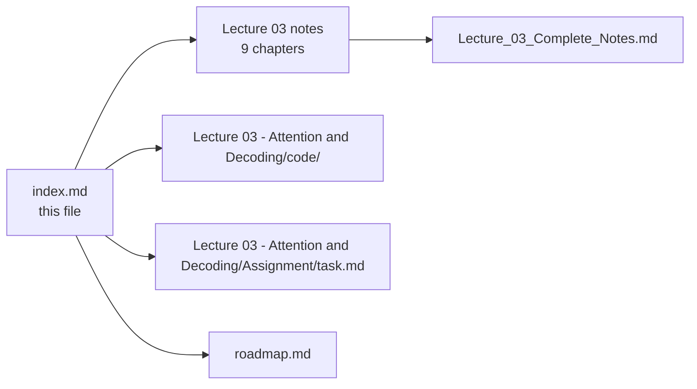

--

## 📚 Lecture 04 — LLM APIs and Multi-SDK

**9 chapters** + 1 consolidated document
**Folder:** [📂 ./Lecture 04 - LLM APIs and Multi-SDK/](./Lecture%2004%20-%20LLM%20APIs%20and%20Multi-SDK/) · [📄 Roadmap](./roadmap.md)

| # | Chapter | One-line summary | Notes |
| :---: | :--- | :--- | :--- |
| **01** | **Genai Applications vs Raw Llms the Engine vs Car Model** | Why typing into a web chat is not "talking to a neural network"; the **engine vs car** analogy (the model is the capability, your application is the vehicle); raw LLM vs tool-augmented application in two scenarios; the knowledge-cutoff problem; the **cardinal rule** — *the LLM only knows what reaches the LLM* — with its responsibility matrix; web UI vs API; what this means for an FDE | [📄 Chapter 01](./Lecture%2004%20-%20LLM%20APIs%20and%20Multi-SDK/notes/01_GenAI_Applications_vs_Raw_LLMs_The_Engine_vs_Car_Model.md) |
| **02** | **The LLM API Protocol HTTP Components and Postman** | It is just an HTTPS `POST` with a JSON body; the **four invariant components** at transport level (endpoint · authentication · model · input) and at payload level (`model` · `messages` · `params` · optional `tools`); the request lifecycle; the **Postman/curl prototype rule** — prove the wire before writing service code; the status-code taxonomy (400 · 401 · 404 · 413 · 429 · 5xx); the enterprise support-ticket triage case study | [📄 Chapter 02](./Lecture%2004%20-%20LLM%20APIs%20and%20Multi-SDK/notes/02_The_LLM_API_Protocol_HTTP_Components_and_Postman.md) |
| **03** | **Message Roles and Prompt Hygiene** | Statelessness — there is no memory, only re-sending (and re-paying); the five roles and their **privilege hierarchy**; chat templates and control tokens; system instructions vs user prompts; the **concatenation anti-pattern** → prompt injection and goal hijacking; reconstructing multi-turn history and the truncation rules; the pre-ship hygiene checklist; role support across providers | [📄 Chapter 03](./Lecture%2004%20-%20LLM%20APIs%20and%20Multi-SDK/notes/03_Message_Roles_and_Prompt_Hygiene.md) |
| **04** | **Token Economics Prefill Decode Metadata and Cost** | The response envelope (content vs metadata); **prefill vs decode** and why the output half is the expensive one; the cost formula with three worked examples; **TTFT and ITL** latency; context-window saturation vs the bill; turning metadata into telemetry; the 10-page incident-report case study; unit economics and the decisions it unlocks | [📄 Chapter 04](./Lecture%2004%20-%20LLM%20APIs%20and%20Multi-SDK/notes/04_Token_Economics_Prefill_Decode_Metadata_and_Cost.md) |
| **05** | **Token Counting and Context Budgeting with Tokenizers** | BPE in four steps; the tokenizer/vocabulary comparison and the **multilingual token tax**; `tiktoken` in practice; the character heuristics and which way their error is dangerous; the **budgeting algorithm** (reserve output, then system, then user, then history oldest-first) and the three truncation strategies; a worked 128k budget; reconciling the local estimate against the provider's `usage` | [📄 Chapter 05](./Lecture%2004%20-%20LLM%20APIs%20and%20Multi-SDK/notes/05_Token_Counting_and_Context_Budgeting_with_Tokenizers.md) |
| **06** | **Rate Limits Quotas Throttling and Retry Backoff** | The two ceilings — **RPM vs TPM** — and why RPM alone is a trap; the wider quota landscape; reading a `429` correctly (`Retry-After` and the rate-limit headers); **exponential backoff with jitter** and which failures are actually retryable; client-side protections; idempotency; the **degradation ladder**; the metrics that predict an outage before it happens | [📄 Chapter 06](./Lecture%2004%20-%20LLM%20APIs%20and%20Multi-SDK/notes/06_Rate_Limits_Quotas_Throttling_and_Retry_Backoff.md) |
| **07** | **Multi SDK Integration Openai Gemini Groq Mistral Anthropic Ollama** | What an SDK is — and is not; the four access layers and what each one costs you; the provider-by-provider **naming trap** (`messages` vs `contents`, `assistant` vs `model`, `max_tokens` vs `maxOutputTokens`); response shapes compared; the **adapter pattern** — one interface, many providers; OpenAI-compatible base URLs; **Ollama** local vs hosted; routing, fallback and cost control; testing across providers | [📄 Chapter 07](./Lecture%2004%20-%20LLM%20APIs%20and%20Multi-SDK/notes/07_Multi_SDK_Integration_OpenAI_Gemini_Groq_Mistral_Anthropic_Ollama.md) |
| **08** | **Building the Service Express Typescript Config Singletons and Telemetry** | Why the backend owns the AI call; the project layout and the ESM + TypeScript toolchain; the layered architecture and what each layer must *not* know; **Zod-validated configuration** and fail-fast boot; client singletons and connection pooling; request validation before you spend; the service layer; routes, health checks and **error mapping**; telemetry and structured logging; secrets hygiene and the key-rotation runbook | [📄 Chapter 08](./Lecture%2004%20-%20LLM%20APIs%20and%20Multi-SDK/notes/08_Building_the_Service_Express_TypeScript_Config_Singletons_and_Telemetry.md) |
| **09** | **AI Slop and Model Collapse** | Two terms side by side — one is your output *today*, the other is the model *over time*; AI slop's economic engine and its in-product symptoms; **model collapse** as a recursive training loop, and what specifically degrades; the honest caveats; the four mitigation families (human review · high-quality data · guardrails · continuous evaluation); the anti-slop checklist for your own pipeline | [📄 Chapter 09](./Lecture%2004%20-%20LLM%20APIs%20and%20Multi-SDK/notes/09_AI_Slop_and_Model_Collapse.md) |

### 📄 Consolidated notes

A single document combining all 9 chapters — executive summary, cheat sheet, decision tables, misconceptions, glossary and self-check questions, with links back into the chapters for detail:

👉 **[Lecture_04_Complete_Notes.md](./Lecture%2004%20-%20LLM%20APIs%20and%20Multi-SDK/notes/Lecture_04_Complete_Notes.md)**

### 🧩 Lecture artefacts

| Artefact | Link | Status |
| :--- | :--- | :---: |
| Lecture workspace README (objectives · level · source mapping · checklist) | [📄 README.md](./Lecture%2004%20-%20LLM%20APIs%20and%20Multi-SDK/README.md) | ✅ |
| Basic Code — the lecture's runnable codebase | [📂 code/Basic Code](./Lecture%2004%20-%20LLM%20APIs%20and%20Multi-SDK/code/Basic%20Code/) | ✅ |
| Assignment — chapter-wise questions, build tasks and completion gate | [📝 Assignment/task.md](./Lecture%2004%20-%20LLM%20APIs%20and%20Multi-SDK/Assignment/task.md) | ✅ |

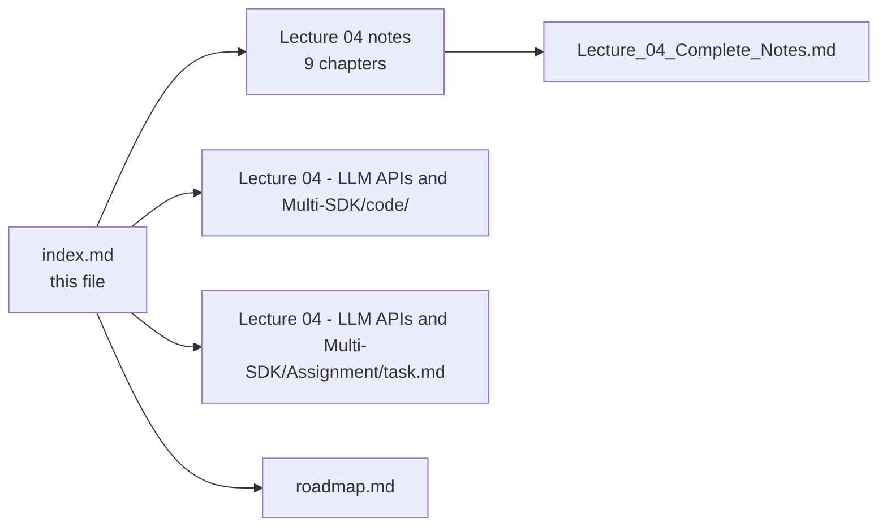

--

## 📚 Lecture 05 — Prompt Engineering

**9 chapters** + 1 consolidated document
**Folder:** [📂 ./Lecture 05 - Prompt Engineering/](./Lecture%2005%20-%20Prompt%20Engineering/) · [📄 Roadmap](./roadmap.md)

| # | Chapter | One-line summary | Notes |
| :---: | :--- | :--- | :--- |
| **01** | **Prompt Engineering as an Engineering Discipline** | A prompt is an interface: **five slots** (role · task · context · constraints · contract), a function signature with a return type, and GIGO as its governing rule; the **lever ladder** tells you when prompting is the wrong tool | [📄 Chapter 01](./Lecture%2005%20-%20Prompt%20Engineering/notes/01_Prompt_Engineering_as_an_Engineering_Discipline.md) |
| **02** | **Zero Shot Prompting** | Instruction + context + constraints with **no examples** — the baseline every other technique must beat; the **constraint trap** (the most common misclassification), a failure taxonomy with the correct fix per row, and the improvement ladder to climb *before* adding examples | [📄 Chapter 02](./Lecture%2005%20-%20Prompt%20Engineering/notes/02_Zero_Shot_Prompting.md) |
| **03** | **Few Shot Prompting and in Context Learning** | Examples teach a pattern **without changing weights**; an exemplar is an input→output *pair*; the **four craft rules** — define the task · show consistent examples · cover important classes · use representative examples — plus ordering and per-request exemplar selection | [📄 Chapter 03](./Lecture%2005%20-%20Prompt%20Engineering/notes/03_Few_Shot_Prompting_and_In_Context_Learning.md) |
| **04** | **Chain of Thought and Structured Reasoning** | Give the model **output tokens to think with**; the three mechanisms CoT exploits; zero-shot vs few-shot CoT vs **self-consistency**; the `INITIAL → THINK → ANALYZE → OUTPUT` pipeline; private CoT vs a published rationale — and the cases where **CoT hurts** | [📄 Chapter 04](./Lecture%2005%20-%20Prompt%20Engineering/notes/04_Chain_of_Thought_and_Structured_Reasoning.md) |
| **05** | **Role Play and Persona Prompting** | A persona is a **behavioural prior**, not new knowledge: seven fields plus a fallback, six failure modes (over-roleplay · false authority · scope creep · persona hijack · drift · cross-endpoint inconsistency) — and why a persona is **never a security boundary** | [📄 Chapter 05](./Lecture%2005%20-%20Prompt%20Engineering/notes/05_Role_Play_and_Persona_Prompting.md) |
| **06** | **Model Specific Prompt Formats and Chat Templates** | A `messages` array **never reaches the transformer**; ChatML · Alpaca · `[INST]` + `<<SYS>>` · Llama-3 header tokens · FLAN-T5 compared; the **generation prompt**; who owns templating at the API vs local-inference boundary; and the three classic formatting bugs, including **double templating** | [📄 Chapter 06](./Lecture%2005%20-%20Prompt%20Engineering/notes/06_Model_Specific_Prompt_Formats_and_Chat_Templates.md) |
| **07** | **Prompt Hygiene Delimiters and Output Contracts** | The LLM analogue of **parameterised queries**: separate rules from data, delimit and **escape** it, order instructions deliberately, resolve contradictions with explicit precedence, prefer positive rules — and state an output contract a machine can enforce via the **four-rung validation ladder** | [📄 Chapter 07](./Lecture%2005%20-%20Prompt%20Engineering/notes/07_Prompt_Hygiene_Delimiters_and_Output_Contracts.md) |
| **08** | **Prompt Injection Guardrails and Extraction Attacks** | Direct vs **indirect** injection, goal hijacking and exfiltration; why prompt-level defences are insufficient; input / output / tool guardrails as *code*; where moderation APIs belong; prompt extraction vs model distillation; **defence in depth**, least privilege and human-in-the-loop | [📄 Chapter 08](./Lecture%2005%20-%20Prompt%20Engineering/notes/08_Prompt_Injection_Guardrails_and_Extraction_Attacks.md) |
| **09** | **Prompt Versioning Evaluation and the Prompt Registry** | Prompts are versioned artifacts: the **registry entry**, semver for prompts, the stratified **golden set**, the **six metrics**, the evaluation harness, the CI regression gate, shadow → canary → A/B — and **drift**, the failure mode nobody instruments | [📄 Chapter 09](./Lecture%2005%20-%20Prompt%20Engineering/notes/09_Prompt_Versioning_Evaluation_and_the_Prompt_Registry.md) |

### 📄 Consolidated notes

A single document combining all 9 chapters — executive summary, cheat sheet, decision tables, misconceptions, glossary and self-check questions, with links back into the chapters for detail:

👉 **[Lecture_05_Complete_Notes.md](./Lecture%2005%20-%20Prompt%20Engineering/notes/Lecture_05_Complete_Notes.md)**

### 🧩 Lecture artefacts

| Artefact | Link | Status |
| :--- | :--- | :---: |
| Lecture workspace README (objectives · level · source mapping · checklist) | [📄 README.md](./Lecture%2005%20-%20Prompt%20Engineering/README.md) | ✅ |
| Basic Code — the lecture's runnable codebase | [📂 code/Basic Code](./Lecture%2005%20-%20Prompt%20Engineering/code/Basic%20Code/) | ✅ |
| Assignment — chapter-wise questions, build tasks and completion gate | [📝 Assignment/task.md](./Lecture%2005%20-%20Prompt%20Engineering/Assignment/task.md) | ✅ |

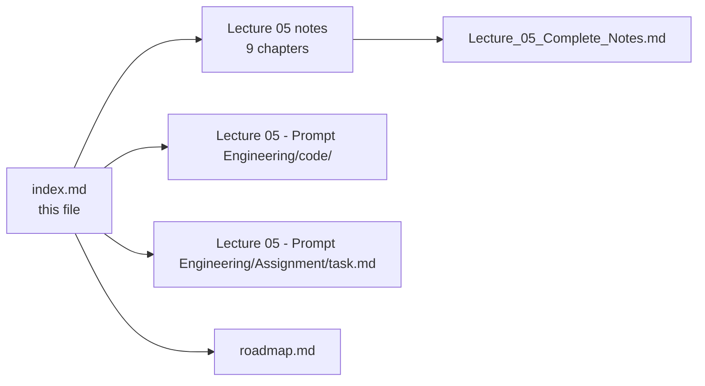

--

## 📚 Lecture 06 — Chatbots and Context

**8 chapters** + 1 consolidated document
**Folder:** [📂 ./Lecture 06 - Chatbots and Context/](./Lecture%2006%20-%20Chatbots%20and%20Context/) · [📄 Roadmap](./roadmap.md)

| # | Chapter | One-line summary | Notes |
| :---: | :--- | :--- | :--- |
| **01** | **Stateless Llms Conversation History and Role Architecture** | The model is **stateless** — no memory survives a request, so the *application* carries the conversation. The multi-turn dependency and coreference problem; `system` · `user` · `assistant` as **authority levels**, not formatting; why the assistant turn must be echoed back; the **prompt-contamination anti-pattern**; the system role as standing operating procedures; the **4 Pillars**; and why a `sessionId` is a capability that needs an ownership check | [📄 Chapter 01](./Lecture%2006%20-%20Chatbots%20and%20Context/notes/01_Stateless_LLMs_Conversation_History_and_Role_Architecture.md) |
| **02** | **Context Windows and Token Accumulation** | The window is a hard budget: $L_{\text{in}} + L_{\text{out}} \le C_{\max}$. What actually occupies it; the **two-tier measurement rule** (estimate to *decide*, tokenizer to *report*); the **$O(N^2)$ accumulation problem** of naive history appending; history cost in **three currencies**; the **lost-in-the-middle** recall curve; the fallacy of "send everything"; and the five-step **budget arithmetic** — safe operating limit, six tiers, output reserved first, instrumented, with an explicit failure mode | [📄 Chapter 02](./Lecture%2006%20-%20Chatbots%20and%20Context/notes/02_Context_Windows_and_Token_Accumulation.md) |
| **03** | **Context Management Strategies** | Four levers — **retain · compress · retrieve · evict** — and the five strategies built from them: the token-budgeted **sliding window**, the **pinned anchor**, **rolling summarisation** with a PRESERVE/DISCARD spec, **semantic recall** over historical memory, and the **layered pipeline** where each layer covers the previous one's blind spot. Includes the comparative table, the selection decision tree, a reference `ContextManager`, and the rule that anything costing latency moves **off the hot path** | [📄 Chapter 03](./Lecture%2006%20-%20Chatbots%20and%20Context/notes/03_Context_Management_Strategies.md) |
| **04** | **Context vs Model Weights and the Illusion of Learning** | Parametric knowledge ($\Theta$, frozen) vs in-context working memory ($X$, fluid); the **context-conditioned prediction** formula; the same question under two contexts; what training changes that inference does not; deconstructing "**in-context learning**"; the **application-memory vs fine-tuning decision matrix**; and the GDPR right to be forgotten — why erasure is an API call in a database and hard research in weights | [📄 Chapter 04](./Lecture%2006%20-%20Chatbots%20and%20Context/notes/04_Context_vs_Model_Weights_and_the_Illusion_of_Learning.md) |
| **05** | **Real Time Streaming and SSE** | Generation is **already incremental** — streaming stops hiding it behind a buffer. The buffered-request bottleneck; **TTFT vs ITL** and total time; the transport options and why **SSE** wins for chat; the wire format (`data:` · `event:` · `id:` · `retry:` · `:comment`, and the `[DONE]` sentinel); the six server responsibilities; cancellation and **orphaned generation**; the production hazards; and persisting history around a stream | [📄 Chapter 05](./Lecture%2006%20-%20Chatbots%20and%20Context/notes/05_Real_Time_Streaming_and_SSE.md) |
| **06** | **Hallucination Mechanisms Fluency vs Truth** | Hallucination is the **training objective working as designed**, not a bug. The **orthogonality of fluency and truth**; why output is unwaveringly confident; the taxonomy of **benign nonsense vs coherent fabrication**; the **five catalysts** of production hallucination; **sycophancy** and the false-premise experiment; how to **measure** hallucination (faithfulness, precision/recall, over-refusal); decoding parameters; and over-refusal as the opposite failure | [📄 Chapter 06](./Lecture%2006%20-%20Chatbots%20and%20Context/notes/06_Hallucination_Mechanisms_Fluency_vs_Truth.md) |
| **07** | **Engineering Defences Grounding RAG Guardrails and Verification** | The fallacy of **prompt-only defences** and the **7-layer defence-in-depth architecture**: input validation & injection guard · RAG grounding · deterministic tools · **calibrated refusal** ("I don't know" as a designed behaviour) · structured outputs · **output verification** (the deterministic verifier toolbox) · observability. Plus the guardrail engineering realities — the false-positive budget and the log-only rollout | [📄 Chapter 07](./Lecture%2006%20-%20Chatbots%20and%20Context/notes/07_Engineering_Defences_Grounding_RAG_Guardrails_and_Verification.md) |
| **08** | **Complete Enterprise Chatbot Architecture** | The **six-tier topology** and the FDE mental model of the **LLM as an unprivileged kernel**; naive prototype vs enterprise production; **one message end to end** with the failure each step prevents; the consolidated engineering principles; the **build task and the six-requirement completion gate**; and the **cost / coherence / latency triangle** you must be able to defend | [📄 Chapter 08](./Lecture%2006%20-%20Chatbots%20and%20Context/notes/08_Complete_Enterprise_Chatbot_Architecture.md) |

### 📄 Consolidated notes

A single document combining all 8 chapters — executive summary, cheat sheet, decision tables, misconceptions, glossary and self-check questions, with links back into the chapters for detail:

👉 **[Lecture_06_Complete_Notes.md](./Lecture%2006%20-%20Chatbots%20and%20Context/notes/Lecture_06_Complete_Notes.md)**

### 🧩 Lecture artefacts

| Artefact | Link | Status |
| :--- | :--- | :---: |
| Lecture workspace README (objectives · level · source mapping · checklist) | [📄 README.md](./Lecture%2006%20-%20Chatbots%20and%20Context/README.md) | ✅ |
| Basic Code — the lecture's runnable codebase | [📂 code/Basic Code](./Lecture%2006%20-%20Chatbots%20and%20Context/code/Basic%20Code/) | ✅ |
| Assignment — chapter-wise questions, build tasks and completion gate | [📝 Assignment/task.md](./Lecture%2006%20-%20Chatbots%20and%20Context/Assignment/task.md) | ✅ |

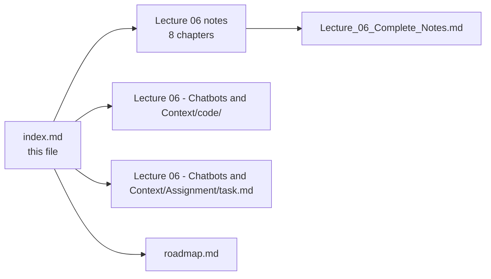

--

## 📚 Lecture 07 — AI Streaming

**9 chapters** + 1 consolidated document
**Folder:** [📂 ./Lecture 07 - AI Streaming/](./Lecture%2007%20-%20AI%20Streaming/) · [📄 Roadmap](./roadmap.md)

| # | Chapter | One-line summary | Notes |
| :---: | :--- | :--- | :--- |
| **01** | **How Llms Generate Text** | Generation is an **irreducibly sequential next-token loop** — tokenize → forward pass → logits → softmax → sample → append. The two phases that govern latency (**prefill** sets TTFT, **decode** sets TPS), the **KV-cache tax** on every turn, the same loop under two delivery shapes, what the training objective does *not* guarantee, and where streaming physically comes from | [📄 Chapter 01](./Lecture%2007%20-%20AI%20Streaming/notes/01_How_LLMs_Generate_Text.md) |
| **02** | **Generation vs Delivery Non Streaming and Streaming Responses** | **Two independent processes** — you cannot make the model faster, but you can stop hiding its output. The buffered and streaming lifecycles side by side; the wire-level comparison; the endpoint decision framework; the **hybrid pattern**; the delivery-path taxonomy; and why streaming changes **failure semantics** (a `500` becomes impossible after the first byte) | [📄 Chapter 02](./Lecture%2007%20-%20AI%20Streaming/notes/02_Generation_vs_Delivery_Non_Streaming_and_Streaming_Responses.md) |
| **03** | **Latency Anatomy TTFT ITL and Perceived Performance** | **TTFT governs perceived responsiveness; total time governs completion.** The full latency decomposition; **TTFT · ITL · TPOT · TPS** and the **reading-speed threshold** above which more TPS buys nothing; every prompt token as a **TTFT tax**; the numbers you must log; and the **client − server TTFT gap** as the one diagnostic that separates *your* stack from the model | [📄 Chapter 03](./Lecture%2007%20-%20AI%20Streaming/notes/03_Latency_Anatomy_TTFT_ITL_and_Perceived_Performance.md) |
| **04** | **Token Chunk Network and Byte Granularity** | **Four granularities with unstable boundaries** — tokens coalesced into deltas, deltas fragmented into network chunks, chunks split mid-character. The **UTF-8 multi-byte split** and why a per-chunk `TextDecoder` corrupts text; the only safe UI contract (**blind accumulation** + accumulate-before-split + retain-the-tail); and the **fragmentation torture test** | [📄 Chapter 04](./Lecture%2007%20-%20AI%20Streaming/notes/04_Token_Chunk_Network_and_Byte_Granularity.md) |
| **05** | **HTTP Streaming Mechanics Chunked Encoding SSE and Websockets** | Streaming is **still HTTP** — the same response with a progressive body and no `Content-Length`. Chunked transfer encoding; the exact **SSE wire grammar** and the headers that matter; **heartbeats** as comment frames; SSE vs WebSockets; raw text vs `text/event-stream`; and the **infrastructure that silently breaks streaming** (proxies, buffering, compression, idle timeouts) | [📄 Chapter 05](./Lecture%2007%20-%20AI%20Streaming/notes/05_HTTP_Streaming_Mechanics_Chunked_Encoding_SSE_and_WebSockets.md) |
| **06** | **End to End Streaming Architecture and Pipeline Invariants** | **Two streams must both stay streamed** — one from the model to your service, one from your service to the user. The full pipeline and who owns each hop; the **seven verifiable invariants** (any single buffering hop silently converts the system back into a buffered one); the both-streams sequence diagram; **backpressure** and flow control; **cancellation propagation**; and naïve vs production pipelines | [📄 Chapter 06](./Lecture%2007%20-%20AI%20Streaming/notes/06_End_to_End_Streaming_Architecture_and_Pipeline_Invariants.md) |
| **07** | **Backend Streaming Call vs Stream Flux and Stream Pumps** | **The return type *is* the architecture** — `String` buffers, a stream type forwards. `Flux`/`AsyncIterable` as a **conveyor belt**, not a box; why the streaming service stays deliberately tiny; the four operators that matter (**observer, not terminator**); **stream pumps, delta coalescing and backend backpressure**; error handling **before vs after the first byte**; and multi-user isolation | [📄 Chapter 07](./Lecture%2007%20-%20AI%20Streaming/notes/07_Backend_Streaming_Call_vs_Stream_Flux_and_Stream_Pumps.md) |
| **08** | **Frontend Streaming Fetch Readablestream Textdecoder** | **One `await response.text()` erases everything the backend built.** `await fetch()` resolves on **headers**, not on completion; `response.body.getReader()`; why a chunk is bytes and not a string; the complete `sendMessage()` flow; **one growing bubble** instead of one per chunk; auto-scroll; rich content while it is still arriving; the **Stop button** and abort semantics; performance, framework patterns and **accessibility** | [📄 Chapter 08](./Lecture%2007%20-%20AI%20Streaming/notes/08_Frontend_Streaming_Fetch_ReadableStream_TextDecoder.md) |
| **09** | **History Persistence and Production Hardening** | **Never store chunks as messages** — one exchange is one assistant turn. The **dual-write pattern** (stream out, buffer in); why the buffer must live on the request and not the service; **interrupted turns belong in history**; token accounting *during* a stream; persistence engineering (atomic, idempotent, ordered); the production **hardening checklist**; the metrics that catch regressions; cost, security and privacy; the testing strategy; and the **anti-pattern catalogue** | [📄 Chapter 09](./Lecture%2007%20-%20AI%20Streaming/notes/09_History_Persistence_and_Production_Hardening.md) |

### 📄 Consolidated notes

A single document combining all 9 chapters — executive summary, cheat sheet, decision tables, misconceptions, glossary and self-check questions, with links back into the chapters for detail:

👉 **[Lecture_07_Complete_Notes.md](./Lecture%2007%20-%20AI%20Streaming/notes/Lecture_07_Complete_Notes.md)**

### 🧩 Lecture artefacts

| Artefact | Link | Status |
| :--- | :--- | :---: |
| Lecture workspace README (objectives · level · source mapping · checklist) | [📄 README.md](./Lecture%2007%20-%20AI%20Streaming/README.md) | ✅ |
| Basic Code — the lecture's runnable codebase | [📂 code/Basic Code](./Lecture%2007%20-%20AI%20Streaming/code/Basic%20Code/) | ✅ |
| Assignment — chapter-wise questions, build tasks and completion gate | [📝 Assignment/task.md](./Lecture%2007%20-%20AI%20Streaming/Assignment/task.md) | ✅ |

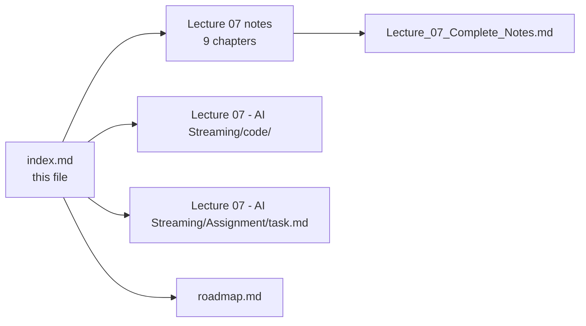

--

## 📚 Lecture 08 — Tool Calling

**8 chapters** + 1 consolidated document
**Folder:** [📂 ./Lecture 08 - Tool Calling/](./Lecture%2008%20-%20Tool%20Calling/) · [📄 Roadmap](./roadmap.md)

| # | Chapter | One-line summary | Notes |
| :---: | :--- | :--- | :--- |
| **01** | **From Token Prediction to Tool Augmentation** | The model predicts tokens and **executes nothing** — BPE chunking destroys digit alignment, so arithmetic must be delegated. The brain-without-hands model; the linguistic impedance mismatch; LLMs as universal semantic decoders; the **five failure classes** of "just ask for JSON"; and the definition the whole lecture rests on — **tool = capability + permission** | [📄 Chapter 01](./Lecture%2008%20-%20Tool%20Calling/notes/01_From_Token_Prediction_to_Tool_Augmentation.md) |
| **02** | **Tool Contracts JSON Schema and Openapi** | A tool is an ordinary function wrapped in a contract — `name`, `description`, JSON Schema `parameters` — and that contract is **the only thing the model knows about your code**. The four pillars; the JSON-Schema vocabulary you actually need; why `description` is the highest-leverage text you will ever write and how it directly controls selection accuracy; what a schema **cannot** enforce; one Zod schema as the single source of truth; the registry; five hygiene rules; and OpenAPI as the same idea for a second audience | [📄 Chapter 02](./Lecture%2008%20-%20Tool%20Calling/notes/02_Tool_Contracts_JSON_Schema_and_OpenAPI.md) |
| **03** | **The Five Step Wire Protocol and Double Turn Calling** | A **stateless HTTP ping-pong**: definitions out → `tool_calls` proposal → local execution → addressed `tool` result → synthesis. Every turn's payload field by field; the message-role invariants; why one hop is **two provider calls** (a proposal turn plus a result turn) and its three structural consequences; parallel calls inside one assistant message; the same protocol across providers; and what changes under streaming | [📄 Chapter 03](./Lecture%2008%20-%20Tool%20Calling/notes/03_The_Five_Step_Wire_Protocol_and_Double_Turn_Calling.md) |
| **04** | **Tool Taxonomy Deterministic and Live Information Tools** | Compute, information and action tools differ in **idempotency, caching, retries, failure cost and permission tier** — and the matrix that turns those differences into policy. A bounded calculator; the four properties every information tool needs; normalising away upstream shape; a scoped database lookup and its five rules; what makes action tools different; six rules for designing the **result** for the model's context; and why results are untrusted input | [📄 Chapter 04](./Lecture%2008%20-%20Tool%20Calling/notes/04_Tool_Taxonomy_Deterministic_and_Live_Information_Tools.md) |
| **05** | **Multi Step Chaining and the REACT Execution Loop** | The model builds the dependency graph from observations — **Thought → Action → Observation** — with no orchestration code written. Sequential chaining and the value that exists nowhere in the prompt; parallel dispatch and its rules; the ReAct triplet and why interleaving beats planning first; the execution engine's four responsibilities; **the five brakes** (steps · deadline · token ceiling · repeated call · no progress) and the failure modes they exist for; how to halt well; and the **visible step trace** | [📄 Chapter 05](./Lecture%2008%20-%20Tool%20Calling/notes/05_Multi_Step_Chaining_and_the_ReAct_Execution_Loop.md) |
| **06** | **Error Handling Self Healing and Result Reinjection** | **A tool failure is a result, not an exception** — a design, not a slogan. Why "never throw" is the wrong reading; the single `executeSafely` boundary; the error taxonomy; the structured contract (`status` · `code` · `message` · `retryable`) and what must never appear in it; the **two-stage** parse-and-validate defence; three levels of self-healing; retry policy with backoff, jitter and a budget; and the anti-patterns behind most production incidents | [📄 Chapter 06](./Lecture%2008%20-%20Tool%20Calling/notes/06_Error_Handling_Self_Healing_and_Result_Reinjection.md) |
| **07** | **Routing Tool Choice and Testing Tool Selection** | Selection is a **semantic match you can measure**. The four `tool_choice` policies and how they interact with tool-set size; the six routing failure modes with a symptom → cause → fix table; fixtures with four expectation kinds; **four metrics** and the **confusion matrix** (including the `none` row most teams forget); regression discipline for anything that changes the match surface; and what else to test besides routing | [📄 Chapter 07](./Lecture%2008%20-%20Tool%20Calling/notes/07_Routing_Tool_Choice_and_Testing_Tool_Selection.md) |
| **08** | **Security Permissions and the Token Economy** | **The application is the kernel** — the prompt is not a control. The three-tier authorization matrix; the threat model for tool-calling agents and the six-layer defence in depth; three structural defences against indirect injection; the **approval gate as a tool result**, with its four binding rules; why loop cost is **super-linear** and the four levers that bound it; the minimum viable instrumentation; and the 24-item hardening checklist plus the two-question ship gate | [📄 Chapter 08](./Lecture%2008%20-%20Tool%20Calling/notes/08_Security_Permissions_and_the_Token_Economy.md) |

### 📄 Consolidated notes

A single document combining all 8 chapters — executive summary, cheat sheet, decision tables, misconceptions, glossary and self-check questions, with links back into the chapters for detail:

👉 **[Lecture_08_Complete_Notes.md](./Lecture%2008%20-%20Tool%20Calling/notes/Lecture_08_Complete_Notes.md)**

### 🧩 Lecture artefacts

| Artefact | Link | Status |
| :--- | :--- | :---: |
| Lecture workspace README (objectives · level · source mapping · checklist) | [📄 README.md](./Lecture%2008%20-%20Tool%20Calling/README.md) | ✅ |
| Basic Code — the lecture's runnable codebase | [📂 code/Basic Code](./Lecture%2008%20-%20Tool%20Calling/code/Basic%20Code/) | ✅ |
| Assignment — chapter-wise questions, build tasks and completion gate | [📝 Assignment/task.md](./Lecture%2008%20-%20Tool%20Calling/Assignment/task.md) | ✅ |


--

## 📚 Lecture 09 — AI Agents and HITL

**9 chapters** + 1 consolidated document
**Folder:** [📂 ./Lecture 09 - AI Agents and HITL/](./Lecture%2009%20-%20AI%20Agents%20and%20HITL/) · [📄 Roadmap](./roadmap.md)

| # | Chapter | One-line summary | Notes |
| :---: | :--- | :--- | :--- |
| **01** | **First Principles of AI Agents and the Agency Spectrum** | An LLM has **no sensors and no actuators**, so "agent" is a claim that must be earned. Agency is a **spectrum of four progressive levels** — raw LLM → single tool → multi-tool routing → **autonomous goal-directed loop** — and the difference between them is *who decides the next step* and *how many decisions chain*. The product-facing **chatbot → copilot → agent** spectrum; the **6-component model**; brain + loop + tools; agent vs workflow; and what an agent is **not** | [📄 Chapter 01](./Lecture%2009%20-%20AI%20Agents%20and%20HITL/notes/01_First_Principles_of_AI_Agents_and_the_Agency_Spectrum.md) |
| **02** | **Agent Architecture Components and Request Lifecycle** | The reference architecture and the split the whole lecture rests on — **what the model owns** (interpretation · selection · synthesis) versus **what the runtime owns** (permissions · budgets & timeouts · retries & idempotency · persistence · truth). The components in depth, the full request lifecycle end to end, the layer map, the two formulas reconciled, and the design decisions the architecture forces you to make | [📄 Chapter 02](./Lecture%2009%20-%20AI%20Agents%20and%20HITL/notes/02_Agent_Architecture_Components_and_Request_Lifecycle.md) |
| **03** | **The Agent Loop Perceive Decide Act and State Machines** | The fundamental loop, and why an **explicit state machine** beats `while (true)` — every terminal state is named, so every terminal state is testable and a gate becomes a *state* rather than a special case. Agent state; the tool runner; the **four-stage act pipeline** (schema validation → authorization → business rules → execution); **never trust tool arguments**; dynamic error recovery; why recovery ≠ unlimited retry; agent vs RAG; and agent loop vs chain-of-thought | [📄 Chapter 03](./Lecture%2009%20-%20AI%20Agents%20and%20HITL/notes/03_The_Agent_Loop_Perceive_Decide_Act_and_State_Machines.md) |
| **04** | **Loop Engineering and Harness Engineering** | Why `while (true)` is dangerous and the **four brakes** that fix it — **loop bounding · timeout protection · token/cost limits · repetition & no-progress detection** — plus the **six named termination conditions**, the causal **execution trace**, the `O(N²)` token ledger, the six classic agent failure modes, the full defensive pipeline and the harness's control plane | [📄 Chapter 04](./Lecture%2009%20-%20AI%20Agents%20and%20HITL/notes/04_Loop_Engineering_and_Harness_Engineering.md) |
| **05** | **Workspace Sandboxing and Agent Security** | **Tool = capability + permission**, and a sandbox is an *architecture, not a sentence*. The fatal anti-pattern of unrestricted shell execution; the **five threat vectors** for filesystem agents; the **`safePath` resolver** with its two mandatory containment checks (lexical *and* canonical) and the four subtleties that make it correct; the four hardened workspace tools; the **hierarchy of isolation tiers**; the three isolation axes; quotas; and the 12-item production checklist | [📄 Chapter 05](./Lecture%2009%20-%20AI%20Agents%20and%20HITL/notes/05_Workspace_Sandboxing_and_Agent_Security.md) |
| **06** | **Building an Autonomous Website Builder Agent** | From *advice* to *actuation*. The system prompt as a **job description** (and why nothing in it is a limit); the **four workspace tools** that are the agent's entire capability surface — scaffold · produce · verify · explore — and why not five or ten; the **controller vs engine** split (thin HTTP vs thick autonomous); the end-to-end BrewLab walkthrough; the **environmental feedback loop** that makes `readFile` a capability multiplier; multi-file coherence; and general-purpose emergence | [📄 Chapter 06](./Lecture%2009%20-%20AI%20Agents%20and%20HITL/notes/06_Building_an_Autonomous_Website_Builder_Agent.md) |
| **07** | **Human in the Loop and Tool Authorization Tiers** | Not every action deserves the same autonomy: the **3-tier matrix** (**read-only → auto** · **scoped mutate → auto within quotas** · **critical/irreversible → HITL mandatory**), the classification decision tree and the five tiering rules. Synchronous vs **asynchronous durable HITL**; the **pause/resume state machine**; the pending-approval record; the policy engine; the resumption webhook's **five correctness requirements**; and the **two layers of idempotency** — because webhooks are at-least-once | [📄 Chapter 07](./Lecture%2009%20-%20AI%20Agents%20and%20HITL/notes/07_Human_in_the_Loop_and_Tool_Authorization_Tiers.md) |
| **08** | **RBAC Defensive Wrapper and Platform Guardrails** | **The model is not part of the authorization path** — its output is a proposal; the backend's check is the decision. Authentication vs authorization; RBAC's three canonical roles; **blast radius**; why a **jailbreak is not an authorization bypass**; tool authorization with **object-level checks** (the IDOR case) and **ABAC**; the **defensive wrapper** with its input gate, 0–100 **risk score** and output gate; wrapper vs guardrail vs firewall; what the wrapper **cannot** solve; the SIEM/SOC audit trail; and the complete security architecture | [📄 Chapter 08](./Lecture%2009%20-%20AI%20Agents%20and%20HITL/notes/08_RBAC_Defensive_Wrapper_and_Platform_Guardrails.md) |
| **09** | **Enterprise Agent Patterns Failure Modes and the 25 Principles** | Pure workflow vs pure agent vs the **hybrid golden pattern** (agency where the *ambiguity* is, determinism where the *consequence* is); the four enterprise topologies; naive chatbot vs enterprise autonomous agent; the four failure classes; **"the application is the kernel"**; the production-readiness maturity model; and the **25 principles** that tie the lecture together | [📄 Chapter 09](./Lecture%2009%20-%20AI%20Agents%20and%20HITL/notes/09_Enterprise_Agent_Patterns_Failure_Modes_and_the_25_Principles.md) |

### 📄 Consolidated notes

A single document combining all 9 chapters — executive summary, cheat sheet, decision tables, misconceptions, glossary and self-check questions, with links back into the chapters for detail:

👉 **[Lecture_09_Complete_Notes.md](./Lecture%2009%20-%20AI%20Agents%20and%20HITL/notes/Lecture_09_Complete_Notes.md)**

### 🧩 Lecture artefacts

| Artefact | Link | Status |
| :--- | :--- | :---: |
| Lecture workspace README (objectives · level · source mapping · checklist) | [📄 README.md](./Lecture%2009%20-%20AI%20Agents%20and%20HITL/README.md) | ✅ |
| Basic Code — the lecture's runnable codebase | [📂 code/Basic Code](./Lecture%2009%20-%20AI%20Agents%20and%20HITL/code/Basic%20Code/) | ✅ |
| Assignment — chapter-wise questions, build tasks and completion gate | [📝 Assignment/task.md](./Lecture%2009%20-%20AI%20Agents%20and%20HITL/Assignment/task.md) | ✅ |

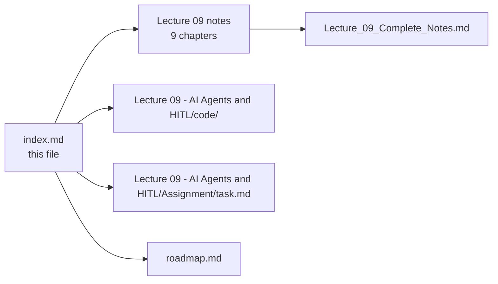

--

## 📚 Lecture 10 — Structured Outputs

**9 chapters** + 1 consolidated document
**Folder:** [📂 ./Lecture 10 - Structured Outputs/](./Lecture%2010%20-%20Structured%20Outputs/) · [📄 Roadmap](./roadmap.md)

| # | Chapter | One-line summary | Notes |
| :---: | :--- | :--- | :--- |
| **01** | **Why Plain Text is Not Enough** | Why unstructured text fails for programmatic use and why structured outputs (JSON) are the contract between model and code. | [📄 Chapter 01](./Lecture%2010%20-%20Structured%20Outputs/notes/01_Why_Plain_Text_Is_Not_Enough.md) |
| **02** | **What Structured Output Is** | Machine-schema-constrained generation — the model emits data that conforms to a declared schema, not free text. | [📄 Chapter 02](./Lecture%2010%20-%20Structured%20Outputs/notes/02_What_Structured_Output_Is.md) |
| **03** | **Why Just Ask for JSON Fails** | Prompting "return JSON" is unreliable; models drift, omit fields and invent types without enforcement. | [📄 Chapter 03](./Lecture%2010%20-%20Structured%20Outputs/notes/03_Why_Just_Ask_For_JSON_Fails.md) |
| **04** | **JSON Schema Design for Llms** | Writing tight, LLM-friendly JSON Schema — required fields, narrow enums, descriptions, avoiding optional bloat. | [📄 Chapter 04](./Lecture%2010%20-%20Structured%20Outputs/notes/04_JSON_Schema_Design_for_LLMs.md) |
| **05** | **Enforcement Mechanisms and the Strict Mode Reality** | How providers constrain token generation to a schema (grammar-guided sampling) and where strict mode falls short. | [📄 Chapter 05](./Lecture%2010%20-%20Structured%20Outputs/notes/05_Enforcement_Mechanisms_and_the_Strict_Mode_Reality.md) |
| **06** | **Validation Repair and Failure Handling** | Validating model output with Zod, repairing invalid JSON, retry loops and fallback strategies. | [📄 Chapter 06](./Lecture%2010%20-%20Structured%20Outputs/notes/06_Validation_Repair_and_Failure_Handling.md) |
| **07** | **Structured Output vs Tool Calling** | When to use JSON schema output versus the tool-calling primitive, and how they complement each other. | [📄 Chapter 07](./Lecture%2010%20-%20Structured%20Outputs/notes/07_Structured_Output_vs_Tool_Calling.md) |
| **08** | **From Data to Action Integrations and MCP** | Turning structured outputs into real actions via APIs and the Model Context Protocol. | [📄 Chapter 08](./Lecture%2010%20-%20Structured%20Outputs/notes/08_From_Data_to_Action_Integrations_and_MCP.md) |
| **09** | **Production Playbook Evaluation and Go Live** | Schema versioning, output evaluation, monitoring and the checklist for shipping structured-output features. | [📄 Chapter 09](./Lecture%2010%20-%20Structured%20Outputs/notes/09_Production_Playbook_Evaluation_and_Go_Live.md) |

### 📄 Consolidated notes

A single document combining all 9 chapters — executive summary, cheat sheet, decision tables, misconceptions, glossary and self-check questions, with links back into the chapters for detail:

👉 **[Lecture_10_Complete_Notes.md](./Lecture%2010%20-%20Structured%20Outputs/notes/Lecture_10_Complete_Notes.md)**

### 🧩 Lecture artefacts

| Artefact | Link | Status |
| :--- | :--- | :---: |
| Lecture workspace README (objectives · level · source mapping · checklist) | [📄 README.md](./Lecture%2010%20-%20Structured%20Outputs/README.md) | ✅ |
| Basic Code — the lecture's runnable codebase | [📂 code/Basic Code](./Lecture%2010%20-%20Structured%20Outputs/code/Basic%20Code/) | ✅ |
| Production Code — defended serving layer | [📂 code/Production Code](./Lecture%2010%20-%20Structured%20Outputs/code/Production%20Code/) | ✅ |
| Assignment — chapter-wise questions, build tasks and completion gate | [📝 Assignment/task.md](./Lecture%2010%20-%20Structured%20Outputs/Assignment/task.md) | ✅ |

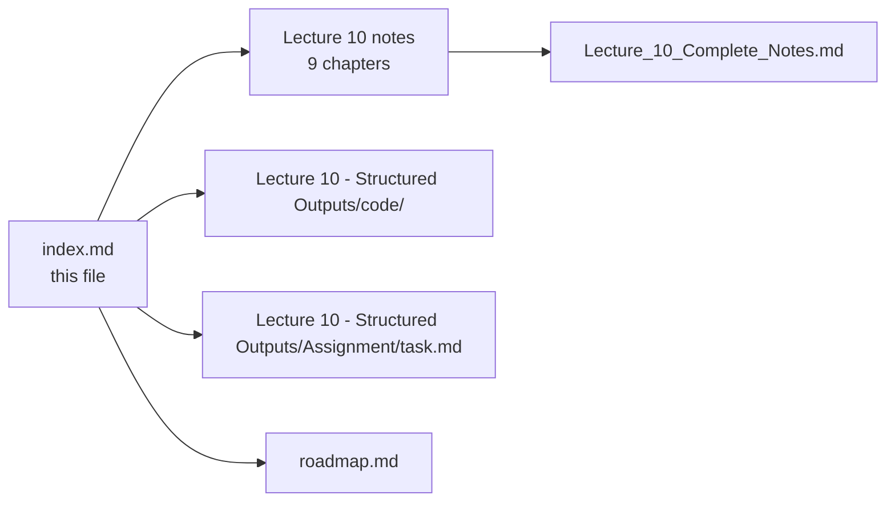

--

## 📚 Lecture 11 — Agent SDK from Scratch

**8 chapters** + 1 consolidated document
**Folder:** [📂 ./Lecture 11 - Agent SDK from Scratch/](./Lecture%2011%20-%20Agent%20SDK%20from%20Scratch/) · [📄 Roadmap](./roadmap.md)

| # | Chapter | One-line summary | Notes |
| :---: | :--- | :--- | :--- |
| **01** | **Introduction to Agent SDK and Architecture** | Stateless vs stateful agents; the Agent SDK triad (LLM + Instructions + State + Tools + Execution Loop). | [📄 Chapter 01](./Lecture%2011%20-%20Agent%20SDK%20from%20Scratch/notes/01-introduction-to-agent-sdk-and-architecture.md) |
| **02** | **Builder Pattern and Agent Configuration** | Fluent `AgentBuilder`, config decoupling, validation at `build()`, `toolList → toolMap`. | [📄 Chapter 02](./Lecture%2011%20-%20Agent%20SDK%20from%20Scratch/notes/02-builder-pattern-and-agent-configuration.md) |
| **03** | **Harness Prompting and REACT Pipeline** | Harness prompt as LLM/runtime contract; 5-stage pipeline `INITIAL → THINK → TOOL_REQUEST → ANALYSE → OUTPUT`. | [📄 Chapter 03](./Lecture%2011%20-%20Agent%20SDK%20from%20Scratch/notes/03-harness-prompting-and-react-pipeline.md) |
| **04** | **Tool Execution Engine and Registry** | `ITool` contract, metadata vs execution, tool registry, dispatch loop, error handling, self-correction. | [📄 Chapter 04](./Lecture%2011%20-%20Agent%20SDK%20from%20Scratch/notes/04-tool-execution-engine-and-registry.md) |
| **05** | **Message State Execution and Interceptors** | `messageHistory` lifecycle, message roles, interceptors/observability, `MAX_LOOP`, context window management. | [📄 Chapter 05](./Lecture%2011%20-%20Agent%20SDK%20from%20Scratch/notes/05-message-state-execution-and-interceptors.md) |
| **06** | **Structured Output and Defensive Parsing** | Strict JSON contract, defensive extraction, Zod schema validation, error recovery loops. | [📄 Chapter 06](./Lecture%2011%20-%20Agent%20SDK%20from%20Scratch/notes/06-structured-output-and-defensive-parsing.md) |
| **07** | **Guardrails Safety and Production Hardening** | Input/output guardrails, CLI safety, timeouts, `MAX_LOOP`, retries, circuit breakers, observability, testing. | [📄 Chapter 07](./Lecture%2011%20-%20Agent%20SDK%20from%20Scratch/notes/07-guardrails-safety-and-production-hardening.md) |
| **08** | **Multi Agent Swarms Providers Packaging** | Multi-agent topologies, handoff protocol, `AgentSwarm`, provider abstraction, SDK packaging. | [📄 Chapter 08](./Lecture%2011%20-%20Agent%20SDK%20from%20Scratch/notes/08-multi-agent-swarms-providers-packaging.md) |

### 📄 Consolidated notes

A single document combining all 8 chapters — executive summary, cheat sheet, decision tables, misconceptions, glossary and self-check questions, with links back into the chapters for detail:

👉 **[Lecture_11_Complete_Notes.md](./Lecture%2011%20-%20Agent%20SDK%20from%20Scratch/notes/Lecture_11_Complete_Notes.md)**

### 🧩 Lecture artefacts

| Artefact | Link | Status |
| :--- | :--- | :---: |
| Lecture workspace README (objectives · level · source mapping · checklist) | [📄 README.md](./Lecture%2011%20-%20Agent%20SDK%20from%20Scratch/README.md) | ✅ |
| Basic Code — the lecture's runnable codebase | [📂 code/Basic Code](./Lecture%2011%20-%20Agent%20SDK%20from%20Scratch/code/Basic%20Code/) | ✅ |
| Assignment — chapter-wise questions, build tasks and completion gate | [📝 Assignment/task.md](./Lecture%2011%20-%20Agent%20SDK%20from%20Scratch/Assignment/task.md) | ✅ |

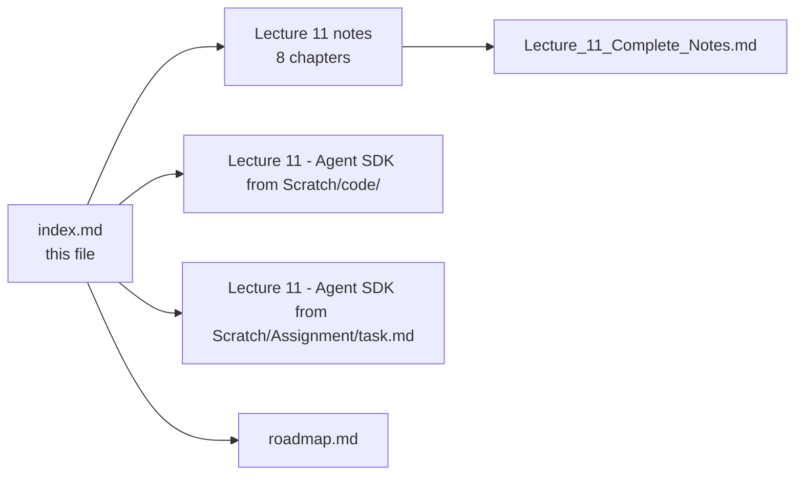

--

## 📚 Lecture 12 — Vector Embeddings

**7 chapters**
**Folder:** [📂 ./Lecture 12 - Vector Embeddings/](./Lecture%2012%20-%20Vector%20Embeddings/) · [📄 Roadmap](./roadmap.md)

| # | Chapter | One-line summary | Notes |
| :---: | :--- | :--- | :--- |
| **01** | **The Problem of Meaning in Computers** | Symbols ≠ meaning; identity matching vs semantic similarity; why math requires vectors | [📄 Chapter 01](./Lecture%2012%20-%20Vector%20Embeddings/notes/01_the_problem_of_meaning_in_computers.md) |
| **02** | **From Numbers to Vectors** | Building feature spaces (1D → 2D → ND); vector order; dimensions; vector space | [📄 Chapter 02](./Lecture%2012%20-%20Vector%20Embeddings/notes/02_from_numbers_to_vectors.md) |
| **03** | **Measuring Similarity Between Vectors** | Euclidean (L2), Manhattan (L1), Dot Product, Cosine; when to use each | [📄 Chapter 03](./Lecture%2012%20-%20Vector%20Embeddings/notes/03_measuring_similarity_between_vectors.md) |
| **04** | **The Failure of Hand Crafted Features** | One-hot, BoW, TF-IDF limitations; interpretability trap; embedding vs generative LLM | [📄 Chapter 04](./Lecture%2012%20-%20Vector%20Embeddings/notes/04_the_failure_of_hand_crafted_features.md) |
| **05** | **What Are Embeddings Learning Representations** | Learned representations; "company it keeps"; vector arithmetic (king − man + woman ≈ queen); latent features | [📄 Chapter 05](./Lecture%2012%20-%20Vector%20Embeddings/notes/05_what_are_embeddings_learning_representations.md) |
| **06** | **Vector vs Embedding and Applications** | Vector vs embedding distinction; semantic search, recommendation, clustering, classification, RAG; common models & dimensions | [📄 Chapter 06](./Lecture%2012%20-%20Vector%20Embeddings/notes/06_vector_vs_embedding_and_applications.md) |
| **07** | **The Complete Journey Synthesis** | Full progression synthesis; definitive definition; end-to-end RAG example; geometry encodes semantics | [📄 Chapter 07](./Lecture%2012%20-%20Vector%20Embeddings/notes/07_the_complete_journey_synthesis.md) |

### 🧩 Lecture artefacts

| Artefact | Link | Status |
| :--- | :--- | :---: |
| Lecture workspace README (objectives · level · source mapping · checklist) | [📄 README.md](./Lecture%2012%20-%20Vector%20Embeddings/README.md) | ✅ |
| Basic Code — the lecture's runnable codebase | [📂 code/Basic Code](./Lecture%2012%20-%20Vector%20Embeddings/code/Basic%20Code/) | ✅ |
| Assignment — chapter-wise questions, build tasks and completion gate | [📝 Assignment/task.md](./Lecture%2012%20-%20Vector%20Embeddings/Assignment/task.md) | ✅ |

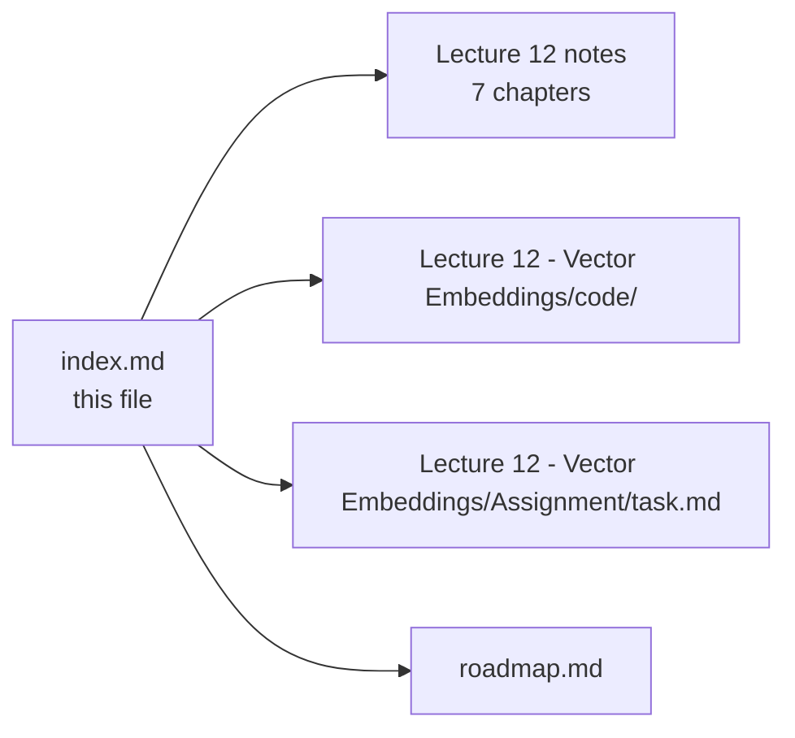

--

## 📚 Lecture 13 — Semantic Search Project

**6 chapters** + 1 consolidated document
**Folder:** [📂 ./Lecture 13 - Semantic Search Project/](./Lecture%2013%20-%20Semantic%20Search%20Project/) · [📄 Roadmap](./roadmap.md)

| # | Chapter | One-line summary | Notes |
| :---: | :--- | :--- | :--- |
| **01** | **Embeddings and the Problem of Meaning** | Why keyword search fails on intent and how dense embeddings capture semantic meaning. | [📄 Chapter 01](./Lecture%2013%20-%20Semantic%20Search%20Project/notes/01_embeddings_and_the_problem_of_meaning.md) |
| **02** | **Why Embeddings Beat LLM for Search** | Precomputing embeddings is cheaper and faster than asking an LLM to rank every document. | [📄 Chapter 02](./Lecture%2013%20-%20Semantic%20Search%20Project/notes/02_why_embeddings_beat_llm_for_search.md) |
| **03** | **Precomputation Engineering Insight** | Indexing embeddings once and reusing them across many queries — the offline/online split. | [📄 Chapter 03](./Lecture%2013%20-%20Semantic%20Search%20Project/notes/03_precomputation_engineering_insight.md) |
| **05** | **Cosine Similarity Measuring Closeness** | The cosine similarity metric, how it ranks candidates, and its limits. | [📄 Chapter 05](./Lecture%2013%20-%20Semantic%20Search%20Project/notes/05_cosine_similarity_measuring_closeness.md) |
| **06** | **Represent Store Compare Rank Mental Model** | The four-stage retrieval loop — represent, store, compare, rank. | [📄 Chapter 06](./Lecture%2013%20-%20Semantic%20Search%20Project/notes/06_represent_store_compare_rank_mental_model.md) |
| **07** | **Complete System Design** | End-to-end semantic search architecture from corpus to ranked results. | [📄 Chapter 07](./Lecture%2013%20-%20Semantic%20Search%20Project/notes/07_complete_system_design.md) |

### 📄 Consolidated notes

A single document combining all 6 chapters — executive summary, cheat sheet, decision tables, misconceptions, glossary and self-check questions, with links back into the chapters for detail:

👉 **[Lecture_13_Complete_Notes.md](./Lecture%2013%20-%20Semantic%20Search%20Project/notes/Lecture_13_Complete_Notes.md)**

### 🧩 Lecture artefacts

| Artefact | Link | Status |
| :--- | :--- | :---: |
| Lecture workspace README (objectives · level · source mapping · checklist) | [📄 README.md](./Lecture%2013%20-%20Semantic%20Search%20Project/README.md) | ✅ |
| Basic Code — the lecture's runnable codebase | [📂 code/Basic Code](./Lecture%2013%20-%20Semantic%20Search%20Project/code/Basic%20Code/) | ✅ |
| Assignment — chapter-wise questions, build tasks and completion gate | [📝 Assignment/task.md](./Lecture%2013%20-%20Semantic%20Search%20Project/Assignment/task.md) | ✅ |

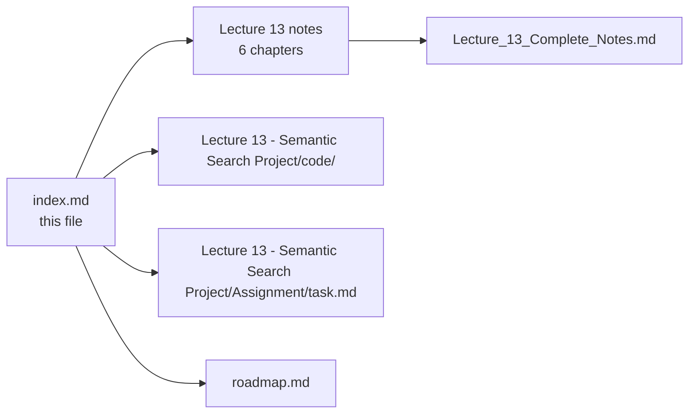

--

## 📚 Lecture 14 — Vector Search and Storage

**8 chapters** + 1 consolidated document
**Folder:** [📂 ./Lecture 14 - Vector Search and Storage/](./Lecture%2014%20-%20Vector%20Search%20and%20Storage/) · [📄 Roadmap](./roadmap.md)

| # | Chapter | One-line summary | Notes |
| :---: | :--- | :--- | :--- |
| **01** | **The Scale Wall** | Why brute-force vector search does not scale past small corpora. | [📄 Chapter 01](./Lecture%2014%20-%20Vector%20Search%20and%20Storage/notes/01_The_Scale_Wall.md) |
| **02** | **Why Relational Databases Are Not Enough** | Why B-tree indexes cannot efficiently search high-dimensional vector space. | [📄 Chapter 02](./Lecture%2014%20-%20Vector%20Search%20and%20Storage/notes/02_Why_Relational_Databases_Are_Not_Enough.md) |
| **03** | **Anatomy of a Vector Database** | The storage, indexing, metadata-filtering and query-execution layers of a vector database. | [📄 Chapter 03](./Lecture%2014%20-%20Vector%20Search%20and%20Storage/notes/03_Anatomy_of_a_Vector_Database.md) |
| **04** | **Brute Force KNN the Correct Baseline** | Exact k-nearest neighbors as the correctness reference, and its O(n) cost. | [📄 Chapter 04](./Lecture%2014%20-%20Vector%20Search%20and%20Storage/notes/04_Brute_Force_KNN_The_Correct_Baseline.md) |
| **05** | **Indexes and Why Scalar Indexes Fail for Vectors** | Why B-trees/LSM-trees designed for scalars break down on vectors. | [📄 Chapter 05](./Lecture%2014%20-%20Vector%20Search%20and%20Storage/notes/05_Indexes_and_Why_Scalar_Indexes_Fail_for_Vectors.md) |
| **06** | **The Curse of Dimensionality** | How distance measures lose discriminative power as dimensions grow. | [📄 Chapter 06](./Lecture%2014%20-%20Vector%20Search%20and%20Storage/notes/06_The_Curse_of_Dimensionality.md) |
| **07** | **Approximate Nearest Neighbor Indexes** | ANN algorithms that trade a little recall for massive speed. | [📄 Chapter 07](./Lecture%2014%20-%20Vector%20Search%20and%20Storage/notes/07_Approximate_Nearest_Neighbor_Indexes.md) |
| **08** | **Production Vector Search Design** | Capacity planning, sharding, replication and operating vector search in production. | [📄 Chapter 08](./Lecture%2014%20-%20Vector%20Search%20and%20Storage/notes/08_Production_Vector_Search_Design.md) |

### 📄 Consolidated notes

A single document combining all 8 chapters — executive summary, cheat sheet, decision tables, misconceptions, glossary and self-check questions, with links back into the chapters for detail:

👉 **[Lecture_14_Complete_Notes.md](./Lecture%2014%20-%20Vector%20Search%20and%20Storage/notes/Lecture_14_Complete_Notes.md)**

### 🧩 Lecture artefacts

| Artefact | Link | Status |
| :--- | :--- | :---: |
| Lecture workspace README (objectives · level · source mapping · checklist) | [📄 README.md](./Lecture%2014%20-%20Vector%20Search%20and%20Storage/README.md) | ✅ |
| Basic Code — the lecture's runnable codebase | [📂 code/Basic Code](./Lecture%2014%20-%20Vector%20Search%20and%20Storage/code/Basic%20Code/) | ✅ |
| Assignment — chapter-wise questions, build tasks and completion gate | [📝 Assignment/task.md](./Lecture%2014%20-%20Vector%20Search%20and%20Storage/Assignment/task.md) | ✅ |

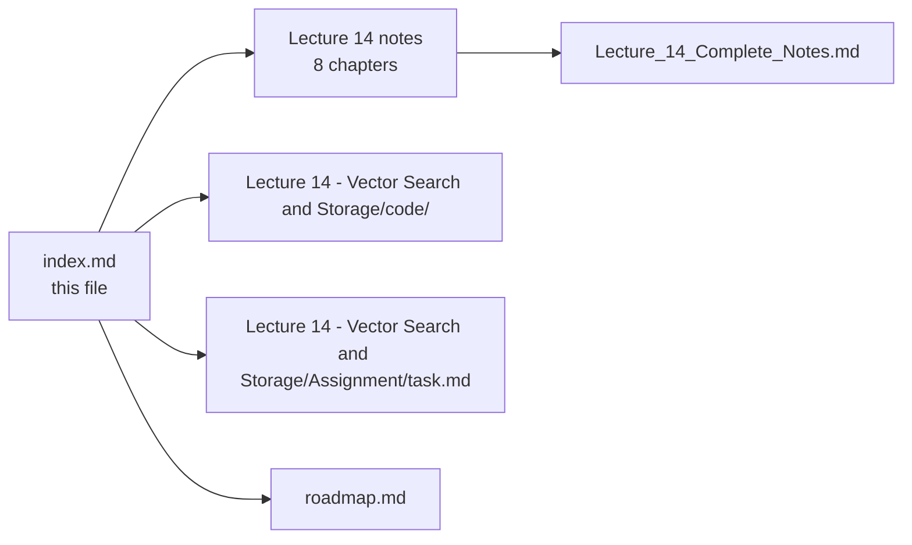

--

## 📚 Lecture 15 — Vector Databases and ANN

**5 chapters** + 1 consolidated document
**Folder:** [📂 ./Lecture 15 - Vector Databases and ANN/](./Lecture%2015%20-%20Vector%20Databases%20and%20ANN/) · [📄 Roadmap](./roadmap.md)

| # | Chapter | One-line summary | Notes |
| :---: | :--- | :--- | :--- |
| **01** | **Vector Database Architecture and the Five Layers** | API → Query Engine → Filtering → Index → Storage; the record model `id + vector + payload`; pre-/post-/filter-aware search modes. | [📄 Chapter 01](./Lecture%2015%20-%20Vector%20Databases%20and%20ANN/notes/01_Vector_Database_Architecture_and_the_Five_Layers.md) |
| **02** | **IVF Inverted File Index** | k-means centroids partition space into lists; query probes nprobe lists; boundary problem; nlist/nprobe tuning; IVF-Flat/PQ/SQ. | [📄 Chapter 02](./Lecture%2015%20-%20Vector%20Databases%20and%20ANN/notes/02_IVF_Inverted_File_Index.md) |
| **03** | **HNSW Hierarchical Navigable Small World** | Multi-layer proximity graph; greedy descent + best-first search; M/M0/efConstruction/efSearch; memory, build cost, tombstones, filtered-search weakness. | [📄 Chapter 03](./Lecture%2015%20-%20Vector%20Databases%20and%20ANN/notes/03_HNSW_Hierarchical_Navigable_Small_World.md) |
| **04** | **Product Quantization and Vector Compression** | Split→codebooks→codes; ADC table-lookup search; memory math (~128×); int8/binary comparison; IVF-PQ / HNSW+PQ combinations. | [📄 Chapter 04](./Lecture%2015%20-%20Vector%20Databases%20and%20ANN/notes/04_Product_Quantization_and_Vector_Compression.md) |
| **05** | **Vector Database Engine Decisions and Production Operations** | pgvector vs Qdrant vs Milvus; hybrid search & RRF; sharding, replication, versioning; production RAG runbook; DiskANN & vendor landscape. | [📄 Chapter 05](./Lecture%2015%20-%20Vector%20Databases%20and%20ANN/notes/05_Vector_Database_Engine_Decisions_and_Production_Operations.md) |

### 📄 Consolidated notes

A single document combining all 5 chapters — executive summary, cheat sheet, decision tables, misconceptions, glossary and self-check questions, with links back into the chapters for detail:

👉 **[Lecture_15_Complete_Notes.md](./Lecture%2015%20-%20Vector%20Databases%20and%20ANN/notes/Lecture_15_Complete_Notes.md)**

### 🧩 Lecture artefacts

| Artefact | Link | Status |
| :--- | :--- | :---: |
| Lecture workspace README (objectives · level · source mapping · checklist) | [📄 README.md](./Lecture%2015%20-%20Vector%20Databases%20and%20ANN/README.md) | ✅ |
| Basic Code — the lecture's runnable codebase | [📂 code/Basic Code](./Lecture%2015%20-%20Vector%20Databases%20and%20ANN/code/Basic%20Code/) | ✅ |
| Assignment — chapter-wise questions, build tasks and completion gate | [📝 Assignment/task.md](./Lecture%2015%20-%20Vector%20Databases%20and%20ANN/Assignment/task.md) | ✅ |

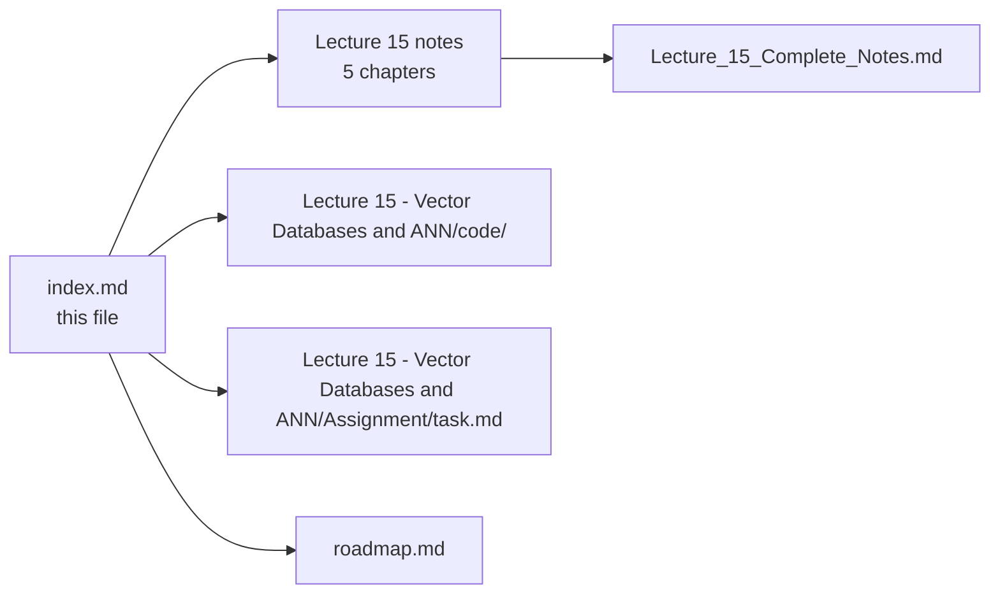

--

## 📚 Lecture 16 — RAG

**9 chapters**
**Folder:** [📂 ./Lecture 16 - RAG/](./Lecture%2016%20-%20RAG/) · [📄 Roadmap](./roadmap.md)

| # | Chapter | One-line summary | Notes |
| :---: | :--- | :--- | :--- |
| **01** | **RAG Fundamentals Stateless Model** | Parametric vs non-parametric memory; why LLMs cannot answer private/recent/proprietary questions; hallucination as expected behaviour outside evidence. | [📄 Chapter 01](./Lecture%2016%20-%20RAG/notes/01_rag_fundamentals_stateless_model.md) |
| **02** | **Open Book Architecture Two Pipelines** | Two pipelines (ingestion offline, serving online); the seven-step query path; why "put the policy in the system prompt" is not RAG. | [📄 Chapter 02](./Lecture%2016%20-%20RAG/notes/02_open_book_architecture_two_pipelines.md) |
| **03** | **Ingestion Documents to Chunks** | PDF extraction hazards, cleaning, chunking with size + overlap, metadata for citation/filtering, content-addressed deterministic ids, idempotent re-ingestion. | [📄 Chapter 03](./Lecture%2016%20-%20RAG/notes/03_ingestion_documents_to_chunks.md) |
| **04** | **Embeddings at Query Time** | One model, one dimension, identical preprocessing at ingest and query; the embedding model as a coordinate system; silent failure when spaces differ. | [📄 Chapter 04](./Lecture%2016%20-%20RAG/notes/04_embeddings_at_query_time.md) |
| **05** | **Vector Index Retrieval Engine** | Record model `id + vector + metadata`; namespaces for isolation; ANN top-K + metadata filter; score floor; dedupe per document; keep top-K. | [📄 Chapter 05](./Lecture%2016%20-%20RAG/notes/05_vector_index_retrieval_engine.md) |
| **06** | **Grounded Generation Prompt Contract** | Role + verbatim context + `[n]` citation grammar + explicit refusal; answer only from context; verify citations against chunks in the prompt. | [📄 Chapter 06](./Lecture%2016%20-%20RAG/notes/06_grounded_generation_prompt_contract.md) |
| **07** | **Conversation State Memory** | Session history per `sessionId`; query rewriting to stand-alone questions; bounded history; tenant isolation on sessions. | [📄 Chapter 07](./Lecture%2016%20-%20RAG/notes/07_conversation_state_memory.md) |
| **08** | **Evaluation Debugging** | Goldenset of question → gold chunk pairs; Hit Rate @ K and Recall @ K; refusal testing; CI regression gate with baseline. | [📄 Chapter 08](./Lecture%2016%20-%20RAG/notes/08_evaluation_debugging.md) |
| **09** | **Production System Design** | Four layers (presentation, application, data, infrastructure); tenant isolation in query filter; cost control via topK/prompt/output caps; four escape questions. | [📄 Chapter 09](./Lecture%2016%20-%20RAG/notes/09_production_system_design.md) |

### 🧩 Lecture artefacts

| Artefact | Link | Status |
| :--- | :--- | :---: |
| Lecture workspace README (objectives · level · source mapping · checklist) | [📄 README.md](./Lecture%2016%20-%20RAG/README.md) | ✅ |
| Basic Code — the lecture's runnable codebase | [📂 code/Basic Code](./Lecture%2016%20-%20RAG/code/Basic%20Code/) | ✅ |
| Assignment — chapter-wise questions, build tasks and completion gate | [📝 Assignment/task.md](./Lecture%2016%20-%20RAG/Assignment/task.md) | ✅ |

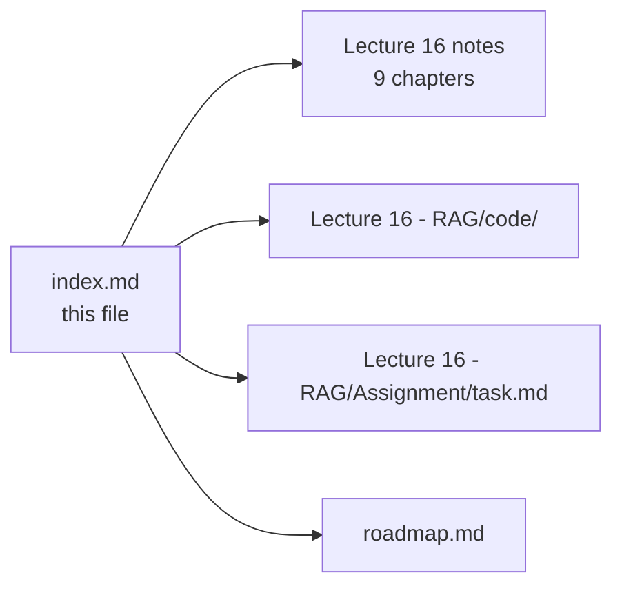

--

## 📚 Lecture 17 — Advanced RAG

**8 chapters** + 1 consolidated document
**Folder:** [📂 ./Lecture 17 - Advanced RAG/](./Lecture%2017%20-%20Advanced%20RAG/) · [📄 Roadmap](./roadmap.md)

| # | Chapter | One-line summary | Notes |
| :---: | :--- | :--- | :--- |
| **01** | **Why Basic RAG Breaks** | Query mismatch, distance mismatch and the failure modes that survive correct basic RAG. | [📄 Chapter 01](./Lecture%2017%20-%20Advanced%20RAG/notes/01_Why_Basic_RAG_Breaks.md) |
| **02** | **Chunking Strategies** | Fixed-size, structural, semantic, contextual and parent-child chunking with overlap arithmetic. | [📄 Chapter 02](./Lecture%2017%20-%20Advanced%20RAG/notes/02_Chunking_Strategies.md) |
| **03** | **Retrieval Controls** | Top-K, similarity thresholds, score floors and metadata filtering. | [📄 Chapter 03](./Lecture%2017%20-%20Advanced%20RAG/notes/03_Retrieval_Controls.md) |
| **04** | **Hybrid Search and Rrf** | Fusing dense and sparse retrieval with Reciprocal Rank Fusion. | [📄 Chapter 04](./Lecture%2017%20-%20Advanced%20RAG/notes/04_Hybrid_Search_and_RRF.md) |
| **05** | **Reranking Two Stage Retrieval** | Cross-encoders as second-stage rankers to lift the recall ceiling. | [📄 Chapter 05](./Lecture%2017%20-%20Advanced%20RAG/notes/05_Reranking_Two_Stage_Retrieval.md) |
| **06** | **Query Processing** | Query rewriting, step-back prompting, sub-query decomposition and HyDE. | [📄 Chapter 06](./Lecture%2017%20-%20Advanced%20RAG/notes/06_Query_Processing.md) |
| **07** | **Context Engineering** | Ordering, compression, budget allocation and lost-in-the-middle mitigation. | [📄 Chapter 07](./Lecture%2017%20-%20Advanced%20RAG/notes/07_Context_Engineering.md) |
| **08** | **Production RAG** | Guardrails, CRAG evaluation, async indexing and the production playbook. | [📄 Chapter 08](./Lecture%2017%20-%20Advanced%20RAG/notes/08_Production_RAG.md) |

### 📄 Consolidated notes

A single document combining all 8 chapters — executive summary, cheat sheet, decision tables, misconceptions, glossary and self-check questions, with links back into the chapters for detail:

👉 **[Lecture_17_Complete_Notes.md](./Lecture%2017%20-%20Advanced%20RAG/notes/Lecture_17_Complete_Notes.md)**

### 🧩 Lecture artefacts

| Artefact | Link | Status |
| :--- | :--- | :---: |
| Lecture workspace README (objectives · level · source mapping · checklist) | [📄 README.md](./Lecture%2017%20-%20Advanced%20RAG/README.md) | ✅ |
| Basic Code — the lecture's runnable codebase | [📂 code/Basic Code](./Lecture%2017%20-%20Advanced%20RAG/code/Basic%20Code/) | ✅ |
| Assignment — chapter-wise questions, build tasks and completion gate | [📝 Assignment/task.md](./Lecture%2017%20-%20Advanced%20RAG/Assignment/task.md) | ✅ |


--

## 📚 Lecture 18 — Vectorless RAG and LLM Wiki

**7 chapters** + 1 consolidated document
**Folder:** [📂 ./Lecture 18 - Vectorless RAG and LLM Wiki/](./Lecture%2018%20-%20Vectorless%20RAG%20and%20LLM%20Wiki/) · [📄 Roadmap](./roadmap.md)

| # | Chapter | One-line summary | Notes |
| :---: | :--- | :--- | :--- |
| **01** | **Limitations Vector RAG Chunking** | Fixed-size token chunking breaks logical boundaries; similarity score does not guarantee relevance. | [📄 Chapter 01](./Lecture%2018%20-%20Vectorless%20RAG%20and%20LLM%20Wiki/notes/01_limitations_vector_rag_chunking.md) |
| **02** | **Vectorless RAG Tree Indexing** | Documents become hierarchical trees (chapter → section → page) instead of flat vector chunks. | [📄 Chapter 02](./Lecture%2018%20-%20Vectorless%20RAG%20and%20LLM%20Wiki/notes/02_vectorless_rag_tree_indexing.md) |
| **03** | **Agentic Tree Search LLM Relevance** | An LLM navigation agent walks the tree branch by branch, pruning irrelevant sections before loading content. | [📄 Chapter 03](./Lecture%2018%20-%20Vectorless%20RAG%20and%20LLM%20Wiki/notes/03_agentic_tree_search_llm_relevance.md) |
| **04** | **LLM Wiki Librarian Architecture** | The LLM acts as a background librarian: organize, summarize, tag, link into a human-readable Markdown vault. | [📄 Chapter 04](./Lecture%2018%20-%20Vectorless%20RAG%20and%20LLM%20Wiki/notes/04_llm_wiki_librarian_architecture.md) |
| **05** | **Two Pass Retrieval Lazy Loading** | Pass 1 scans lightweight metadata; Pass 2 loads full content only for selected documents. | [📄 Chapter 05](./Lecture%2018%20-%20Vectorless%20RAG%20and%20LLM%20Wiki/notes/05_two_pass_retrieval_lazy_loading.md) |
| **06** | **System Comparison Hybrid RAG** | Vector RAG vs Vectorless RAG vs LLM Wiki compared across structure, retrieval, context, cost and accuracy. | [📄 Chapter 06](./Lecture%2018%20-%20Vectorless%20RAG%20and%20LLM%20Wiki/notes/06_system_comparison_hybrid_rag.md) |
| **07** | **Decision Framework Production Architecture** | When to choose each architecture; hybrid combines vector pre-filtering with tree navigation. | [📄 Chapter 07](./Lecture%2018%20-%20Vectorless%20RAG%20and%20LLM%20Wiki/notes/07_decision_framework_production_architecture.md) |

### 📄 Consolidated notes

A single document combining all 7 chapters — executive summary, cheat sheet, decision tables, misconceptions, glossary and self-check questions, with links back into the chapters for detail:

👉 **[Lecture_18_Complete_Notes.md](./Lecture%2018%20-%20Vectorless%20RAG%20and%20LLM%20Wiki/notes/Lecture_18_Complete_Notes.md)**

### 🧩 Lecture artefacts

| Artefact | Link | Status |
| :--- | :--- | :---: |
| Lecture workspace README (objectives · level · source mapping · checklist) | [📄 README.md](./Lecture%2018%20-%20Vectorless%20RAG%20and%20LLM%20Wiki/README.md) | ✅ |
| Basic Code — the lecture's runnable codebase | [📂 code/Basic Code](./Lecture%2018%20-%20Vectorless%20RAG%20and%20LLM%20Wiki/code/Basic%20Code/) | ✅ |
| Assignment — chapter-wise questions, build tasks and completion gate | [📝 Assignment/task.md](./Lecture%2018%20-%20Vectorless%20RAG%20and%20LLM%20Wiki/Assignment/task.md) | ✅ |

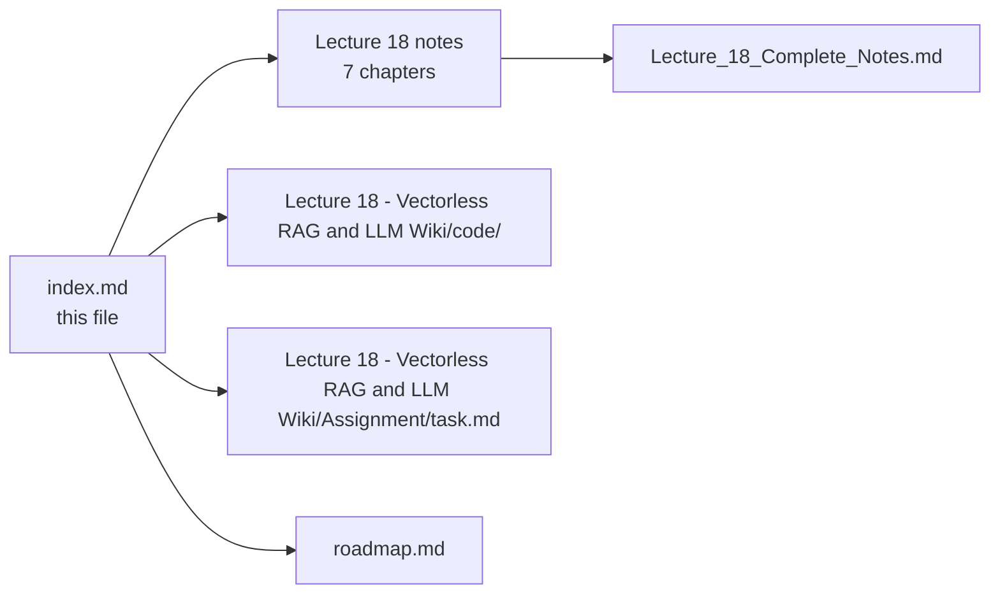

--

## 📚 Lecture 19 — Agent Memory Systems

**8 chapters** + 1 consolidated document
**Folder:** [📂 ./Lecture 19 - Agent Memory Systems/](./Lecture%2019%20-%20Agent%20Memory%20Systems/) · [📄 Roadmap](./roadmap.md)

| # | Chapter | One-line summary | Notes |
| :---: | :--- | :--- | :--- |
| **01** | **Stateless LLM Apis and Context Window Limitations** | LLM APIs are stateless; the application must store, manage and selectively send conversation context with every request. | [📄 Chapter 01](./Lecture%2019%20-%20Agent%20Memory%20Systems/notes/01_Stateless_LLM_APIs_and_Context_Window_Limitations.md) |
| **02** | **Short Term Memory and Sliding Windows** | Sliding windows keep only the last N turns so context stays bounded while preserving conversational continuity. | [📄 Chapter 02](./Lecture%2019%20-%20Agent%20Memory%20Systems/notes/02_Short_Term_Memory_and_Sliding_Windows.md) |
| **03** | **Long Term Memory Taxonomy and Fact Extraction** | Semantic, episodic and graph memory store persistent facts; an LLM-based extraction pipeline turns raw conversation into curated memories. | [📄 Chapter 03](./Lecture%2019%20-%20Agent%20Memory%20Systems/notes/03_Long_Term_Memory_Taxonomy_and_Fact_Extraction.md) |
| **04** | **Dynamic Context Assembly Stm Ltm RAG Query** | Combines STM, retrieved LTM facts and the current Query into one LLM prompt inside a token budget. | [📄 Chapter 04](./Lecture%2019%20-%20Agent%20Memory%20Systems/notes/04_Dynamic_Context_Assembly_Stm_Ltm_Rag_Query.md) |
| **05** | **Memory Eviction Contradiction Resolution and Decay** | Memory scoring (frequency + recency) identifies eviction candidates; contradiction resolution keeps newer/high-confidence facts. | [📄 Chapter 05](./Lecture%2019%20-%20Agent%20Memory%20Systems/notes/05_Memory_Eviction_Contradiction_Resolution_and_Decay.md) |
| **06** | **Claude Style Memory Dreaming and Background Reflection** | A background reflection process cleans duplicates, contradictions and stale memories without blocking the user request path. | [📄 Chapter 06](./Lecture%2019%20-%20Agent%20Memory%20Systems/notes/06_Claude_Style_Memory_Dreaming_and_Background_Reflection.md) |
| **07** | **Managed Memory Mem0 Multi Tenancy Privacy Compliance** | mem0 abstracts memory storage/retrieval; every operation enforces userId isolation, encryption, consent and deletion. | [📄 Chapter 07](./Lecture%2019%20-%20Agent%20Memory%20Systems/notes/07_Managed_Memory_mem0_Multi_Tenancy_Privacy_Compliance.md) |
| **08** | **Production Memory System Architecture** | Three-layer design (API / Memory / Background) with token budgeting, caching, monitoring and operational best practices. | [📄 Chapter 08](./Lecture%2019%20-%20Agent%20Memory%20Systems/notes/08_Production_Memory_System_Architecture.md) |

### 📄 Consolidated notes

A single document combining all 8 chapters — executive summary, cheat sheet, decision tables, misconceptions, glossary and self-check questions, with links back into the chapters for detail:

👉 **[Lecture_19_Complete_Notes.md](./Lecture%2019%20-%20Agent%20Memory%20Systems/notes/Lecture_19_Complete_Notes.md)**

### 🧩 Lecture artefacts

| Artefact | Link | Status |
| :--- | :--- | :---: |
| Lecture workspace README (objectives · level · source mapping · checklist) | [📄 README.md](./Lecture%2019%20-%20Agent%20Memory%20Systems/README.md) | ✅ |
| Basic Code — the lecture's runnable codebase | [📂 code/Basic Code](./Lecture%2019%20-%20Agent%20Memory%20Systems/code/Basic%20Code/) | ✅ |
| Assignment — chapter-wise questions, build tasks and completion gate | [📝 Assignment/task.md](./Lecture%2019%20-%20Agent%20Memory%20Systems/Assignment/task.md) | ✅ |

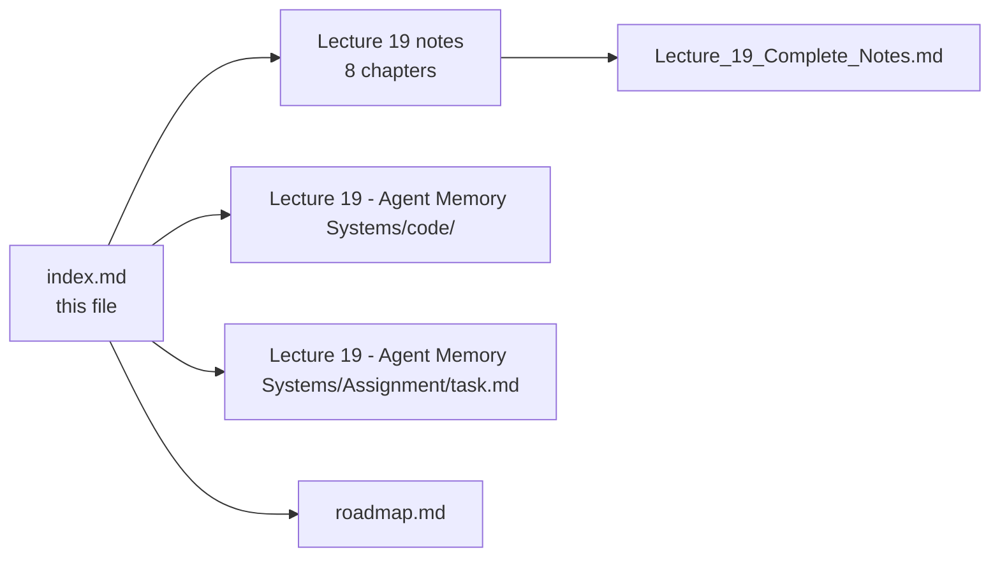

--

## 📚 Lecture 20 — Graph Databases and GraphRAG

**8 chapters** + 1 consolidated document
**Folder:** [📂 ./Lecture 20 - Graph Databases and GraphRAG/](./Lecture%2020%20-%20Graph%20Databases%20and%20GraphRAG/) · [📄 Roadmap](./roadmap.md)

| # | Chapter | One-line summary | Notes |
| :---: | :--- | :--- | :--- |
| **01** | **Graph Database Fundamentals** | Nodes, relationships, properties and the property graph model. | [📄 Chapter 01](./Lecture%2020%20-%20Graph%20Databases%20and%20GraphRAG/notes/01_Graph_Database_Fundamentals.md) |
| **02** | **Cypher Query Language** | Reading and writing graph data with Cypher patterns and clauses. | [📄 Chapter 02](./Lecture%2020%20-%20Graph%20Databases%20and%20GraphRAG/notes/02_Cypher_Query_Language.md) |
| **03** | **NEO4J Architecture Deployment LLM Cypher** | Neo4j internals and generating Cypher from LLMs. | [📄 Chapter 03](./Lecture%2020%20-%20Graph%20Databases%20and%20GraphRAG/notes/03_Neo4j_Architecture_Deployment_LLM_Cypher.md) |
| **04** | **NEO4J NODEJS Driver** | Connecting a Node.js/TypeScript app to Neo4j and executing queries. | [📄 Chapter 04](./Lecture%2020%20-%20Graph%20Databases%20and%20GraphRAG/notes/04_Neo4j_NodeJS_Driver.md) |
| **05** | **Advanced Graph Modeling Graphrag Memory** | Modeling entities and relations for retrieval-augmented generation. | [📄 Chapter 05](./Lecture%2020%20-%20Graph%20Databases%20and%20GraphRAG/notes/05_Advanced_Graph_Modeling_GraphRAG_Memory.md) |
| **06** | **Graphrag Hybrid Retrieval** | Combining graph traversal with vector and lexical search. | [📄 Chapter 06](./Lecture%2020%20-%20Graph%20Databases%20and%20GraphRAG/notes/06_GraphRAG_Hybrid_Retrieval.md) |
| **07** | **AI Agent Memory Systems** | Using graphs as long-term, structured agent memory. | [📄 Chapter 07](./Lecture%2020%20-%20Graph%20Databases%20and%20GraphRAG/notes/07_AI_Agent_Memory_Systems.md) |
| **08** | **End to End Cognitive Memory App** | A full graph-based cognitive memory application. | [📄 Chapter 08](./Lecture%2020%20-%20Graph%20Databases%20and%20GraphRAG/notes/08_End_to_End_Cognitive_Memory_App.md) |

### 📄 Consolidated notes

A single document combining all 8 chapters — executive summary, cheat sheet, decision tables, misconceptions, glossary and self-check questions, with links back into the chapters for detail:

👉 **[Lecture_20_Complete_Notes.md](./Lecture%2020%20-%20Graph%20Databases%20and%20GraphRAG/notes/Lecture_20_Complete_Notes.md)**

### 🧩 Lecture artefacts

| Artefact | Link | Status |
| :--- | :--- | :---: |
| Lecture workspace README (objectives · level · source mapping · checklist) | [📄 README.md](./Lecture%2020%20-%20Graph%20Databases%20and%20GraphRAG/README.md) | ✅ |
| Basic Code — the lecture's runnable codebase | [📂 code/Basic Code](./Lecture%2020%20-%20Graph%20Databases%20and%20GraphRAG/code/Basic%20Code/) | ✅ |
| Assignment — chapter-wise questions, build tasks and completion gate | [📝 Assignment/task.md](./Lecture%2020%20-%20Graph%20Databases%20and%20GraphRAG/Assignment/task.md) | ✅ |

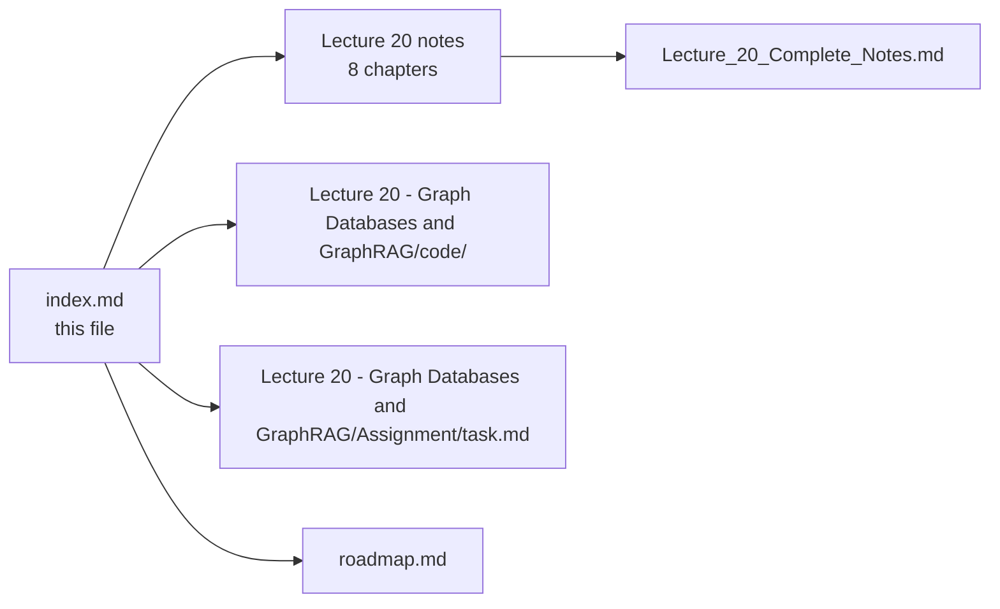

--

## 📚 Lecture 21 — MCP Core

**8 chapters** + 1 consolidated document
**Folder:** [📂 ./Lecture 21 - MCP Core/](./Lecture%2021%20-%20MCP%20Core/) · [📄 Roadmap](./roadmap.md)

| # | Chapter | One-line summary | Notes |
| :---: | :--- | :--- | :--- |
| **01** | **The Integration Problem and Why Standards Win** | N × M bespoke integrations scale badly; one protocol scales as N + M. | [📄 Chapter 01](./Lecture%2021%20-%20MCP%20Core/notes/01_The_Integration_Problem_and_Why_Standards_Win.md) |
| **02** | **What MCP is Protocol Server and Standard Interface** | MCP standardises *access*, not *capability*; a server needs no LLM. | [📄 Chapter 02](./Lecture%2021%20-%20MCP%20Core/notes/02_What_MCP_Is_Protocol_Server_and_Standard_Interface.md) |
| **03** | **MCP vs Tool Calling Complementary Layers** | Tool calling = selection (model); MCP = delivery (application/protocol). | [📄 Chapter 03](./Lecture%2021%20-%20MCP%20Core/notes/03_MCP_vs_Tool_Calling_Complementary_Layers.md) |
| **04** | **Host Client Server Architecture** | The core triad; one client per server; transports stdio + Streamable HTTP. | [📄 Chapter 04](./Lecture%2021%20-%20MCP%20Core/notes/04_Host_Client_Server_Architecture.md) |
| **05** | **The Tools Primitive** | Tool definitions (name, description, schema), discovery, invocation, errors. | [📄 Chapter 05](./Lecture%2021%20-%20MCP%20Core/notes/05_The_Tools_Primitive.md) |
| **06** | **Resources and Prompts** | Tools (do), Resources (know), Prompts (reuse); control model. | [📄 Chapter 06](./Lecture%2021%20-%20MCP%20Core/notes/06_Resources_and_Prompts.md) |
| **07** | **Discovery Invocation and Lifecycle** | End-to-end lifecycle; caching; context budget; diagnostics. | [📄 Chapter 07](./Lecture%2021%20-%20MCP%20Core/notes/07_Discovery_Invocation_and_Lifecycle.md) |
| **08** | **Security Production and Practical Architecture** | Security stays with the host; threat model, OAuth resource servers, production concerns. | [📄 Chapter 08](./Lecture%2021%20-%20MCP%20Core/notes/08_Security_Production_and_Practical_Architecture.md) |

### 📄 Consolidated notes

A single document combining all 8 chapters — executive summary, cheat sheet, decision tables, misconceptions, glossary and self-check questions, with links back into the chapters for detail:

👉 **[Lecture_21_Complete_Notes.md](./Lecture%2021%20-%20MCP%20Core/notes/Lecture_21_Complete_Notes.md)**

### 🧩 Lecture artefacts

| Artefact | Link | Status |
| :--- | :--- | :---: |
| Lecture workspace README (objectives · level · source mapping · checklist) | [📄 README.md](./Lecture%2021%20-%20MCP%20Core/README.md) | ✅ |
| Basic Code — the lecture's runnable codebase | [📂 code/Basic Code](./Lecture%2021%20-%20MCP%20Core/code/Basic%20Code/) | ✅ |
| Assignment — chapter-wise questions, build tasks and completion gate | [📝 Assignment/task.md](./Lecture%2021%20-%20MCP%20Core/Assignment/task.md) | ✅ |

```mermaid
flowchart LR
    IDX["index.md<br/>this file"] --> L21["Lecture 21 notes<br/>8 chapters"]
    L21 --> CN["Lecture_21_Complete_Notes.md"]
    IDX --> CODE["Lecture 21 - MCP Core/code/"]
    IDX --> ASG["Lecture 21 - MCP Core/Assignment/task.md"]
    IDX --> RM["roadmap.md"]
```

--

## 📚 Lecture 22 — MCP Resources Prompts and Gateway

**9 chapters** + 1 consolidated document
**Folder:** [📂 ./Lecture 22 - MCP Resources Prompts and Gateway/](./Lecture%2022%20-%20MCP%20Resources%20Prompts%20and%20Gateway/) · [📄 Roadmap](./roadmap.md)

| # | Chapter | One-line summary | Notes |
| :---: | :--- | :--- | :--- |
| **01** | **The Three Primitives and the Control Model** | Every capability is a Tool, Resource, or Prompt; who decides: model, application, or user. | [📄 Chapter 01](./Lecture%2022%20-%20MCP%20Resources%20Prompts%20and%20Gateway/notes/01_The_Three_Primitives_and_the_Control_Model.md) |
| **02** | **Why Resources Context as a First Class Primitive** | Context as a first-class primitive; why resources separate knowledge from action. | [📄 Chapter 02](./Lecture%2022%20-%20MCP%20Resources%20Prompts%20and%20Gateway/notes/02_Why_Resources_Context_as_a_First_Class_Primitive.md) |
| **03** | **Resource Discovery Reading and Anatomy** | The `resources/list`, `resources/read`, and `resources/templates/list` protocol; URI, MIME, and template anatomy. | [📄 Chapter 03](./Lecture%2022%20-%20MCP%20Resources%20Prompts%20and%20Gateway/notes/03_Resource_Discovery_Reading_and_Anatomy.md) |
| **04** | **Building Resources Static Dynamic and Templated** | `listResources()` + `readResource(uri)` for static strings, dynamic reads and templated variables. | [📄 Chapter 04](./Lecture%2022%20-%20MCP%20Resources%20Prompts%20and%20Gateway/notes/04_Building_Resources_Static_Dynamic_and_Templated.md) |
| **05** | **How the Application Chooses a Resource** | Selection strategies: user selection, application state, retrieval, LLM routing; fallback order and scoring. | [📄 Chapter 05](./Lecture%2022%20-%20MCP%20Resources%20Prompts%20and%20Gateway/notes/05_How_the_Application_Chooses_a_Resource.md) |
| **06** | **MCP Prompts Reusable Interaction Templates** | `prompts/list` + `prompts/get`; Prompts as message templates with arguments and client wiring. | [📄 Chapter 06](./Lecture%2022%20-%20MCP%20Resources%20Prompts%20and%20Gateway/notes/06_MCP_Prompts_Reusable_Interaction_Templates.md) |
| **07** | **Prompt Arguments Discovery and Client Wiring** | Argument schemas, validation against the declared JSON schema, and how a client discovers and fills them. | [📄 Chapter 07](./Lecture%2022%20-%20MCP%20Resources%20Prompts%20and%20Gateway/notes/07_Prompt_Arguments_Discovery_and_Client_Wiring.md) |
| **08** | **Bringing Tools Resources and Prompts Together** | End-to-end MCP flow: prompt → resources → tools → response; the gateway as the integration layer. | [📄 Chapter 08](./Lecture%2022%20-%20MCP%20Resources%20Prompts%20and%20Gateway/notes/08_Bringing_Tools_Resources_and_Prompts_Together.md) |
| **09** | **MCP Gateway Context Poisoning and Security** | Gateway filtering, routing, auth, audit; tool context poisoning vectors and the 4-part defence. | [📄 Chapter 09](./Lecture%2022%20-%20MCP%20Resources%20Prompts%20and%20Gateway/notes/09_MCP_Gateway_Context_Poisoning_and_Security.md) |

### 📄 Consolidated notes

A single document combining all 9 chapters — executive summary, cheat sheet, decision tables, misconceptions, glossary and self-check questions, with links back into the chapters for detail:

👉 **[Lecture_22_Complete_Notes.md](./Lecture%2022%20-%20MCP%20Resources%20Prompts%20and%20Gateway/notes/Lecture_22_Complete_Notes.md)**

### 🧩 Lecture artefacts

| Artefact | Link | Status |
| :--- | :--- | :---: |
| Lecture workspace README (objectives · level · source mapping · checklist) | [📄 README.md](./Lecture%2022%20-%20MCP%20Resources%20Prompts%20and%20Gateway/README.md) | ✅ |
| Basic Code — the lecture's runnable codebase | [📂 code/Basic Code](./Lecture%2022%20-%20MCP%20Resources%20Prompts%20and%20Gateway/code/Basic%20Code/) | ✅ |
| Production Code — defended serving layer | [📂 code/Production Code](./Lecture%2022%20-%20MCP%20Resources%20Prompts%20and%20Gateway/code/Production%20Code/) | ✅ |
| Assignment — chapter-wise questions, build tasks and completion gate | [📝 Assignment/task.md](./Lecture%2022%20-%20MCP%20Resources%20Prompts%20and%20Gateway/Assignment/task.md) | ✅ |

```mermaid
flowchart LR
    IDX["index.md<br/>this file"] --> L22["Lecture 22 notes<br/>9 chapters"]
    L22 --> CN["Lecture_22_Complete_Notes.md"]
    IDX --> CODE["Lecture 22 - MCP Resources Prompts and Gateway/code/"]
    IDX --> ASG["Lecture 22 - MCP Resources Prompts and Gateway/Assignment/task.md"]
    IDX --> RM["roadmap.md"]
```

--

## 📚 Lecture 23 — Claude Skills

**6 chapters** + 1 consolidated document
**Folder:** [📂 ./Lecture 23 - Claude Skills/](./Lecture%2023%20-%20Claude%20Skills/) · [📄 Roadmap](./roadmap.md)

| # | Chapter | One-line summary | Notes |
| :---: | :--- | :--- | :--- |
| **01** | **Introduction and Fundamentals of Claude Skills** | What Claude Skills are and how they extend Claude's capabilities. | [📄 Chapter 01](./Lecture%2023%20-%20Claude%20Skills/notes/01-introduction-and-fundamentals-of-claude-skills.md) |
| **02** | **Planning Design and Technical Requirements** | Designing a skill — inputs, outputs and technical constraints. | [📄 Chapter 02](./Lecture%2023%20-%20Claude%20Skills/notes/02-planning-design-and-technical-requirements.md) |
| **03** | **Testing Iteration and Evaluation Strategies** | Validating skill behavior and improving through evals. | [📄 Chapter 03](./Lecture%2023%20-%20Claude%20Skills/notes/03-testing-iteration-and-evaluation-strategies.md) |
| **04** | **Distribution Sharing and API Integration** | Publishing skills and calling them via API. | [📄 Chapter 04](./Lecture%2023%20-%20Claude%20Skills/notes/04-distribution-sharing-and-api-integration.md) |
| **05** | **Architecture Patterns and Troubleshooting** | Common skill architectures and debugging techniques. | [📄 Chapter 05](./Lecture%2023%20-%20Claude%20Skills/notes/05-architecture-patterns-and-troubleshooting.md) |
| **06** | **Resources Checklists and Reference Templates** | Reusable templates and checklists for skill authors. | [📄 Chapter 06](./Lecture%2023%20-%20Claude%20Skills/notes/06-resources-checklists-and-reference-templates.md) |

### 📄 Consolidated notes

A single document combining all 6 chapters — executive summary, cheat sheet, decision tables, misconceptions, glossary and self-check questions, with links back into the chapters for detail:

👉 **[Lecture_23_Complete_Notes.md](./Lecture%2023%20-%20Claude%20Skills/notes/Lecture_23_Complete_Notes.md)**

### 🧩 Lecture artefacts

| Artefact | Link | Status |
| :--- | :--- | :---: |
| Lecture workspace README (objectives · level · source mapping · checklist) | [📄 README.md](./Lecture%2023%20-%20Claude%20Skills/README.md) | ✅ |
| Basic Code — the lecture's runnable codebase | [📂 code/Basic Code](./Lecture%2023%20-%20Claude%20Skills/code/Basic%20Code/) | ✅ |
| Assignment — chapter-wise questions, build tasks and completion gate | [📝 Assignment/task.md](./Lecture%2023%20-%20Claude%20Skills/Assignment/task.md) | ✅ |

```mermaid
flowchart LR
    IDX["index.md<br/>this file"] --> L23["Lecture 23 notes<br/>6 chapters"]
    L23 --> CN["Lecture_23_Complete_Notes.md"]
    IDX --> CODE["Lecture 23 - Claude Skills/code/"]
    IDX --> ASG["Lecture 23 - Claude Skills/Assignment/task.md"]
    IDX --> RM["roadmap.md"]
```

--

## 📚 Lecture 24 — Multimodal AI

**10 chapters** + 1 consolidated document
**Folder:** [📂 ./Lecture 24 - Multimodal AI/](./Lecture%2024%20-%20Multimodal%20AI/) · [📄 Roadmap](./roadmap.md)

| # | Chapter | One-line summary | Notes |
| :---: | :--- | :--- | :--- |
| **01** | **Why Text Only AI is Not Enough** | The limits of text-only models and why vision, audio and video matter. | [📄 Chapter 01](./Lecture%2024%20-%20Multimodal%20AI/notes/01_Why_Text_Only_AI_Is_Not_Enough.md) |
| **02** | **What Multimodal Models Understand and OCR vs MLLM** | What models "see" — OCR for structured text versus MLLM for free-form understanding. | [📄 Chapter 02](./Lecture%2024%20-%20Multimodal%20AI/notes/02_What_Multimodal_Models_Understand_And_OCR_vs_MLLM.md) |
| **03** | **The Text Pipeline Recap** | Text → tokens → token IDs → vectors, with a reproducible pseudo-tokenizer. | [📄 Chapter 03](./Lecture%2024%20-%20Multimodal%20AI/notes/03_The_Text_Pipeline_Recap.md) |
| **04** | **Images Are Numbers Pixels Patches and Visual Embeddings** | Pixels → grid → patches → embeddings; fixed patch size and dimension arithmetic. | [📄 Chapter 04](./Lecture%2024%20-%20Multimodal%20AI/notes/04_Images_Are_Numbers_Pixels_Patches_And_Visual_Embeddings.md) |
| **05** | **Connecting Vision to Language Projection Position and Attention** | Projection layers, positional encoding, cross-attention; bridging vision and language spaces. | [📄 Chapter 05](./Lecture%2024%20-%20Multimodal%20AI/notes/05_Connecting_Vision_To_Language_Projection_Position_And_Attention.md) |
| **06** | **How Models Learn Vision Language Alignment** | Contrastive pretraining, instruction tuning, cosine similarity; image-description pairs. | [📄 Chapter 06](./Lecture%2024%20-%20Multimodal%20AI/notes/06_How_Models_Learn_Vision_Language_Alignment.md) |
| **07** | **The End to End Multimodal Pipeline** | The full multimodal request lifecycle; the /chat contract; application packages never interpret. | [📄 Chapter 07](./Lecture%2024%20-%20Multimodal%20AI/notes/07_The_End_To_End_Multimodal_Pipeline.md) |
| **08** | **Production Multimodal Systems Cost Security and Evaluation** | Token budgets, cost guards, untrusted-image middleware and security considerations. | [📄 Chapter 08](./Lecture%2024%20-%20Multimodal%20AI/notes/08_Production_Multimodal_Systems_Cost_Security_And_Evaluation.md) |
| **09** | **Multimodal Data Ingestion and Advanced RAG** | Ingesting images/audio/video/PDF/web; chunking and indexing strategies. | [📄 Chapter 09](./Lecture%2024%20-%20Multimodal%20AI/notes/09_Multimodal_Data_Ingestion_And_Advanced_RAG.md) |
| **10** | **Multimodal RAG and Complete Picture** | Multimodal retrieval, the RAG pipeline, cost/latency reports and an evaluation harness. | [📄 Chapter 10](./Lecture%2024%20-%20Multimodal%20AI/notes/10_Multimodal_RAG_And_Complete_Picture.md) |

### 📄 Consolidated notes

A single document combining all 10 chapters — executive summary, cheat sheet, decision tables, misconceptions, glossary and self-check questions, with links back into the chapters for detail:

👉 **[Lecture_24_Complete_Notes.md](./Lecture%2024%20-%20Multimodal%20AI/notes/Lecture_24_Complete_Notes.md)**

### 🧩 Lecture artefacts

| Artefact | Link | Status |
| :--- | :--- | :---: |
| Lecture workspace README (objectives · level · source mapping · checklist) | [📄 README.md](./Lecture%2024%20-%20Multimodal%20AI/README.md) | ✅ |
| Basic Code — the lecture's runnable codebase | [📂 code/Basic Code](./Lecture%2024%20-%20Multimodal%20AI/code/Basic%20Code/) | ✅ |
| Assignment — chapter-wise questions, build tasks and completion gate | [📝 Assignment/task.md](./Lecture%2024%20-%20Multimodal%20AI/Assignment/task.md) | ✅ |

```mermaid
flowchart LR
    IDX["index.md<br/>this file"] --> L24["Lecture 24 notes<br/>10 chapters"]
    L24 --> CN["Lecture_24_Complete_Notes.md"]
    IDX --> CODE["Lecture 24 - Multimodal AI/code/"]
    IDX --> ASG["Lecture 24 - Multimodal AI/Assignment/task.md"]
    IDX --> RM["roadmap.md"]
```

--

## 📚 Lecture 25 — vLLM and PagedAttention

**8 chapters** + 1 consolidated document
**Folder:** [📂 ./Lecture 25 - vLLM and PagedAttention/](./Lecture%2025%20-%20vLLM%20and%20PagedAttention/) · [📄 Roadmap](./roadmap.md)

| # | Chapter | One-line summary | Notes |
| :---: | :--- | :--- | :--- |
| **01** | **LLM Hardware Mechanics: GPU VRAM, HBM, Memory Hierarchy** | GPU VRAM stores weights and KV cache; HBM provides high bandwidth; memory hierarchy (Registers → SRAM → L2 → HBM → System RAM); data locality is critical — moving weights costs more than computing. | [📄 Chapter 01](./Lecture%2025%20-%20vLLM%20and%20PagedAttention/notes/01_LLM_Hardware_Mechanics.md) |
| **02** | **Compute-Bound Training vs Memory-Bandwidth-Bound Inference** | Training is compute-bound (high arithmetic intensity); inference is memory-bandwidth bound (low arithmetic intensity); doubling GPU compute does not halve decode latency. | [📄 Chapter 02](./Lecture%2025%20-%20vLLM%20and%20PagedAttention/notes/02_Compute_Bound_vs_Memory_Bound.md) |
| **03** | **Inference Engine Architecture: Prefill vs Decode Phases** | Inference engine manages queue, batching, KV cache, scheduling; Prefill = parallel prompt processing (compute-heavy); Decode = sequential token generation (memory-bandwidth sensitive). | [📄 Chapter 03](./Lecture%2025%20-%20vLLM%20and%20PagedAttention/notes/03_Inference_Engine_Architecture.md) |
| **04** | **vLLM Architecture Overview** | High-throughput serving engine: API server, scheduler, continuous batching, chunked prefill, prefix caching, PagedAttention, quantization, optimized kernels, speculative decoding. | [📄 Chapter 04](./Lecture%2025%20-%20vLLM%20and%20PagedAttention/notes/04_vLLM_Architecture_Overview.md) |
| **05** | **PagedAttention: Virtual Memory for KV Cache** | Virtual memory paging for KV cache — logical blocks mapped to physical GPU pages; eliminates fragmentation; memory waste <4%; dynamic allocation as sequence grows. | [📄 Chapter 05](./Lecture%2025%20-%20vLLM%20and%20PagedAttention/notes/05_PagedAttention.md) |
| **06** | **Continuous Batching, Chunked Prefill, Prefix Caching** | Continuous batching: dynamic token-iteration scheduling; Chunked prefill: breaks large prompts into chunks; Prefix caching: reuses KV cache for shared system prompts. | [📄 Chapter 06](./Lecture%2025%20-%20vLLM%20and%20PagedAttention/notes/06_Continuous_Batching_Chunked_Prefill_Prefix_Caching.md) |
| **07** | **Quantization, Optimized Kernels, MoE, Speculative Decoding** | Quantization (FP8/INT8/INT4/AWQ/GPTQ/GGUF) reduces memory 50-80%; FlashAttention/FlashInfer/Triton/CUTLASS kernels; MoE sparse routing; Speculative decoding: draft + verify. | [📄 Chapter 07](./Lecture%2025%20-%20vLLM%20and%20PagedAttention/notes/07_Quantization_Kernels_MoE_Speculative.md) |
| **08** | **Serving Economics, Self-Hosting vs Managed APIs, Roofline Model** | Cost per 1M tokens: self-hosted ~$0.10-1.50 vs managed $2.50-30; GPU utilization target 70-80%; Roofline model shows inference is memory-bound. | [📄 Chapter 08](./Lecture%2025%20-%20vLLM%20and%20PagedAttention/notes/08_Serving_Economics_and_Roofline.md) |

### 📄 Consolidated notes

A single document combining all 8 chapters — executive summary, cheat sheet, decision tables, misconceptions, glossary and self-check questions, with links back into the chapters for detail:

👉 **[Lecture_25_Complete_Notes.md](./Lecture%2025%20-%20vLLM%20and%20PagedAttention/notes/Lecture_25_Complete_Notes.md)**

### 🧩 Lecture artefacts

| Artefact | Link | Status |
| :--- | :--- | :---: |
| Lecture workspace README (objectives · level · source mapping · checklist) | [📄 README.md](./Lecture%2025%20-%20vLLM%20and%20PagedAttention/README.md) | ✅ |
| Basic Code — the lecture's runnable codebase | [📂 code/Basic Code](./Lecture%2025%20-%20vLLM%20and%20PagedAttention/code/Basic%20Code/) | ✅ |
| Assignment — chapter-wise questions, build tasks and completion gate | [📝 Assignment/task.md](./Lecture%2025%20-%20vLLM%20and%20PagedAttention/Assignment/task.md) | ✅ |

```mermaid
flowchart LR
    IDX["index.md<br/>this file"] --> L25["Lecture 25 notes<br/>8 chapters"]
    L25 --> CN["Lecture_25_Complete_Notes.md"]
    IDX --> CODE["Lecture 25 - vLLM and PagedAttention/code/"]
    IDX --> ASG["Lecture 25 - vLLM and PagedAttention/Assignment/task.md"]
    IDX --> RM["roadmap.md"]
```

--

## 📥 Lectures in Progress (notes not yet written)

The following lectures exist as folders but have no numbered chapter notes yet. They will be added to this index as notes are written:

| Lecture | Title | Status |
| :---: | :--- | :--- |
| 26 | Durable Execution with Inngest | Notes not yet written |
| 27 | Full-Stack AI Platform | Notes not yet written |
| 28 | Async Indexing and RAG Chat | Notes not yet written |
| 29 | GitHub PR Reviewer Bot | Notes not yet written |
| 30 | Evals and Testing | Notes not yet written |
| 31 | Security and Guardrails | Notes not yet written |

---

*Built from the actual `notes/` files in each lecture folder. Chapters are listed in reading order and link directly to each note file.*
