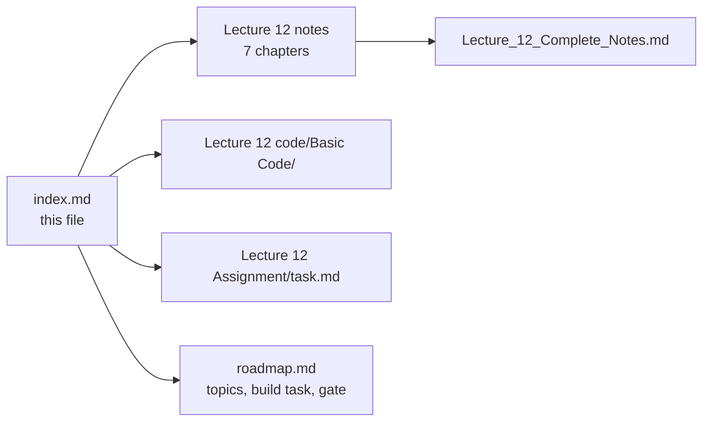
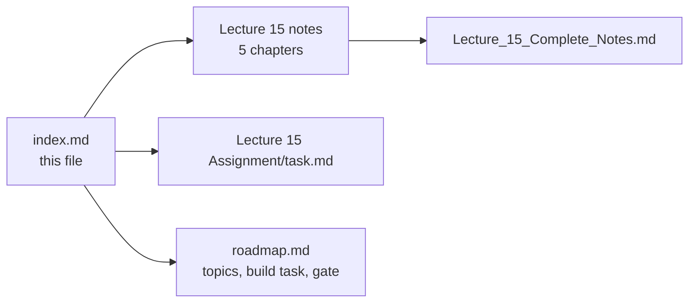
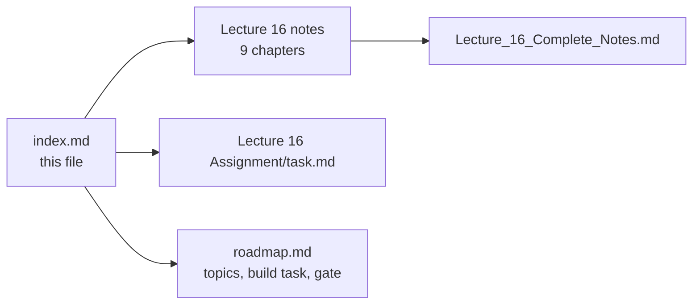
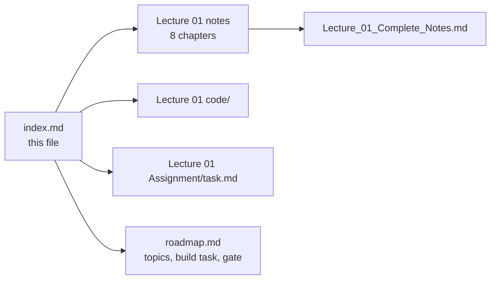
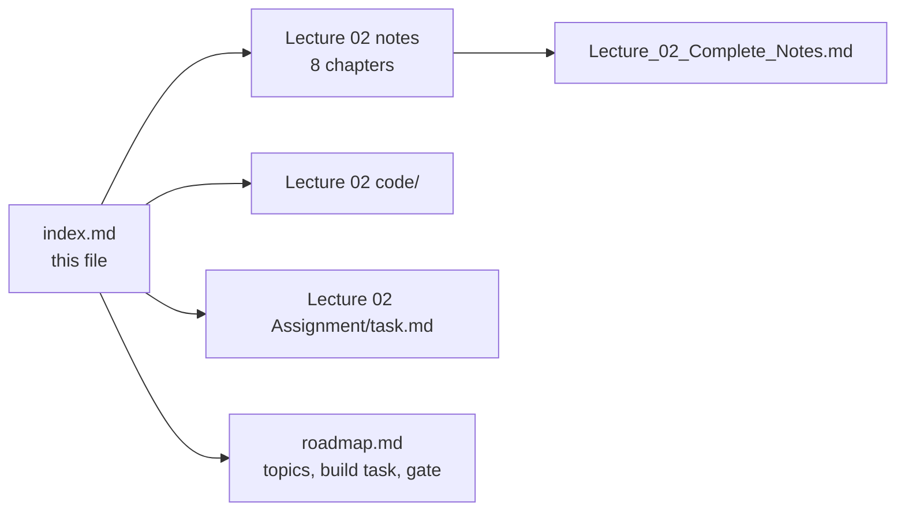
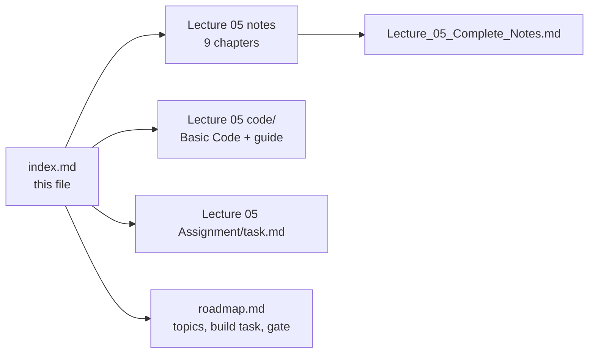
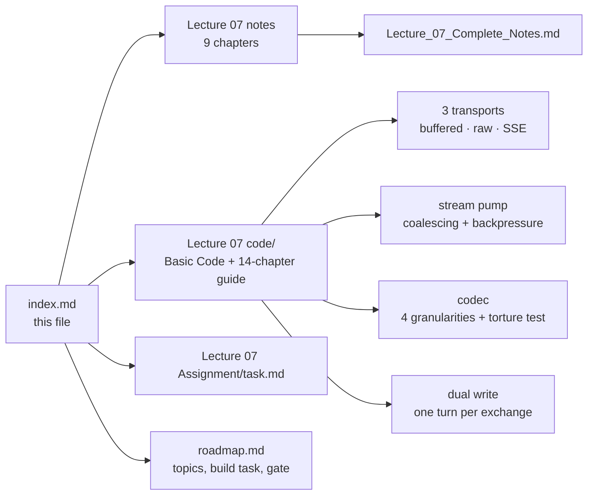
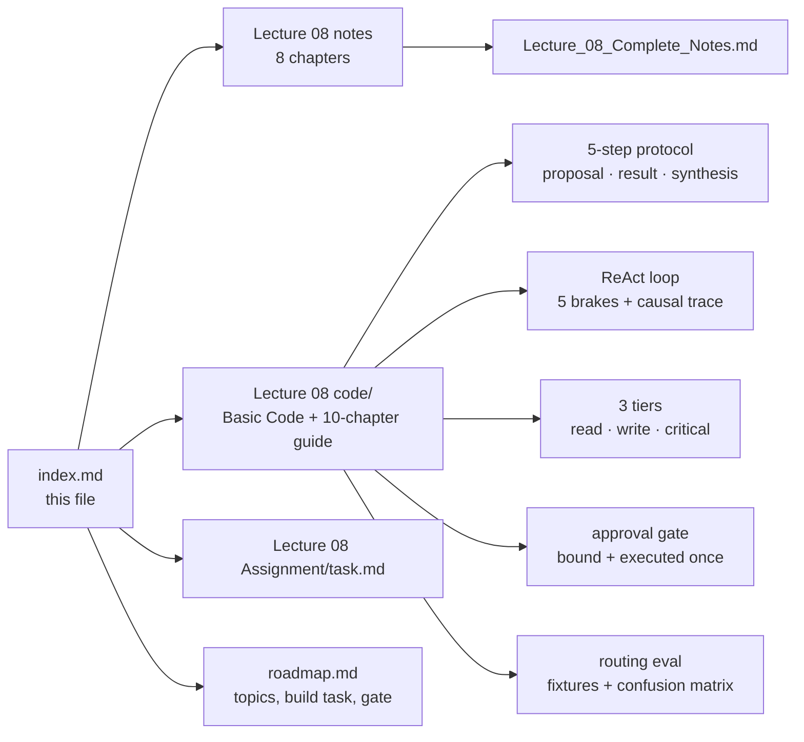
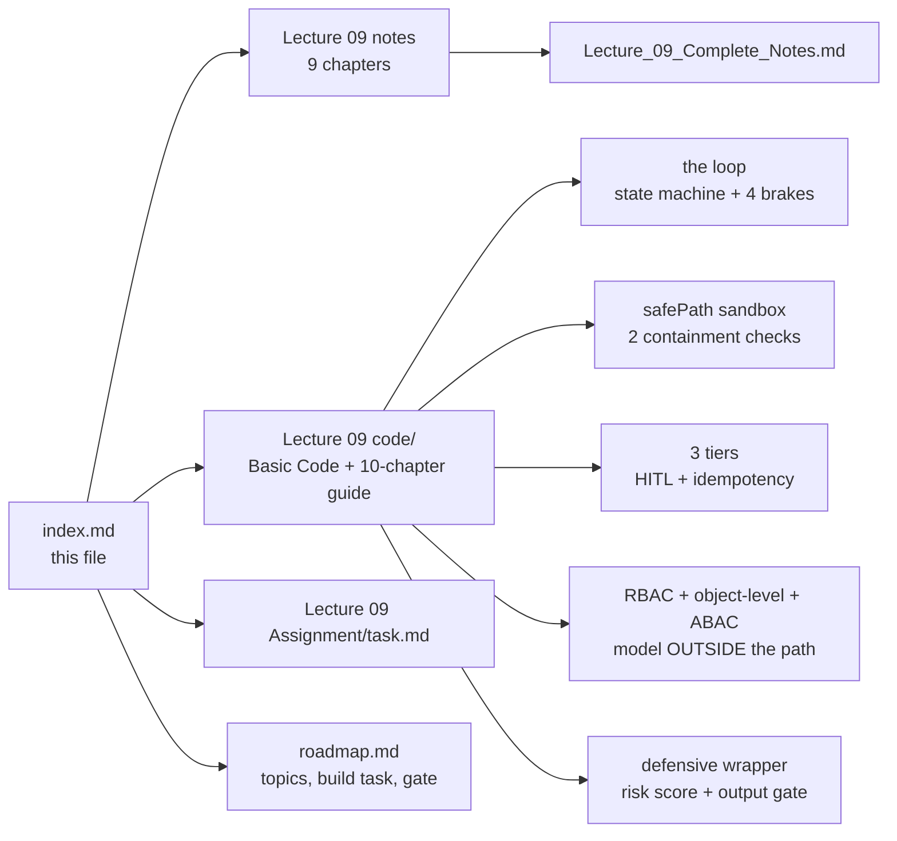

# 📚 Chapter Index

### The lecture notes index for this repository — one section per lecture

> **What this file is:** the chapter index for every lecture that has notes written. Each section lists
> the lecture's chapters with a number, a title, a one-line summary and a direct link to the file in
> that lecture's `notes/` folder — plus links to the lecture's `code/` and `Assignment/task.md`.
>
> **What this file is not:** the curriculum plan. For the topic list, goal, build task, gate and
> progress tracker of each lecture, use **[README.md](./README.md)** and **[roadmap.md](./roadmap.md)** —
> they are the single source of truth, so no topic is duplicated here.

**Repository navigation:** [README](./README.md) · [Roadmap](./roadmap.md) · [Progress Tracker (Appendix D)](./roadmap.md#-appendix-d--progress-tracker)

| | Section | Contents |
| :---: | :--- | :--- |
| 📚 | **[Lecture 01](#-lecture-01--introduction-to-fde-and-ai-history)** | 8 chapters + consolidated notes |
| 📚 | **[Lecture 02](#-lecture-02--llm-foundations)** | 8 chapters + consolidated notes |
| 📚 | **[Lecture 03](#-lecture-03--attention-and-decoding)** | 9 chapters + consolidated notes |
| 📚 | **[Lecture 04](#-lecture-04--llm-apis-and-multi-sdk)** | 9 chapters + consolidated notes |
| 📚 | **[Lecture 05](#-lecture-05--prompt-engineering)** | 9 chapters + consolidated notes |
| 📚 | **[Lecture 06](#-lecture-06--chatbots-and-context)** | 8 chapters + consolidated notes |
| 📚 | **[Lecture 07](#-lecture-07--ai-streaming)** | 9 chapters + consolidated notes |
| 📚 | **[Lecture 08](#-lecture-08--tool-calling)** | 8 chapters + consolidated notes |
| 📚 | **[Lecture 09](#-lecture-09--ai-agents-and-hitl)** | 9 chapters + consolidated notes |
| 📚 | **[Lecture 10 — Structured Outputs](#-lecture-10--structured-outputs)** | 9 chapters + consolidated notes + code + assignment |
| 📚 | **[Lecture 11 — Agent SDK from Scratch](#-lecture-11--agent-sdk-from-scratch)** | 8 chapters + consolidated notes + code + assignment |
| 📚 | **[Lecture 15 — Vector Databases and ANN](#-lecture-15--vector-databases-and-ann)** | 5 chapters + consolidated notes + code + assignment |
| 📚 | **[Lecture 16 — RAG](#-lecture-16--rag)** | 10 chapters + consolidated notes + code + assignment |
| 📚 | **[Lecture 18 — Vectorless RAG & LLM Wiki](#-lecture-18--vectorless-rag--llm-wiki)** | 7 chapters + consolidated notes + code + assignment |
| 📚 | **[Lecture 19 — Agent Memory Systems](#-lecture-19--agent-memory-systems)** | 8 chapters + consolidated notes + code + assignment |

---

## 🟦 Lecture 11 — Agent SDK from Scratch

**Phase 3 · Agency & Contracts · 🟠 Advanced · 8 chapters + 1 consolidated document**
**Folder:** **[📂 Lecture 11 - Agent SDK from Scratch](./Lecture%2011%20-%20Agent%20SDK%20from%20Scratch/)** · **[📄 Roadmap: Phase 3](./roadmap.md#-phase-3--agency-tools-agents--output-contracts)**

| # | Chapter | One-line summary | Notes |
| :---: | :--- | :--- | :--- |
| **01** | **Introduction to Agent SDK & Core Architecture** | Stateless vs stateful agents; the Agent SDK triad (LLM + Instructions + State + Tools + Execution Loop). | [📄 Chapter 01](./Lecture%2011%20-%20Agent%20SDK%20from%20Scratch/notes/01-introduction-to-agent-sdk-and-architecture.md) |
| **02** | **Builder Pattern & Agent Configuration** | Fluent `AgentBuilder`, config decoupling, validation at `build()`, `toolList → toolMap`. | [📄 Chapter 02](./Lecture%2011%20-%20Agent%20SDK%20from%20Scratch/notes/02-builder-pattern-and-agent-configuration.md) |
| **03** | **Harness Prompting & ReAct Pipeline** | Harness prompt as LLM/runtime contract; 5-stage pipeline `INITIAL → THINK → TOOL_REQUEST → ANALYSE → OUTPUT`. | [📄 Chapter 03](./Lecture%2011%20-%20Agent%20SDK%20from%20Scratch/notes/03-harness-prompting-and-react-pipeline.md) |
| **04** | **Tool Execution Engine & Registry** | `ITool` contract, metadata vs execution, tool registry, dispatch loop, error handling, self-correction. | [📄 Chapter 04](./Lecture%2011%20-%20Agent%20SDK%20from%20Scratch/notes/04-tool-execution-engine-and-registry.md) |
| **05** | **Message State Execution & Interceptor Middleware** | `messageHistory` lifecycle, message roles, interceptors/observability, `MAX_LOOP`, context window management. | [📄 Chapter 05](./Lecture%2011%20-%20Agent%20SDK%20from%20Scratch/notes/05-message-state-execution-and-interceptors.md) |
| **06** | **Structured Output & Defensive Parsing** | Strict JSON contract, defensive extraction, Zod schema validation, error recovery loops. | [📄 Chapter 06](./Lecture%2011%20-%20Agent%20SDK%20from%20Scratch/notes/06-structured-output-and-defensive-parsing.md) |
| **07** | **Guardrails, Safety & Production Hardening** | Input/output guardrails, CLI safety, timeouts, `MAX_LOOP`, retries, circuit breakers, observability, testing. | [📄 Chapter 07](./Lecture%2011%20-%20Agent%20SDK%20from%20Scratch/notes/07-guardrails-safety-and-production-hardening.md) |
| **08** | **Multi-Agent Swarms, Handoffs & Provider Packaging** | Multi-agent topologies, handoff protocol, `AgentSwarm`, provider abstraction, SDK packaging. | [📄 Chapter 08](./Lecture%2011%20-%20Agent%20SDK%20from%20Scratch/notes/08-multi-agent-swarms-providers-packaging.md) |

### 🧩 This lecture's other artefacts

| Artefact | Link | Status |
| :--- | :--- | :---: |
| **Basic Code** — Express + TypeScript Agent SDK: 9 source files, `POST /chat` + `GET /health`, fluent `AgentBuilder`, `ToolRegistry` with `toolMap`, `MessageHistory` with interceptors, `HarnessPipeline` ReAct loop, `BasicLLMEngine` stub, example `WeatherTool` + `CalculatorTool`, chapter-wise implementation guide | [📂 code/Basic Code](./Lecture%2011%20-%20Agent%20SDK%20from%20Scratch/code/Basic%20Code/) | ✅ |
| Chapter-wise implementation guide (9 chapters, 00 → 08: overview + full code + block-by-block explanation) | [📘 implementations guide](./Lecture%2011%20-%20Agent%20SDK%20from%20Scratch/code/Basic%20Code/implementations%20guide/) | ✅ |
| Assignment — chapter-wise practice questions, hands-on coding tasks, capstone extensions, completion gate | [📝 Assignment/task.md](./Lecture%2011%20-%20Agent%20SDK%20from%20Scratch/Assignment/task.md) | ✅ |

---
## 🟧 Lecture 12 — Vector Embeddings

**Phase 4 · Meaning & Retrieval: Embeddings · 🟢 Beginner · 7 chapters + 1 consolidated document**
**Folder:** **[📂 Lecture 12 - Vector Embeddings](./Lecture%2012%20-%20Vector%20Embeddings/)** · **[📄 Roadmap: Phase 4](./roadmap.md#-phase-4--meaning--retrieval-embeddings)**

| # | Chapter | One-line summary | Notes |
| :---: | :--- | :--- | :--- |
| **01** | **The Problem of Meaning in Computers** | Symbols ≠ meaning; identity matching vs semantic similarity; why math requires vectors | [📄 Chapter 01](./Lecture%2012%20-%20Vector%20Embeddings/notes/01_the_problem_of_meaning_in_computers.md) |
| **02** | **From Numbers to Vectors** | Building feature spaces (1D → 2D → ND); vector order; dimensions; vector space | [📄 Chapter 02](./Lecture%2012%20-%20Vector%20Embeddings/notes/02_from_numbers_to_vectors.md) |
| **03** | **Measuring Similarity Between Vectors** | Euclidean (L2), Manhattan (L1), Dot Product, Cosine; when to use each | [📄 Chapter 03](./Lecture%2012%20-%20Vector%20Embeddings/notes/03_measuring_similarity_between_vectors.md) |
| **04** | **The Failure of Hand-Crafted Features** | One-hot, BoW, TF-IDF limitations; interpretability trap; embedding vs generative LLM | [📄 Chapter 04](./Lecture%2012%20-%20Vector%20Embeddings/notes/04_the_failure_of_hand_crafted_features.md) |
| **05** | **What Are Embeddings? Learning Representations** | Learned representations; "company it keeps"; vector arithmetic (king − man + woman ≈ queen); latent features | [📄 Chapter 05](./Lecture%2012%20-%20Vector%20Embeddings/notes/05_what_are_embeddings_learning_representations.md) |
| **06** | **Vector vs Embedding — Applications & Real-World Use Cases** | Vector vs embedding distinction; semantic search, recommendation, clustering, classification, RAG; common models & dimensions | [📄 Chapter 06](./Lecture%2012%20-%20Vector%20Embeddings/notes/06_vector_vs_embedding_and_applications.md) |
| **07** | **The Complete Journey — From Objects to Embeddings** | Full progression synthesis; definitive definition; end-to-end RAG example; geometry encodes semantics | [📄 Chapter 07](./Lecture%2012%20-%20Vector%20Embeddings/notes/07_the_complete_journey_synthesis.md) |

### 📄 Consolidated notes

A single document combining all seven chapters — executive summary, cheat sheet, decision tables, misconceptions, glossary, and 20 self-check questions:

👉 **[Lecture_12_Complete_Notes.md](./Lecture%2012%20-%20Vector%20Embeddings/notes/Lecture_12_Complete_Notes.md)**

### 🧩 This lecture's other artefacts

| Artefact | Link | Status |
| :--- | :--- | :---: |
| Lecture workspace README (objectives · level · source mapping · checklist) | [📄 README.md](./Lecture%2012%20-%20Vector%20Embeddings/README.md) | ✅ |
| Chapter index for the lecture (reading order) | [📑 index.md](./Lecture%2012%20-%20Vector%20Embeddings/index.md) | ✅ |
| Basic Code — Express + TypeScript vector similarity API (24 sentences, 4 similarity measures, nearest neighbours, vector arithmetic) | [📂 code/Basic Code](./Lecture%2012%20-%20Vector%20Embeddings/code/Basic%20Code/) | ✅ |
| Production Code | [📂 code/](./Lecture%2012%20-%20Vector%20Embeddings/code/) | 🔜 to build |
| Assignment — chapter-wise practice questions, hands-on coding tasks, completion gate | [📝 Assignment/task.md](./Lecture%2012%20-%20Vector%20Embeddings/Assignment/task.md) | ✅ |




## 🟧 Lecture 15 — Vector Databases and ANN Algorithms

**Phase 4 · Meaning & Retrieval: Embeddings · 🟠 Advanced · 5 chapters + 1 consolidated document**
**Folder:** **[📂 Lecture 15 - Vector Databases and ANN](./Lecture%2015%20-%20Vector%20Databases%20and%20ANN/)** · **[📄 Roadmap: Phase 4](./roadmap.md#-phase-4--meaning--retrieval-embeddings)**

| # | Chapter | One-line summary | Notes |
| :---: | :--- | :--- | :--- |
| **01** | **Vector Database Architecture and the Five Layers** | API → Query Engine → Filtering → Index → Storage; the record model `id + vector + payload`; pre-/post-/filter-aware search modes. | [📄 Chapter 01](./Lecture%2015%20-%20Vector%20Databases%20and%20ANN/notes/01_Vector_Database_Architecture_and_the_Five_Layers.md) |
| **02** | **IVF — Inverted File Index** | k-means centroids partition space into lists; query probes nprobe lists; boundary problem; nlist/nprobe tuning; IVF-Flat/PQ/SQ. | [📄 Chapter 02](./Lecture%2015%20-%20Vector%20Databases%20and%20ANN/notes/02_IVF_Inverted_File_Index.md) |
| **03** | **HNSW — Hierarchical Navigable Small World** | Multi-layer proximity graph; greedy descent + best-first search; M/M0/efConstruction/efSearch; memory, build cost, tombstones, filtered-search weakness. | [📄 Chapter 03](./Lecture%2015%20-%20Vector%20Databases%20and%20ANN/notes/03_HNSW_Hierarchical_Navigable_Small_World.md) |
| **04** | **Product Quantization & Vector Compression** | Split→codebooks→codes; ADC table-lookup search; memory math (~128×); int8/binary comparison; IVF-PQ / HNSW+PQ combinations. | [📄 Chapter 04](./Lecture%2015%20-%20Vector%20Databases%20and%20ANN/notes/04_Product_Quantization_and_Vector_Compression.md) |
| **05** | **Vector Database Engine Decisions & Production Operations** | pgvector vs Qdrant vs Milvus; hybrid search & RRF; sharding, replication, versioning; production RAG runbook; DiskANN & vendor landscape. | [📄 Chapter 05](./Lecture%2015%20-%20Vector%20Databases%20and%20ANN/notes/05_Vector_Database_Engine_Decisions_and_Production_Operations.md) |

### 📄 Consolidated notes

A single document combining all five chapters — end-to-end narrative, parameter cheat sheets, decision tables, memory comparison, common pitfalls, and links back into each chapter for detail:

👉 **[Lecture_15_Complete_Notes.md](./Lecture%2015%20-%20Vector%20Databases%20and%20ANN/notes/Lecture_15_Complete_Notes.md)**

### 🧩 This lecture's other artefacts

| Artefact | Link | Status |
| :--- | :--- | :---: |
| Lecture workspace README (objectives · level · source mapping · checklist) | [📄 README.md](./Lecture%2015%20-%20Vector%20Databases%20and%20ANN/README.md) | ✅ |
| Chapter index for the lecture (reading order) | [📑 index.md](./Lecture%2015%20-%20Vector%20Databases%20and%20ANN/index.md) | ✅ |
| **Basic Code** — Express + TypeScript **vector search API**: `POST /api/vectors` (store id + vector + payload), `POST /api/search` (cosine similarity top-K with optional metadata filter), `GET /api/vectors/count` across `config/` · `controllers/` · `routes/` · `services/` · `types/`, plus a 6-chapter implementation guide (00 → 05) | [📂 code/Basic Code](./Lecture%2015%20-%20Vector%20Databases%20and%20ANN/code/Basic%20Code/) | ✅ |
| Chapter-wise implementation guide (6 chapters, 00 → 05: full file + block-by-block explanation) | [📘 implementations guide](./Lecture%2015%20-%20Vector%20Databases%20and%20ANN/code/Basic%20Code/implementations%20guide/) | ✅ |
| Assignment — chapter-wise practice questions & completion gate | [📝 Assignment/task.md](./Lecture%2015%20-%20Vector%20Databases%20and%20ANN/Assignment/task.md) | ✅ |




## 🟥 Lecture 16 — RAG: The Open-Book Architecture

**Phase 5 · RAG & Knowledge · 🟡 Intermediate · 9 chapters + 1 consolidated document**
**Folder:** **[📂 Lecture 16 - RAG](./Lecture%2016%20-%20RAG/)** · **[📄 Roadmap: Phase 5](./roadmap.md#-phase-5--rag--knowledge-systems)**

| # | Chapter | One-line summary | Notes |
| :---: | :--- | :--- | :--- |
| **01** | **RAG Fundamentals — The Stateless Model** | Parametric vs non-parametric memory; why LLMs cannot answer private/recent/proprietary questions; hallucination as expected behaviour outside evidence. | [📄 Chapter 01](./Lecture%2016%20-%20RAG/notes/01_rag_fundamentals_stateless_model.md) |
| **02** | **RAG — The Open-Book Architecture** | Two pipelines (ingestion offline, serving online); the seven-step query path; why "put the policy in the system prompt" is not RAG. | [📄 Chapter 02](./Lecture%2016%20-%20RAG/notes/02_open_book_architecture_two_pipelines.md) |
| **03** | **Ingestion — Documents to Chunks** | PDF extraction hazards, cleaning, chunking with size + overlap, metadata for citation/filtering, content-addressed deterministic ids, idempotent re-ingestion. | [📄 Chapter 03](./Lecture%2016%20-%20RAG/notes/03_ingestion_documents_to_chunks.md) |
| **04** | **Embeddings at Query Time** | One model, one dimension, identical preprocessing at ingest and query; the embedding model as a coordinate system; silent failure when spaces differ. | [📄 Chapter 04](./Lecture%2016%20-%20RAG/notes/04_embeddings_at_query_time.md) |
| **05** | **The Vector Index — Storing and Searching Knowledge** | Record model `id + vector + metadata`; namespaces for isolation; ANN top-K + metadata filter; score floor; dedupe per document; keep top-K. | [📄 Chapter 05](./Lecture%2016%20-%20RAG/notes/05_vector_index_retrieval_engine.md) |
| **06** | **Grounded Generation and the Prompt Contract** | Role + verbatim context + `[n]` citation grammar + explicit refusal; answer only from context; verify citations against chunks in the prompt. | [📄 Chapter 06](./Lecture%2016%20-%20RAG/notes/06_grounded_generation_prompt_contract.md) |
| **07** | **Conversation State and Memory** | Session history per `sessionId`; query rewriting to stand-alone questions; bounded history; tenant isolation on sessions. | [📄 Chapter 07](./Lecture%2016%20-%20RAG/notes/07_conversation_state_memory.md) |
| **08** | **Evaluation and Debugging** | Goldenset of question → gold chunk pairs; Hit Rate @ K and Recall @ K; refusal testing; CI regression gate with baseline. | [📄 Chapter 08](./Lecture%2016%20-%20RAG/notes/08_evaluation_debugging.md) |
| **09** | **Production System Design** | Four layers (presentation, application, data, infrastructure); tenant isolation in query filter; cost control via topK/prompt/output caps; four escape questions. | [📄 Chapter 09](./Lecture%2016%20-%20RAG/notes/09_production_system_design.md) |

### 📄 Consolidated notes

A single document combining all nine chapters — executive summary, one master diagram, decision tables, common pitfalls, and links back into each chapter for detail:

👉 **[Lecture_16_Complete_Notes.md](./Lecture%2016%20-%20RAG/notes/Lecture_16_Complete_Notes.md)**

### 🧩 This lecture's other artefacts

| Artefact | Link | Status |
| :--- | :--- | :---: |
| Lecture workspace README (objectives · level · source mapping · checklist) | [📄 README.md](./Lecture%2016%20-%20RAG/README.md) | ✅ |
| Chapter index for the lecture (reading order) | [📑 index.md](./Lecture%2016%20-%20RAG/index.md) | ✅ |
| **Basic Code** — Express + TypeScript **minimum RAG server**: `POST /api/ingest` (document → chunks → embed → upsert with content-addressed id), `POST /api/query` (embed question → tenant-filtered retrieval → grounded generation with `[n]` citations + refusal), `GET /api/health` across `config/` · `controllers/` · `router/` · `services/` · `types/`, plus a 10-chapter implementation guide (00 → 09) | [📂 code/Basic Code](./Lecture%2016%20-%20RAG/code/Basic%20Code/) | ✅ |
| Chapter-wise implementation guide (10 chapters, 00 → 09: full file + block-by-block explanation) | [📘 implementations guide](./Lecture%2016%20-%20RAG/code/Basic%20Code/implementations%20guide/) | ✅ |
| Assignment — chapter-wise practice questions & completion gate | [📝 Assignment/task.md](./Lecture%2016%20-%20RAG/Assignment/task.md) | ✅ |




## 🟦 Lecture 01 — Introduction to FDE and AI History

**Phase 0 · Orientation · 🟢 Beginner · 8 chapters + 1 consolidated document**
**Folder:** **[📂 Lecture 01 - Introduction to FDE and AI History](./Lecture%2001%20-%20Introduction%20to%20FDE%20and%20AI%20History/)** · **[📄 Roadmap: Phase 0](./roadmap.md#-phase-0--orientation)**

| # | Chapter | One-line summary | Notes |
| :---: | :--- | :--- | :--- |
| **01** | **The FDE Role & Requirement Discovery** | Why "we want a chatbot" is a proposed solution rather than a requirement; the 50k-query case study; the discovery workflow; primary vs guardrail metrics; the one-page discovery brief | [📄 Chapter 01](./Lecture%2001%20-%20Introduction%20to%20FDE%20and%20AI%20History/notes/01_The_FDE_Role_and_Requirement_Discovery.md) |
| **02** | **From Vague Request to Grounded Production System** | The three failed attempts (rules → ML classifier → naïve LLM); the grounded architecture around an application boundary; the lifecycle of a write request; the six production engineering considerations | [📄 Chapter 02](./Lecture%2001%20-%20Introduction%20to%20FDE%20and%20AI%20History/notes/02_From_Vague_Request_to_Grounded_Production_System.md) |
| **03** | **AI Foundations & Rule-Based Systems** | Turing (1950) and the Imitation Game; McCarthy coining "AI" at Dartmouth (1956); deterministic vs cognitive computing; expert systems (fact base + rule base + inference engine); ELIZA (1966); the combinatorial explosion | [📄 Chapter 03](./Lecture%2001%20-%20Introduction%20to%20FDE%20and%20AI%20History/notes/03_AI_Foundations_and_Rule_Based_Systems.md) |
| **04** | **Machine Learning & Deep Learning Foundations** | $Y = f(X; \Theta)$; training vs inference; prompting vs training vs fine-tuning; supervised, unsupervised and self-supervised learning; the feature-engineering bottleneck; representation learning; CNN vs RNN vs Transformer | [📄 Chapter 04](./Lecture%2001%20-%20Introduction%20to%20FDE%20and%20AI%20History/notes/04_Machine_Learning_and_Deep_Learning_Foundations.md) |
| **05** | **Natural Language Challenges & Statistical Language Models** | The six linguistic challenges (polysemy, word order, negation, coreference, sarcasm, productivity); the chain rule; frequency counting; n-grams and the Markov assumption; sparsity, smoothing and perplexity; Zipf's law and OOV | [📄 Chapter 05](./Lecture%2001%20-%20Introduction%20to%20FDE%20and%20AI%20History/notes/05_Natural_Language_Challenges_and_Statistical_Language_Models.md) |
| **06** | **Neural Language Models & the RNN Bottleneck** | Embeddings; the RNN recurrence; the information bottleneck and long-range decay; vanishing gradients; LSTM/GRU gating; encoder–decoder and the fixed-size context vector; teacher forcing and exposure bias | [📄 Chapter 06](./Lecture%2001%20-%20Introduction%20to%20FDE%20and%20AI%20History/notes/06_Neural_Language_Models_and_the_RNN_Bottleneck.md) |
| **07** | **Attention, Transformers & Modern LLMs** | *Attention Is All You Need*: Q/K/V, scaled dot-product attention and the $\sqrt{d_k}$ argument; multi-head attention; the full encoder–decoder; positional encodings; the complexity table; training methodology, ablations and BLEU; decoder-only GPT; KV cache, GQA, FlashAttention and RoPE | [📄 Chapter 07](./Lecture%2001%20-%20Introduction%20to%20FDE%20and%20AI%20History/notes/07_Attention_Transformers_and_Modern_LLMs.md) |
| **08** | **The Production AI Stack & the Evolutionary Matrix** | The six-row evolutionary matrix; the bottleneck chain; the **grounded · observable · secure · actionable** stack; the six mandatory production criteria; the NFR checklist; the FDE mindset and the 20 fundamental takeaways | [📄 Chapter 08](./Lecture%2001%20-%20Introduction%20to%20FDE%20and%20AI%20History/notes/08_Production_AI_Stack_and_Evolutionary_Matrix.md) |

### 📄 Consolidated notes

A single document combining all eight chapters — executive summary, arc diagram, cheat sheet, formulas,
complexity numbers, decision tables, 20 misconceptions, 20 self-check questions and a glossary, with
links back into the chapters for detail:

👉 **[Lecture_01_Complete_Notes.md](./Lecture%2001%20-%20Introduction%20to%20FDE%20and%20AI%20History/notes/Lecture_01_Complete_Notes.md)**

### 🧩 This lecture's other artefacts

| Artefact | Link | Status |
| :--- | :--- | :---: |
| Lecture workspace README (objectives · level · source mapping · checklist) | [📄 README.md](./Lecture%2001%20-%20Introduction%20to%20FDE%20and%20AI%20History/README.md) | ✅ |
| Chapter index for the lecture (reading order) | [📑 index.md](./Lecture%2001%20-%20Introduction%20to%20FDE%20and%20AI%20History/index.md) | ✅ |
| Rebuilt codebase — Basic Code · Production Code + implementation guides | [📂 code/](./Lecture%2001%20-%20Introduction%20to%20FDE%20and%20AI%20History/code/) | 🔜 to build |
| Assignment — chapter-wise practice, code tasks, capstone brief and the completion gate | [📝 Assignment/task.md](./Lecture%2001%20-%20Introduction%20to%20FDE%20and%20AI%20History/Assignment/task.md) | ✅ |



---

## 🟦 Lecture 02 — LLM Foundations

**Phase 1 · Foundations · 🟢 Beginner · 8 chapters + 1 consolidated document**
**Folder:** **[📂 Lecture 02 - LLM Foundations](./Lecture%2002%20-%20LLM%20Foundations/)** · **[📄 Roadmap: Phase 1](./roadmap.md#-phase-1--foundations-how-llms-actually-work)**

| # | Chapter | One-line summary | Notes |
| :---: | :--- | :--- | :--- |
| **01** | **What an LLM Is & Next-Token Prediction** | The one core task $P(t_n \mid t_1 \dots t_{n-1})$; GPT (the engine) vs ChatGPT (the car); the context-narrowing prompt experiment; the autoregressive loop and its per-token cost model; why emergent capability is a side effect of learning to predict | [📄 Chapter 01](./Lecture%2002%20-%20LLM%20Foundations/notes/01_What_an_LLM_Is_and_Next_Token_Prediction.md) |
| **02** | **The Text Pipeline & Why Token IDs Are Labels** | Why text must become numbers; raw text → tokens → token IDs as three distinct objects; the roll-number analogy (IDs are labels, not measurements); the forward pipeline, the streaming reverse pipeline and the seven pipeline invariants | [📄 Chapter 02](./Lecture%2002%20-%20LLM%20Foundations/notes/02_The_Text_Pipeline_and_Why_Token_IDs_Are_Labels.md) |
| **03** | **Tokenization Strategies: Word vs Character vs Subword** | Word level: vocabulary explosion and `<UNK>` information destruction; character level: sequence-length explosion and $O(N^2)$ attention cost; byte level as the shipped extreme; subword as the equilibrium; vocabulary-size trade-offs and the multilingual token tax | [📄 Chapter 03](./Lecture%2002%20-%20LLM%20Foundations/notes/03_Tokenization_Strategies_Word_Character_Subword.md) |
| **04** | **BPE, WordPiece, SentencePiece & the Vocabulary** | BPE trained by hand (count → merge → repeat); training versus encoding; WordPiece's `##` and likelihood-based merges; Unigram and SentencePiece's `▁`; byte-level BPE; vocabulary anatomy (base, merged, special, template, reserved); **why "strawberry" is hard** | [📄 Chapter 04](./Lecture%2002%20-%20LLM%20Foundations/notes/04_BPE_WordPiece_SentencePiece_and_Vocabulary.md) |
| **05** | **Tokenizers in Practice: `tiktoken` & Model Comparison** | `gpt2` / `cl100k_base` / `o200k_base` and the Llama, Gemini, Claude and Mistral families; local token counting with `tiktoken` (and when it is only an estimate); the per-request cost formula; the six-part context-window budget; token accounting inside a retrieval pipeline | [📄 Chapter 05](./Lecture%2002%20-%20LLM%20Foundations/notes/05_Tokenizers_in_Practice_tiktoken_and_Model_Comparison.md) |
| **06** | **Embeddings: Dense Vectors & Similarity** | The embedding lookup as a table read ($W_{\text{emb}} \in \mathbb{R}^{\lvert V\rvert \times d_{\text{model}}}$); why one-hot vectors fail; dot product vs cosine vs Euclidean; word arithmetic and its limits; static vs contextual embeddings and the `bank` problem; token embeddings vs retrieval embeddings | [📄 Chapter 06](./Lecture%2002%20-%20LLM%20Foundations/notes/06_Embeddings_Dense_Vectors_and_Similarity.md) |
| **07** | **Positional Encodings & Word Order** | Permutation invariance (`"Dog bites man"` vs `"Man bites dog"`); the additive formula $\mathbf{X}_{\text{in}} = \mathbf{E} + \mathbf{P}$; sinusoidal encodings and the linear-offset property; learned absolute, **RoPE** and **ALiBi**; the `"The cat sat on the mat"` trace; "lost in the middle" and prompt layout | [📄 Chapter 07](./Lecture%2002%20-%20LLM%20Foundations/notes/07_Positional_Encodings_and_Word_Order.md) |
| **08** | **Context Windows, Training vs Inference & the Complete Pipeline** | Capacity versus attention quality; the three costs of long sequences; truncation strategies; the training phase (free next-token labels, cross-entropy, pre-training → SFT → preference tuning); the inference phase (prefill, decode, KV cache); the master end-to-end pipeline and the FDE checklist | [📄 Chapter 08](./Lecture%2002%20-%20LLM%20Foundations/notes/08_Context_Windows_Training_vs_Inference_and_the_Complete_Pipeline.md) |

### 📄 Consolidated notes

A single document combining all eight chapters — executive summary, cheat sheet, formulas, tokenizer
comparison, decision tables, 25 misconceptions, glossary and 20 self-check questions, with links back into
the chapters for detail:

👉 **[Lecture_02_Complete_Notes.md](./Lecture%2002%20-%20LLM%20Foundations/notes/Lecture_02_Complete_Notes.md)**

### 🧩 This lecture's other artefacts

| Artefact | Link | Status |
| :--- | :--- | :---: |
| Lecture workspace README (objectives · level · source mapping · checklist) | [📄 README.md](./Lecture%2002%20-%20LLM%20Foundations/README.md) | ✅ |
| Chapter index for the lecture (reading order) | [📑 index.md](./Lecture%2002%20-%20LLM%20Foundations/index.md) | ✅ |
| **Basic Code** — Express + TypeScript, the **real `tiktoken` tokenizer**, every chapter as an endpoint | [📂 code/Basic Code](./Lecture%2002%20-%20LLM%20Foundations/code/Basic%20Code/) | ✅ |
| Chapter-wise implementation guide (10 chapters: full file, then a block-by-block explanation) | [📘 implementations guide](./Lecture%2002%20-%20LLM%20Foundations/code/Basic%20Code/implementations%20guide/) | ✅ |
| **Production Code** — provider adapters, budget guard, metrics and tests | [📂 code/](./Lecture%2002%20-%20LLM%20Foundations/code/) | 🔜 to build |
| Assignment — chapter-wise practice, code tasks, the cross-provider token report and the completion gate | [📝 Assignment/task.md](./Lecture%2002%20-%20LLM%20Foundations/Assignment/task.md) | ✅ |



---

## 🟦 Lecture 03 — Attention and Decoding

**Phase 1 · Foundations · 🟢 Beginner · 9 chapters + 1 consolidated document**
**Folder:** **[📂 Lecture 03 - Attention and Decoding](./Lecture%2003%20-%20Attention%20and%20Decoding/)** · **[📄 Roadmap: Phase 1](./roadmap.md#-phase-1--foundations-how-llms-actually-work)**

| # | Chapter | One-line summary | Notes |
| :---: | :--- | :--- | :--- |
| **01** | **Why Attention: From Static Vectors to Dynamic Context** | The problem attention solves — a static embedding lookup can never be context-dependent (`bank`, `it`, `his`); attention as a **differentiable soft database lookup**; self vs cross attention and the four modes; the $O(1)$ path-length argument against RNNs; why an attention row **is** a probability distribution; and what attention does *not* do | [📄 Chapter 01](./Lecture%2003%20-%20Attention%20and%20Decoding/notes/01_Why_Attention_From_Static_Vectors_to_Dynamic_Context.md) |
| **02** | **Queries, Keys & Values: The Attention Search Engine** | One token vector, three projections — **Query** (what I look for), **Key** (what I am findable as), **Value** (what I contribute); the shapes and the parameter cost $3d_{\text{model}}^2$ (independent of $N$); the $N \times N$ score matrix $QK^{T}$; why $W_Q$ must differ from $W_K$; and the **KV cache** (why $Q$ is not in it) | [📄 Chapter 02](./Lecture%2003%20-%20Attention%20and%20Decoding/notes/02_Queries_Keys_Values_The_Attention_Search_Engine.md) |
| **03** | **Scaled Dot-Product Attention, By Hand** | $\text{softmax}\!\left(\frac{QK^{T}}{\sqrt{d_k}}\right)V$ symbol by symbol; the five steps **score → scale → mask → softmax → mix**; the lecture's worked trace for `"on"`; *why* $1/\sqrt{d_k}$ (a variance argument **and** a gradient argument); the causal mask and why it is $-Infinity$ rather than $0$; numerical stability via the row maximum; the $N^2$ cost model | [📄 Chapter 03](./Lecture%2003%20-%20Attention%20and%20Decoding/notes/03_Scaled_Dot_Product_Attention_by_Hand.md) |
| **04** | **Multi-Head Attention & Head Specialisation** | Why one attention pattern is not enough; $\text{Concat}(\text{head}_1 \dots \text{head}_h)W^{O}$; $d_{\text{head}} = d_{\text{model}}/h$ and why multi-head is **nearly free** (identical projections and identical mixing FLOPs); what heads specialise in (and why a head's weights are *not* an explanation); **MQA/GQA** and the KV-cache saving | [📄 Chapter 04](./Lecture%2003%20-%20Attention%20and%20Decoding/notes/04_Multi_Head_Attention_and_Head_Specialisation.md) |
| **05** | **The Transformer Block & the Residual Stream** | **A Transformer is not attention** — six operations: LayerNorm → multi-head attention → residual → LayerNorm → FFN → residual; pre-LN vs post-LN and RMSNorm; the **residual stream** as a shared memory bus; why the FFN is the only place new features are computed; and where the parameters actually live (**FFN ≈ two-thirds**) | [📄 Chapter 05](./Lecture%2003%20-%20Attention%20and%20Decoding/notes/05_The_Transformer_Block_and_the_Residual_Stream.md) |
| **06** | **Encoder-Decoder vs Decoder-Only & Why GPT Is Decoder-Only** | The three families differ in exactly **one** place — the mask; the 2017 encoder + decoder + cross-attention; the three attention modes; the **five reasons** GPT is decoder-only; what decoder-only gave up and where it went; prefix-LM; and the training/inference asymmetry that makes serving expensive | [📄 Chapter 06](./Lecture%2003%20-%20Attention%20and%20Decoding/notes/06_Encoder_Decoder_vs_Decoder_Only_and_Why_GPT.md) |
| **07** | **Logits, the LM Head & Softmax** | $H_{\text{final}} \rightarrow W_{\text{lm}} \rightarrow$ logits $\rightarrow$ softmax $\rightarrow$ distribution; what logits **are not** (unnormalised scores in log-space, not probabilities); the LM head's shape and weight tying; the three softmax properties (**shift invariance · scale sensitivity · ranking preservation**); log probabilities; and logit bias / vocabulary masking as constrained decoding | [📄 Chapter 07](./Lecture%2003%20-%20Attention%20and%20Decoding/notes/07_Logits_the_LM_Head_and_Softmax.md) |
| **08** | **Decoding Strategies & Sampling Controls** | The model **proposes**, the decoder **selects**; greedy, beam and sampling; **temperature** (dividing the logits — it changes the gaps, never the ranking); top-k, top-p (nucleus) and min-p; penalties, stop conditions and length limits; the **fixed order of operations**; determinism and seeds; why ChatGPT streams; and parameter recipes per task | [📄 Chapter 08](./Lecture%2003%20-%20Attention%20and%20Decoding/notes/08_Decoding_Strategies_and_Sampling_Controls.md) |
| **09** | **Position, Masking & Attention Geometry** | Why self-attention is permutation invariant; sinusoidal encodings and the **linear-offset property**; the four positional schemes compared; **RoPE** (rotation instead of addition) and context extension; **ALiBi** (a distance penalty, no positional vector); the geometry of masks — one mechanism, **two axes**; and the runtime consequences: "lost in the middle", chunk order, advertised vs usable context | [📄 Chapter 09](./Lecture%2003%20-%20Attention%20and%20Decoding/notes/09_Position_Masking_and_Attention_Geometry.md) |

### 📄 Consolidated notes

A single document combining all nine chapters — executive summary, cheat sheet (formulas, shapes, the
parameter budget, the five attention steps, the decoding order), **four decision tables**, a 17-stage
end-to-end walkthrough, **25 misconceptions**, a four-part glossary and **20 self-check questions**, with
links back into the chapters for detail:

👉 **[Lecture_03_Complete_Notes.md](./Lecture%2003%20-%20Attention%20and%20Decoding/notes/Lecture_03_Complete_Notes.md)**

### 🧩 This lecture's other artefacts

| Artefact | Link | Status |
| :--- | :--- | :---: |
| Lecture workspace README (objectives · level · source mapping · checklist) | [📄 README.md](./Lecture%2003%20-%20Attention%20and%20Decoding/README.md) | ✅ |
| Chapter index for the lecture (reading order) | [📑 index.md](./Lecture%2003%20-%20Attention%20and%20Decoding/index.md) | ✅ |
| **Basic Code** — Express + TypeScript with **no ML library**: 15 endpoints computing Q/K/V, the score matrix, the block, logits and sampling by hand, all reproducible | [📂 code/Basic Code](./Lecture%2003%20-%20Attention%20and%20Decoding/code/Basic%20Code/) | ✅ |
| Chapter-wise implementation guide (11 chapters: the full file, then a block-by-block explanation) | [📘 implementations guide](./Lecture%2003%20-%20Attention%20and%20Decoding/code/Basic%20Code/implementations%20guide/) | ✅ |
| **Production Code** — a defended serving layer (batching, KV-cache accounting, metrics, tests) | [📂 code/](./Lecture%2003%20-%20Attention%20and%20Decoding/code/) | 🔜 to build |
| Assignment — 103 practice questions, 6 code extensions, the attention-by-hand capstone and the completion gate | [📝 Assignment/task.md](./Lecture%2003%20-%20Attention%20and%20Decoding/Assignment/task.md) | ✅ |


---

## 🟩 Lecture 04 — LLM APIs and Multi-SDK

**Phase 2 · The Application Layer · 🟢 Beginner · 9 chapters + 1 consolidated document**
**Folder:** **[📂 Lecture 04 - LLM APIs and Multi-SDK](./Lecture%2004%20-%20LLM%20APIs%20and%20Multi-SDK/)** · **[📄 Roadmap: Phase 2](./roadmap.md#-phase-2--the-application-layer-talking-to-models)**

| # | Chapter | One-line summary | Notes |
| :---: | :--- | :--- | :--- |
| **01** | **GenAI Applications vs Raw LLMs — the Engine vs Car Model** | Why typing into a web chat is not "talking to a neural network"; the **engine vs car** analogy (the model is the capability, your application is the vehicle); raw LLM vs tool-augmented application in two scenarios; the knowledge-cutoff problem; the **cardinal rule** — *the LLM only knows what reaches the LLM* — with its responsibility matrix; web UI vs API; what this means for an FDE | [📄 Chapter 01](./Lecture%2004%20-%20LLM%20APIs%20and%20Multi-SDK/notes/01_GenAI_Applications_vs_Raw_LLMs_The_Engine_vs_Car_Model.md) |
| **02** | **The LLM API Protocol — HTTP, the Four Components & Postman** | It is just an HTTPS `POST` with a JSON body; the **four invariant components** at transport level (endpoint · authentication · model · input) and at payload level (`model` · `messages` · `params` · optional `tools`); the request lifecycle; the **Postman/curl prototype rule** — prove the wire before writing service code; the status-code taxonomy (400 · 401 · 404 · 413 · 429 · 5xx); the enterprise support-ticket triage case study | [📄 Chapter 02](./Lecture%2004%20-%20LLM%20APIs%20and%20Multi-SDK/notes/02_The_LLM_API_Protocol_HTTP_Components_and_Postman.md) |
| **03** | **Message Roles & Prompt Hygiene** | Statelessness — there is no memory, only re-sending (and re-paying); the five roles and their **privilege hierarchy**; chat templates and control tokens; system instructions vs user prompts; the **concatenation anti-pattern** → prompt injection and goal hijacking; reconstructing multi-turn history and the truncation rules; the pre-ship hygiene checklist; role support across providers | [📄 Chapter 03](./Lecture%2004%20-%20LLM%20APIs%20and%20Multi-SDK/notes/03_Message_Roles_and_Prompt_Hygiene.md) |
| **04** | **Token Economics — Prefill vs Decode, Metadata & Cost** | The response envelope (content vs metadata); **prefill vs decode** and why the output half is the expensive one; the cost formula with three worked examples; **TTFT and ITL** latency; context-window saturation vs the bill; turning metadata into telemetry; the 10-page incident-report case study; unit economics and the decisions it unlocks | [📄 Chapter 04](./Lecture%2004%20-%20LLM%20APIs%20and%20Multi-SDK/notes/04_Token_Economics_Prefill_Decode_Metadata_and_Cost.md) |
| **05** | **Token Counting & Context Budgeting with Tokenizers** | BPE in four steps; the tokenizer/vocabulary comparison and the **multilingual token tax**; `tiktoken` in practice; the character heuristics and which way their error is dangerous; the **budgeting algorithm** (reserve output, then system, then user, then history oldest-first) and the three truncation strategies; a worked 128k budget; reconciling the local estimate against the provider's `usage` | [📄 Chapter 05](./Lecture%2004%20-%20LLM%20APIs%20and%20Multi-SDK/notes/05_Token_Counting_and_Context_Budgeting_with_Tokenizers.md) |
| **06** | **Rate Limits, Quotas, Throttling & Retry/Backoff** | The two ceilings — **RPM vs TPM** — and why RPM alone is a trap; the wider quota landscape; reading a `429` correctly (`Retry-After` and the rate-limit headers); **exponential backoff with jitter** and which failures are actually retryable; client-side protections; idempotency; the **degradation ladder**; the metrics that predict an outage before it happens | [📄 Chapter 06](./Lecture%2004%20-%20LLM%20APIs%20and%20Multi-SDK/notes/06_Rate_Limits_Quotas_Throttling_and_Retry_Backoff.md) |
| **07** | **Multi-SDK Integration — OpenAI · Gemini · Groq · Mistral · Claude · Ollama** | What an SDK is — and is not; the four access layers and what each one costs you; the provider-by-provider **naming trap** (`messages` vs `contents`, `assistant` vs `model`, `max_tokens` vs `maxOutputTokens`); response shapes compared; the **adapter pattern** — one interface, many providers; OpenAI-compatible base URLs; **Ollama** local vs hosted; routing, fallback and cost control; testing across providers | [📄 Chapter 07](./Lecture%2004%20-%20LLM%20APIs%20and%20Multi-SDK/notes/07_Multi_SDK_Integration_OpenAI_Gemini_Groq_Mistral_Anthropic_Ollama.md) |
| **08** | **Building the Service — Express, TypeScript, Config, Singletons & Telemetry** | Why the backend owns the AI call; the project layout and the ESM + TypeScript toolchain; the layered architecture and what each layer must *not* know; **Zod-validated configuration** and fail-fast boot; client singletons and connection pooling; request validation before you spend; the service layer; routes, health checks and **error mapping**; telemetry and structured logging; secrets hygiene and the key-rotation runbook | [📄 Chapter 08](./Lecture%2004%20-%20LLM%20APIs%20and%20Multi-SDK/notes/08_Building_the_Service_Express_TypeScript_Config_Singletons_and_Telemetry.md) |
| **09** | **AI Slop & Model Collapse** | Two terms side by side — one is your output *today*, the other is the model *over time*; AI slop's economic engine and its in-product symptoms; **model collapse** as a recursive training loop, and what specifically degrades; the honest caveats; the four mitigation families (human review · high-quality data · guardrails · continuous evaluation); the anti-slop checklist for your own pipeline | [📄 Chapter 09](./Lecture%2004%20-%20LLM%20APIs%20and%20Multi-SDK/notes/09_AI_Slop_and_Model_Collapse.md) |

### 📄 Consolidated notes

A single document combining all nine chapters — executive summary, a ten-part cheat sheet (request shape, transport components, roles, cost and latency formulas, prefill vs decode, token estimates, status codes, provider call signatures, environment variables, the telemetry record), **six decision tables**, **25 misconceptions**, a ~35-term glossary and **20 self-check questions**, with links back into the chapters for detail:

👉 **[Lecture_04_Complete_Notes.md](./Lecture%2004%20-%20LLM%20APIs%20and%20Multi-SDK/notes/Lecture_04_Complete_Notes.md)**

### 🧩 This lecture's other artefacts

| Artefact | Link | Status |
| :--- | :--- | :---: |
| Lecture workspace README (objectives · level · source mapping · checklist) | [📄 README.md](./Lecture%2004%20-%20LLM%20APIs%20and%20Multi-SDK/README.md) | ✅ |
| Chapter index for the lecture (reading order) | [📑 index.md](./Lecture%2004%20-%20LLM%20APIs%20and%20Multi-SDK/index.md) | 🔜 to write |
| **Basic Code** — Express + TypeScript service that calls a **real** provider: 12 files, 3 endpoints (`/api/health` · `/api/chat` · `/api/tokens/count`), one `Provider` interface across 5 providers, Zod-validated config, a context-budget guard, retry with backoff + jitter, and a cost / slop / telemetry ledger on every call | [📂 code/Basic Code](./Lecture%2004%20-%20LLM%20APIs%20and%20Multi-SDK/code/Basic%20Code/) | ✅ |
| Chapter-wise implementation guide (10 chapters, 00 → 09: the full file, then a block-by-block explanation) | [📘 implementations guide](./Lecture%2004%20-%20LLM%20APIs%20and%20Multi-SDK/code/Basic%20Code/implementations%20guide/) | ✅ |
| **Production Code** — a defended serving layer (client-side throttling, per-caller cost ceilings, conformance tests, structured logging) | [📂 code/](./Lecture%2004%20-%20LLM%20APIs%20and%20Multi-SDK/code/) | 🔜 to build |
| Assignment — 9 chapter-wise question sets, 6 code extensions, the Support Ticket Summarizer + three-provider conformance capstone, and the completion gate | [📝 Assignment/task.md](./Lecture%2004%20-%20LLM%20APIs%20and%20Multi-SDK/Assignment/task.md) | ✅ |


---

## 🟩 Lecture 05 — Prompt Engineering

**Phase 2 · The Application Layer · 🟢 Beginner · 9 chapters + 1 consolidated document**
**Folder:** **[📂 Lecture 05 - Prompt Engineering](./Lecture%2005%20-%20Prompt%20Engineering/)** · **[📄 Roadmap: Phase 2](./roadmap.md#-phase-2--the-application-layer-talking-to-models)**

| # | Chapter | One-line summary | Notes |
| :---: | :--- | :--- | :--- |
| **01** | **Prompt Engineering as an Engineering Discipline** | A prompt is an interface: **five slots** (role · task · context · constraints · contract), a function signature with a return type, and GIGO as its governing rule; the **lever ladder** tells you when prompting is the wrong tool | [📄 Chapter 01](./Lecture%2005%20-%20Prompt%20Engineering/notes/01_Prompt_Engineering_as_an_Engineering_Discipline.md) |
| **02** | **Zero-Shot Prompting** | Instruction + context + constraints with **no examples** — the baseline every other technique must beat; the **constraint trap** (the most common misclassification), a failure taxonomy with the correct fix per row, and the improvement ladder to climb *before* adding examples | [📄 Chapter 02](./Lecture%2005%20-%20Prompt%20Engineering/notes/02_Zero_Shot_Prompting.md) |
| **03** | **Few-Shot Prompting & In-Context Learning** | Examples teach a pattern **without changing weights**; an exemplar is an input→output *pair*; the **four craft rules** — define the task · show consistent examples · cover important classes · use representative examples — plus ordering and per-request exemplar selection | [📄 Chapter 03](./Lecture%2005%20-%20Prompt%20Engineering/notes/03_Few_Shot_Prompting_and_In_Context_Learning.md) |
| **04** | **Chain-of-Thought & Structured Reasoning** | Give the model **output tokens to think with**; the three mechanisms CoT exploits; zero-shot vs few-shot CoT vs **self-consistency**; the `INITIAL → THINK → ANALYZE → OUTPUT` pipeline; private CoT vs a published rationale — and the cases where **CoT hurts** | [📄 Chapter 04](./Lecture%2005%20-%20Prompt%20Engineering/notes/04_Chain_of_Thought_and_Structured_Reasoning.md) |
| **05** | **Role-Play & Persona Prompting** | A persona is a **behavioural prior**, not new knowledge: seven fields plus a fallback, six failure modes (over-roleplay · false authority · scope creep · persona hijack · drift · cross-endpoint inconsistency) — and why a persona is **never a security boundary** | [📄 Chapter 05](./Lecture%2005%20-%20Prompt%20Engineering/notes/05_Role_Play_and_Persona_Prompting.md) |
| **06** | **Model-Specific Prompt Formats & Chat Templates** | A `messages` array **never reaches the transformer**; ChatML · Alpaca · `[INST]` + `<<SYS>>` · Llama-3 header tokens · FLAN-T5 compared; the **generation prompt**; who owns templating at the API vs local-inference boundary; and the three classic formatting bugs, including **double templating** | [📄 Chapter 06](./Lecture%2005%20-%20Prompt%20Engineering/notes/06_Model_Specific_Prompt_Formats_and_Chat_Templates.md) |
| **07** | **Prompt Hygiene, Delimiters & Output Contracts** | The LLM analogue of **parameterised queries**: separate rules from data, delimit and **escape** it, order instructions deliberately, resolve contradictions with explicit precedence, prefer positive rules — and state an output contract a machine can enforce via the **four-rung validation ladder** | [📄 Chapter 07](./Lecture%2005%20-%20Prompt%20Engineering/notes/07_Prompt_Hygiene_Delimiters_and_Output_Contracts.md) |
| **08** | **Prompt Injection, Guardrails & Extraction Attacks** | Direct vs **indirect** injection, goal hijacking and exfiltration; why prompt-level defences are insufficient; input / output / tool guardrails as *code*; where moderation APIs belong; prompt extraction vs model distillation; **defence in depth**, least privilege and human-in-the-loop | [📄 Chapter 08](./Lecture%2005%20-%20Prompt%20Engineering/notes/08_Prompt_Injection_Guardrails_and_Extraction_Attacks.md) |
| **09** | **Prompt Versioning, Evaluation & the Prompt Registry** | Prompts are versioned artifacts: the **registry entry**, semver for prompts, the stratified **golden set**, the **six metrics**, the evaluation harness, the CI regression gate, shadow → canary → A/B — and **drift**, the failure mode nobody instruments | [📄 Chapter 09](./Lecture%2005%20-%20Prompt%20Engineering/notes/09_Prompt_Versioning_Evaluation_and_the_Prompt_Registry.md) |

### 📄 Consolidated notes

A single document combining all nine chapters — executive summary, one master diagram, a **12-part cheat sheet**, **7 decision tables**, **22 misconceptions**, a **48-term glossary** and **20 self-check questions**, with links back into the chapters for detail:

👉 **[Lecture_05_Complete_Notes.md](./Lecture%2005%20-%20Prompt%20Engineering/notes/Lecture_05_Complete_Notes.md)**

### 🧩 This lecture's other artefacts

| Artefact | Link | Status |
| :--- | :--- | :---: |
| Lecture workspace README (objectives · level · source mapping · checklist) | [📄 README.md](./Lecture%2005%20-%20Prompt%20Engineering/README.md) | ✅ |
| Chapter index for the lecture (reading order) | [📑 index.md](./Lecture%2005%20-%20Prompt%20Engineering/index.md) | ✅ |
| **Basic Code** — Express + TypeScript **prompt-pattern lab**: 14 files, **7 endpoints** (`/api/health` · `/api/prompts` · `/api/prompts/:id` · `/api/lab/preview` · `/api/lab/compare` · `/api/audit` · `/api/eval/run`), four patterns built from one assembler, delimiters with escaping, an enforceable output contract, input/output/tool guardrails, and a prompt registry with a golden set, six metrics and a regression gate | [📂 code/Basic Code](./Lecture%2005%20-%20Prompt%20Engineering/code/Basic%20Code/) | ✅ |
| Chapter-wise implementation guide (10 chapters, 00 → 09: the full file, then a block-by-block explanation) | [📘 implementations guide](./Lecture%2005%20-%20Prompt%20Engineering/code/Basic%20Code/implementations%20guide/) | ✅ |
| **Production Code** — a defended prompt layer (constrained decoding, a real moderation API, prompt-registry persistence, drift alerting) | [📂 code/](./Lecture%2005%20-%20Prompt%20Engineering/code/) | 🔜 to build |
| Assignment — 9 chapter-wise question sets (105 questions), 6 code extensions, the prompt-pattern lab + comparison-table capstone, and the completion gate | [📝 Assignment/task.md](./Lecture%2005%20-%20Prompt%20Engineering/Assignment/task.md) | ✅ |



---

## 🟩 Lecture 06 — Chatbots and Context

**Phase 2 · The Application Layer · 🟡 Intermediate · 8 chapters + 1 consolidated document**
**Folder:** **[📂 Lecture 06 - Chatbots and Context](./Lecture%2006%20-%20Chatbots%20and%20Context/)** · **[📄 Roadmap: Phase 2](./roadmap.md#-phase-2--the-application-layer-talking-to-models)**

| # | Chapter | One-line summary | Notes |
| :---: | :--- | :--- | :--- |
| **01** | **Stateless LLMs, Conversation History & Role Architecture** | The model is **stateless** — no memory survives a request, so the *application* carries the conversation. The multi-turn dependency and coreference problem; `system` · `user` · `assistant` as **authority levels**, not formatting; why the assistant turn must be echoed back; the **prompt-contamination anti-pattern**; the system role as standing operating procedures; the **4 Pillars**; and why a `sessionId` is a capability that needs an ownership check | [📄 Chapter 01](./Lecture%2006%20-%20Chatbots%20and%20Context/notes/01_Stateless_LLMs_Conversation_History_and_Role_Architecture.md) |
| **02** | **Context Windows & Token Accumulation** | The window is a hard budget: $L_{\text{in}} + L_{\text{out}} \le C_{\max}$. What actually occupies it; the **two-tier measurement rule** (estimate to *decide*, tokenizer to *report*); the **$O(N^2)$ accumulation problem** of naive history appending; history cost in **three currencies**; the **lost-in-the-middle** recall curve; the fallacy of "send everything"; and the five-step **budget arithmetic** — safe operating limit, six tiers, output reserved first, instrumented, with an explicit failure mode | [📄 Chapter 02](./Lecture%2006%20-%20Chatbots%20and%20Context/notes/02_Context_Windows_and_Token_Accumulation.md) |
| **03** | **Context Management Strategies** | Four levers — **retain · compress · retrieve · evict** — and the five strategies built from them: the token-budgeted **sliding window**, the **pinned anchor**, **rolling summarisation** with a PRESERVE/DISCARD spec, **semantic recall** over historical memory, and the **layered pipeline** where each layer covers the previous one's blind spot. Includes the comparative table, the selection decision tree, a reference `ContextManager`, and the rule that anything costing latency moves **off the hot path** | [📄 Chapter 03](./Lecture%2006%20-%20Chatbots%20and%20Context/notes/03_Context_Management_Strategies.md) |
| **04** | **Context vs Model Weights & the Illusion of Learning** | Parametric knowledge ($\Theta$, frozen) vs in-context working memory ($X$, fluid); the **context-conditioned prediction** formula; the same question under two contexts; what training changes that inference does not; deconstructing "**in-context learning**"; the **application-memory vs fine-tuning decision matrix**; and the GDPR right to be forgotten — why erasure is an API call in a database and hard research in weights | [📄 Chapter 04](./Lecture%2006%20-%20Chatbots%20and%20Context/notes/04_Context_vs_Model_Weights_and_the_Illusion_of_Learning.md) |
| **05** | **Real-Time Streaming & SSE** | Generation is **already incremental** — streaming stops hiding it behind a buffer. The buffered-request bottleneck; **TTFT vs ITL** and total time; the transport options and why **SSE** wins for chat; the wire format (`data:` · `event:` · `id:` · `retry:` · `:comment`, and the `[DONE]` sentinel); the six server responsibilities; cancellation and **orphaned generation**; the production hazards; and persisting history around a stream | [📄 Chapter 05](./Lecture%2006%20-%20Chatbots%20and%20Context/notes/05_Real_Time_Streaming_and_SSE.md) |
| **06** | **Hallucination Mechanisms: Fluency vs Truth** | Hallucination is the **training objective working as designed**, not a bug. The **orthogonality of fluency and truth**; why output is unwaveringly confident; the taxonomy of **benign nonsense vs coherent fabrication**; the **five catalysts** of production hallucination; **sycophancy** and the false-premise experiment; how to **measure** hallucination (faithfulness, precision/recall, over-refusal); decoding parameters; and over-refusal as the opposite failure | [📄 Chapter 06](./Lecture%2006%20-%20Chatbots%20and%20Context/notes/06_Hallucination_Mechanisms_Fluency_vs_Truth.md) |
| **07** | **Engineering Defences: Grounding, RAG, Guardrails & Verification** | The fallacy of **prompt-only defences** and the **7-layer defence-in-depth architecture**: input validation & injection guard · RAG grounding · deterministic tools · **calibrated refusal** ("I don't know" as a designed behaviour) · structured outputs · **output verification** (the deterministic verifier toolbox) · observability. Plus the guardrail engineering realities — the false-positive budget and the log-only rollout | [📄 Chapter 07](./Lecture%2006%20-%20Chatbots%20and%20Context/notes/07_Engineering_Defences_Grounding_RAG_Guardrails_and_Verification.md) |
| **08** | **Complete Enterprise Chatbot Architecture** | The **six-tier topology** and the FDE mental model of the **LLM as an unprivileged kernel**; naive prototype vs enterprise production; **one message end to end** with the failure each step prevents; the consolidated engineering principles; the **build task and the six-requirement completion gate**; and the **cost / coherence / latency triangle** you must be able to defend | [📄 Chapter 08](./Lecture%2006%20-%20Chatbots%20and%20Context/notes/08_Complete_Enterprise_Chatbot_Architecture.md) |

### 📄 Consolidated notes

A single document combining all eight chapters — executive summary, one master diagram, a **cheat sheet**, **6 decision tables**, a **failure → defence matrix**, **20 misconceptions**, a **grouped glossary** and **23 self-check questions**, with links back into the chapters for detail:

👉 **[Lecture_06_Complete_Notes.md](./Lecture%2006%20-%20Chatbots%20and%20Context/notes/Lecture_06_Complete_Notes.md)**

### 🧩 This lecture's other artefacts

| Artefact | Link | Status |
| :--- | :--- | :---: |
| Lecture workspace README (objectives · level · source mapping · checklist) | [📄 README.md](./Lecture%2006%20-%20Chatbots%20and%20Context/README.md) | ✅ |
| Chapter index for the lecture (reading order) | [📑 index.md](./Lecture%2006%20-%20Chatbots%20and%20Context/index.md) | ✅ |
| **Basic Code** — Express + TypeScript **stateless chatbot microservice**: 17 files, **9 endpoints** (`/api/health` · `/api/session` · `/api/session/:id` · `DELETE /api/session/:id` · `/api/session/:id/memory` · `/api/context/preview` · `/api/context/projection` · `/api/chat` · `/api/chat/stream`), a session store the model lacks, a **derived** token budget, a seven-layer context manager, durable user memory, SSE streaming with TTFT/ITL, and grounded refusal with a deterministic citation verifier — runnable with **no API key** (OFFLINE mode) | [📂 code/Basic Code](./Lecture%2006%20-%20Chatbots%20and%20Context/code/Basic%20Code/) | ✅ |
| Chapter-wise implementation guide (14 chapters, 00 → 13: the full file, then a block-by-block explanation) | [📘 implementations guide](./Lecture%2006%20-%20Chatbots%20and%20Context/code/Basic%20Code/implementations%20guide/) | ✅ |
| **Production Code** — a hardened chatbot (Redis + Postgres persistence, a real vector store, durable compaction, a faithfulness eval harness) | [📂 code/](./Lecture%2006%20-%20Chatbots%20and%20Context/code/) | 🔜 to build |
| Assignment — 8 chapter-wise question sets (81 questions), 6 code extensions, the conversational-microservice capstone with a **context-bloat test** and a **hallucination test**, and the completion gate | [📝 Assignment/task.md](./Lecture%2006%20-%20Chatbots%20and%20Context/Assignment/task.md) | ✅ |


---

## 🟩 Lecture 07 — AI Streaming

**Phase 2 · The Application Layer · 🟡 Intermediate · 9 chapters + 1 consolidated document**
**Folder:** **[📂 Lecture 07 - AI Streaming](./Lecture%2007%20-%20AI%20Streaming/)** · **[📄 Roadmap: Phase 2](./roadmap.md#-phase-2--the-application-layer-talking-to-models)**

| # | Chapter | One-line summary | Notes |
| :---: | :--- | :--- | :--- |
| **01** | **How LLMs Generate Text — the Root Cause of Streaming** | Generation is an **irreducibly sequential next-token loop** — tokenize → forward pass → logits → softmax → sample → append. The two phases that govern latency (**prefill** sets TTFT, **decode** sets TPS), the **KV-cache tax** on every turn, the same loop under two delivery shapes, what the training objective does *not* guarantee, and where streaming physically comes from | [📄 Chapter 01](./Lecture%2007%20-%20AI%20Streaming/notes/01_How_LLMs_Generate_Text.md) |
| **02** | **Generation vs Delivery: Non-Streaming & Streaming Responses** | **Two independent processes** — you cannot make the model faster, but you can stop hiding its output. The buffered and streaming lifecycles side by side; the wire-level comparison; the endpoint decision framework; the **hybrid pattern**; the delivery-path taxonomy; and why streaming changes **failure semantics** (a `500` becomes impossible after the first byte) | [📄 Chapter 02](./Lecture%2007%20-%20AI%20Streaming/notes/02_Generation_vs_Delivery_Non_Streaming_and_Streaming_Responses.md) |
| **03** | **Latency Anatomy: TTFT, ITL & Perceived Performance** | **TTFT governs perceived responsiveness; total time governs completion.** The full latency decomposition; **TTFT · ITL · TPOT · TPS** and the **reading-speed threshold** above which more TPS buys nothing; every prompt token as a **TTFT tax**; the numbers you must log; and the **client − server TTFT gap** as the one diagnostic that separates *your* stack from the model | [📄 Chapter 03](./Lecture%2007%20-%20AI%20Streaming/notes/03_Latency_Anatomy_TTFT_ITL_and_Perceived_Performance.md) |
| **04** | **Token, Provider Chunk, Network Chunk & Byte** | **Four granularities with unstable boundaries** — tokens coalesced into deltas, deltas fragmented into network chunks, chunks split mid-character. The **UTF-8 multi-byte split** and why a per-chunk `TextDecoder` corrupts text; the only safe UI contract (**blind accumulation** + accumulate-before-split + retain-the-tail); and the **fragmentation torture test** | [📄 Chapter 04](./Lecture%2007%20-%20AI%20Streaming/notes/04_Token_Chunk_Network_and_Byte_Granularity.md) |
| **05** | **HTTP Streaming Mechanics: Chunked, SSE & WebSockets** | Streaming is **still HTTP** — the same response with a progressive body and no `Content-Length`. Chunked transfer encoding; the exact **SSE wire grammar** and the headers that matter; **heartbeats** as comment frames; SSE vs WebSockets; raw text vs `text/event-stream`; and the **infrastructure that silently breaks streaming** (proxies, buffering, compression, idle timeouts) | [📄 Chapter 05](./Lecture%2007%20-%20AI%20Streaming/notes/05_HTTP_Streaming_Mechanics_Chunked_Encoding_SSE_and_WebSockets.md) |
| **06** | **End-to-End Architecture & the 7 Pipeline Invariants** | **Two streams must both stay streamed** — one from the model to your service, one from your service to the user. The full pipeline and who owns each hop; the **seven verifiable invariants** (any single buffering hop silently converts the system back into a buffered one); the both-streams sequence diagram; **backpressure** and flow control; **cancellation propagation**; and naïve vs production pipelines | [📄 Chapter 06](./Lecture%2007%20-%20AI%20Streaming/notes/06_End_to_End_Streaming_Architecture_and_Pipeline_Invariants.md) |
| **07** | **Backend: `call` vs `stream`, `Flux` & Stream Pumps** | **The return type *is* the architecture** — `String` buffers, a stream type forwards. `Flux`/`AsyncIterable` as a **conveyor belt**, not a box; why the streaming service stays deliberately tiny; the four operators that matter (**observer, not terminator**); **stream pumps, delta coalescing and backend backpressure**; error handling **before vs after the first byte**; and multi-user isolation | [📄 Chapter 07](./Lecture%2007%20-%20AI%20Streaming/notes/07_Backend_Streaming_Call_vs_Stream_Flux_and_Stream_Pumps.md) |
| **08** | **Frontend: `fetch`, `ReadableStream` & `TextDecoder`** | **One `await response.text()` erases everything the backend built.** `await fetch()` resolves on **headers**, not on completion; `response.body.getReader()`; why a chunk is bytes and not a string; the complete `sendMessage()` flow; **one growing bubble** instead of one per chunk; auto-scroll; rich content while it is still arriving; the **Stop button** and abort semantics; performance, framework patterns and **accessibility** | [📄 Chapter 08](./Lecture%2007%20-%20AI%20Streaming/notes/08_Frontend_Streaming_Fetch_ReadableStream_TextDecoder.md) |
| **09** | **History, Persistence & Production Hardening** | **Never store chunks as messages** — one exchange is one assistant turn. The **dual-write pattern** (stream out, buffer in); why the buffer must live on the request and not the service; **interrupted turns belong in history**; token accounting *during* a stream; persistence engineering (atomic, idempotent, ordered); the production **hardening checklist**; the metrics that catch regressions; cost, security and privacy; the testing strategy; and the **anti-pattern catalogue** | [📄 Chapter 09](./Lecture%2007%20-%20AI%20Streaming/notes/09_History_Persistence_and_Production_Hardening.md) |

### 📄 Consolidated notes

A single document combining all nine chapters — executive summary, one **master diagram** plus a concept mindmap, a **cheat sheet**, **5 decision tables**, the **7 pipeline invariants**, a condensed **hardening checklist**, **20 misconceptions**, a glossary and **35 self-check questions**, with links back into the chapters for detail:

👉 **[Lecture_07_Complete_Notes.md](./Lecture%2007%20-%20AI%20Streaming/notes/Lecture_07_Complete_Notes.md)**

### 🧩 This lecture's other artefacts

| Artefact | Link | Status |
| :--- | :--- | :---: |
| Lecture workspace README (objectives · level · source mapping · checklist) | [📄 README.md](./Lecture%2007%20-%20AI%20Streaming/README.md) | ✅ |
| Chapter index for the lecture (reading order) | [📑 index.md](./Lecture%2007%20-%20AI%20Streaming/index.md) | ✅ |
| **Basic Code** — Express + TypeScript **streaming microservice + browser client**: 15 TypeScript files + 1 client, **9 endpoints** (`/api/health` · `/api/chat` · `/api/chat/stream` · `/api/chat/events` · `/api/conversation/:id` · `/api/metrics` · `/api/codec/decode` · `/api/codec/frames` · `/api/codec/torture`), **three transports** (buffered · raw `text/plain` · SSE), a **coalescing stream pump** with real backpressure, one generation loop with two consumers, the **four granularities** with a streaming `TextDecoder` and a leftover-buffer frame parser, the **fragmentation torture test** (10 cases, CI-shaped), **dual-write history** with interrupted turns kept, cancellation that propagates upstream, TTFT/ITL/TPS/`charsPerFrame` metrics with the **client−server TTFT gap** on screen, and **graceful shutdown** — runnable with **no API key** (OFFLINE mode) | [📂 code/Basic Code](./Lecture%2007%20-%20AI%20Streaming/code/Basic%20Code/) | ✅ |
| Chapter-wise implementation guide (14 chapters, 00 → 13: the full file, then a block-by-block explanation) | [📘 implementations guide](./Lecture%2007%20-%20AI%20Streaming/code/Basic%20Code/implementations%20guide/) | ✅ |
| **Production Code** — a hardened streaming service (a real broker, multi-instance fan-out, resumable streams, compression that does not break streaming) | [📂 code/](./Lecture%2007%20-%20AI%20Streaming/code/) | 🔜 to build |
| Assignment — 9 chapter-wise question sets (**87 questions**), **27 runnable checks**, 8 in-chapter extensions, the **streaming-microservice capstone** with a **chaos hunt**, a **UTF-8 torture test wired into CI** and a **benchmark script**, plus the completion gate | [📝 Assignment/task.md](./Lecture%2007%20-%20AI%20Streaming/Assignment/task.md) | ✅ |



---

## 🟨 Lecture 08 — Tool Calling

**Phase 3 · Agency: Tools, Agents & Output Contracts · 🟡 Intermediate · 8 chapters + 1 consolidated document**
**Folder:** **[📂 Lecture 08 - Tool Calling](./Lecture%2008%20-%20Tool%20Calling/)** · **[📄 Roadmap: Phase 3](./roadmap.md#-phase-3--agency-tools-agents--output-contracts)**

| # | Chapter | One-line summary | Notes |
| :---: | :--- | :--- | :--- |
| **01** | **From Token Prediction to Tool Augmentation** | The model predicts tokens and **executes nothing** — BPE chunking destroys digit alignment, so arithmetic must be delegated. The brain-without-hands model; the linguistic impedance mismatch; LLMs as universal semantic decoders; the **five failure classes** of "just ask for JSON"; and the definition the whole lecture rests on — **tool = capability + permission** | [📄 Chapter 01](./Lecture%2008%20-%20Tool%20Calling/notes/01_From_Token_Prediction_to_Tool_Augmentation.md) |
| **02** | **Tool Contracts: JSON Schema, OpenAPI & Parameter Typing** | A tool is an ordinary function wrapped in a contract — `name`, `description`, JSON Schema `parameters` — and that contract is **the only thing the model knows about your code**. The four pillars; the JSON-Schema vocabulary you actually need; why `description` is the highest-leverage text you will ever write and how it directly controls selection accuracy; what a schema **cannot** enforce; one Zod schema as the single source of truth; the registry; five hygiene rules; and OpenAPI as the same idea for a second audience | [📄 Chapter 02](./Lecture%2008%20-%20Tool%20Calling/notes/02_Tool_Contracts_JSON_Schema_and_OpenAPI.md) |
| **03** | **The 5-Step Wire Protocol & Double-Turn Tool Calling** | A **stateless HTTP ping-pong**: definitions out → `tool_calls` proposal → local execution → addressed `tool` result → synthesis. Every turn's payload field by field; the message-role invariants; why one hop is **two provider calls** (a proposal turn plus a result turn) and its three structural consequences; parallel calls inside one assistant message; the same protocol across providers; and what changes under streaming | [📄 Chapter 03](./Lecture%2008%20-%20Tool%20Calling/notes/03_The_Five_Step_Wire_Protocol_and_Double_Turn_Calling.md) |
| **04** | **Tool Taxonomy: Deterministic, Information & Action Tools** | Compute, information and action tools differ in **idempotency, caching, retries, failure cost and permission tier** — and the matrix that turns those differences into policy. A bounded calculator; the four properties every information tool needs; normalising away upstream shape; a scoped database lookup and its five rules; what makes action tools different; six rules for designing the **result** for the model's context; and why results are untrusted input | [📄 Chapter 04](./Lecture%2008%20-%20Tool%20Calling/notes/04_Tool_Taxonomy_Deterministic_and_Live_Information_Tools.md) |
| **05** | **Multi-Step Chaining & the ReAct Execution Loop** | The model builds the dependency graph from observations — **Thought → Action → Observation** — with no orchestration code written. Sequential chaining and the value that exists nowhere in the prompt; parallel dispatch and its rules; the ReAct triplet and why interleaving beats planning first; the execution engine's four responsibilities; **the five brakes** (steps · deadline · token ceiling · repeated call · no progress) and the failure modes they exist for; how to halt well; and the **visible step trace** | [📄 Chapter 05](./Lecture%2008%20-%20Tool%20Calling/notes/05_Multi_Step_Chaining_and_the_ReAct_Execution_Loop.md) |
| **06** | **Error Handling, Self-Healing & Result Re-injection** | **A tool failure is a result, not an exception** — a design, not a slogan. Why "never throw" is the wrong reading; the single `executeSafely` boundary; the error taxonomy; the structured contract (`status` · `code` · `message` · `retryable`) and what must never appear in it; the **two-stage** parse-and-validate defence; three levels of self-healing; retry policy with backoff, jitter and a budget; and the anti-patterns behind most production incidents | [📄 Chapter 06](./Lecture%2008%20-%20Tool%20Calling/notes/06_Error_Handling_Self_Healing_and_Result_Reinjection.md) |
| **07** | **Routing, `tool_choice` & Testing Tool Selection** | Selection is a **semantic match you can measure**. The four `tool_choice` policies and how they interact with tool-set size; the six routing failure modes with a symptom → cause → fix table; fixtures with four expectation kinds; **four metrics** and the **confusion matrix** (including the `none` row most teams forget); regression discipline for anything that changes the match surface; and what else to test besides routing | [📄 Chapter 07](./Lecture%2008%20-%20Tool%20Calling/notes/07_Routing_Tool_Choice_and_Testing_Tool_Selection.md) |
| **08** | **Security, Permissions & the Token Economy** | **The application is the kernel** — the prompt is not a control. The three-tier authorization matrix; the threat model for tool-calling agents and the six-layer defence in depth; three structural defences against indirect injection; the **approval gate as a tool result**, with its four binding rules; why loop cost is **super-linear** and the four levers that bound it; the minimum viable instrumentation; and the 24-item hardening checklist plus the two-question ship gate | [📄 Chapter 08](./Lecture%2008%20-%20Tool%20Calling/notes/08_Security_Permissions_and_the_Token_Economy.md) |
| **—** | **Lecture 08 — Complete Notes** | Consolidated revision layer for all eight chapters — executive summary, one **master diagram** plus a concept mindmap, a **cheat sheet**, **decision tables**, the hardening checklist, **20 misconceptions**, a glossary and **20 self-check questions**, with links back into the chapters for detail | [📄 Complete notes](./Lecture%2008%20-%20Tool%20Calling/notes/Lecture_08_Complete_Notes.md) |

**Chapter count: 8** (within the 5–10 limit for this lecture).

### 📘 The consolidated revision layer

One document covers all eight chapters — executive summary, a master diagram plus a concept mindmap, a cheat
sheet, decision tables, a condensed hardening checklist, **20 misconceptions**, a glossary and **20 self-check
questions**, with links back into the chapters for detail:

👉 **[Lecture_08_Complete_Notes.md](./Lecture%2008%20-%20Tool%20Calling/notes/Lecture_08_Complete_Notes.md)**

### 🧩 This lecture's other artefacts

| Artefact | Link | Status |
| :--- | :--- | :---: |
| Lecture workspace README (objectives · level · source mapping · checklist) | [📄 README.md](./Lecture%2008%20-%20Tool%20Calling/README.md) | ✅ |
| Chapter index for the lecture (reading order, plus a symptom → chapter troubleshooting table) | [📑 index.md](./Lecture%2008%20-%20Tool%20Calling/index.md) | ✅ |
| **Basic Code** — Express + TypeScript **tool-calling runtime**: 12 source files, **8 endpoints** (`/api/health` · `/api/tools` · `/api/tools/:name/call` · `/api/agent/run` · `/api/eval/routing` · `/api/ledger` · `/api/approvals` · `/api/approvals/:approvalId`), a **6-tool registry** with three permission tiers (`read` · `write` · `critical`), one Zod schema driving both the wire contract and runtime validation, the **5-step wire protocol**, the **ReAct loop** with five brakes and a causal trace, `executeSafely` as the single error boundary, a **TTL cache** for information tools, **routing fixtures** with four metrics and a confusion matrix, a **Tier 3 approval gate** that executes exactly once, and a per-request **token ledger** — runnable with **no API key** (OFFLINE mode), plus a `scripts/verify.py` walkthrough | [📂 code/Basic Code](./Lecture%2008%20-%20Tool%20Calling/code/Basic%20Code/) | ✅ |
| Chapter-wise implementation guide (10 chapters, 00 → 09: the full file, then a block-by-block explanation) | [📘 implementations guide](./Lecture%2008%20-%20Tool%20Calling/code/Basic%20Code/implementations%20guide/) | ✅ |
| **Production Code** — a hardened tool platform (durable approval queue, real tool backends, per-tenant rate limits, an audit log and a shared cache) | [📂 code/](./Lecture%2008%20-%20Tool%20Calling/code/) | 🔜 to build |
| Assignment — 8 chapter-wise question sets (**96 questions**), **43 runnable checks** plus two gate rehearsals, 8 in-chapter extensions, the **CLI-agent capstone** with a routing-eval harness, a **gate demonstration**, a **cost table** and a live completion gate | [📝 Assignment/task.md](./Lecture%2008%20-%20Tool%20Calling/Assignment/task.md) | ✅ |



---

## 🟨 Lecture 09 — AI Agents and HITL

**Phase 3 · Agency: Tools, Agents & Output Contracts · 🟡 Intermediate · 9 chapters + 1 consolidated document**
**Folder:** **[📂 Lecture 09 - AI Agents and HITL](./Lecture%2009%20-%20AI%20Agents%20and%20HITL/)** · **[📄 Roadmap: Phase 3](./roadmap.md#-phase-3--agency-tools-agents--output-contracts)**

| # | Chapter | One-line summary | Notes |
| :---: | :--- | :--- | :--- |
| **01** | **First Principles of AI Agents & the Agency Spectrum** | An LLM has **no sensors and no actuators**, so "agent" is a claim that must be earned. Agency is a **spectrum of four progressive levels** — raw LLM → single tool → multi-tool routing → **autonomous goal-directed loop** — and the difference between them is *who decides the next step* and *how many decisions chain*. The product-facing **chatbot → copilot → agent** spectrum; the **6-component model**; brain + loop + tools; agent vs workflow; and what an agent is **not** | [📄 Chapter 01](./Lecture%2009%20-%20AI%20Agents%20and%20HITL/notes/01_First_Principles_of_AI_Agents_and_the_Agency_Spectrum.md) |
| **02** | **Agent Architecture: Components & the Request Lifecycle** | The reference architecture and the split the whole lecture rests on — **what the model owns** (interpretation · selection · synthesis) versus **what the runtime owns** (permissions · budgets & timeouts · retries & idempotency · persistence · truth). The components in depth, the full request lifecycle end to end, the layer map, the two formulas reconciled, and the design decisions the architecture forces you to make | [📄 Chapter 02](./Lecture%2009%20-%20AI%20Agents%20and%20HITL/notes/02_Agent_Architecture_Components_and_Request_Lifecycle.md) |
| **03** | **The Agent Loop: Perceive → Decide → Act & State Machines** | The fundamental loop, and why an **explicit state machine** beats `while (true)` — every terminal state is named, so every terminal state is testable and a gate becomes a *state* rather than a special case. Agent state; the tool runner; the **four-stage act pipeline** (schema validation → authorization → business rules → execution); **never trust tool arguments**; dynamic error recovery; why recovery ≠ unlimited retry; agent vs RAG; and agent loop vs chain-of-thought | [📄 Chapter 03](./Lecture%2009%20-%20AI%20Agents%20and%20HITL/notes/03_The_Agent_Loop_Perceive_Decide_Act_and_State_Machines.md) |
| **04** | **Loop Engineering & Harness Engineering** | Why `while (true)` is dangerous and the **four brakes** that fix it — **loop bounding · timeout protection · token/cost limits · repetition & no-progress detection** — plus the **six named termination conditions**, the causal **execution trace**, the `O(N²)` token ledger, the six classic agent failure modes, the full defensive pipeline and the harness's control plane | [📄 Chapter 04](./Lecture%2009%20-%20AI%20Agents%20and%20HITL/notes/04_Loop_Engineering_and_Harness_Engineering.md) |
| **05** | **Workspace Sandboxing & Agent Security** | **Tool = capability + permission**, and a sandbox is an *architecture, not a sentence*. The fatal anti-pattern of unrestricted shell execution; the **five threat vectors** for filesystem agents; the **`safePath` resolver** with its two mandatory containment checks (lexical *and* canonical) and the four subtleties that make it correct; the four hardened workspace tools; the **hierarchy of isolation tiers**; the three isolation axes; quotas; and the 12-item production checklist | [📄 Chapter 05](./Lecture%2009%20-%20AI%20Agents%20and%20HITL/notes/05_Workspace_Sandboxing_and_Agent_Security.md) |

| **06** | **Building an Autonomous Website-Builder Agent** | From *advice* to *actuation*. The system prompt as a **job description** (and why nothing in it is a limit); the **four workspace tools** that are the agent's entire capability surface — scaffold · produce · verify · explore — and why not five or ten; the **controller vs engine** split (thin HTTP vs thick autonomous); the end-to-end BrewLab walkthrough; the **environmental feedback loop** that makes `readFile` a capability multiplier; multi-file coherence; and general-purpose emergence | [📄 Chapter 06](./Lecture%2009%20-%20AI%20Agents%20and%20HITL/notes/06_Building_an_Autonomous_Website_Builder_Agent.md) |
| **07** | **Human-in-the-Loop & the 3-Tier Tool Authorization Matrix** | Not every action deserves the same autonomy: the **3-tier matrix** (**read-only → auto** · **scoped mutate → auto within quotas** · **critical/irreversible → HITL mandatory**), the classification decision tree and the five tiering rules. Synchronous vs **asynchronous durable HITL**; the **pause/resume state machine**; the pending-approval record; the policy engine; the resumption webhook's **five correctness requirements**; and the **two layers of idempotency** — because webhooks are at-least-once | [📄 Chapter 07](./Lecture%2009%20-%20AI%20Agents%20and%20HITL/notes/07_Human_in_the_Loop_and_Tool_Authorization_Tiers.md) |
| **08** | **RBAC, the Defensive Wrapper & Platform Guardrails** | **The model is not part of the authorization path** — its output is a proposal; the backend's check is the decision. Authentication vs authorization; RBAC's three canonical roles; **blast radius**; why a **jailbreak is not an authorization bypass**; tool authorization with **object-level checks** (the IDOR case) and **ABAC**; the **defensive wrapper** with its input gate, 0–100 **risk score** and output gate; wrapper vs guardrail vs firewall; what the wrapper **cannot** solve; the SIEM/SOC audit trail; and the complete security architecture | [📄 Chapter 08](./Lecture%2009%20-%20AI%20Agents%20and%20HITL/notes/08_RBAC_Defensive_Wrapper_and_Platform_Guardrails.md) |
| **09** | **Enterprise Agent Patterns, Failure Modes & the 25 Cardinal Principles** | Pure workflow vs pure agent vs the **hybrid golden pattern** (agency where the *ambiguity* is, determinism where the *consequence* is); the four enterprise topologies; naive chatbot vs enterprise autonomous agent; the four failure classes; **"the application is the kernel"**; the production-readiness maturity model; and the **25 principles** that tie the lecture together | [📄 Chapter 09](./Lecture%2009%20-%20AI%20Agents%20and%20HITL/notes/09_Enterprise_Agent_Patterns_Failure_Modes_and_the_25_Principles.md) |
| **—** | **Lecture 09 — Complete Notes** | Consolidated revision layer for all nine chapters — executive summary, one **master diagram**, a **cheat sheet**, **seven decision tables**, **20 misconceptions**, a glossary and **20 self-check questions**, with links back into the chapters for detail | [📄 Complete notes](./Lecture%2009%20-%20AI%20Agents%20and%20HITL/notes/Lecture_09_Complete_Notes.md) |

**Chapter count: 9** (within the 5–10 limit for this lecture).

### 📘 The consolidated revision layer

The single document to read the night before an interview. It adds an executive summary, a master diagram, a cheat
sheet, seven decision tables, a condensed production checklist, **20 misconceptions**, a glossary and **20
self-check questions**, with links back into the chapters for detail:

👉 **[Lecture_09_Complete_Notes.md](./Lecture%2009%20-%20AI%20Agents%20and%20HITL/notes/Lecture_09_Complete_Notes.md)**

### 🧩 This lecture's other artefacts

| Artefact | Link | Status |
| :--- | :--- | :---: |
| Lecture workspace README (objectives · level · source mapping · checklist) | [📄 README.md](./Lecture%2009%20-%20AI%20Agents%20and%20HITL/README.md) | ✅ |
| Chapter index for the lecture (reading order, plus a symptom → chapter troubleshooting table) | [📑 index.md](./Lecture%2009%20-%20AI%20Agents%20and%20HITL/index.md) | ✅ |
| **Basic Code** — Express + TypeScript **sandboxed agent runtime**: 15 source files, **9 endpoints** (`/api/health` · `/api/tools` · `/api/agent/run` · `/api/workspace/write` · `/api/workspace/files` · `/api/approvals` · `/api/agent/resume` · `/api/guard/scan` · `/api/audit`), a **7-tool registry** across the **three authorization tiers** (`read` · `write` · `critical`), a **3-role** RBAC layer with **object-level + ABAC** checks, the **`safePath`** sandbox (lexical + canonical containment, encoded-separator rejection, deny-list, five quotas), a **durable HITL pause/resume** with **two-layer idempotency**, the **four brakes** with six named termination conditions and a causal **trace + token ledger**, a **defensive wrapper** with a 0–100 risk score and an output gate, and a **security audit log** — runnable with **no API key** (OFFLINE mode) | [📂 code/Basic Code](./Lecture%2009%20-%20AI%20Agents%20and%20HITL/code/Basic%20Code/) | ✅ |
| Chapter-wise implementation guide (10 chapters, 00 → 09: the full file, then a block-by-block explanation) | [📘 implementations guide](./Lecture%2009%20-%20AI%20Agents%20and%20HITL/code/Basic%20Code/implementations%20guide/) | ✅ |
| **Production Code** — a hardened agent platform (durable approval store, real tool backends, container isolation, per-tenant rate limits and a SIEM pipeline) | [📂 code/](./Lecture%2009%20-%20AI%20Agents%20and%20HITL/code/) | 🔜 to build |
| Assignment — 9 chapter-wise question sets (**172 questions**), **48 runnable checks** plus 3 ABAC extras, 8 in-chapter extensions, the **sandboxed-agent capstone** with an attack log, a **blast-radius statement**, a **cost table** and a live completion gate | [📝 Assignment/task.md](./Lecture%2009%20-%20AI%20Agents%20and%20HITL/Assignment/task.md) | ✅ |
| Answer sheet template (172 slots + Parts B–D templates + a pre-submit checklist) | [📝 Assignment/answers-template.md](./Lecture%2009%20-%20AI%20Agents%20and%20HITL/Assignment/answers-template.md) | ✅ |



---

## ➕ Adding the next lecture

When a lecture's notes are written, append a section above using the same shape — **do not restructure
the existing ones**:

```markdown
## 🟦 Lecture NN — <Title>

**Phase N · <Level> · X chapters**
**Folder:** **[📂 Lecture NN - <Title>](./Lecture%20NN%20-%20<Title>/)** 

| # | Chapter | One-line summary | Notes |
| :---: | :--- | :--- | :--- |
| **01** | **<Chapter title>** | <one line> | [📄 Chapter 01](./Lecture%20NN%20-%20<Title>/notes/01_<file>.md) |
```

Then tick the lecture in **[roadmap.md → Appendix D](./roadmap.md#-appendix-d--progress-tracker)**

---

## 🟫 Lecture 18 — Vectorless RAG & LLM Wiki

**Phase 5 · RAG & Knowledge · 🟠 Advanced · 7 chapters + 1 consolidated document**
**Folder:** **[📂 Lecture 18 - Vectorless RAG and LLM Wiki](./Lecture%2018%20-%20Vectorless%20RAG%20and%20LLM%20Wiki/)** · **[📄 Roadmap: Phase 5](./roadmap.md#-phase-5--rag--knowledge)**

| # | Chapter | One-line summary | Notes |
| :---: | :--- | :--- | :--- |
| **01** | **Limitations of Vector RAG & the Abrupt Chunking Problem** | Fixed-size token chunking breaks logical boundaries; similarity score does not guarantee relevance. | [📄 Chapter 01](./Lecture%2018%20-%20Vectorless%20RAG%20and%20LLM%20Wiki/notes/01_limitations_vector_rag_chunking.md) |
| **02** | **Vectorless RAG & Tree-Structured Indexing** | Documents become hierarchical trees (chapter → section → page) instead of flat vector chunks. | [📄 Chapter 02](./Lecture%2018%20-%20Vectorless%20RAG%20and%20LLM%20Wiki/notes/02_vectorless_rag_tree_indexing.md) |
| **03** | **Agentic Tree Search & LLM Relevance Retrieval** | An LLM navigation agent walks the tree branch by branch, pruning irrelevant sections before loading content. | [📄 Chapter 03](./Lecture%2018%20-%20Vectorless%20RAG%20and%20LLM%20Wiki/notes/03_agentic_tree_search_llm_relevance.md) |
| **04** | **LLM Wiki Architecture (Andrej Karpathy)** | The LLM acts as a background librarian: organize, summarize, tag, link into a human-readable Markdown vault. | [📄 Chapter 04](./Lecture%2018%20-%20Vectorless%20RAG%20and%20LLM%20Wiki/notes/04_llm_wiki_librarian_architecture.md) |
| **05** | **Two-Pass Retrieval & Lazy Loading** | Pass 1 scans lightweight metadata; Pass 2 loads full content only for selected documents. | [📄 Chapter 05](./Lecture%2018%20-%20Vectorless%20RAG%20and%20LLM%20Wiki/notes/05_two_pass_retrieval_lazy_loading.md) |
| **06** | **System Comparison & Hybrid RAG** | Vector RAG vs Vectorless RAG vs LLM Wiki compared across structure, retrieval, context, cost and accuracy. | [📄 Chapter 06](./Lecture%2018%20-%20Vectorless%20RAG%20and%20LLM%20Wiki/notes/06_system_comparison_hybrid_rag.md) |
| **07** | **Decision Framework, Benchmarks & Production Architecture** | When to choose each architecture; hybrid combines vector pre-filtering with tree navigation. | [📄 Chapter 07](./Lecture%2018%20-%20Vectorless%20RAG%20and%20LLM%20Wiki/notes/07_decision_framework_production_architecture.md) |

### 📄 Consolidated notes

A single document combining all seven chapters — the complete mental model of Vectorless RAG vs Vector RAG vs LLM Wiki, with the hybrid production architecture and decision framework:

👉 **[Lecture_18_Complete_Notes.md](./Lecture%2018%20-%20Vectorless%20RAG%20and%20LLM%20Wiki/notes/Lecture_18_Complete_Notes.md)**

### 🧩 This lecture's other artefacts

| Artefact | Link | Status |
| :--- | :--- | :---: |
| Lecture workspace README (objectives · level · source mapping · checklist) | [📄 README.md](./Lecture%2018%20-%20Vectorless%20RAG%20and%20LLM%20Wiki/README.md) | ✅ |
| Chapter index for the lecture (reading order) | [📑 index.md](./Lecture%2018%20-%20Vectorless%20RAG%20and%20LLM%20Wiki/index.md) | ✅ |
| **Basic Code** — Express + TypeScript API with tree indexing, agentic tree search, LLM Wiki vault, and two-pass retrieval | [📂 code/Basic Code](./Lecture%2018%20-%20Vectorless%20RAG%20and%20LLM%20Wiki/code/Basic%20Code/) | ✅ |
| Chapter-wise implementation guide (10 chapters, 00 → 09: the full file, then a block-by-block explanation) | [📘 implementations guide](./Lecture%2018%20-%20Vectorless%20RAG%20and%20LLM%20Wiki/code/Basic%20Code/implementations%20guide/) | ✅ |
| **Production Code** | [📂 code/](./Lecture%2018%20-%20Vectorless%20RAG%20and%20LLM%20Wiki/code/) | 🔜 to build |
| Assignment — 7 chapter-wise question sets and the completion gate | [📝 Assignment/task.md](./Lecture%2018%20-%20Vectorless%20RAG%20and%20LLM%20Wiki/Assignment/task.md) | ✅ |


## 🟫 Lecture 19 — Agent Memory Systems

**Phase 5 · RAG & Knowledge · 🟠 Advanced · 8 chapters + 1 consolidated document**
**Folder:** **[📂 Lecture 19 - Agent Memory Systems](./Lecture%2019%20-%20Agent%20Memory%20Systems/)** · **[📄 Roadmap: Phase 5](./roadmap.md#-phase-5--rag--knowledge-systems)**

| # | Chapter | One-line summary | Notes |
| :---: | :--- | :--- | :--- |
| **01** | **Stateless LLM APIs & Context-Window Limitations** | LLM APIs are stateless; the application must store, manage and selectively send conversation context with every request. | [📄 Chapter 01](./Lecture%2019%20-%20Agent%20Memory%20Systems/notes/01_Stateless_LLM_APIs_and_Context_Window_Limitations.md) |
| **02** | **Short-Term Memory (STM) & Sliding Windows** | Sliding windows keep only the last N turns so context stays bounded while preserving conversational continuity. | [📄 Chapter 02](./Lecture%2019%20-%20Agent%20Memory%20Systems/notes/02_Short_Term_Memory_and_Sliding_Windows.md) |
| **03** | **Long-Term Memory (LTM) Taxonomy & Fact Extraction** | Semantic, episodic and graph memory store persistent facts; an LLM-based extraction pipeline turns raw conversation into curated memories. | [📄 Chapter 03](./Lecture%2019%20-%20Agent%20Memory%20Systems/notes/03_Long_Term_Memory_Taxonomy_and_Fact_Extraction.md) |
| **04** | **Dynamic Context Assembly (STM + LTM_RAG + Query)** | Combines STM, retrieved LTM facts and the current Query into one LLM prompt inside a token budget. | [📄 Chapter 04](./Lecture%2019%20-%20Agent%20Memory%20Systems/notes/04_Dynamic_Context_Assembly_Stm_Ltm_Rag_Query.md) |
| **05** | **Memory Eviction, Contradiction Resolution & Decay** | Memory scoring (frequency + recency) identifies eviction candidates; contradiction resolution keeps newer/high-confidence facts. | [📄 Chapter 05](./Lecture%2019%20-%20Agent%20Memory%20Systems/notes/05_Memory_Eviction_Contradiction_Resolution_and_Decay.md) |
| **06** | **Claude-Style Memory Dreaming & Background Reflection** | A background reflection process cleans duplicates, contradictions and stale memories without blocking the user request path. | [📄 Chapter 06](./Lecture%2019%20-%20Agent%20Memory%20Systems/notes/06_Claude_Style_Memory_Dreaming_and_Background_Reflection.md) |
| **07** | **Managed Memory (mem0) + Multi-tenancy, Privacy & Compliance** | mem0 abstracts memory storage/retrieval; every operation enforces userId isolation, encryption, consent and deletion. | [📄 Chapter 07](./Lecture%2019%20-%20Agent%20Memory%20Systems/notes/07_Managed_Memory_mem0_Multi_Tenancy_Privacy_Compliance.md) |
| **08** | **Production Memory System Architecture** | Three-layer design (API / Memory / Background) with token budgeting, caching, monitoring and operational best practices. | [📄 Chapter 08](./Lecture%2019%20-%20Agent%20Memory%20Systems/notes/08_Production_Memory_System_Architecture.md) |

### 📄 Consolidated notes

A single document combining all eight chapters — executive summary, cheat sheets, decision tables, misconceptions, glossary and 20 self-check questions:

👉 **[Lecture_19_Complete_Notes.md](./Lecture%2019%20-%20Agent%20Memory%20Systems/notes/Lecture_19_Complete_Notes.md)**

### 🧩 This lecture's other artefacts

| Artefact | Link | Status |
| :--- | :--- | :---: |
| Lecture workspace README (objectives · level · source mapping · checklist) | [📄 README.md](./Lecture%2019%20-%20Agent%20Memory%20Systems/README.md) | ✅ |
| Chapter index for the lecture (reading order) | [📑 index.md](./Lecture%2019%20-%20Agent%20Memory%20Systems/index.md) | ✅ |
| **Basic Code** — Express + TypeScript agent memory: STM sliding window, LTM fact store + search, context assembly, fact extraction, dreaming | [📂 code/Basic Code](./Lecture%2019%20-%20Agent%20Memory%20Systems/code/Basic%20Code/) | ✅ |
| Chapter-wise implementation guide (00 → 07: the full file, then a block-by-block explanation) | [📘 implementations guide](./Lecture%2019%20-%20Agent%20Memory%20Systems/code/Basic%20Code/implementations%20guide/) | ✅ |
| Assignment — 8 chapter-wise task sets, completion gate and end-to-end capstone | [📝 Assignment/task.md](./Lecture%2019%20-%20Agent%20Memory%20Systems/Assignment/task.md) | ✅ |


