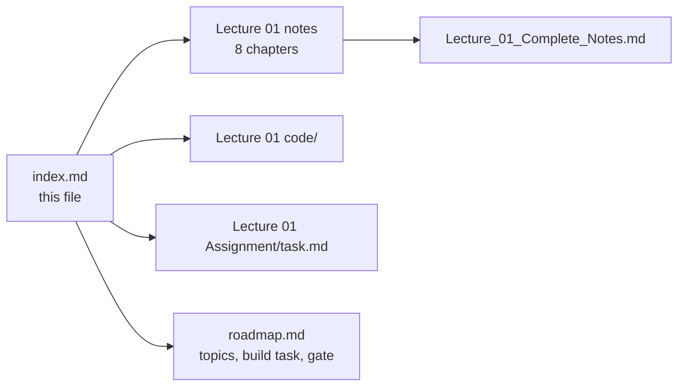
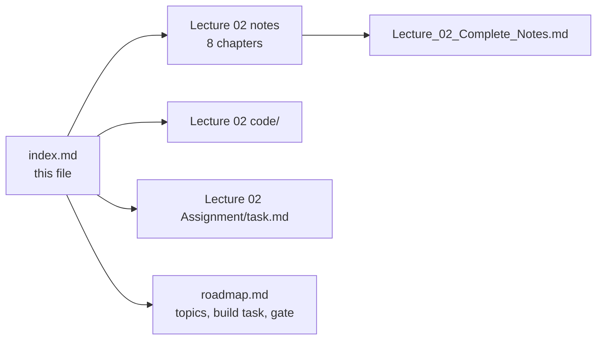

# 📚 Chapter Index

### The lecture notes index for this repository — one section per lecture

> **What this file is:** the chapter index for every lecture that has notes written. Each section lists
> the lecture's chapters with a number, a title, a one-line summary and a direct link to the file in
> that lecture's `notes/` folder — plus links to the lecture's `code/` and `Assignment/task.md`.
>
> **What this file is not:** the curriculum plan. For the topic list, goal, build task, gate and
> progress tracker of each lecture, use **[README.md](./README.md)** and **[roadmap.md](./roadmap.md)** —
> they are the single source of truth, so no topic is duplicated here.

**Repository navigation:** [README](./README.md) · [Roadmap](./roadmap.md) · [Progress Tracker (Appendix D)](./roadmap.md#-appendix-d--progress-tracker)

| | Section | Contents |
| :---: | :--- | :--- |
| 📚 | **[Lecture 01](#-lecture-01--introduction-to-fde-and-ai-history)** | 8 chapters + consolidated notes |
| 📚 | **[Lecture 02](#-lecture-02--llm-foundations)** | 8 chapters + consolidated notes |
| 📚 | **[Lecture 03](#-lecture-03--attention-and-decoding)** | 9 chapters + consolidated notes |
| 📚 | **[Lecture 04](#-lecture-04--llm-apis-and-multi-sdk)** | 9 chapters + consolidated notes |
| 🔜 | Lectures 05–31 | Notes not written yet — see the **[README curriculum navigation](./README.md#-curriculum-navigation)** |

---

## 🟦 Lecture 01 — Introduction to FDE and AI History

**Phase 0 · Orientation · 🟢 Beginner · 8 chapters + 1 consolidated document**
**Folder:** **[📂 Lecture 01 - Introduction to FDE and AI History](./Lecture%2001%20-%20Introduction%20to%20FDE%20and%20AI%20History/)** · **[📄 Roadmap: Phase 0](./roadmap.md#-phase-0--orientation)**

| # | Chapter | One-line summary | Notes |
| :---: | :--- | :--- | :--- |
| **01** | **The FDE Role & Requirement Discovery** | Why "we want a chatbot" is a proposed solution rather than a requirement; the 50k-query case study; the discovery workflow; primary vs guardrail metrics; the one-page discovery brief | [📄 Chapter 01](./Lecture%2001%20-%20Introduction%20to%20FDE%20and%20AI%20History/notes/01_The_FDE_Role_and_Requirement_Discovery.md) |
| **02** | **From Vague Request to Grounded Production System** | The three failed attempts (rules → ML classifier → naïve LLM); the grounded architecture around an application boundary; the lifecycle of a write request; the six production engineering considerations | [📄 Chapter 02](./Lecture%2001%20-%20Introduction%20to%20FDE%20and%20AI%20History/notes/02_From_Vague_Request_to_Grounded_Production_System.md) |
| **03** | **AI Foundations & Rule-Based Systems** | Turing (1950) and the Imitation Game; McCarthy coining "AI" at Dartmouth (1956); deterministic vs cognitive computing; expert systems (fact base + rule base + inference engine); ELIZA (1966); the combinatorial explosion | [📄 Chapter 03](./Lecture%2001%20-%20Introduction%20to%20FDE%20and%20AI%20History/notes/03_AI_Foundations_and_Rule_Based_Systems.md) |
| **04** | **Machine Learning & Deep Learning Foundations** | $Y = f(X; \Theta)$; training vs inference; prompting vs training vs fine-tuning; supervised, unsupervised and self-supervised learning; the feature-engineering bottleneck; representation learning; CNN vs RNN vs Transformer | [📄 Chapter 04](./Lecture%2001%20-%20Introduction%20to%20FDE%20and%20AI%20History/notes/04_Machine_Learning_and_Deep_Learning_Foundations.md) |
| **05** | **Natural Language Challenges & Statistical Language Models** | The six linguistic challenges (polysemy, word order, negation, coreference, sarcasm, productivity); the chain rule; frequency counting; n-grams and the Markov assumption; sparsity, smoothing and perplexity; Zipf's law and OOV | [📄 Chapter 05](./Lecture%2001%20-%20Introduction%20to%20FDE%20and%20AI%20History/notes/05_Natural_Language_Challenges_and_Statistical_Language_Models.md) |
| **06** | **Neural Language Models & the RNN Bottleneck** | Embeddings; the RNN recurrence; the information bottleneck and long-range decay; vanishing gradients; LSTM/GRU gating; encoder–decoder and the fixed-size context vector; teacher forcing and exposure bias | [📄 Chapter 06](./Lecture%2001%20-%20Introduction%20to%20FDE%20and%20AI%20History/notes/06_Neural_Language_Models_and_the_RNN_Bottleneck.md) |
| **07** | **Attention, Transformers & Modern LLMs** | *Attention Is All You Need*: Q/K/V, scaled dot-product attention and the $\sqrt{d_k}$ argument; multi-head attention; the full encoder–decoder; positional encodings; the complexity table; training methodology, ablations and BLEU; decoder-only GPT; KV cache, GQA, FlashAttention and RoPE | [📄 Chapter 07](./Lecture%2001%20-%20Introduction%20to%20FDE%20and%20AI%20History/notes/07_Attention_Transformers_and_Modern_LLMs.md) |
| **08** | **The Production AI Stack & the Evolutionary Matrix** | The six-row evolutionary matrix; the bottleneck chain; the **grounded · observable · secure · actionable** stack; the six mandatory production criteria; the NFR checklist; the FDE mindset and the 20 fundamental takeaways | [📄 Chapter 08](./Lecture%2001%20-%20Introduction%20to%20FDE%20and%20AI%20History/notes/08_Production_AI_Stack_and_Evolutionary_Matrix.md) |

### 📄 Consolidated notes

A single document combining all eight chapters — executive summary, arc diagram, cheat sheet, formulas,
complexity numbers, decision tables, 20 misconceptions, 20 self-check questions and a glossary, with
links back into the chapters for detail:

👉 **[Lecture_01_Complete_Notes.md](./Lecture%2001%20-%20Introduction%20to%20FDE%20and%20AI%20History/notes/Lecture_01_Complete_Notes.md)**

### 🧩 This lecture's other artefacts

| Artefact | Link | Status |
| :--- | :--- | :---: |
| Lecture workspace README (objectives · level · source mapping · checklist) | [📄 README.md](./Lecture%2001%20-%20Introduction%20to%20FDE%20and%20AI%20History/README.md) | ✅ |
| Chapter index for the lecture (reading order) | [📑 index.md](./Lecture%2001%20-%20Introduction%20to%20FDE%20and%20AI%20History/index.md) | ✅ |
| Rebuilt codebase — Basic Code · Production Code + implementation guides | [📂 code/](./Lecture%2001%20-%20Introduction%20to%20FDE%20and%20AI%20History/code/) | 🔜 to build |
| Assignment — chapter-wise practice, code tasks, capstone brief and the completion gate | [📝 Assignment/task.md](./Lecture%2001%20-%20Introduction%20to%20FDE%20and%20AI%20History/Assignment/task.md) | ✅ |



---

## 🟦 Lecture 02 — LLM Foundations

**Phase 1 · Foundations · 🟢 Beginner · 8 chapters + 1 consolidated document**
**Folder:** **[📂 Lecture 02 - LLM Foundations](./Lecture%2002%20-%20LLM%20Foundations/)** · **[📄 Roadmap: Phase 1](./roadmap.md#-phase-1--foundations-how-llms-actually-work)**

| # | Chapter | One-line summary | Notes |
| :---: | :--- | :--- | :--- |
| **01** | **What an LLM Is & Next-Token Prediction** | The one core task $P(t_n \mid t_1 \dots t_{n-1})$; GPT (the engine) vs ChatGPT (the car); the context-narrowing prompt experiment; the autoregressive loop and its per-token cost model; why emergent capability is a side effect of learning to predict | [📄 Chapter 01](./Lecture%2002%20-%20LLM%20Foundations/notes/01_What_an_LLM_Is_and_Next_Token_Prediction.md) |
| **02** | **The Text Pipeline & Why Token IDs Are Labels** | Why text must become numbers; raw text → tokens → token IDs as three distinct objects; the roll-number analogy (IDs are labels, not measurements); the forward pipeline, the streaming reverse pipeline and the seven pipeline invariants | [📄 Chapter 02](./Lecture%2002%20-%20LLM%20Foundations/notes/02_The_Text_Pipeline_and_Why_Token_IDs_Are_Labels.md) |
| **03** | **Tokenization Strategies: Word vs Character vs Subword** | Word level: vocabulary explosion and `<UNK>` information destruction; character level: sequence-length explosion and $O(N^2)$ attention cost; byte level as the shipped extreme; subword as the equilibrium; vocabulary-size trade-offs and the multilingual token tax | [📄 Chapter 03](./Lecture%2002%20-%20LLM%20Foundations/notes/03_Tokenization_Strategies_Word_Character_Subword.md) |
| **04** | **BPE, WordPiece, SentencePiece & the Vocabulary** | BPE trained by hand (count → merge → repeat); training versus encoding; WordPiece's `##` and likelihood-based merges; Unigram and SentencePiece's `▁`; byte-level BPE; vocabulary anatomy (base, merged, special, template, reserved); **why "strawberry" is hard** | [📄 Chapter 04](./Lecture%2002%20-%20LLM%20Foundations/notes/04_BPE_WordPiece_SentencePiece_and_Vocabulary.md) |
| **05** | **Tokenizers in Practice: `tiktoken` & Model Comparison** | `gpt2` / `cl100k_base` / `o200k_base` and the Llama, Gemini, Claude and Mistral families; local token counting with `tiktoken` (and when it is only an estimate); the per-request cost formula; the six-part context-window budget; token accounting inside a retrieval pipeline | [📄 Chapter 05](./Lecture%2002%20-%20LLM%20Foundations/notes/05_Tokenizers_in_Practice_tiktoken_and_Model_Comparison.md) |
| **06** | **Embeddings: Dense Vectors & Similarity** | The embedding lookup as a table read ($W_{\text{emb}} \in \mathbb{R}^{\lvert V\rvert \times d_{\text{model}}}$); why one-hot vectors fail; dot product vs cosine vs Euclidean; word arithmetic and its limits; static vs contextual embeddings and the `bank` problem; token embeddings vs retrieval embeddings | [📄 Chapter 06](./Lecture%2002%20-%20LLM%20Foundations/notes/06_Embeddings_Dense_Vectors_and_Similarity.md) |
| **07** | **Positional Encodings & Word Order** | Permutation invariance (`"Dog bites man"` vs `"Man bites dog"`); the additive formula $\mathbf{X}_{\text{in}} = \mathbf{E} + \mathbf{P}$; sinusoidal encodings and the linear-offset property; learned absolute, **RoPE** and **ALiBi**; the `"The cat sat on the mat"` trace; "lost in the middle" and prompt layout | [📄 Chapter 07](./Lecture%2002%20-%20LLM%20Foundations/notes/07_Positional_Encodings_and_Word_Order.md) |
| **08** | **Context Windows, Training vs Inference & the Complete Pipeline** | Capacity versus attention quality; the three costs of long sequences; truncation strategies; the training phase (free next-token labels, cross-entropy, pre-training → SFT → preference tuning); the inference phase (prefill, decode, KV cache); the master end-to-end pipeline and the FDE checklist | [📄 Chapter 08](./Lecture%2002%20-%20LLM%20Foundations/notes/08_Context_Windows_Training_vs_Inference_and_the_Complete_Pipeline.md) |

### 📄 Consolidated notes

A single document combining all eight chapters — executive summary, cheat sheet, formulas, tokenizer
comparison, decision tables, 25 misconceptions, glossary and 20 self-check questions, with links back into
the chapters for detail:

👉 **[Lecture_02_Complete_Notes.md](./Lecture%2002%20-%20LLM%20Foundations/notes/Lecture_02_Complete_Notes.md)**

### 🧩 This lecture's other artefacts

| Artefact | Link | Status |
| :--- | :--- | :---: |
| Lecture workspace README (objectives · level · source mapping · checklist) | [📄 README.md](./Lecture%2002%20-%20LLM%20Foundations/README.md) | ✅ |
| Chapter index for the lecture (reading order) | [📑 index.md](./Lecture%2002%20-%20LLM%20Foundations/index.md) | ✅ |
| **Basic Code** — Express + TypeScript, the **real `tiktoken` tokenizer**, every chapter as an endpoint | [📂 code/Basic Code](./Lecture%2002%20-%20LLM%20Foundations/code/Basic%20Code/) | ✅ |
| Chapter-wise implementation guide (10 chapters: full file, then a block-by-block explanation) | [📘 implementations guide](./Lecture%2002%20-%20LLM%20Foundations/code/Basic%20Code/implementations%20guide/) | ✅ |
| **Production Code** — provider adapters, budget guard, metrics and tests | [📂 code/](./Lecture%2002%20-%20LLM%20Foundations/code/) | 🔜 to build |
| Assignment — chapter-wise practice, code tasks, the cross-provider token report and the completion gate | [📝 Assignment/task.md](./Lecture%2002%20-%20LLM%20Foundations/Assignment/task.md) | ✅ |



---

## 🟦 Lecture 03 — Attention and Decoding

**Phase 1 · Foundations · 🟢 Beginner · 9 chapters + 1 consolidated document**
**Folder:** **[📂 Lecture 03 - Attention and Decoding](./Lecture%2003%20-%20Attention%20and%20Decoding/)** · **[📄 Roadmap: Phase 1](./roadmap.md#-phase-1--foundations-how-llms-actually-work)**

| # | Chapter | One-line summary | Notes |
| :---: | :--- | :--- | :--- |
| **01** | **Why Attention: From Static Vectors to Dynamic Context** | The problem attention solves — a static embedding lookup can never be context-dependent (`bank`, `it`, `his`); attention as a **differentiable soft database lookup**; self vs cross attention and the four modes; the $O(1)$ path-length argument against RNNs; why an attention row **is** a probability distribution; and what attention does *not* do | [📄 Chapter 01](./Lecture%2003%20-%20Attention%20and%20Decoding/notes/01_Why_Attention_From_Static_Vectors_to_Dynamic_Context.md) |
| **02** | **Queries, Keys & Values: The Attention Search Engine** | One token vector, three projections — **Query** (what I look for), **Key** (what I am findable as), **Value** (what I contribute); the shapes and the parameter cost $3d_{\text{model}}^2$ (independent of $N$); the $N \times N$ score matrix $QK^{T}$; why $W_Q$ must differ from $W_K$; and the **KV cache** (why $Q$ is not in it) | [📄 Chapter 02](./Lecture%2003%20-%20Attention%20and%20Decoding/notes/02_Queries_Keys_Values_The_Attention_Search_Engine.md) |
| **03** | **Scaled Dot-Product Attention, By Hand** | $\text{softmax}\!\left(\frac{QK^{T}}{\sqrt{d_k}}\right)V$ symbol by symbol; the five steps **score → scale → mask → softmax → mix**; the lecture's worked trace for `"on"`; *why* $1/\sqrt{d_k}$ (a variance argument **and** a gradient argument); the causal mask and why it is $-Infinity$ rather than $0$; numerical stability via the row maximum; the $N^2$ cost model | [📄 Chapter 03](./Lecture%2003%20-%20Attention%20and%20Decoding/notes/03_Scaled_Dot_Product_Attention_by_Hand.md) |
| **04** | **Multi-Head Attention & Head Specialisation** | Why one attention pattern is not enough; $\text{Concat}(\text{head}_1 \dots \text{head}_h)W^{O}$; $d_{\text{head}} = d_{\text{model}}/h$ and why multi-head is **nearly free** (identical projections and identical mixing FLOPs); what heads specialise in (and why a head's weights are *not* an explanation); **MQA/GQA** and the KV-cache saving | [📄 Chapter 04](./Lecture%2003%20-%20Attention%20and%20Decoding/notes/04_Multi_Head_Attention_and_Head_Specialisation.md) |
| **05** | **The Transformer Block & the Residual Stream** | **A Transformer is not attention** — six operations: LayerNorm → multi-head attention → residual → LayerNorm → FFN → residual; pre-LN vs post-LN and RMSNorm; the **residual stream** as a shared memory bus; why the FFN is the only place new features are computed; and where the parameters actually live (**FFN ≈ two-thirds**) | [📄 Chapter 05](./Lecture%2003%20-%20Attention%20and%20Decoding/notes/05_The_Transformer_Block_and_the_Residual_Stream.md) |
| **06** | **Encoder-Decoder vs Decoder-Only & Why GPT Is Decoder-Only** | The three families differ in exactly **one** place — the mask; the 2017 encoder + decoder + cross-attention; the three attention modes; the **five reasons** GPT is decoder-only; what decoder-only gave up and where it went; prefix-LM; and the training/inference asymmetry that makes serving expensive | [📄 Chapter 06](./Lecture%2003%20-%20Attention%20and%20Decoding/notes/06_Encoder_Decoder_vs_Decoder_Only_and_Why_GPT.md) |
| **07** | **Logits, the LM Head & Softmax** | $H_{\text{final}} \rightarrow W_{\text{lm}} \rightarrow$ logits $\rightarrow$ softmax $\rightarrow$ distribution; what logits **are not** (unnormalised scores in log-space, not probabilities); the LM head's shape and weight tying; the three softmax properties (**shift invariance · scale sensitivity · ranking preservation**); log probabilities; and logit bias / vocabulary masking as constrained decoding | [📄 Chapter 07](./Lecture%2003%20-%20Attention%20and%20Decoding/notes/07_Logits_the_LM_Head_and_Softmax.md) |
| **08** | **Decoding Strategies & Sampling Controls** | The model **proposes**, the decoder **selects**; greedy, beam and sampling; **temperature** (dividing the logits — it changes the gaps, never the ranking); top-k, top-p (nucleus) and min-p; penalties, stop conditions and length limits; the **fixed order of operations**; determinism and seeds; why ChatGPT streams; and parameter recipes per task | [📄 Chapter 08](./Lecture%2003%20-%20Attention%20and%20Decoding/notes/08_Decoding_Strategies_and_Sampling_Controls.md) |
| **09** | **Position, Masking & Attention Geometry** | Why self-attention is permutation invariant; sinusoidal encodings and the **linear-offset property**; the four positional schemes compared; **RoPE** (rotation instead of addition) and context extension; **ALiBi** (a distance penalty, no positional vector); the geometry of masks — one mechanism, **two axes**; and the runtime consequences: "lost in the middle", chunk order, advertised vs usable context | [📄 Chapter 09](./Lecture%2003%20-%20Attention%20and%20Decoding/notes/09_Position_Masking_and_Attention_Geometry.md) |

### 📄 Consolidated notes

A single document combining all nine chapters — executive summary, cheat sheet (formulas, shapes, the
parameter budget, the five attention steps, the decoding order), **four decision tables**, a 17-stage
end-to-end walkthrough, **25 misconceptions**, a four-part glossary and **20 self-check questions**, with
links back into the chapters for detail:

👉 **[Lecture_03_Complete_Notes.md](./Lecture%2003%20-%20Attention%20and%20Decoding/notes/Lecture_03_Complete_Notes.md)**

### 🧩 This lecture's other artefacts

| Artefact | Link | Status |
| :--- | :--- | :---: |
| Lecture workspace README (objectives · level · source mapping · checklist) | [📄 README.md](./Lecture%2003%20-%20Attention%20and%20Decoding/README.md) | ✅ |
| Chapter index for the lecture (reading order) | [📑 index.md](./Lecture%2003%20-%20Attention%20and%20Decoding/index.md) | ✅ |
| **Basic Code** — Express + TypeScript with **no ML library**: 15 endpoints computing Q/K/V, the score matrix, the block, logits and sampling by hand, all reproducible | [📂 code/Basic Code](./Lecture%2003%20-%20Attention%20and%20Decoding/code/Basic%20Code/) | ✅ |
| Chapter-wise implementation guide (11 chapters: the full file, then a block-by-block explanation) | [📘 implementations guide](./Lecture%2003%20-%20Attention%20and%20Decoding/code/Basic%20Code/implementations%20guide/) | ✅ |
| **Production Code** — a defended serving layer (batching, KV-cache accounting, metrics, tests) | [📂 code/](./Lecture%2003%20-%20Attention%20and%20Decoding/code/) | 🔜 to build |
| Assignment — 103 practice questions, 6 code extensions, the attention-by-hand capstone and the completion gate | [📝 Assignment/task.md](./Lecture%2003%20-%20Attention%20and%20Decoding/Assignment/task.md) | ✅ |


---

## 🟩 Lecture 04 — LLM APIs and Multi-SDK

**Phase 2 · The Application Layer · 🟢 Beginner · 9 chapters + 1 consolidated document**
**Folder:** **[📂 Lecture 04 - LLM APIs and Multi-SDK](./Lecture%2004%20-%20LLM%20APIs%20and%20Multi-SDK/)** · **[📄 Roadmap: Phase 2](./roadmap.md#-phase-2--the-application-layer-talking-to-models)**

| # | Chapter | One-line summary | Notes |
| :---: | :--- | :--- | :--- |
| **01** | **GenAI Applications vs Raw LLMs — the Engine vs Car Model** | Why typing into a web chat is not "talking to a neural network"; the **engine vs car** analogy (the model is the capability, your application is the vehicle); raw LLM vs tool-augmented application in two scenarios; the knowledge-cutoff problem; the **cardinal rule** — *the LLM only knows what reaches the LLM* — with its responsibility matrix; web UI vs API; what this means for an FDE | [📄 Chapter 01](./Lecture%2004%20-%20LLM%20APIs%20and%20Multi-SDK/notes/01_GenAI_Applications_vs_Raw_LLMs_The_Engine_vs_Car_Model.md) |
| **02** | **The LLM API Protocol — HTTP, the Four Components & Postman** | It is just an HTTPS `POST` with a JSON body; the **four invariant components** at transport level (endpoint · authentication · model · input) and at payload level (`model` · `messages` · `params` · optional `tools`); the request lifecycle; the **Postman/curl prototype rule** — prove the wire before writing service code; the status-code taxonomy (400 · 401 · 404 · 413 · 429 · 5xx); the enterprise support-ticket triage case study | [📄 Chapter 02](./Lecture%2004%20-%20LLM%20APIs%20and%20Multi-SDK/notes/02_The_LLM_API_Protocol_HTTP_Components_and_Postman.md) |
| **03** | **Message Roles & Prompt Hygiene** | Statelessness — there is no memory, only re-sending (and re-paying); the five roles and their **privilege hierarchy**; chat templates and control tokens; system instructions vs user prompts; the **concatenation anti-pattern** → prompt injection and goal hijacking; reconstructing multi-turn history and the truncation rules; the pre-ship hygiene checklist; role support across providers | [📄 Chapter 03](./Lecture%2004%20-%20LLM%20APIs%20and%20Multi-SDK/notes/03_Message_Roles_and_Prompt_Hygiene.md) |
| **04** | **Token Economics — Prefill vs Decode, Metadata & Cost** | The response envelope (content vs metadata); **prefill vs decode** and why the output half is the expensive one; the cost formula with three worked examples; **TTFT and ITL** latency; context-window saturation vs the bill; turning metadata into telemetry; the 10-page incident-report case study; unit economics and the decisions it unlocks | [📄 Chapter 04](./Lecture%2004%20-%20LLM%20APIs%20and%20Multi-SDK/notes/04_Token_Economics_Prefill_Decode_Metadata_and_Cost.md) |
| **05** | **Token Counting & Context Budgeting with Tokenizers** | BPE in four steps; the tokenizer/vocabulary comparison and the **multilingual token tax**; `tiktoken` in practice; the character heuristics and which way their error is dangerous; the **budgeting algorithm** (reserve output, then system, then user, then history oldest-first) and the three truncation strategies; a worked 128k budget; reconciling the local estimate against the provider's `usage` | [📄 Chapter 05](./Lecture%2004%20-%20LLM%20APIs%20and%20Multi-SDK/notes/05_Token_Counting_and_Context_Budgeting_with_Tokenizers.md) |
| **06** | **Rate Limits, Quotas, Throttling & Retry/Backoff** | The two ceilings — **RPM vs TPM** — and why RPM alone is a trap; the wider quota landscape; reading a `429` correctly (`Retry-After` and the rate-limit headers); **exponential backoff with jitter** and which failures are actually retryable; client-side protections; idempotency; the **degradation ladder**; the metrics that predict an outage before it happens | [📄 Chapter 06](./Lecture%2004%20-%20LLM%20APIs%20and%20Multi-SDK/notes/06_Rate_Limits_Quotas_Throttling_and_Retry_Backoff.md) |
| **07** | **Multi-SDK Integration — OpenAI · Gemini · Groq · Mistral · Claude · Ollama** | What an SDK is — and is not; the four access layers and what each one costs you; the provider-by-provider **naming trap** (`messages` vs `contents`, `assistant` vs `model`, `max_tokens` vs `maxOutputTokens`); response shapes compared; the **adapter pattern** — one interface, many providers; OpenAI-compatible base URLs; **Ollama** local vs hosted; routing, fallback and cost control; testing across providers | [📄 Chapter 07](./Lecture%2004%20-%20LLM%20APIs%20and%20Multi-SDK/notes/07_Multi_SDK_Integration_OpenAI_Gemini_Groq_Mistral_Anthropic_Ollama.md) |
| **08** | **Building the Service — Express, TypeScript, Config, Singletons & Telemetry** | Why the backend owns the AI call; the project layout and the ESM + TypeScript toolchain; the layered architecture and what each layer must *not* know; **Zod-validated configuration** and fail-fast boot; client singletons and connection pooling; request validation before you spend; the service layer; routes, health checks and **error mapping**; telemetry and structured logging; secrets hygiene and the key-rotation runbook | [📄 Chapter 08](./Lecture%2004%20-%20LLM%20APIs%20and%20Multi-SDK/notes/08_Building_the_Service_Express_TypeScript_Config_Singletons_and_Telemetry.md) |
| **09** | **AI Slop & Model Collapse** | Two terms side by side — one is your output *today*, the other is the model *over time*; AI slop's economic engine and its in-product symptoms; **model collapse** as a recursive training loop, and what specifically degrades; the honest caveats; the four mitigation families (human review · high-quality data · guardrails · continuous evaluation); the anti-slop checklist for your own pipeline | [📄 Chapter 09](./Lecture%2004%20-%20LLM%20APIs%20and%20Multi-SDK/notes/09_AI_Slop_and_Model_Collapse.md) |

### 📄 Consolidated notes

A single document combining all nine chapters — executive summary, a ten-part cheat sheet (request shape, transport components, roles, cost and latency formulas, prefill vs decode, token estimates, status codes, provider call signatures, environment variables, the telemetry record), **six decision tables**, **25 misconceptions**, a ~35-term glossary and **20 self-check questions**, with links back into the chapters for detail:

👉 **[Lecture_04_Complete_Notes.md](./Lecture%2004%20-%20LLM%20APIs%20and%20Multi-SDK/notes/Lecture_04_Complete_Notes.md)**

### 🧩 This lecture's other artefacts

| Artefact | Link | Status |
| :--- | :--- | :---: |
| Lecture workspace README (objectives · level · source mapping · checklist) | [📄 README.md](./Lecture%2004%20-%20LLM%20APIs%20and%20Multi-SDK/README.md) | ✅ |
| Chapter index for the lecture (reading order) | [📑 index.md](./Lecture%2004%20-%20LLM%20APIs%20and%20Multi-SDK/index.md) | 🔜 to write |
| **Basic Code** — Express + TypeScript service that calls a **real** provider: 12 files, 3 endpoints (`/api/health` · `/api/chat` · `/api/tokens/count`), one `Provider` interface across 5 providers, Zod-validated config, a context-budget guard, retry with backoff + jitter, and a cost / slop / telemetry ledger on every call | [📂 code/Basic Code](./Lecture%2004%20-%20LLM%20APIs%20and%20Multi-SDK/code/Basic%20Code/) | ✅ |
| Chapter-wise implementation guide (10 chapters, 00 → 09: the full file, then a block-by-block explanation) | [📘 implementations guide](./Lecture%2004%20-%20LLM%20APIs%20and%20Multi-SDK/code/Basic%20Code/implementations%20guide/) | ✅ |
| **Production Code** — a defended serving layer (client-side throttling, per-caller cost ceilings, conformance tests, structured logging) | [📂 code/](./Lecture%2004%20-%20LLM%20APIs%20and%20Multi-SDK/code/) | 🔜 to build |
| Assignment — 9 chapter-wise question sets, 6 code extensions, the Support Ticket Summarizer + three-provider conformance capstone, and the completion gate | [📝 Assignment/task.md](./Lecture%2004%20-%20LLM%20APIs%20and%20Multi-SDK/Assignment/task.md) | ✅ |


---

## ➕ Adding the next lecture

When a lecture's notes are written, append a section above using the same shape — **do not restructure
the existing ones**:

```markdown
## 🟦 Lecture NN — <Title>

**Phase N · <Level> · X chapters**
**Folder:** **[📂 Lecture NN - <Title>](./Lecture%20NN%20-%20<Title>/)** 

| # | Chapter | One-line summary | Notes |
| :---: | :--- | :--- | :--- |
| **01** | **<Chapter title>** | <one line> | [📄 Chapter 01](./Lecture%20NN%20-%20<Title>/notes/01_<file>.md) |
```

Then tick the lecture in **[roadmap.md → Appendix D](./roadmap.md#-appendix-d--progress-tracker)**
(`Notes written` · `Code built` · `Gate passed`).
