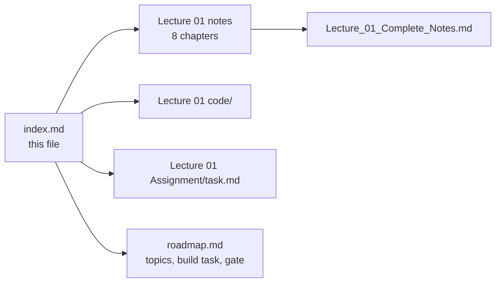
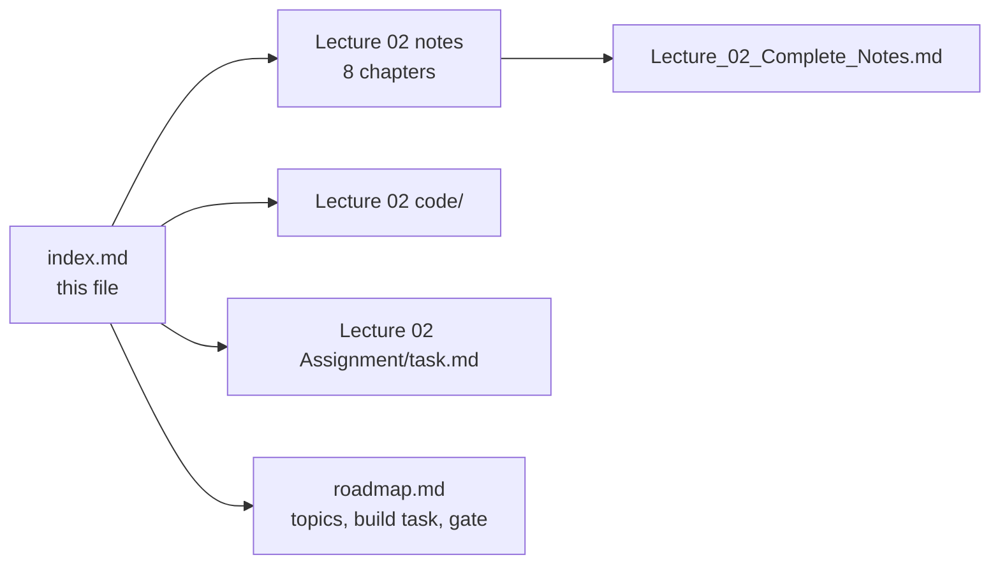

# 📚 Chapter Index

### The lecture notes index for this repository — one section per lecture

> **What this file is:** the chapter index for every lecture that has notes written. Each section lists
> the lecture's chapters with a number, a title, a one-line summary and a direct link to the file in
> that lecture's `notes/` folder — plus links to the lecture's `code/` and `Assignment/task.md`.
>
> **What this file is not:** the curriculum plan. For the topic list, goal, build task, gate and
> progress tracker of each lecture, use **[README.md](./README.md)** and **[roadmap.md](./roadmap.md)** —
> they are the single source of truth, so no topic is duplicated here.

**Repository navigation:** [README](./README.md) · [Roadmap](./roadmap.md) · [Progress Tracker (Appendix D)](./roadmap.md#-appendix-d--progress-tracker)

| | Section | Contents |
| :---: | :--- | :--- |
| 📚 | **[Lecture 01](#-lecture-01--introduction-to-fde-and-ai-history)** | 8 chapters + consolidated notes |
| 📚 | **[Lecture 02](#-lecture-02--llm-foundations)** | 8 chapters + consolidated notes |
| 🔜 | Lectures 03–31 | Notes not written yet — see the **[README curriculum navigation](./README.md#-curriculum-navigation)** |

---

## 🟦 Lecture 01 — Introduction to FDE and AI History

**Phase 0 · Orientation · 🟢 Beginner · 8 chapters + 1 consolidated document**
**Folder:** **[📂 Lecture 01 - Introduction to FDE and AI History](./Lecture%2001%20-%20Introduction%20to%20FDE%20and%20AI%20History/)** · **[📄 Roadmap: Phase 0](./roadmap.md#-phase-0--orientation)**

| # | Chapter | One-line summary | Notes |
| :---: | :--- | :--- | :--- |
| **01** | **The FDE Role & Requirement Discovery** | Why "we want a chatbot" is a proposed solution rather than a requirement; the 50k-query case study; the discovery workflow; primary vs guardrail metrics; the one-page discovery brief | [📄 Chapter 01](./Lecture%2001%20-%20Introduction%20to%20FDE%20and%20AI%20History/notes/01_The_FDE_Role_and_Requirement_Discovery.md) |
| **02** | **From Vague Request to Grounded Production System** | The three failed attempts (rules → ML classifier → naïve LLM); the grounded architecture around an application boundary; the lifecycle of a write request; the six production engineering considerations | [📄 Chapter 02](./Lecture%2001%20-%20Introduction%20to%20FDE%20and%20AI%20History/notes/02_From_Vague_Request_to_Grounded_Production_System.md) |
| **03** | **AI Foundations & Rule-Based Systems** | Turing (1950) and the Imitation Game; McCarthy coining "AI" at Dartmouth (1956); deterministic vs cognitive computing; expert systems (fact base + rule base + inference engine); ELIZA (1966); the combinatorial explosion | [📄 Chapter 03](./Lecture%2001%20-%20Introduction%20to%20FDE%20and%20AI%20History/notes/03_AI_Foundations_and_Rule_Based_Systems.md) |
| **04** | **Machine Learning & Deep Learning Foundations** | $Y = f(X; \Theta)$; training vs inference; prompting vs training vs fine-tuning; supervised, unsupervised and self-supervised learning; the feature-engineering bottleneck; representation learning; CNN vs RNN vs Transformer | [📄 Chapter 04](./Lecture%2001%20-%20Introduction%20to%20FDE%20and%20AI%20History/notes/04_Machine_Learning_and_Deep_Learning_Foundations.md) |
| **05** | **Natural Language Challenges & Statistical Language Models** | The six linguistic challenges (polysemy, word order, negation, coreference, sarcasm, productivity); the chain rule; frequency counting; n-grams and the Markov assumption; sparsity, smoothing and perplexity; Zipf's law and OOV | [📄 Chapter 05](./Lecture%2001%20-%20Introduction%20to%20FDE%20and%20AI%20History/notes/05_Natural_Language_Challenges_and_Statistical_Language_Models.md) |
| **06** | **Neural Language Models & the RNN Bottleneck** | Embeddings; the RNN recurrence; the information bottleneck and long-range decay; vanishing gradients; LSTM/GRU gating; encoder–decoder and the fixed-size context vector; teacher forcing and exposure bias | [📄 Chapter 06](./Lecture%2001%20-%20Introduction%20to%20FDE%20and%20AI%20History/notes/06_Neural_Language_Models_and_the_RNN_Bottleneck.md) |
| **07** | **Attention, Transformers & Modern LLMs** | *Attention Is All You Need*: Q/K/V, scaled dot-product attention and the $\sqrt{d_k}$ argument; multi-head attention; the full encoder–decoder; positional encodings; the complexity table; training methodology, ablations and BLEU; decoder-only GPT; KV cache, GQA, FlashAttention and RoPE | [📄 Chapter 07](./Lecture%2001%20-%20Introduction%20to%20FDE%20and%20AI%20History/notes/07_Attention_Transformers_and_Modern_LLMs.md) |
| **08** | **The Production AI Stack & the Evolutionary Matrix** | The six-row evolutionary matrix; the bottleneck chain; the **grounded · observable · secure · actionable** stack; the six mandatory production criteria; the NFR checklist; the FDE mindset and the 20 fundamental takeaways | [📄 Chapter 08](./Lecture%2001%20-%20Introduction%20to%20FDE%20and%20AI%20History/notes/08_Production_AI_Stack_and_Evolutionary_Matrix.md) |

### 📄 Consolidated notes

A single document combining all eight chapters — executive summary, arc diagram, cheat sheet, formulas,
complexity numbers, decision tables, 20 misconceptions, 20 self-check questions and a glossary, with
links back into the chapters for detail:

👉 **[Lecture_01_Complete_Notes.md](./Lecture%2001%20-%20Introduction%20to%20FDE%20and%20AI%20History/notes/Lecture_01_Complete_Notes.md)**

### 🧩 This lecture's other artefacts

| Artefact | Link | Status |
| :--- | :--- | :---: |
| Lecture workspace README (objectives · level · source mapping · checklist) | [📄 README.md](./Lecture%2001%20-%20Introduction%20to%20FDE%20and%20AI%20History/README.md) | ✅ |
| Chapter index for the lecture (reading order) | [📑 index.md](./Lecture%2001%20-%20Introduction%20to%20FDE%20and%20AI%20History/index.md) | ✅ |
| Rebuilt codebase — Basic Code · Production Code + implementation guides | [📂 code/](./Lecture%2001%20-%20Introduction%20to%20FDE%20and%20AI%20History/code/) | 🔜 to build |
| Assignment — chapter-wise practice, code tasks, capstone brief and the completion gate | [📝 Assignment/task.md](./Lecture%2001%20-%20Introduction%20to%20FDE%20and%20AI%20History/Assignment/task.md) | ✅ |



---

## 🟦 Lecture 02 — LLM Foundations

**Phase 1 · Foundations · 🟢 Beginner · 8 chapters + 1 consolidated document**
**Folder:** **[📂 Lecture 02 - LLM Foundations](./Lecture%2002%20-%20LLM%20Foundations/)** · **[📄 Roadmap: Phase 1](./roadmap.md#-phase-1--foundations-how-llms-actually-work)**

| # | Chapter | One-line summary | Notes |
| :---: | :--- | :--- | :--- |
| **01** | **What an LLM Is & Next-Token Prediction** | The one core task $P(t_n \mid t_1 \dots t_{n-1})$; GPT (the engine) vs ChatGPT (the car); the context-narrowing prompt experiment; the autoregressive loop and its per-token cost model; why emergent capability is a side effect of learning to predict | [📄 Chapter 01](./Lecture%2002%20-%20LLM%20Foundations/notes/01_What_an_LLM_Is_and_Next_Token_Prediction.md) |
| **02** | **The Text Pipeline & Why Token IDs Are Labels** | Why text must become numbers; raw text → tokens → token IDs as three distinct objects; the roll-number analogy (IDs are labels, not measurements); the forward pipeline, the streaming reverse pipeline and the seven pipeline invariants | [📄 Chapter 02](./Lecture%2002%20-%20LLM%20Foundations/notes/02_The_Text_Pipeline_and_Why_Token_IDs_Are_Labels.md) |
| **03** | **Tokenization Strategies: Word vs Character vs Subword** | Word level: vocabulary explosion and `<UNK>` information destruction; character level: sequence-length explosion and $O(N^2)$ attention cost; byte level as the shipped extreme; subword as the equilibrium; vocabulary-size trade-offs and the multilingual token tax | [📄 Chapter 03](./Lecture%2002%20-%20LLM%20Foundations/notes/03_Tokenization_Strategies_Word_Character_Subword.md) |
| **04** | **BPE, WordPiece, SentencePiece & the Vocabulary** | BPE trained by hand (count → merge → repeat); training versus encoding; WordPiece's `##` and likelihood-based merges; Unigram and SentencePiece's `▁`; byte-level BPE; vocabulary anatomy (base, merged, special, template, reserved); **why "strawberry" is hard** | [📄 Chapter 04](./Lecture%2002%20-%20LLM%20Foundations/notes/04_BPE_WordPiece_SentencePiece_and_Vocabulary.md) |
| **05** | **Tokenizers in Practice: `tiktoken` & Model Comparison** | `gpt2` / `cl100k_base` / `o200k_base` and the Llama, Gemini, Claude and Mistral families; local token counting with `tiktoken` (and when it is only an estimate); the per-request cost formula; the six-part context-window budget; token accounting inside a retrieval pipeline | [📄 Chapter 05](./Lecture%2002%20-%20LLM%20Foundations/notes/05_Tokenizers_in_Practice_tiktoken_and_Model_Comparison.md) |
| **06** | **Embeddings: Dense Vectors & Similarity** | The embedding lookup as a table read ($W_{\text{emb}} \in \mathbb{R}^{\lvert V\rvert \times d_{\text{model}}}$); why one-hot vectors fail; dot product vs cosine vs Euclidean; word arithmetic and its limits; static vs contextual embeddings and the `bank` problem; token embeddings vs retrieval embeddings | [📄 Chapter 06](./Lecture%2002%20-%20LLM%20Foundations/notes/06_Embeddings_Dense_Vectors_and_Similarity.md) |
| **07** | **Positional Encodings & Word Order** | Permutation invariance (`"Dog bites man"` vs `"Man bites dog"`); the additive formula $\mathbf{X}_{\text{in}} = \mathbf{E} + \mathbf{P}$; sinusoidal encodings and the linear-offset property; learned absolute, **RoPE** and **ALiBi**; the `"The cat sat on the mat"` trace; "lost in the middle" and prompt layout | [📄 Chapter 07](./Lecture%2002%20-%20LLM%20Foundations/notes/07_Positional_Encodings_and_Word_Order.md) |
| **08** | **Context Windows, Training vs Inference & the Complete Pipeline** | Capacity versus attention quality; the three costs of long sequences; truncation strategies; the training phase (free next-token labels, cross-entropy, pre-training → SFT → preference tuning); the inference phase (prefill, decode, KV cache); the master end-to-end pipeline and the FDE checklist | [📄 Chapter 08](./Lecture%2002%20-%20LLM%20Foundations/notes/08_Context_Windows_Training_vs_Inference_and_the_Complete_Pipeline.md) |

### 📄 Consolidated notes

A single document combining all eight chapters — executive summary, cheat sheet, formulas, tokenizer
comparison, decision tables, 25 misconceptions, glossary and 20 self-check questions, with links back into
the chapters for detail:

👉 **[Lecture_02_Complete_Notes.md](./Lecture%2002%20-%20LLM%20Foundations/notes/Lecture_02_Complete_Notes.md)**

### 🧩 This lecture's other artefacts

| Artefact | Link | Status |
| :--- | :--- | :---: |
| Lecture workspace README (objectives · level · source mapping · checklist) | [📄 README.md](./Lecture%2002%20-%20LLM%20Foundations/README.md) | ✅ |
| Chapter index for the lecture (reading order) | [📑 index.md](./Lecture%2002%20-%20LLM%20Foundations/index.md) | ✅ |
| **Basic Code** — Express + TypeScript, the **real `tiktoken` tokenizer**, every chapter as an endpoint | [📂 code/Basic Code](./Lecture%2002%20-%20LLM%20Foundations/code/Basic%20Code/) | ✅ |
| Chapter-wise implementation guide (full file, then a block-by-block explanation) | [📘 implementations guide](./Lecture%2002%20-%20LLM%20Foundations/code/Basic%20Code/implementations%20guide/) | 🚧 2 of 10 chapters |
| **Production Code** — provider adapters, budget guard, metrics and tests | [📂 code/](./Lecture%2002%20-%20LLM%20Foundations/code/) | 🔜 to build |
| Assignment — chapter-wise practice, code tasks, the cross-provider token report and the completion gate | [📝 Assignment/task.md](./Lecture%2002%20-%20LLM%20Foundations/Assignment/task.md) | ✅ |



---

## ➕ Adding the next lecture

When a lecture's notes are written, append a section above using the same shape — **do not restructure
the existing ones**:

```markdown
## 🟦 Lecture NN — <Title>

**Phase N · <Level> · X chapters**
**Folder:** **[📂 Lecture NN - <Title>](./Lecture%20NN%20-%20<Title>/)**

| # | Chapter | One-line summary | Notes |
| :---: | :--- | :--- | :--- |
| **01** | **<Chapter title>** | <one line> | [📄 Chapter 01](./Lecture%20NN%20-%20<Title>/notes/01_<file>.md) |
```

Then tick the lecture in **[roadmap.md → Appendix D](./roadmap.md#-appendix-d--progress-tracker)**
(`Notes written` · `Code built` · `Gate passed`).


