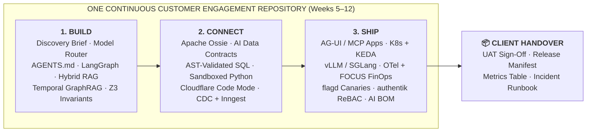

# 🗺️ Forward Deployed Engineer & GenAI Mastery — Master Roadmap v1 (`45 Lectures`)

<div align="center">

[-blueviolet?style=for-the-badge&logo=googlegemini&logoColor=white)](#-phase-graph)
[](#-macro-delivery-phases)
[](#-appendix-d--progress-tracker)
[](#-appendix-c--tech-stack-prerequisites--study-plan)

```text
████████████████████████████████  45 / 45 Lectures Built (100.0%) · 32 Existing/Upgraded + 13 New FDE Modules Complete
```

**[🗺️ Phase Graph](#-phase-graph)** • **[🪜 Career Ladder](#-the-career-capability-ladder)** • **[📚 45 Lecture Cards](#-phase-0--orientation)** • **[📈 Progress Tracker](#-appendix-d--progress-tracker)** • **[🏁 Capstone](#-capstone--single-engagement-proving-ground)** • **[🗂️ Appendices](#-appendix-a--re-numbering--de-duplication-map)**

</div>

---

> [!IMPORTANT]
> **What `roadmap-v1.md` is:** The upgraded **45-Lecture + Single-Engagement Capstone** master map merging the original 32-lecture curriculum ([`roadmap.md`](./roadmap.md)) with the **24-Session FDE Delivery Curriculum** (`Build → Connect → Ship`) and **Cloudflare Code Mode** ([`update.md`](./update.md)).
>
> **How it is organized:** **3 Macro Delivery Stages** (`Build` · `Connect` · `Ship`) spanning **11 Technical Phases (`0`–`10`)** and **45 sequential lectures (`L01`–`L45`)**. Existing workspaces keep clickable links to their current folders until you run the optional folder-renumbering migration.

---

## 🧭 Macro Delivery Phases

| Macro Stage | Technical Phases | Lectures | Core FDE Mandate | Coverage |
| :--- | :---: | :---: | :--- | :---: |
| **1 · BUILD** *(Engineer AI Systems)* | `0` – `5` | `L01` – `L23` | Foundations, prompt caching, model routing, `AGENTS.md`/SDD/TDD, tool loops, A2A, LangGraph, vectors, hybrid RAG, memory & GraphRAG | `21 Existing · 2 New` |
| **2 · CONNECT** *(Enterprise Data & APIs)* | `6` – `7` | `L24` – `L32` | Data estates, Apache Ossie, AI data contracts, lakehouse lifecycle, semantic Text-to-SQL, sandboxed Python, MCP, **Cloudflare Code Mode**, CDC & Inngest | `4 Existing · 5 New` |
| **3 · SHIP** *(Scale, Ops, Identity & Security)* | `8` – `10` | `L33` – `L45` | Multimodal, full-stack apps, `AG-UI`/`MCP Apps`, K8s/KEDA, vLLM & disaggregated inference (`SGLang`/`llm-d`), evals, Z3/GEPA, OTel/FOCUS FinOps, `flagd` canaries, OIDC/ReBAC & AI BOM | `7 Existing · 6 New` |
| **★ · CAPSTONE** *(One Engagement)* | `All` | `Weeks 5–12` | Apply every layer onto **one continuous customer engagement repository** from discovery to UAT & handover | `Single-Engagement` |

---

## 🗺️ Phase Graph

```mermaid
flowchart TD
    classDef build fill:#1e293b,stroke:#3b82f6,stroke-width:2px,color:#f8fafc;
    classDef connect fill:#1e293b,stroke:#a855f7,stroke-width:2px,color:#f8fafc;
    classDef ship fill:#1e293b,stroke:#10b981,stroke-width:2px,color:#f8fafc;
    classDef cap fill:#312e81,stroke:#fbbf24,stroke-width:3px,color:#fbbf24;

    subgraph BUILD["🔵 STAGE 1: BUILD — Engineer Intelligent AI Systems (L01–L23)"]
        P0["<b>Phase 0 · Orientation</b><br/>L01: FDE Role & AI History"]:::build
        P1["<b>Phase 1 · LLM Foundations</b><br/>L02: Tokens & Embeddings · L03: Attention & Decoding"]:::build
        P2["<b>Phase 2 · App Layer & Harness Velocity</b><br/>L04: APIs & Caching · L05: Prompts<br/>L06: Context Compaction · L07: Streaming<br/>🆕 L08: Routing, AGENTS.md & SDD/TDD"]:::build
        P3["<b>Phase 3 · Agency, Graphs & Loops</b><br/>L09: Tools · L10: Sandboxing & HITL · L11: Zod<br/>L12: Agent SDK · L13: LangChain/LangGraph/LangSmith<br/>🆕 L14: Loop Engineering & A2A Protocol"]:::build
        P4["<b>Phase 4 · Vector Meaning & ANN</b><br/>L15: Embeddings · L16: Semantic Search<br/>L17: Scale kNN · L18: IVF, HNSW & PQ"]:::build
        P5["<b>Phase 5 · RAG, Memory & Knowledge Graphs</b><br/>L19: RAG · L20: Adv RAG (Provenance/Abstention)<br/>L21: Vectorless · L22: Memory & Expiry<br/>L23: GraphRAG, Ontologies & Temporal Facts"]:::build
        P0 --> P1 --> P2 --> P3 --> P4 --> P5
    end

    subgraph CONNECT["🟣 STAGE 2: CONNECT — Integrate Enterprise Data & Systems (L24–L32)"]
        P6["<b>Phase 6 · Enterprise Data & SQL</b><br/>🆕 L24: Data Discovery, Lineage & Apache Ossie<br/>🆕 L25: AI Data Contracts & Lakehouse Lifecycle<br/>🆕 L26: Semantic Text-to-SQL & Python Analytics"]:::connect
        P7["<b>Phase 7 · MCP, Code Mode & Proactive Flows</b><br/>L27: MCP Core · L28: Gateway · L29: Skills<br/>🆕 L30: OpenAPI-to-MCP & Computer-Use<br/>🆕 L31: Cloudflare Code Mode MCP<br/>L32: Inngest Durable Execution & CDC"]:::connect
        P6 --> P7
    end

    subgraph SHIP["🟢 STAGE 3: SHIP — Secure, Deploy, Operate & Prove Value (L33–L45)"]
        P8["<b>Phase 8 · Apps, Agent UIs & Scaling</b><br/>L33: Multimodal · L34: Full-Stack Platform<br/>L35: Async RAG · L36: GitHub PR Bot<br/>🆕 L37: AG-UI, MCP Apps & K8s/KEDA"]:::ship
        P9["<b>Phase 9 · Distributed & Sovereign Inference</b><br/>L38: vLLM, Quantization & Sovereign/Indic<br/>🆕 L39: SGLang, llm-d, Dynamo & Disaggregated Serving"]:::ship
        P10["<b>Phase 10 · Quality, FinOps, Identity & Security</b><br/>L40: Evals · 🆕 L41: Z3 & GEPA<br/>🆕 L42: OTel, OpenObserve & FOCUS FinOps<br/>🆕 L43: Progressive Autonomy & flagd Canaries<br/>🆕 L44: OIDC, SAML, SCIM, authentik & ReBAC<br/>L45: Security, OWASP Agentic/MCP & AI BOM"]:::ship
        P8 --> P9 --> P10
    end

    CAP["<b>🏁 SINGLE-ENGAGEMENT CAPSTONE</b><br/>One Customer Repo · Build → Connect → Ship · UAT & FinOps Handover"]:::cap

    P5 --> P6
    P7 --> P8
    P10 --> CAP
```



---

## 🪜 The Career Capability Ladder

```text
Principal / Staff Forward Deployed AI Architect  ─────────────────────────  Phase 10 + Capstone
  ▲  Z3 invariants, OTel/FOCUS FinOps, flagd canaries, OIDC/ReBAC, OWASP & AI BOM
  │
Distributed AI Systems & Inference Lead          ─────────────────────────  Phases 8 & 9
  ▲  AG-UI / MCP Apps, K8s + KEDA scaling, vLLM, SGLang, disaggregated prefill/decode
  │
Enterprise Data & Protocol Architect             ─────────────────────────  Phases 6 & 7
  ▲  Apache Ossie, AI data contracts, AST-validated SQL, Cloudflare Code Mode, CDC
  │
RAG & Knowledge Systems Engineer                 ─────────────────────────  Phases 4 & 5
  ▲  Hybrid BM25 + dense retrieval, HNSW tuning, temporal memory, Neo4j GraphRAG
  │
Autonomous Agent & Graph Developer               ─────────────────────────  Phase 3
  ▲  Plan-Act-Verify loops, A2A, LangGraph state machines, sandboxing, Zod contracts
  │
AI Application Engineer                          ─────────────────────────  Phases 0, 1 & 2
     Deliberative vs fast routing, prompt caching, AGENTS.md, SDD/TDD, SSE streaming
```

---

## ⬜ Phase 0 — Orientation *(Stage 1: Build)*

> **Thesis:** The job is not to build the chatbot the client asked for; it is to find the business problem underneath it, prove an LLM is the right tool, and scope one grounded customer engagement.

### Lecture 01 — Introduction to FDE and AI History
* **Status:** `✅ Existing (Old L01)` · **Level:** 🟢 Beginner · **Workspace:** [📂 Lecture 01](./Lecture%2001%20-%20Introduction%20to%20FDE%20and%20AI%20History/)
* **Goal:** Understand the Forward Deployed Engineer role, requirement discovery, and why classical rules vs. ML vs. LLMs succeed or fail.
* **Topics Unlocked:** FDE discovery workflow (problem $\to$ root cause $\to$ solution); 50k-query e-commerce case study; primary vs. guardrail metrics; Turing, Dartmouth (1956), ELIZA, expert systems; $Y = f(X; \Theta)$; polysemy, negation, sarcasm; Markov assumption, n-grams, perplexity.
* **What You Build:** A one-page customer engagement discovery brief with measurable success criteria and failure boundaries.
* **Release Gate:** Pass the 5-point discovery check justifying rules vs. classical ML vs. an LLM with cost/latency trade-offs.

---

## 🟦 Phase 1 — LLM Foundations *(Stage 1: Build)*

> **Thesis:** An LLM is a next-token probability machine: text $\to$ tokens $\to$ vectors $\to$ attention $\to$ logits $\to$ softmax $\to$ one next token.

### Lecture 02 — LLM Foundations: Next-Token Prediction, Tokenization & Embeddings
* **Status:** `✅ Existing (Old L02)` · **Level:** 🟢 Beginner · **Workspace:** [📂 Lecture 02](./Lecture%2002%20-%20LLM%20Foundations/)
* **Goal:** Master autoregressive token generation, BPE tokenization, and semantic embedding spaces.
* **Topics Unlocked:** $\mathbf{P}(w_t \mid w_1, \dots, w_{t-1})$; BPE algorithm mechanics; lossy tokenization failure modes; special tokens; embedding projections; cosine similarity vs. Euclidean distance.
* **What You Build:** `tiktoken` tokenizer inspection service and token cost calculator.
* **Release Gate:** Predict token counts across 3 languages within 1% error margin.

### Lecture 03 — Attention, Transformer Architecture & Decoding Strategies
* **Status:** `✅ Existing (Old L03)` · **Level:** 🟢 Beginner · **Workspace:** [📂 Lecture 03](./Lecture%2003%20-%20Attention%20and%20Decoding/)
* **Goal:** Understand multi-head self-attention, positional encodings, and decoding sampling mechanics.
* **Topics Unlocked:** $\text{Attention}(Q,K,V) = \text{softmax}\left(\frac{QK^T}{\sqrt{d_k}}\right)V$; Multi-Head Attention; RoPE; logits, temperature, Top-$k$, Top-$p$ (nucleus) sampling, repetition penalties.
* **What You Build:** 15-endpoint attention & decoding playground demonstrating manual self-attention and logits sampling.
* **Release Gate:** Execute manual self-attention matrix math over a 4-token sequence and verify softmax normalization.

---

## 🟩 Phase 2 — Application Layer & Harness Velocity *(Stage 1: Build)*

> **Thesis:** A raw model is an engine, not a car. Your gateway supplies provider abstraction, prompt caching, reasoning-budget routing, context compaction, and engineering velocity (`AGENTS.md`, SDD/TDD).

### Lecture 04 — LLM APIs, Multi-SDK, Prompt Caching & Reasoning Models
* **Status:** `🔼 Upgraded (Old L04)` · **Level:** 🟢 Beginner · **Workspace:** [📂 Lecture 04](./Lecture%2004%20-%20LLM%20APIs%20and%20Multi-SDK/)
* **Goal:** Call fast and deliberative models through a unified gateway with prompt caching, retries, and token economics.
* **Topics Unlocked:** Unified provider SDKs (OpenAI, Anthropic, Gemini, Ollama); **fast vs. deliberative models** (System-1 vs. System-2 reasoning budgets); **prompt prefix caching** mechanics; exponential backoff with jitter; token cost ledgers.
* **What You Build:** Multi-provider gateway with automatic fallback, prompt-cache hit tracking, and per-call cost ledger.
* **Release Gate:** Automatic fallback triggers seamlessly on HTTP 429; cached prefixes reduce input token cost by 50%+.

### Lecture 05 — Prompt Engineering: Zero/Few-Shot, CoT, Persona & Prompt Hygiene
* **Status:** `✅ Existing (Old L05)` · **Level:** 🟢 Beginner · **Workspace:** [📂 Lecture 05](./Lecture%2005%20-%20Prompt%20Engineering/)
* **Goal:** Engineer reproducible prompts with structured XML/markdown delimiters and quantifiable accuracy gains.
* **Topics Unlocked:** In-context learning; zero-shot vs. few-shot; Chain-of-Thought (and when it hurts); persona steering; preventing sycophancy; negative constraints.
* **What You Build:** Versioned prompt template suite with few-shot exemplars and structured delimiters.
* **Release Gate:** Demonstrate 20%+ accuracy lift on complex extraction using CoT + few-shot over zero-shot.

### Lecture 06 — Chatbots, Context Budgeting & Compaction
* **Status:** `✅ Existing (Old L06)` · **Level:** 🟡 Intermediate · **Workspace:** [📂 Lecture 06](./Lecture%2006%20-%20Chatbots%20and%20Context/)
* **Goal:** Solve HTTP statelessness with sliding-window context managers, compaction, and hallucination controls.
* **Topics Unlocked:** $O(N^2)$ token accumulation; context-window budgets; **context compaction & summarization**; lost-in-the-middle effects; root causes of hallucinations.
* **What You Build:** Multi-turn context manager that compacts history automatically at 80% budget utilization.
* **Release Gate:** Sustain 50 simulated turns without exceeding the configured context budget.

### Lecture 07 — AI Streaming: From LLM Tokens to a Live Chat Experience
* **Status:** `✅ Existing (Old L07)` · **Level:** 🟡 Intermediate · **Workspace:** [📂 Lecture 07](./Lecture%2007%20-%20AI%20Streaming/)
* **Goal:** Deliver low-latency token streaming using Server-Sent Events (SSE) and chunked encoding.
* **Topics Unlocked:** TTFT vs. ITL; HTTP chunked transfer; SSE (`text/event-stream`); multi-byte UTF-8 boundary decoding; client backpressure and reconnection.
* **What You Build:** Express + Next.js streaming pipeline with safe multi-byte UTF-8 framing.
* **Release Gate:** TTFT under 600ms and zero corrupted unicode characters across multi-byte payloads.

### Lecture 08 — Model Routing & Agent Harness Velocity (`AGENTS.md`, `Pi`, SDD/TDD)
* **Status:** `🆕 NEW (Covers S01 & S02)` · **Level:** 🟡 Intermediate · **Workspace:** *To be scaffolded (`Lecture 08`)*
* **Goal:** Route requests dynamically between fast and deliberative models and accelerate agent engineering with `AGENTS.md`, `Pi`, `Superpowers`, and SDD/TDD.
* **Topics Unlocked:** Complexity-based **model routing**; **`AGENTS.md`** repository instruction standard; **`Pi`** coding harness; **`Superpowers`** composable skills; **Spec-Driven Development (SDD)** & **Test-Driven Development (TDD)** for AI coding; independent automated review loops; sandboxed execution.
* **What You Build:** A dynamic fast/deliberative model router + an `AGENTS.md`-governed codebase built and verified via SDD/TDD loops.
* **Release Gate:** Router achieves $\ge 40\%$ cost reduction without accuracy regression; TDD suite catches injected spec violations automatically.

---

## 🟨 Phase 3 — Agency, Graphs & Loop Engineering *(Stage 1: Build)*

> **Thesis:** A tool call is an untrusted proposal, not an instruction. Bound the loop, verify schemas, isolate sandboxes, and orchestrate stateful graphs with explicit recovery paths.

### Lecture 09 — Tool Calling & Function Execution Loops
* **Status:** `✅ Existing (Old L08)` · **Level:** 🟡 Intermediate · **Workspace:** [📂 Lecture 08](./Lecture%2008%20-%20Tool%20Calling/)
* **Goal:** Implement the ReAct loop where models propose, invoke, and observe typed external tools.
* **Topics Unlocked:** JSON Schema tool contracts; `tool_choice` policies (`auto`, `required`, `none`); ReAct execution loop; error feedback injection.
* **What You Build:** Standalone ReAct loop calling weather, math, and database tools with error recovery.
* **Release Gate:** Agent resolves multi-step tool dependencies and recovers from simulated tool errors.

### Lecture 10 — AI Agents from First Principles: Agency, Sandboxing & HITL
* **Status:** `✅ Existing (Old L09)` · **Level:** 🟡 Intermediate · **Workspace:** [📂 Lecture 09](./Lecture%2009%20-%20AI%20Agents%20and%20HITL/)
* **Goal:** Build autonomous agents with jailed filesystem sandboxes, tool authorization tiers, and Human-in-the-Loop (HITL) approvals.
* **Topics Unlocked:** The 4-level Agency Spectrum; Perceive-Decide-Act; workspace sandboxing; tool risk tiers (Read / Write / Destructive); HITL approval gates.
* **What You Build:** Jailed website-builder agent requiring human approval before destructive writes.
* **Release Gate:** Zero path-traversal escapes against adversarial filesystem inputs.

### Lecture 11 — Structured Outputs: Schema Enforcement, Validation & Repair
* **Status:** `✅ Existing (Old L10)` · **Level:** 🟡 Intermediate · **Workspace:** [📂 Lecture 10](./Lecture%2010%20-%20Structured%20Outputs/)
* **Goal:** Guarantee 100% typed, runtime-validated JSON outputs conforming to Zod schemas.
* **Topics Unlocked:** Constrained logit decoding; Provider strategy vs. Tool strategy; self-healing schema repair loops; nullable/optional handling.
* **What You Build:** Self-healing Zod extraction pipeline feeding validation diffs back for automatic repair.
* **Release Gate:** 100 consecutive extractions pass strict Zod validation with zero manual `JSON.parse` errors.

### Lecture 12 — Building an Agent SDK from Scratch
* **Status:** `✅ Existing (Old L11)` · **Level:** 🟠 Advanced · **Workspace:** [📂 Lecture 11](./Lecture%2011%20-%20Agent%20SDK%20from%20Scratch/)
* **Goal:** Architect a reusable TypeScript Agent SDK with fluent builders, tool registries, and middleware interceptors.
* **Topics Unlocked:** Stateful SDK vs. stateless API; `AgentBuilder` fluent pattern; tool execution engines; pre/post interceptors; multi-provider decoupling.
* **What You Build:** Custom `@my-org/agent-sdk` package in TypeScript with zero framework dependencies.
* **Release Gate:** Run 3 distinct agent workflows powered solely by your custom SDK.

### Lecture 13 — LangChain, LangGraph & LangSmith
* **Status:** `🔀 Moved (Old L32)` · **Level:** 🟡 Intermediate · **Workspace:** [📂 Lecture 32](./Lecture%2032%20-%20LangChain%20LangGraph%20LangSmith/)
* **Goal:** Master LangChain's universal harness (`initChatModel`, `createAgent`), LangGraph stateful orchestration (`StateGraph`, Pregel super-steps, checkpointers), and LangSmith tracing & evals.
* **Topics Unlocked:** $\text{Agent} = \text{Model} + \text{Harness}$; `StateSchema` & channel reducers; `addConditionalEdges` & `Command`; `MemorySaver` & `interruptBefore`; Notion & Calendar workflows; LangSmith `@traceable` & `evaluate()`.
* **What You Build:** 15-chapter reference, Tavily CLI agent, compiled `StateGraph` Notion workflow, and LangSmith trace suite.
* **Release Gate:** `typecheck` passes; `MemorySaver` preserves state across separate `thread_id` invocations; traces appear in LangSmith.

### Lecture 14 — Advanced Loop Engineering, Adaptive Topologies & A2A Protocol
* **Status:** `🆕 NEW (Covers S05 & S06)` · **Level:** 🟠 Advanced · **Workspace:** *To be scaffolded (`Lecture 14`)*
* **Goal:** Engineer resilient bounded loops with stuck detection, proactive triggers, adaptive graph topologies, and Agent-to-Agent (A2A) delegation.
* **Topics Unlocked:** **Plan-Act-Verify** loops; bounded goal loops; **heartbeat**, schedule, and event triggers; tool permission boundaries & budget caps; **stuck detection**, **retry**, **pivot**, and **escalation**; static vs. **adaptive graphs**; **A2A (Agent-to-Agent)** discovery and parallel delegation.
* **What You Build:** A Plan-Act-Verify orchestrator with loop stuck-detection that pivots strategies or delegates sub-tasks to a peer agent via A2A.
* **Release Gate:** Inject an infinite tool-failure loop; system detects stuck state within 3 iterations, pivots or escalates, and respects hard token budgets.

---

## 🟧 Phase 4 — Vector Meaning & ANN Retrieval *(Stage 1: Build)*

> **Thesis:** Represent $\to$ store $\to$ compare $\to$ rank. Meaning becomes geometry, and scale turns geometry into an index-engineering problem.

### Lecture 15 — Vector Embeddings from First Principles
* **Status:** `✅ Existing (Old L12)` · **Level:** 🟢 Beginner · **Workspace:** [📂 Lecture 12](./Lecture%2012%20-%20Vector%20Embeddings/)
* **Goal:** Master high-dimensional vector spaces, distance metrics, and $L2$ normalization.
* **Topics Unlocked:** Geometry of meaning; Dot Product, Cosine Similarity, Euclidean ($L2$), Manhattan ($L1$); unit-vector normalization; Matryoshka embeddings.
* **What You Build:** Native TypeScript vector math library implementing all 4 metrics.
* **Release Gate:** Prove cosine similarity equals dot product on $L2$-normalized vectors.

### Lecture 16 — Embeddings Project: Semantic Search & Movie Recommendation
* **Status:** `✅ Existing (Old L13)` · **Level:** 🟡 Intermediate · **Workspace:** [📂 Lecture 13](./Lecture%2013%20-%20Semantic%20Search%20Project/)
* **Goal:** Build a semantic search and recommendation engine over 10,000+ items.
* **Topics Unlocked:** Semantic vs. lexical search; embedding caching; similarity thresholding; recommendation geometry.
* **What You Build:** Semantic movie search API supporting metaphorical queries with zero keyword overlap.
* **Release Gate:** Metaphorical queries return relevant top-5 results with $<100\text{ms}$ query latency.

### Lecture 17 — Vector Search & Storage: Scale, kNN & Curse of Dimensionality
* **Status:** `✅ Existing (Old L14)` · **Level:** 🟡 Intermediate · **Workspace:** [📂 Lecture 14](./Lecture%2014%20-%20Vector%20Search%20and%20Storage/)
* **Goal:** Benchmark exact kNN scaling ceilings and decide when `pgvector` suffices vs. dedicated vector DBs.
* **Topics Unlocked:** Exact kNN $O(N \cdot D)$; memory bandwidth bottlenecks; curse of dimensionality (distance concentration); `pgvector` trade-offs.
* **What You Build:** Latency benchmark suite across $N = 1\text{k}, 10\text{k}, 100\text{k}, 1\text{M}$ vectors.
* **Release Gate:** Identify and chart the exact inflection point where brute-force scan violates a 50ms SLA.

### Lecture 18 — Vector Databases & ANN Algorithms: IVF, HNSW & Product Quantization
* **Status:** `✅ Existing (Old L15)` · **Level:** 🟠 Advanced · **Workspace:** [📂 Lecture 15](./Lecture%2015%20-%20Vector%20Databases%20and%20ANN/)
* **Goal:** Tune Approximate Nearest Neighbor (ANN) indexes: IVF, HNSW, and Product Quantization.
* **Topics Unlocked:** Recall vs. latency trade-offs; IVF (`nlist`, `nprobe`, Voronoi cells); Product Quantization (PQ); HNSW (`M`, `efConstruction`, `efSearch`).
* **What You Build:** Qdrant / Pinecone index tuned for 98%+ recall at sub-15ms latency.
* **Release Gate:** Achieve $<15\text{ms}$ search latency at $\ge 95\%$ recall on a 100k-vector index.

---

## 🟥 Phase 5 — RAG, Memory & Knowledge Graphs *(Stage 1: Build)*

> **Thesis:** Retrieval sets the ceiling; the prompt can only use what arrived. Combine hybrid retrieval, provenance, abstention, temporal memory, and ontologies.

### Lecture 19 — RAG: The Open-Book Architecture
* **Status:** `✅ Existing (Old L16)` · **Level:** 🟡 Intermediate · **Workspace:** [📂 Lecture 16](./Lecture%2016%20-%20RAG/)
* **Goal:** Build the offline ingestion and online retrieval-augmented generation pipelines with grounded citations.
* **Topics Unlocked:** Parametric vs. non-parametric memory; ingestion (load $\to$ clean $\to$ chunk $\to$ embed $\to$ index); online query synthesis; grounding rules.
* **What You Build:** End-to-end PDF Q&A service with inline source citations.
* **Release Gate:** Out-of-domain questions trigger explicit groundedness refusals with zero fabricated citations.

### Lecture 20 — Advanced RAG: Chunking, Hybrid Retrieval, Reranking, Provenance & Abstention
* **Status:** `🔼 Upgraded (Old L17)` · **Level:** 🟠 Advanced · **Workspace:** [📂 Lecture 17](./Lecture%2017%20-%20Advanced%20RAG/)
* **Goal:** Fix basic RAG failures with BM25 + dense hybrid search, cross-encoder rerankers, chunk provenance, and calibrated abstention.
* **Topics Unlocked:** Semantic & markdown chunking; Reciprocal Rank Fusion (RRF); cross-encoder rerankers; **chunk-level provenance & citation verification**; **abstention engineering** under low retrieval confidence.
* **What You Build:** Hybrid BM25 + Qdrant + Reranker pipeline with provenance checks and abstention thresholds.
* **Release Gate:** 18%+ Hit@3 lift on acronym queries; 0% hallucination rate when retrieval confidence falls below abstention threshold.

### Lecture 21 — Vectorless RAG, Hierarchical Tree Indexing & LLM Wiki Engines
* **Status:** `✅ Existing (Old L18)` · **Level:** 🟠 Advanced · **Workspace:** [📂 Lecture 18](./Lecture%2018%20-%20Vectorless%20RAG%20and%20LLM%20Wiki/)
* **Goal:** Traverse long documents without flat chunking using hierarchical summary trees (RAPTOR) and LLM Wikis.
* **Topics Unlocked:** Abrupt-chunking failures; vectorless retrieval; hierarchical tree indexing; LLM-maintained wiki engines.
* **What You Build:** Tree-traversal document retriever answering corpus-wide thematic questions.
* **Release Gate:** Accurately answer global summary questions that fail under standard top-$k$ vector chunking.

### Lecture 22 — Agent Memory Systems: Working, Episodic, Semantic, Procedural & Poisoning Defence
* **Status:** `🔼 Upgraded (Old L19)` · **Level:** 🟠 Advanced · **Workspace:** [📂 Lecture 19](./Lecture%2019%20-%20Agent%20Memory%20Systems/)
* **Goal:** Engineer tiered agent memory with consolidation, contradiction resolution, TTL expiry, and poisoning defence.
* **Topics Unlocked:** Working, episodic, semantic & procedural memory; `mem0`; consolidation & compaction; contradiction resolution; **memory expiry (TTL) & revision**; **deletion**; **memory poisoning defence**.
* **What You Build:** Persistent memory service with fact extraction, TTL expiry, and adversarial write validation.
* **Release Gate:** Agent recalls preferences across 30 sessions, supersedes contradicted facts, and blocks poisoned memory writes.

### Lecture 23 — Graph Databases, Cypher, Neo4j, Ontologies & Temporal GraphRAG
* **Status:** `🔼 Upgraded (Old L20)` · **Level:** 🟠 Advanced · **Workspace:** [📂 Lecture 20](./Lecture%2020%20-%20Graph%20Databases%20and%20GraphRAG/)
* **Goal:** Model multi-hop relational knowledge and bitemporal facts using Neo4j, Cypher, ontologies, and GraphRAG.
* **Topics Unlocked:** Property graphs & index-free adjacency; Cypher variable-length paths; Text-to-Cypher; **formal ontology engineering**; **temporal facts** (`valid_from` / `valid_to` point-in-time queries); graph-assisted retrieval.
* **What You Build:** Temporal Neo4j GraphRAG system answering point-in-time multi-hop queries.
* **Release Gate:** Resolve 3-hop historical queries accurately across time-bounded fact edges.

---

## 🟣 Phase 6 — Enterprise Data, Semantics & SQL *(Stage 2: Connect)*

> **Thesis:** Enterprise AI fails when agents guess table names or metric definitions. Ground agents in data catalogues, canonical ontologies, AI data contracts, semantic-layer SQL, and sandboxed Python.

### Lecture 24 — Enterprise Data Discovery, Ontologies & Apache Ossie
* **Status:** `🆕 NEW (Covers S09 & S10)` · **Level:** 🟠 Advanced · **Workspace:** *To be scaffolded (`Lecture 24`)*
* **Goal:** Map enterprise data estates, establish canonical business entities, and build metadata-aware AI using Apache Ossie.
* **Topics Unlocked:** Data estates, metadata discovery, ownership, lineage, and data catalogues; synthetic data environments; **canonical entities** & cross-system identity mapping; business vocabularies & semantic metrics; source-of-truth precedence & knowledge provenance; **Apache Ossie** & metadata-aware AI.
* **What You Build:** Canonical enterprise ontology + metadata catalogue indexer exposing entity lineage and metric definitions to agents.
* **Release Gate:** Agent resolves conflicting customer records across 2 systems using source-of-truth precedence rules.

### Lecture 25 — AI Data Contracts, Lakehouse Storage & Knowledge Lifecycle
* **Status:** `🆕 NEW (Covers S11 & S12)` · **Level:** 🟠 Advanced · **Workspace:** *To be scaffolded (`Lecture 25`)*
* **Goal:** Enforce producer/consumer AI data contracts across relational, vector, graph, and lakehouse stores with safe migrations and cascade deletions.
* **Topics Unlocked:** LLM extraction/enrichment + deterministic transforms; **AI data contracts** (schema, exception queues, freshness SLAs); **deletion propagation** (GDPR cascade across SQL/vector/graph); **lakehouse & warehouse integration**; tenant-aware filtering; **zero-downtime re-embedding**, knowledge versioning, retention & safe migrations.
* **What You Build:** Contract-validated ingestion pipeline into lakehouse/vector/graph stores with freshness checks and cascade delete propagation.
* **Release Gate:** Deleting a source record removes all derived chunks, graph nodes, and cache entries within SLA; re-embedding migration runs with zero downtime.

### Lecture 26 — Semantic-Layer Text-to-SQL & Analytical Intelligence
* **Status:** `🆕 NEW (Covers S13 & S14)` · **Level:** 🔴 Expert · **Workspace:** *To be scaffolded (`Lecture 26`)*
* **Goal:** Build read-only, AST-validated Text-to-SQL agents and sandboxed Python analytical planners with numerical reconciliation.
* **Topics Unlocked:** Metadata-guided schema discovery; semantic metric definitions; query decomposition; **SQL AST validation**; schema & column-level authorization; read-only execution & query cost budgets; execution-accuracy evals; multi-step analytical planning; **sandboxed Python** computation; cross-modal (SQL + Vector + Graph) reasoning; **numerical reconciliation**.
* **What You Build:** Semantic-layer Text-to-SQL + Sandboxed Python analyst agent guarded by SQL AST policy checks.
* **Release Gate:** AST validator blocks `DROP`/`UPDATE` and unauthorized columns 100% of the time; analytical agent reconciles numbers against warehouse truth on benchmark queries.

---

## 🟣 Phase 7 — Connectors, Code Mode & Proactive Workflows *(Stage 2: Connect)*

> **Thesis:** Replace $N \times M$ bespoke integrations with MCP, compress 2,500-endpoint APIs into ~1,000 tokens with Cloudflare Code Mode, and drive continuous freshness via CDC and Inngest.

### Lecture 27 — MCP Core: Host, Client, Server & Tools
* **Status:** `✅ Existing (Old L21)` · **Level:** 🟡 Intermediate · **Workspace:** [📂 Lecture 21](./Lecture%2021%20-%20MCP%20Core/)
* **Goal:** Master the Model Context Protocol (MCP) specification and build custom MCP servers.
* **Topics Unlocked:** Host / Client / Server architecture; JSON-RPC 2.0; STDIO vs. Streamable HTTP/SSE; tool discovery & lifecycle; tool context poisoning.
* **What You Build:** TypeScript MCP server exposing database and filesystem tools over STDIO and HTTP.
* **Release Gate:** Connect server to an MCP host and execute verified end-to-end tool calls.

### Lecture 28 — MCP Resources, Prompts & Production Gateway Architecture
* **Status:** `✅ Existing (Old L22)` · **Level:** 🟠 Advanced · **Workspace:** [📂 Lecture 22](./Lecture%2022%20-%20MCP%20Resources%20Prompts%20and%20Gateway/)
* **Goal:** Implement MCP Resources and Prompts and enforce policy through an enterprise MCP gateway.
* **Topics Unlocked:** Control model (model vs. app vs. user); static/dynamic/templated URIs; MCP Prompts; gateway filtering, routing, auth, and audit logging.
* **What You Build:** Multi-tenant MCP Gateway enforcing per-role tool visibility and audit trails.
* **Release Gate:** Lower-privilege tokens cannot discover or invoke restricted admin tools through the gateway.

### Lecture 29 — Claude Skills & the Agent Skills Open Standard
* **Status:** `✅ Existing (Old L23)` · **Level:** 🟠 Advanced · **Workspace:** [📂 Lecture 23](./Lecture%2023%20-%20Claude%20Skills/)
* **Goal:** Package repeatable workflow knowledge as portable skills using progressive disclosure.
* **Topics Unlocked:** Skills vs. MCP; progressive disclosure (`frontmatter` $\to$ `body` $\to$ `resources`); `SKILL.md` spec; deterministic scripts over prose; `/v1/skills` API.
* **What You Build:** Production skill package with bundled deterministic scripts and validation tests.
* **Release Gate:** Skill loads lazily on trigger and completes workflow deterministically.

### Lecture 30 — Enterprise APIs, OpenAPI-to-MCP, Idempotency & Computer-Use Fallback
* **Status:** `🆕 NEW (Covers S15)` · **Level:** 🟠 Advanced · **Workspace:** *To be scaffolded (`Lecture 30`)*
* **Goal:** Convert legacy enterprise APIs into idempotent, governed MCP capabilities—with browser/computer-use fallback when APIs do not exist.
* **Topics Unlocked:** Automated **OpenAPI-to-MCP** adaptation; typed tool contracts; scoped permissions & approval-bound mutations; **idempotency keys**; connector governance; **browser & computer-use fallback** for legacy UI-only systems.
* **What You Build:** OpenAPI-to-MCP adapter with idempotency enforcement on `POST`/`PATCH` actions + Playwright computer-use fallback.
* **Release Gate:** Replaying a mutating tool call with the same idempotency key executes the side effect exactly once.

### Lecture 31 — Cloudflare Code Mode & Isolated Code-Execution MCP (`@cloudflare/codemode`)
* **Status:** `🆕 NEW (Cloudflare Code Mode)` · **Level:** 🟠 Advanced · **Workspace:** *To be scaffolded (`Lecture 31`)*
* **References:** [Code Mode Blog](https://blog.cloudflare.com/code-mode/) · [Build a Code Mode MCP Server](https://developers.cloudflare.com/agents/model-context-protocol/guides/build-codemode-mcp-server/)
* **Goal:** Solve the 2M-token tool-schema explosion by collapsing massive enterprise APIs into **~1,000 tokens** via typed TypeScript code execution inside isolated Dynamic Worker sandboxes.
* **8-Chapter Syllabus:**
  1. `01_The_Tool_Schema_Scaling_Wall.md` — Why 500+ JSON tool schemas degrade reasoning and blow context limits.
  2. `02_Code_First_Agents_vs_JSON_Tool_Calling.md` — Why LLMs write TypeScript against typed APIs far more reliably than chaining JSON tool calls.
  3. `03_Single_Code_Tool_Pattern_codeMcpServer.md` — Wrapping existing MCP servers with `codeMcpServer()` and the `codemode` namespace.
  4. `04_Search_and_Execute_Pattern_openApiMcpServer.md` — Publishing 2,500+ OpenAPI endpoints in ~1,000 tokens via `search()` + `execute()`.
  5. `05_Dynamic_Workers_and_Sandbox_Isolation.md` — Keeping intermediate loop data, pagination, and API secrets out of the LLM context window.
  6. `06_OAuth_2_1_and_Scoped_Delegated_Execution.md` — Workers OAuth Providers and per-user permission downscoping.
  7. `07_Serving_with_Cloudflare_Workers_and_Agents_SDK.md` — Wiring `createLegacyMcpHandler` on Cloudflare Workers.
  8. `08_Production_Code_Mode_Governance_and_Evals.md` — Benchmarking token savings, latency, and sandbox safety.
* **What You Build:** A Cloudflare Worker running `codeMcpServer()` and `openApiMcpServer()` over a 200+ endpoint OpenAPI spec.
* **Release Gate:** Agent discovers endpoints via `search()`, chains multi-step API calls in one `execute()` block using $<1,500$ schema tokens, and leaks zero credentials.

### Lecture 32 — Durable Execution (Inngest) & Event-Driven CDC Workflows
* **Status:** `🔼 Upgraded (Old L26)` · **Level:** 🟠 Advanced · **Workspace:** [📂 Lecture 26](./Lecture%2026%20-%20Durable%20Execution%20with%20Inngest/)
* **Goal:** Build proactive, event-driven agent workflows powered by Inngest, webhooks, schedules, and Change Data Capture (CDC).
* **Topics Unlocked:** Durable execution (`step.run`, `step.waitForEvent`); **CDC (Change Data Capture)** pipelines (Debezium/Postgres WAL); **duplicate-event idempotency**; retries with backoff; **dead-letter queue (DLQ) replay** & recovery.
* **What You Build:** CDC-triggered Inngest workflow that keeps vector/graph indexes fresh with DLQ handling.
* **Release Gate:** Force-kill worker mid-run and replay duplicate CDC events: workflow resumes cleanly with zero duplicate writes.

---

## 🟫 Phase 8 — Multimodality, Full-Stack Apps & Agent Scaling *(Stage 3: Ship)*

> **Thesis:** Production AI requires multimodal ingestion, multi-tenant platforms, native Agent-to-User UIs (`AG-UI`, `MCP Apps`), and autoscaled Kubernetes workers with microVM sandboxes.

### Lecture 33 — Multimodal AI: Vision Transformers & Document Parsing
* **Status:** `✅ Existing (Old L24)` · **Level:** 🟠 Advanced · **Workspace:** [📂 Lecture 24](./Lecture%2024%20-%20Multimodal%20AI/)
* **Goal:** Parse images, scanned tables, and receipts using Vision-Language Models vs. specialized OCR on cost/accuracy evidence.
* **Topics Unlocked:** ViT patching & projection; high-res image tiling; visual hallucinations; VLM vs. OCR benchmarks.
* **What You Build:** Multimodal invoice/receipt extractor emitting validated JSON line items.
* **Release Gate:** $\ge 95\%$ total-amount extraction accuracy on noisy receipt images.

### Lecture 34 — Enterprise Full-Stack AI Platform
* **Status:** `✅ Existing (Old L27)` · **Level:** 🔴 Expert · **Workspace:** [📂 Lecture 27](./Lecture%2027%20-%20Full-Stack%20AI%20Platform/)
* **Goal:** Build a multi-tenant AI SaaS platform with PostgreSQL, auth boundaries, and token quotas.
* **Topics Unlocked:** Next.js + Express REST/SSE topology; Prisma/Postgres schema; Better Auth & RBAC; multi-tenant isolation; usage quotas.
* **What You Build:** Multi-tenant full-stack AI app with isolated workspaces and enforced token budgets.
* **Release Gate:** Cross-tenant security check confirms User A cannot read User B's threads or embeddings.

### Lecture 35 — Async Vector Indexing, Streaming RAG & UI Artifacts
* **Status:** `✅ Existing (Old L28)` · **Level:** 🔴 Expert · **Workspace:** [📂 Lecture 28](./Lecture%2028%20-%20Async%20Indexing%20and%20RAG%20Chat/)
* **Goal:** Connect background Inngest indexing with real-time SSE RAG chat and generative UI artifacts.
* **Topics Unlocked:** Decoupled upload vs. indexing; progress telemetry over SSE; interactive UI artifact streaming.
* **What You Build:** Async RAG platform indexing 50-page PDFs in background with live UI progress and cited chat.
* **Release Gate:** Upload 50-page PDF; background job streams progress over SSE without blocking chat requests.

### Lecture 36 — Hands-On: Autonomous GitHub PR Reviewer Bot
* **Status:** `✅ Existing (Old L29)` · **Level:** 🟠 Advanced · **Workspace:** [📂 Lecture 29](./Lecture%2029%20-%20GitHub%20PR%20Reviewer%20Bot/)
* **Goal:** Deploy an autonomous event-driven GitHub PR reviewer bot using Inngest and Octokit.
* **Topics Unlocked:** Webhook HMAC verification; Octokit REST/GraphQL; diff chunking & AST focus; inline line-level comments.
* **What You Build:** GitHub App bot posting line-level security and logic reviews on pull requests.
* **Release Gate:** Bot detects seeded SQL injection and prompt injection flaws on a test PR with line-accurate comments.

### Lecture 37 — Agent-to-User UIs (`AG-UI`, `MCP Apps`), Kubernetes & KEDA Scaling
* **Status:** `🆕 NEW (Covers S22 & S23)` · **Level:** 🔴 Expert · **Workspace:** *To be scaffolded (`Lecture 37`)*
* **Goal:** Ship interactive agent interfaces (`AG-UI`, `MCP Apps`) backed by stateless APIs, Kubernetes workers, KEDA autoscaling, and sandboxed code execution.
* **Topics Unlocked:** **`AG-UI`** (Agent-User Interaction protocol); **`MCP Apps`** (interactive UI widgets inside MCP hosts); stateless services vs. durable worker state; **Kubernetes** pods & queues; **KEDA** event-driven autoscaling; microVM/gVisor **sandbox isolation** & resource limits; managed vs. self-hosted runtimes.
* **What You Build:** Containerized agent backend streaming `AG-UI` / `MCP Apps` progress + Kubernetes/KEDA scaling manifests + isolated code runner.
* **Release Gate:** Queue spike triggers KEDA scale-out from 1 to $N$ worker pods; untrusted Python snippet cannot access host network or filesystem.

---

## 🟦 Phase 9 — Distributed & Sovereign Inference *(Stage 3: Ship)*

> **Thesis:** Inference is memory-bandwidth-bound. Serve models economically with vLLM, quantization, sovereign/Indic models, KV-cache reuse, and disaggregated prefill/decode (`SGLang`, `llm-d`, `Dynamo`).

### Lecture 38 — High-Performance Inference: vLLM, Quantization & Sovereign / Indic Models
* **Status:** `🔼 Upgraded (Old L25)` · **Level:** 🔴 Expert · **Workspace:** [📂 Lecture 25](./Lecture%2025%20-%20vLLM%20and%20PagedAttention/)
* **Goal:** Optimize LLM serving with PagedAttention, continuous batching, quantization, and sovereign/Indian-language model selection.
* **Topics Unlocked:** Compute-bound training vs. memory-bandwidth-bound inference; KV-cache fragmentation; **PagedAttention** & vLLM; **quantization** (AWQ, GPTQ, FP8); **hosted vs. self-hosted** economics; **RAG vs. fine-tuning**; **sovereign & Indian-language models** (Sarvam, Krutrim, Airavata, Indic benchmarks).
* **What You Build:** vLLM + quantized model benchmark comparing throughput against standard HuggingFace serving + Indic evaluation slice.
* **Release Gate:** Achieve $\ge 3\times$ concurrent token throughput gain with vLLM continuous batching while holding quality within 2% of FP16.

### Lecture 39 — Distributed Inference (`SGLang`, `llm-d`, `Dynamo`) & Capacity Engineering
* **Status:** `🆕 NEW (Covers S24)` · **Level:** 🔴 Expert · **Workspace:** *To be scaffolded (`Lecture 39`)*
* **Goal:** Architect multi-node distributed inference using prefix/KV-cache routing, disaggregated prefill/decode, and data residency controls.
* **Topics Unlocked:** Model-aware routing; **KV cache reuse & offloading** (LMCache/Mooncake); **disaggregated prefill/decode inference**; **SGLang** (RadixAttention), **`llm-d`**, and **NVIDIA Dynamo**; data **residency**, high availability, and cost-capacity engineering.
* **What You Build:** Multi-node routing & capacity simulator comparing monolithic serving vs. disaggregated prefill/decode with KV-cache reuse.
* **Release Gate:** Produce a verified capacity & TTFT/TPOT sizing sheet proving residency compliance and SLO adherence under peak load.

---

## 🟥 Phase 10 — Quality, FinOps, Identity & Security *(Stage 3: Ship)*

> **Thesis:** Never ship an autonomous system without trajectory evals, Z3 invariants, OTel/FOCUS FinOps, `flagd` progressive releases, delegated OIDC/ReBAC identity, and an AI BOM security gate.

### Lecture 40 — GenAI Evaluation & Testing: Golden Datasets & LLM-as-a-Judge
* **Status:** `✅ Existing (Old L30)` · **Level:** 🟡 Intermediate · **Workspace:** [📂 Lecture 30](./Lecture%2030%20-%20Evals%20and%20Testing/)
* **Goal:** Build automated evaluation suites with versioned golden datasets, deterministic assertions, and calibrated LLM judges.
* **Topics Unlocked:** Attribution problem; versioned golden datasets; deterministic checks; quality as a vector; pointwise/pairwise LLM judges & calibration; RAG metrics (Faithfulness, Recall@k, MRR, nDCG); CI release gates.
* **What You Build:** Automated CI eval pipeline blocking merges when faithfulness or schema validity regresses.
* **Release Gate:** CI gate fails intentionally when a prompt regression drops faithfulness below 0.85.

### Lecture 41 — Neuro-Symbolic Verification, Trajectory Evals, Z3 Constraints & GEPA
* **Status:** `🆕 NEW (Covers S08)` · **Level:** 🔴 Expert · **Workspace:** *To be scaffolded (`Lecture 41`)*
* **Goal:** Verify multi-step agent trajectories using property-based testing, Z3 SMT solver invariants, and evaluation-driven optimization (GEPA).
* **Topics Unlocked:** **Trajectory evaluation** (step-by-step path & tool-action correctness); **property-based testing**; **neuro-symbolic verification** & deterministic invariants; **Z3 SMT constraints** for plan/policy validation; evaluation-driven optimization (**GEPA**).
* **What You Build:** Trajectory evaluator + Z3 constraint checker rejecting invalid agent action sequences pre-execution + GEPA prompt optimizer.
* **Release Gate:** Z3 verifier blocks 100% of policy-violating action plans; GEPA optimization improves benchmark pass rate measurably.

### Lecture 42 — AI Observability (`OpenTelemetry`, `OpenObserve`) & FOCUS FinOps
* **Status:** `🆕 NEW (Covers S17)` · **Level:** 🟠 Advanced · **Workspace:** *To be scaffolded (`Lecture 42`)*
* **Goal:** Instrument agents with vendor-neutral OpenTelemetry specs, ship telemetry to OpenObserve, and track FOCUS-aligned AI FinOps.
* **Topics Unlocked:** **OpenTelemetry (OTel)** GenAI semantic conventions; **OpenObserve** traces, metrics & logs; quality drift & SLOs; **cost per successful task**; tenant & feature attribution; budgets; **FOCUS-aligned** cost reporting.
* **What You Build:** OTel-instrumented agent exporting model/tool/RAG spans to OpenObserve with a FOCUS-aligned cost-per-task report.
* **Release Gate:** Trace links user tenant $\to$ feature $\to$ model calls $\to$ FOCUS cost-per-successful-task metric accurately.

### Lecture 43 — Progressive Autonomy, Feature Flags (`OpenFeature`/`flagd`) & Safe Releases
* **Status:** `🆕 NEW (Covers S18)` · **Level:** 🟠 Advanced · **Workspace:** *To be scaffolded (`Lecture 43`)*
* **Goal:** Roll out model migrations and agent autonomy safely using shadow mode, `OpenFeature`/`flagd`, eval-gated canaries, and release manifests.
* **Topics Unlocked:** Progressive autonomy (**Shadow $\to$ Human-Approved $\to$ Scoped Autonomous**); **OpenFeature & `flagd`**; evaluation-based **canaries**; prompt/model/skill versioning; **release manifests**; **technical UAT**; instant rollback & incident recovery.
* **What You Build:** Shadow-mode + `flagd` progressive rollout pipeline with automated canary rollback and signed release manifest.
* **Release Gate:** Simulated quality drop in canary cohort triggers automatic `flagd` rollback to baseline model within 30s.

### Lecture 44 — Enterprise Identity & Agent Authorization (`OIDC`, `SAML`, `SCIM`, `authentik`, `ReBAC`)
* **Status:** `🆕 NEW (Covers S19)` · **Level:** 🔴 Expert · **Workspace:** *To be scaffolded (`Lecture 44`)*
* **Goal:** Enforce user-to-tool identity attribution and fine-grained authorization across MCP and agent gateways.
* **Topics Unlocked:** **OIDC, SAML & SCIM**; **`authentik`** identity provider; scoped & **delegated credentials** (On-Behalf-Of); user-to-tool attribution; **MCP Authorization** spec; **RBAC vs. ReBAC** (Relationship-Based Access Control); gateway policy controls.
* **What You Build:** `authentik` OIDC/SCIM + ReBAC policy engine sitting in front of an MCP gateway with full user-to-tool audit logs.
* **Release Gate:** Agent acting for User A cannot invoke tools or read resources owned by User B, even via prompt injection.

### Lecture 45 — GenAI Security, Guardrails, OWASP Agentic/MCP Top 10 & AI Supply Chain (AI BOM)
* **Status:** `🔼 Upgraded (Old L31)` · **Level:** 🔴 Expert · **Workspace:** [📂 Lecture 31](./Lecture%2031%20-%20Security%20and%20Guardrails/)
* **Goal:** Defend against OWASP LLM/Agentic/MCP threats, malicious skills, memory poisoning, and secure the AI supply chain with an AI BOM.
* **Topics Unlocked:** Threat modeling & blast radius; direct/indirect prompt injection; **OWASP LLM, Agentic & MCP Top 10**; **malicious skills & plugins** scanning; **memory poisoning** & tool escalation; fail-closed layered guardrails; bidirectional PII masking; model provenance & **AI Bills of Materials (AI BOM)**; red-teaming suites.
* **What You Build:** Fail-closed guardrail proxy + AI BOM generator + 50-payload OWASP agentic/MCP red-team suite.
* **Release Gate:** Zero successful injections or unauthorized escalations across all 50 red-team payloads; verified AI BOM generated for release.

---

## 🏁 Capstone — Single-Engagement Proving Ground

> **Thesis:** One customer engagement. Every layer of delivery (`Build → Connect → Ship`). From discovery brief to tested deployment, UAT sign-off, FOCUS FinOps report, and handover.



### Capstone Deliverables Contract
1. **Single Engagement Repository** uniting all 3 phases (`Build` → `Connect` → `Ship`).
2. **Architecture & Data Lineage Diagram** (including Apache Ossie semantic layer & MCP/Code Mode boundaries).
3. **Verified Metrics Scorecard**:
   * Retrieval: **Recall@k**, **Faithfulness**, and **Execution Accuracy** (SQL/Python).
   * Performance: **TTFT**, **p95 Latency**, and **Throughput**.
   * Economics: **FOCUS-aligned Cost per Successful Task** & **Code Mode Token Savings**.
4. **Ship & Handover Package**: Signed **Release Manifest**, **AI BOM**, **50-payload Red-Team Report**, and **Technical UAT Sign-off**.

---

## 🗂️ Appendix A — Re-Numbering & De-duplication Map

| New # | Old # / Source | Status | Lecture Title |
| :---: | :---: | :---: | :--- |
| `L01`–`L03` | `Old L01–L03` | ✅ Keep | Orientation, LLM Foundations, Attention & Decoding |
| `L04` | `Old L04` | 🔼 Upgrade | LLM APIs, Multi-SDK, Prompt Caching & Reasoning Models |
| `L05`–`L07` | `Old L05–L07` | ✅ Keep | Prompt Engineering, Context Compaction & AI Streaming |
| `L08` | *S01 + S02* | 🆕 **NEW** | Model Routing & Agent Harness Velocity (`AGENTS.md`, `Pi`, SDD/TDD) |
| `L09`–`L12` | `Old L08–L11` | ✅ Keep | Tool Calling, Sandboxing & HITL, Structured Outputs, Agent SDK |
| `L13` | `Old L32` | 🔀 Moved | LangChain, LangGraph & LangSmith |
| `L14` | *S05 + S06* | 🆕 **NEW** | Loop Engineering (Plan-Act-Verify, Stuck Detection) & A2A Protocol |
| `L15`–`L19` | `Old L12–L16` | ✅ Keep | Embeddings, Semantic Search, Scale kNN, IVF/HNSW, Basic RAG |
| `L20` | `Old L17` | 🔼 Upgrade | Advanced RAG *(+ Provenance, Citations & Abstention)* |
| `L21` | `Old L18` | ✅ Keep | Vectorless RAG & LLM Wiki Engines |
| `L22` | `Old L19` | 🔼 Upgrade | Agent Memory Systems *(+ Expiry/TTL, Revision & Poisoning Defence)* |
| `L23` | `Old L20` | 🔼 Upgrade | Graph Databases, Cypher, Neo4j & GraphRAG *(+ Ontologies & Temporal Facts)* |
| `L24`–`L26` | *S09–S14* | 🆕 **NEW** | Data Discovery/Apache Ossie (`L24`), AI Data Contracts/Lakehouse (`L25`), Semantic SQL/Python (`L26`) |
| `L27`–`L29` | `Old L21–L23` | ✅ Keep | MCP Core, MCP Gateway & Claude Skills |
| `L30` | *S15* | 🆕 **NEW** | Enterprise APIs, OpenAPI-to-MCP, Idempotency & Computer-Use Fallback |
| `L31` | *Cloudflare Docs* | 🆕 **NEW** | Cloudflare Code Mode & Isolated Code-Execution MCP (`@cloudflare/codemode`) |
| `L32` | `Old L26` | 🔼 Upgrade | Durable Execution (Inngest) & Event-Driven CDC Workflows *(+ CDC & DLQ)* |
| `L33`–`L36` | `Old L24, L27–L29` | ✅ Keep | Multimodal AI, Full-Stack Platform, Async RAG, GitHub PR Bot |
| `L37` | *S22 + S23* | 🆕 **NEW** | Agent-to-User UIs (`AG-UI`, `MCP Apps`), Kubernetes & KEDA Scaling |
| `L38` | `Old L25` | 🔼 Upgrade | High-Performance Inference: vLLM, Quantization & Sovereign / Indic Models |
| `L39` | *S24* | 🆕 **NEW** | Distributed Inference (`SGLang`, `llm-d`, `Dynamo`) & Capacity Engineering |
| `L40` | `Old L30` | ✅ Keep | GenAI Evaluation & Testing |
| `L41`–`L44` | *S08, S17–S19* | 🆕 **NEW** | Z3/GEPA (`L41`), OTel/OpenObserve/FOCUS FinOps (`L42`), `flagd`/Shadow Releases (`L43`), OIDC/ReBAC (`L44`) |
| `L45` | `Old L31` | 🔼 Upgrade | GenAI Security, Guardrails, OWASP Agentic/MCP Top 10 & AI Supply Chain (AI BOM) |

---

## 📋 Appendix B — 24-Session FDE Coverage Checklist

* **Phase 1: Build (`S01`–`S08`):** `S01` (`L04`, `L08`) ✅ · `S02` (`L08`, `L29`) ✅ · `S03` (`L19`–`L21`, `L33`) ✅ · `S04` (`L23`) ✅ · `S05` (`L09`, `L10`, `L14`) ✅ · `S06` (`L13`, `L14`) ✅ · `S07` (`L22`) ✅ · `S08` (`L40`, `L41`) ✅
* **Phase 2: Connect (`S09`–`S16`):** `S09` (`L24`) ✅ · `S10` (`L24`) ✅ · `S11` (`L25`) ✅ · `S12` (`L25`) ✅ · `S13` (`L26`) ✅ · `S14` (`L26`) ✅ · `S15` (`L27`–`L31`) ✅ · `S16` (`L32`) ✅
* **Phase 3: Ship (`S17`–`S24`):** `S17` (`L42`) ✅ · `S18` (`L43`) ✅ · `S19` (`L44`) ✅ · `S20` (`L45`) ✅ · `S21` (`L38`) ✅ · `S22` (`L34`, `L37`) ✅ · `S23` (`L37`) ✅ · `S24` (`L39`) ✅
* **Cloudflare Code Mode:** `L31` (`@cloudflare/codemode`, `codeMcpServer`, `openApiMcpServer`) ✅

**Result:** **24 / 24** FDE Sessions + **Cloudflare Code Mode** = **100% Covered** across **45 Lectures**.

---

## 🧰 Appendix C — Tech Stack, Prerequisites & Study Plan

### Expanded Production Stack
* **Languages & Schemas:** TypeScript,  SQL, Cypher, Zod, Z3 SMT, OpenAPI 3.1.
* **Agent & Graph Frameworks:** LangChain.js, LangGraph.js, LangSmith, `Pi`, `AGENTS.md`, `SKILL.md`, A2A.
* **Protocols & Edge Sandboxing:** MCP, **Cloudflare Code Mode (`@cloudflare/codemode`)**, Cloudflare Dynamic Workers, `AG-UI`, `MCP Apps`, Playwright.
* **Data, Storage & CDC:** PostgreSQL (`pgvector`), Qdrant, Neo4j, Apache Iceberg / Lakehouse, **Apache Ossie**, Debezium CDC, Inngest.
* **Inference & Scaling:** vLLM, **SGLang**, **`llm-d`**, **NVIDIA Dynamo**, Kubernetes, **KEDA**, gVisor / microVMs.
* **Ops, Identity & Security:** **OpenTelemetry**, **OpenObserve**, **FOCUS FinOps**, **OpenFeature / `flagd`**, **OIDC / SAML / SCIM / `authentik`**, **ReBAC**, OWASP Agentic/MCP, AI BOM.

---

## 📈 Appendix D — Progress Tracker

| New # | Old # | Lecture Title | Stage | Level | Notes | Code | Gate |
| :---: | :---: | :--- | :---: | :---: | :---: | :---: | :---: |
| **01** | `01` | FDE Introduction & AI History | Build | 🟢 | ✅ | ✅ | ☐ |
| **02** | `02` | LLM Foundations | Build | 🟢 | ✅ | ✅ | ☐ |
| **03** | `03` | Attention & Decoding | Build | 🟢 | ✅ | ✅ | ☐ |
| **04** | `04` | APIs, Multi-SDK, Caching & Reasoning Models | Build | 🟢 | ✅ | ✅ | ☐ |
| **05** | `05` | Prompt Engineering | Build | 🟢 | ✅ | ✅ | ☐ |
| **06** | `06` | Chatbots, Context & Compaction | Build | 🟡 | ✅ | ✅ | ☐ |
| **07** | `07` | AI Streaming | Build | 🟡 | ✅ | ✅ | ☐ |
| **08** | — | **Model Routing & Harness Velocity (`AGENTS.md`, SDD/TDD)** | Build | 🟡 | ✅ | ✅ | ☐ |
| **09** | `08` | Tool Calling | Build | 🟡 | ✅ | ✅ | ☐ |
| **10** | `09` | Agents, Sandboxing & HITL | Build | 🟡 | ✅ | ✅ | ☐ |
| **11** | `10` | Structured Outputs | Build | 🟡 | ✅ | ✅ | ☐ |
| **12** | `11` | Agent SDK from Scratch | Build | 🟠 | ✅ | ✅ | ☐ |
| **13** | `32` | LangChain, LangGraph & LangSmith | Build | 🟡 | ✅ | ✅ | ☐ |
| **14** | — | **Loop Engineering (Plan-Act-Verify) & A2A Protocol** | Build | 🟠 | ✅ | ✅ | ☐ |
| **15** | `12` | Embeddings First Principles | Build | 🟢 | ✅ | ✅ | ☐ |
| **16** | `13` | Semantic Search Project | Build | 🟡 | ✅ | ✅ | ☐ |
| **17** | `14` | Vector Search & Storage | Build | 🟡 | ✅ | ✅ | ☐ |
| **18** | `15` | Vector DBs & ANN | Build | 🟠 | ✅ | ✅ | ☐ |
| **19** | `16` | RAG Open-Book Architecture | Build | 🟡 | ✅ | ✅ | ☐ |
| **20** | `17` | Advanced RAG *(+ Provenance & Abstention)* | Build | 🟠 | ✅ | ✅ | ☐ |
| **21** | `18` | Vectorless RAG & LLM Wiki | Build | 🟠 | ✅ | ✅ | ☐ |
| **22** | `19` | Agent Memory Systems *(+ Expiry & Poisoning Defence)* | Build | 🟠 | ✅ | ✅ | ☐ |
| **23** | `20` | Graph DB, Cypher, Neo4j & GraphRAG *(+ Ontologies & Temporal)* | Build | 🟠 | ✅ | ✅ | ✅ |
| **24** | — | **Enterprise Data Discovery, Ontologies & Apache Ossie** | Connect | 🟠 | ✅ | ✅ | ☐ |
| **25** | — | **AI Data Contracts, Lakehouse & Knowledge Lifecycle** | Connect | 🟠 | ✅ | ✅ | ☐ |
| **26** | — | **Semantic-Layer Text-to-SQL & Analytical Python** | Connect | 🔴 | ✅ | ✅ | ☐ |
| **27** | `21` | MCP Core | Connect | 🟡 | ✅ | ✅ | ✅ |
| **28** | `22` | MCP Resources, Prompts & Gateway | Connect | 🟠 | ✅ | ✅ | ☐ |
| **29** | `23` | Claude Skills | Connect | 🟠 | ✅ | ✅ | ☐ |
| **30** | — | **Enterprise APIs, OpenAPI-to-MCP & Computer-Use** | Connect | 🟠 | ✅ | ✅ | ☐ |
| **31** | — | **Cloudflare Code Mode & Dynamic Worker MCP** | Connect | 🟠 | ✅ | ✅ | ☐ |
| **32** | `26` | Durable Execution (Inngest) & CDC Workflows | Connect | 🟠 | ✅ | ✅ | ☐ |
| **33** | `24` | Multimodal AI | Ship | 🟠 | ✅ | ✅ | ✅ |
| **34** | `27` | Full-Stack AI Platform | Ship | 🔴 | ☐ | ✅ | ☐ |
| **35** | `28` | Async Indexing & RAG Chat | Ship | 🔴 | ✅ | ✅ | ☐ |
| **36** | `29` | GitHub PR Reviewer Bot | Ship | 🟠 | ✅ | ✅ | ☐ |
| **37** | — | **Agent UIs (`AG-UI`, `MCP Apps`), Kubernetes & KEDA** | Ship | 🔴 | ✅ | ✅ | ☐ |
| **38** | `25` | vLLM, Quantization & Sovereign / Indic Models | Ship | 🔴 | ✅ | ✅ | ☐ |
| **39** | — | **Distributed Inference (`SGLang`, `llm-d`, `Dynamo`)** | Ship | 🔴 | ✅ | ✅ | ☐ |
| **40** | `30` | Evals & Testing | Ship | 🟡 | ✅ | ✅ | ☐ |
| **41** | — | **Neuro-Symbolic Verification, Z3 & GEPA** | Ship | 🔴 | ✅ | ✅ | ☐ |
| **42** | — | **AI Observability (`OTel`, `OpenObserve`) & FOCUS FinOps** | Ship | 🟠 | ✅ | ✅ | ☐ |
| **43** | — | **Progressive Autonomy, `flagd` & Safe Releases** | Ship | 🟠 | ✅ | ✅ | ☐ |
| **44** | — | **Enterprise Identity (`OIDC`, `SCIM`, `authentik`, `ReBAC`)** | Ship | 🔴 | ✅ | ✅ | ☐ |
| **45** | `31` | Security, Guardrails, OWASP Agentic/MCP & AI BOM | Ship | 🔴 | ✅ | ✅ | ☐ |
| **★** | `★` | **Single-Engagement Capstone** | All | 🔴 | ☐ | ☐ | ☐ |

---

## 🪜 Appendix E — Structural Learning Design

```text
[Build: Phases 0–5]   ──► Unlocks: Intelligent reasoning, bounded loops, hybrid RAG, temporal memory & GraphRAG
         │
         ▼
[Connect: Phases 6–7] ──► Unlocks: Enterprise data contracts, AST-safe SQL, OpenAPI/Code Mode MCP & CDC freshness
         │
         ▼
[Ship: Phases 8–10]   ──► Unlocks: AG-UI, K8s/KEDA, disaggregated inference, Z3, OTel FinOps, flagd, OIDC/ReBAC & AI BOM
         │
         ▼
[Capstone Engagement] ──► Unlocks: End-to-end Forward Deployed Engineer production handover & UAT sign-off
```

---

<div align="center">

**[⬆️ Return to Top](#️-forward-deployed-engineer--genai-mastery--master-roadmap-v1-45-lectures)**

</div>

