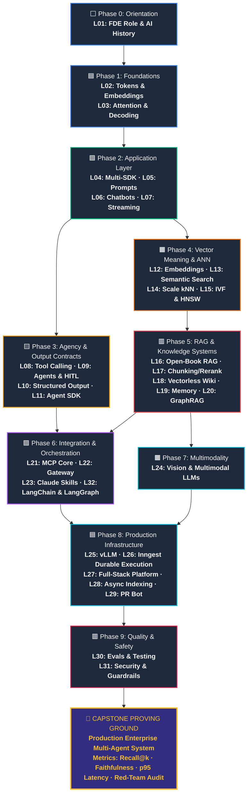
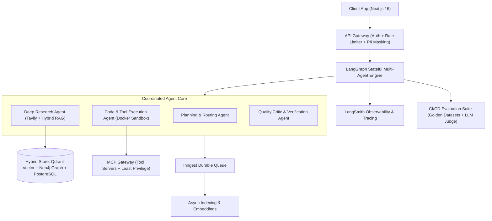

# 🗺️ Forward Deployed Engineer & GenAI Mastery — Master Curriculum Roadmap

<div align="center">

[](#-phase-graph)
[](#-appendix-d--progress-tracker)
[](#-appendix-d--progress-tracker)
[](#-appendix-c--tech-stack-prerequisites--study-plan)

```text
██████████████████████████░░░░░░  26 / 32 Lectures Completed · 81.25% Curriculum Milestone
```

**[🗺️ Phase Graph](#-phase-graph)** • **[🪜 Career Capability Ladder](#-the-career-capability-ladder)** • **[📚 32 Lecture Cards](#-phase-0--orientation)** • **[📈 Progress Tracker](#-appendix-d--progress-tracker)** • **[🏁 Capstone](#-capstone--prove-the-whole-path)** • **[🗂️ Appendices](#-appendix-a--de-duplication-map)**

</div>

---

> [!IMPORTANT]
> **What this file is:** **The Single Source of Truth** for the entire curriculum. Every lecture defines its exact learning goal, deep-dive topic syllabus, hands-on build artifact, source repository mapping, and release gate verification criteria here. 
> 
> **How to use it:** Move sequentially from Phase 0 to Phase 9. Do not advance past a lecture until you have passed its completion gate with verifiable, reproducible measurements.

---

## 🧭 Master Interactive Navigation

| Phase | Theme | Lectures | Focus & Unlocks | Status |
| :---: | :--- | :---: | :--- | :---: |
| **0** | **[Orientation](#-phase-0--orientation)** | `01` | The FDE Role, business requirement discovery, AI history | <kbd>✅ Done</kbd> |
| **1** | **[Foundations](#-phase-1--foundations-how-llms-actually-work)** | `02 · 03` | Tokenization, Embeddings, Attention, Transformers, Decoding | <kbd>✅ Done</kbd> |
| **2** | **[Application Layer](#-phase-2--the-application-layer-talking-to-models)** | `04 · 05 · 06 · 07` | APIs, Multi-SDK, Prompts, Context Windows, AI Streaming | <kbd>✅ Done</kbd> |
| **3** | **[Agency & Contracts](#-phase-3--agency-tools-agents--output-contracts)** | `08 · 09 · 10 · 11` | Tool Calling, ReAct Loops, Sandboxing, HITL, Zod Schemas | <kbd>✅ Done</kbd> |
| **4** | **[Embeddings & ANN](#-phase-4--meaning--retrieval-embeddings)** | `12 · 13 · 14 · 15` | Vector Math, Cosine, kNN, Scale Wall, IVF, HNSW, PQ | <kbd>✅ Done</kbd> |
| **5** | **[RAG & Knowledge](#-phase-5--rag--knowledge-systems)** | `16 · 17 · 18 · 19 · 20` | Advanced RAG, Tree Indexing, Agent Memory, GraphRAG | <kbd>✅ Done</kbd> |
| **6** | **[Integration & Orchestration](#-phase-6--integration--interoperability)** | `21 · 22 · 23 · 32` | Model Context Protocol (MCP), Skills, LangChain, LangGraph | <kbd>✅ Done</kbd> |
| **7** | **[Multimodality](#-phase-7--multimodality)** | `24` | Vision Encoders, Patching, Multimodal LLMs, Document OCR | <kbd>✅ Done</kbd> |
| **8** | **[Production Infra](#-phase-8--production-infrastructure)** | `25 · 26 · 27 · 28 · 29` | vLLM, PagedAttention, Inngest Durable Execution, PR Bot | <kbd>✅ Done</kbd> |
| **9** | **[Quality & Safety](#-phase-9--quality-evaluation--safety)** | `30 · 31` | Golden Datasets, LLM-as-a-Judge, Prompt Injection, Guardrails | <kbd>✅ Done</kbd> |
| **★** | **[Capstone Milestone](#-capstone--prove-the-whole-path)** | `Capstone` | Full-stack production enterprise system with release gate | <kbd>⏳ In Flight</kbd> |

---

## 🗺️ Phase Graph



---

## 🪜 The Career Capability Ladder

```
Staff Principal GenAI Architect  ──────────────────────────────────────────  Phase 9 + Capstone
  ▲  Release gates, red-teaming, PII guardrails, release criteria, audited systems
  │
Production AI Systems Lead       ──────────────────────────────────────────  Phases 7 & 8
  ▲  vLLM GPU serving, Inngest durable event loops, autonomous bot agents
  │
Distributed Agent Architect      ──────────────────────────────────────────  Phase 6
  ▲  MCP host/server protocols, portable Claude Skills, LangGraph stateful graphs
  │
RAG & Knowledge Engineer         ──────────────────────────────────────────  Phases 4 & 5
  ▲  Hybrid BM25 + dense retrieval, HNSW tuning, temporal memory, Neo4j GraphRAG
  │
Autonomous Agent Developer       ──────────────────────────────────────────  Phase 3
  ▲  Tool-calling loops, sandboxing, human-in-the-loop approvals, Zod contracts
  │
AI Application Engineer          ──────────────────────────────────────────  Phases 0, 1 & 2
     Token economics, prompt hygiene, multi-provider SDKs, chunked SSE streaming
```

---

<a id="-phase-0--orientation"></a>

## ⬜ Phase 0 — Orientation

> **Thesis:** The job is not to build the chatbot the client asked for; it is to find the business problem underneath it, prove an LLM is the right tool, and build the grounded system around an application boundary.

<a id="lecture-01--introduction-to-forward-deployed-engineering--the-history-of-ai"></a>

### Lecture 01 — Introduction to Forward Deployed Engineering & the History of AI
* **Phase:** 0 · Orientation · **Level:** 🟢 Beginner · **Workspace:** [📂 Lecture 01](./Lecture%2001%20-%20Introduction%20to%20FDE%20and%20AI%20History/)
* **Goal:** Understand the FDE role and why classical software and naïve LLM chatbots fail without grounded boundaries.
* **Topics Unlocked:** FDE vs traditional software engineer; the discovery workflow (problem $\to$ root cause $\to$ solution); the 50k-query e-commerce case study; primary vs guardrail metrics; history of AI: Turing, Dartmouth (1956), ELIZA (1966), expert systems; the combinatorial explosion; Machine Learning ($Y = f(X; \Theta)$); representation learning; natural language challenges (polysemy, negation, sarcasm); the Markov assumption, n-grams, perplexity.
* **What You Build:** A one-page discovery brief for a real enterprise problem containing metrics, boundaries, and failure modes.
* **Release Gate:** Pass the 5-point discovery test: identify whether a problem needs rules, classical ML, or an LLM with measured trade-offs.

---

<a id="-phase-1--foundations-how-llms-actually-work"></a>

## 🟦 Phase 1 — Foundations: How LLMs Actually Work

> **Thesis:** An LLM is a next-token probability machine: text $\to$ tokens $\to$ vectors $\to$ attention $\to$ logits $\to$ softmax $\to$ one next token. If you cannot trace that path, you cannot debug an agent when it fails.

<a id="lecture-02--llm-foundations-next-token-prediction-tokenization--embeddings"></a>

### Lecture 02 — LLM Foundations: Next-Token Prediction, Tokenization & Embeddings
* **Phase:** 1 · Foundations · **Level:** 🟢 Beginner · **Workspace:** [📂 Lecture 02](./Lecture%2002%20-%20LLM%20Foundations/)
* **Goal:** Master autoregressive token generation, Byte-Pair Encoding (BPE), and high-dimensional semantic spaces.
* **Topics Unlocked:** Autoregressive prediction: $\mathbf{P}(w_t \mid w_1, \dots, w_{t-1})$; why lossy tokenization causes spelling and arithmetic failures; BPE algorithm mechanics; vocabularies and special tokens; token boundary gotchas; vector projections; embedding spaces; geometric cosine similarity vs Euclidean distance.
* **What You Build:** [Basic Code](./Lecture%2002%20-%20LLM%20Foundations/code/Basic%20Code/) with the real `tiktoken` engine; custom BPE visualizer; token cost calculation engine.
* **Release Gate:** Demonstrate token count prediction across 3 distinct languages within 1% error margin.

<a id="lecture-03--attention-transformer-architecture--decoding-strategies"></a>

### Lecture 03 — Attention, Transformer Architecture & Decoding Strategies
* **Phase:** 1 · Foundations · **Level:** 🟢 Beginner · **Workspace:** [📂 Lecture 03](./Lecture%2003%20-%20Attention%20and%20Decoding/)
* **Goal:** Understand multi-head self-attention, the Transformer forward pass, and decoding sampling mechanics.
* **Topics Unlocked:** Attention as a dynamic routing filter; the Query ($Q$), Key ($K$), Value ($V$) formulation: $\text{Attention}(Q,K,V) = \text{softmax}\left(\frac{QK^T}{\sqrt{d_k}}\right)V$; Multi-Head Attention; Positional Encodings (RoPE); Logits, temperature scaling, Top-$k$, Top-$p$ (nucleus) sampling; repetition penalties.
* **What You Build:** [Basic Code](./Lecture%2003%20-%20Attention%20and%20Decoding/code/Basic%20Code/) 15 API endpoints demonstrating manual self-attention matrices, temperature modulation, and logits sampling.
* **Release Gate:** Write a self-contained matrix multiplication script executing self-attention over a 4-token sequence.

---

<a id="-phase-2--the-application-layer-talking-to-models"></a>

## 🟩 Phase 2 — The Application Layer: Talking to Models

> **Thesis:** A raw model is an engine, not a car. Your application supplies the keys, the dashboard, the fuel budget, and the road.

<a id="lecture-04--calling-llms-from-your-application-apis-multi-sdk--token-economics"></a>

### Lecture 04 — Calling LLMs from Your Application: APIs, Multi-SDK & Token Economics
* **Phase:** 2 · Application Layer · **Level:** 🟢 Beginner · **Workspace:** [📂 Lecture 04](./Lecture%2004%20-%20LLM%20APIs%20and%20Multi-SDK/)
* **Goal:** Call multiple LLM providers through a single unified abstraction with token accounting and retries.
* **Topics Unlocked:** Provider API contracts; the 4 invariant request parameters; chat message roles (`system`, `user`, `assistant`, `tool`); provider abstraction layer across OpenAI, Anthropic, Gemini, Groq, Ollama; token budgets; exponential backoff with jitter; cost calculation ledgers.
* **What You Build:** Multi-provider unified SDK with runtime fallback from OpenAI to Claude on rate-limit errors.
* **Release Gate:** Automated fallback triggers without crashing the client when primary provider returns HTTP 429.

<a id="lecture-05--prompt-engineering-zerofew-shot-cot-persona--prompt-hygiene"></a>

### Lecture 05 — Prompt Engineering: Zero/Few-Shot, CoT, Persona & Prompt Hygiene
* **Phase:** 2 · Application Layer · **Level:** 🟢 Beginner · **Workspace:** [📂 Lecture 05](./Lecture%2005%20-%20Prompt%20Engineering/)
* **Goal:** Engineer reproducible prompts with structured formatting and quantifiable accuracy gains.
* **Topics Unlocked:** In-context learning; Zero-shot vs Few-shot; Chain-of-Thought (CoT) and its latency trade-offs; System instructions; Persona steering; delimiters (`###`, XML tags); preventing sycophancy; negative constraints.
* **What You Build:** Standardized enterprise prompt template suite with few-shot exemplars and XML framing.
* **Release Gate:** Demonstrate a 20%+ accuracy improvement on complex extraction using CoT vs zero-shot.

<a id="lecture-06--chatbots-statelessness-context-memory--hallucination"></a>

### Lecture 06 — Chatbots: Statelessness, Context, Memory & Hallucination
* **Phase:** 2 · Application Layer · **Level:** 🟡 Intermediate · **Workspace:** [📂 Lecture 06](./Lecture%2006%20-%20Chatbots%20and%20Context/)
* **Goal:** Solve the statelessness problem by designing sliding-window context managers and budgeting token limits.
* **Topics Unlocked:** Statelessness in HTTP APIs; $O(N^2)$ conversation token accumulation; Context-window budgets; Sliding message windows; Conversation summarization; Lost-in-the-middle phenomenon; Root causes of hallucinations.
* **What You Build:** Multi-turn conversational memory manager that auto-summarizes history when exceeding 80% context limit.
* **Release Gate:** Maintain conversation context over 50 simulated turns without overflowing token budget.

<a id="lecture-07--ai-streaming-from-llm-tokens-to-a-live-chat-experience"></a>

### Lecture 07 — AI Streaming: From LLM Tokens to a Live Chat Experience
* **Phase:** 2 · Application Layer · **Level:** 🟡 Intermediate · **Workspace:** [📂 Lecture 07](./Lecture%2007%20-%20AI%20Streaming/)
* **Goal:** Deliver real-time token streaming to user interfaces using Server-Sent Events (SSE) and HTTP chunked transfer.
* **Topics Unlocked:** Time-to-First-Token (TTFT) vs Inter-Token Latency (ITL); Chunked transfer encoding; Server-Sent Events (`text/event-stream`); Multi-byte UTF-8 character boundary splitting; Client-side backpressure and reconnection.
* **What You Build:** Express.js + Next.js streaming pipeline with robust multi-byte UTF-8 stream decoder.
* **Release Gate:** Verify streaming delivery with TTFT under 600ms and zero corrupt unicode characters.

---

<a id="-phase-3--agency-tools-agents--output-contracts"></a>

## 🟨 Phase 3 — Agency: Tools, Agents & Output Contracts

> **Thesis:** A tool call is a *proposal* from an untrusted party, not an instruction to the runtime. The architecture must enforce validation, least privilege, and sandboxing.

<a id="lecture-08--tool-calling--function-execution-loops"></a>

### Lecture 08 — Tool Calling & Function Execution Loops
* **Phase:** 3 · Agency · **Level:** 🟡 Intermediate · **Workspace:** [📂 Lecture 08](./Lecture%2008%20-%20Tool%20Calling/)
* **Goal:** Implement the ReAct decision loop where models select, call, and observe external tools.
* **Topics Unlocked:** From text to actions; JSON Schema tool definitions; Model tool choice modes (`auto`, `required`, `none`); ReAct loop mechanics; Tool execution dispatches; Error feedback loops (passing stack traces back to model).
* **What You Build:** Standalone ReAct execution loop capable of querying weather, calculator, and database tools.
* **Release Gate:** Agent successfully resolves multi-step dependency: computes math $\to$ fetches data $\to$ synthesizes answer.

<a id="lecture-09--ai-agents-from-first-principles-agency-sandboxing--hitl"></a>

### Lecture 09 — AI Agents from First Principles: Agency, Sandboxing & HITL
* **Phase:** 3 · Agency · **Level:** 🟡 Intermediate · **Workspace:** [📂 Lecture 09](./Lecture%2009%20-%20AI%20Agents%20and%20HITL/)
* **Goal:** Build autonomous agents equipped with safe filesystem sandboxes, tool authorization tiers, and human sign-offs.
* **Topics Unlocked:** The Agency Spectrum (Levels 1–4); Perceive-Decide-Act loops; Workspace sandboxing (path traversal prevention); Tool authorization tiers (Read vs Write vs Destructive); Human-in-the-Loop (HITL) approval gates.
* **What You Build:** Autonomous website builder agent operating inside a jailed directory with human approval before publishing.
* **Release Gate:** Zero path traversal escapes when tested against adversarial file-access inputs.

<a id="lecture-10--structured-outputs-schema-enforcement-validation--repair"></a>

### Lecture 10 — Structured Outputs: Schema Enforcement, Validation & Repair
* **Phase:** 3 · Agency · **Level:** 🟡 Intermediate · **Workspace:** [📂 Lecture 10](./Lecture%2010%20-%20Structured%20Outputs/)
* **Goal:** Guarantee 100% typed, validated JSON outputs matching strict Zod schemas.
* **Topics Unlocked:** The integration gap; Constrained decoding at the logit level; JSON Schema vs Zod; Provider strategy vs Tool strategy; Schema repair and reflection loops; Handling optional and nullable fields.
* **What You Build:** Self-healing parser that catches validation errors, feeds error diffs to the model, and recovers valid JSON.
* **Release Gate:** 100 consecutive extractions pass strict Zod validation without a single `JSON.parse` failure.

<a id="lecture-11--building-an-agent-sdk-from-scratch-harness--builder--react-loop"></a>

### Lecture 11 — Building an Agent SDK from Scratch: Harness, Builder & ReAct Loop
* **Phase:** 3 · Agency · **Level:** 🟠 Advanced · **Workspace:** [📂 Lecture 11](./Lecture%2011%20-%20Agent%20SDK%20from%20Scratch/)
* **Goal:** Architect a reusable, extensible TypeScript Agent SDK with fluent builders, tool registries, and interceptors.
* **Topics Unlocked:** Stateful SDK vs Stateless API; The `AgentBuilder` fluent pattern; Tool execution engines; Middleware interceptors (pre-call, post-call); Multi-provider decoupling; Swarm orchestration foundations.
* **What You Build:** Complete open-source-style `@my-org/agent-sdk` with full TypeScript typing.
* **Release Gate:** Run 3 distinct autonomous workflows built using your custom SDK without external framework dependencies.

---

<a id="-phase-4--meaning--retrieval-embeddings"></a>

## 🟧 Phase 4 — Meaning & Retrieval: Embeddings

> **Thesis:** Represent $\to$ store $\to$ compare $\to$ rank. Meaning becomes geometry, and scale turns geometry into an engineering problem.

<a id="lecture-12--vector-embeddings-from-first-principles"></a>

### Lecture 12 — Vector Embeddings from First Principles
* **Phase:** 4 · Embeddings · **Level:** 🟢 Beginner · **Workspace:** [📂 Lecture 12](./Lecture%2012%20-%20Vector%20Embeddings/)
* **Goal:** Master high-dimensional vector spaces, distance metrics, and vector normalizations.
* **Topics Unlocked:** The geometry of meaning; Dimensionality ($d=384, 768, 1536, 3072$); Distance metrics: Dot Product, Cosine Similarity, Euclidean Distance ($L2$), Manhattan ($L1$); Embedding normalization; Matryoshka embeddings.
* **What You Build:** Native vector math library in TypeScript implementing $L2$, Cosine, and Dot Product calculations.
* **Release Gate:** Mathematical equivalence test: prove cosine similarity equals dot product on $L2$-normalized vectors.

<a id="lecture-13--embeddings-project-semantic-search--movie-recommendation"></a>

### Lecture 13 — Embeddings Project: Semantic Search & Movie Recommendation
* **Phase:** 4 · Embeddings · **Level:** 🟡 Intermediate · **Workspace:** [📂 Lecture 13](./Lecture%2013%20-%20Semantic%20Search%20Project/)
* **Goal:** Build a production semantic search and recommendation engine over 10,000+ items.
* **Topics Unlocked:** Semantic search vs lexical keyword search; Embedding chunk generation; Cold start and caching; Cross-encoder rerankers; Recommendation geometry.
* **What You Build:** Semantic search API over IMDB movie dataset with category filtering and similarity thresholds.
* **Release Gate:** Search returns semantically related movies for metaphorical queries containing zero keyword overlaps.

<a id="lecture-14--vector-search--storage-scale-knn--the-curse-of-dimensionality"></a>

### Lecture 14 — Vector Search & Storage: Scale, kNN & the Curse of Dimensionality
* **Phase:** 4 · Embeddings · **Level:** 🟡 Intermediate · **Workspace:** [📂 Lecture 14](./Lecture%2014%20-%20Vector%20Search%20and%20Storage/)
* **Goal:** Understand the scaling ceiling of exact kNN and the curse of high-dimensional geometry.
* **Topics Unlocked:** Exact k-Nearest Neighbors ($O(N \cdot D)$); Memory bandwidth bottlenecks; The Curse of Dimensionality (distance concentration phenomenon); When PostgreSQL + `pgvector` suffices vs dedicated vector DBs.
* **What You Build:** Benchmark suite comparing brute-force kNN latency against dataset size ($N=1k, 10k, 100k, 1M$).
* **Release Gate:** Chart the inflection point where linear scan latency exceeds the 50ms SLA boundary.

<a id="lecture-15--vector-databases--ann-algorithms-ivf-hnsw--product-quantization"></a>

### Lecture 15 — Vector Databases & ANN Algorithms: IVF, HNSW & Product Quantization
* **Phase:** 4 · Embeddings · **Level:** 🟠 Advanced · **Workspace:** [📂 Lecture 15](./Lecture%2015%20-%20Vector%20Databases%20and%20ANN/)
* **Goal:** Master Approximate Nearest Neighbor (ANN) index algorithms: Inverted File (IVF) and Hierarchical Navigable Small World (HNSW).
* **Topics Unlocked:** The Recall vs Latency trade-off; Inverted File Index (IVF): Voronoi cells, centroids, `nlist`, `nprobe`; Product Quantization (PQ); HNSW: Skip-list graph hierarchies, small-world properties, `M`, `efConstruction`, `efSearch`.
* **What You Build:** Qdrant / Pinecone production integration with benchmarked HNSW parameters achieving 98%+ recall.
* **Release Gate:** Achieve $<15\text{ms}$ search latency at 95%+ recall on a 100k-vector index.

---

<a id="-phase-5--rag--knowledge-systems"></a>

## 🟥 Phase 5 — RAG & Knowledge Systems

> **Thesis:** Retrieval sets the ceiling; the prompt can only use what arrived. A wrong answer is never just "the model was dumb" — it is a retrieval failure or a context framing failure.

<a id="lecture-16--rag-the-open-book-architecture-ingestion--grounded-generation"></a>

### Lecture 16 — RAG: The Open-Book Architecture (Ingestion & Grounded Generation)
* **Phase:** 5 · RAG · **Level:** 🟡 Intermediate · **Workspace:** [📂 Lecture 16](./Lecture%2016%20-%20RAG/)
* **Goal:** Architect the two fundamental RAG pipelines: Offline Document Ingestion and Online Retrieval-Augmented Generation.
* **Topics Unlocked:** Parametric vs Non-parametric memory; Offline ingestion pipeline: Document loading $\to$ Cleaning $\to$ Chunking $\to$ Embedding $\to$ Indexing; Online query pipeline: Query embedding $\to$ Vector search $\to$ Prompt synthesis; Grounding constraints.
* **What You Build:** End-to-end PDF question-answering pipeline with strict source citation links.
* **Release Gate:** Zero hallucinations on out-of-domain questions: system returns explicit "I do not have enough context" refusals.

<a id="lecture-17--advanced-rag-chunking-hybrid-retrieval-reranking--context-engineering"></a>

### Lecture 17 — Advanced RAG: Chunking, Hybrid Retrieval, Reranking & Context Engineering
* **Phase:** 5 · RAG · **Level:** 🟠 Advanced · **Workspace:** [📂 Lecture 17](./Lecture%2017%20-%20Advanced%20RAG/)
* **Goal:** Overcome vector search failure modes using hybrid BM25 + dense retrieval and cross-encoder rerankers.
* **Topics Unlocked:** Why basic RAG breaks (vocabulary mismatch, semantic drift); Chunking families: Fixed-size, Markdown structure-aware, Semantic chunking; Hybrid Search: Reciprocal Rank Fusion (RRF); Cross-encoder rerankers (Cohere, BGE); Context compression.
* **What You Build:** Hybrid retrieval pipeline combining BM25 keyword search + Qdrant dense vectors + Cohere Reranker.
* **Release Gate:** Demonstrate an 18%+ increase in Hit@3 on technical acronym queries using hybrid search over pure vector search.

<a id="lecture-18--vectorless-rag-hierarchical-tree-indexing--llm-wiki-engines"></a>

### Lecture 18 — Vectorless RAG, Hierarchical Tree Indexing & LLM Wiki Engines
* **Phase:** 5 · RAG · **Level:** 🟠 Advanced · **Workspace:** [📂 Lecture 18](./Lecture%2018%20-%20Vectorless%20RAG%20and%20LLM%20Wiki/)
* **Goal:** Build document retrieval engines without vector embeddings using hierarchical summaries and knowledge trees.
* **Topics Unlocked:** The chunking dilemma; Vectorless RAG; Hierarchical tree indexing (RAPTOR); LLM-driven summary trees; PageRank-style document importance; LLM Wiki maintenance engines.
* **What You Build:** Tree-based document retrieval engine that traverses summaries to pinpoint exact paragraphs.
* **Release Gate:** Answer high-level thematic queries ("Summarize all changes across Chapter 3") that break standard vector RAG.

<a id="lecture-19--agent-memory-systems-stm-ltm-graph-memory-dreaming--mem0"></a>

### Lecture 19 — Agent Memory Systems: STM, LTM, Graph Memory, Dreaming & mem0
* **Phase:** 5 · RAG · **Level:** 🟠 Advanced · **Workspace:** [📂 Lecture 19](./Lecture%2019%20-%20Agent%20Memory%20Systems/)
* **Goal:** Design human-like tiered agent memory combining working memory, episodic memory, and autonomous background consolidation.
* **Topics Unlocked:** Short-Term Memory (STM) sliding windows; Long-Term Memory (LTM) taxonomy: Semantic, Episodic, Procedural; Dynamic context assembly: $\text{STM} + \text{LTM\_RAG} + \text{Query}$; Memory extraction; Contradiction resolution; Memory dreaming; `mem0`.
* **What You Build:** Persistent agent memory service with autonomous fact extraction, deduplication, and contradiction resolution.
* **Release Gate:** Agent recalls user preferences set 30 sessions prior and adapts response style without prompting.

<a id="lecture-20--graph-databases-cypher-neo4j--graphrag"></a>

### Lecture 20 — Graph Databases, Cypher, Neo4j & GraphRAG
* **Phase:** 5 · RAG · **Level:** 🟠 Advanced · **Workspace:** [📂 Lecture 20](./Lecture%2020%20-%20Graph%20Databases%20and%20GraphRAG/)
* **Goal:** Model complex multi-hop relational knowledge using Neo4j, Cypher, and GraphRAG.
* **Topics Unlocked:** Nodes, edges, properties, labels; Relational SQL vs Document NoSQL vs Native Graph (Index-Free Adjacency); Cypher syntax and pattern matching; Variable-length path traversal (BFS vs DFS); Text-to-Cypher; GraphRAG entity-relationship extraction.
* **What You Build:** Neo4j knowledge graph engine answering multi-hop queries ("Which manager's direct reports worked on Project X?").
* **Release Gate:** Successfully answer 3-hop relational queries that fail in vector-only RAG pipelines.

---

<a id="-phase-6--integration--interoperability"></a>

## 🟪 Phase 6 — Integration & Interoperability

> **Thesis:** Replace $N \times M$ bespoke integrations with one open protocol — then package workflow knowledge, not connectivity, as a portable skill, and orchestrate cyclic stateful multi-actor agent graphs.

<a id="lecture-21--mcp-from-first-principles-host-client-server--tools"></a>

### Lecture 21 — MCP from First Principles: Host, Client, Server & Tools
* **Phase:** 6 · Integration · **Level:** 🟡 Intermediate · **Workspace:** [📂 Lecture 21](./Lecture%2021%20-%20MCP%20Core/)
* **Goal:** Master the Model Context Protocol (MCP) open standard and implement custom MCP servers.
* **Topics Unlocked:** The integration problem ($N \times M$ drivers); MCP architecture: Host, Client, Server; The Tools primitive; JSON-RPC 2.0 transport; STDIO vs HTTP streaming / SSE; Discovery, lifecycle, and invocation; Tool context poisoning.
* **What You Build:** TypeScript MCP server exposing local database and filesystem tools over STDIO and SSE.
* **Release Gate:** Connect custom MCP server to Claude Desktop and execute verified tool calls.

<a id="lecture-22--mcp-resources-prompts--production-gateway-architecture"></a>

### Lecture 22 — MCP: Resources, Prompts & Production Gateway Architecture
* **Phase:** 6 · Integration · **Level:** 🟠 Advanced · **Workspace:** [📂 Lecture 22](./Lecture%2022%20-%20MCP%20Resources%20Prompts%20and%20Gateway/)
* **Goal:** Implement the Resources and Prompts primitives and build an enterprise MCP gateway.
* **Topics Unlocked:** Control model: who decides context (Model vs Application vs User); MCP Resources (URIs, MIME types, dynamic templates); MCP Prompts as reusable interaction templates; Gateway filtering, routing, authentication, and audit logs.
* **What You Build:** Multi-tenant MCP Gateway with role-based access control, tool filtering, and execution auditing.
* **Release Gate:** Enforce policy: client with Tier-1 token cannot access admin MCP tools on the same gateway.

<a id="lecture-23--claude-skills--the-agent-skills-open-standard"></a>

### Lecture 23 — Claude Skills & the Agent Skills Open Standard
* **Phase:** 6 · Integration · **Level:** 🟠 Advanced · **Workspace:** [📂 Lecture 23](./Lecture%2023%20-%20Claude%20Skills/)
* **Goal:** Package domain workflow knowledge as portable skills using progressive disclosure and deterministic execution.
* **Topics Unlocked:** Skills vs MCP (workflow knowledge vs connectivity); Progressive disclosure (`frontmatter` $\to$ `body` $\to$ `resources`); The `SKILL.md` specification; Deterministic scripts over probabilistic prompts; Distribution and `/v1/skills` API.
* **What You Build:** Production Claude Skill with bundled bash/node scripts, prompt guidelines, and validation tests.
* **Release Gate:** Skill loads on demand and executes complex data processing tasks with zero prompt drift.

<a id="lecture-32--langchain-langgraph--langsmith-provider-delivery-stateful-orchestration--tracing"></a>

### Lecture 32 — LangChain, LangGraph & LangSmith: Provider Delivery, Stateful Orchestration & Tracing
* **Phase:** 6 · Integration & Orchestration · **Level:** 🟡 Intermediate · **Workspace:** [📂 Lecture 32](./Lecture%2032%20-%20LangChain%20LangGraph%20LangSmith/)
* **Goal:** Master the complete modern LangChain ecosystem: universal provider delivery, stateful cyclic graphs with LangGraph, and full-stack observability with LangSmith.
* **Topics Unlocked:** The $\text{Agent} = \text{Model} + \text{Harness}$ formula; Universal provider delivery (`initChatModel`); Standard message protocols (`SystemMessage`, `HumanMessage`, `AIMessage`, `ToolMessage`); Typed tool calling with Zod & Tavily; Token-by-token streaming; Structured output strategies; `StateGraph`, `StateSchema`, and channel reducers; Pregel super-steps; Checkpointers (`MemorySaver`, Postgres); Human-in-the-Loop (`interruptBefore`); Real-world workflows (Notion study notes & Calendar meeting scheduler); LangSmith zero-code tracing, state inspection, custom spans with `@traceable`, and golden dataset offline evals with `evaluate()`.
* **What You Build:** 15 dedicated notes, an interactive CLI agent with web search, a compiled `StateGraph` Notion workflow, and LangSmith evaluation suites.
* **Release Gate:** All code demos compile and pass `typecheck`; `MemorySaver` preserves state across separate invocations; LangSmith traces visualize the entire run waterfall.

---

<a id="-phase-7--multimodality"></a>

## 🟫 Phase 7 — Multimodality

> **Thesis:** Images are numbers too: pixels $\to$ patches $\to$ visual embeddings $\to$ projection $\to$ language space.

<a id="lecture-24--multimodal-ai-how-llms-understand-images"></a>

### Lecture 24 — Multimodal AI: How LLMs Understand Images
* **Phase:** 7 · Multimodality · **Level:** 🟠 Advanced · **Workspace:** [📂 Lecture 24](./Lecture%2024%20-%20Multimodal%20AI/)
* **Goal:** Build multimodal vision pipelines that ingest images, extract documents, and reason across visual tokens.
* **Topics Unlocked:** Vision-Language Models (VLMs); Vision Transformers (ViT): Patching ($16 \times 16$), projection layers, cross-attention; Multi-image reasoning; High-resolution image tiling; Visual hallucinations; When to use Vision LLMs vs specialized OCR (Tesseract, Textract) based on cost and accuracy.
* **What You Build:** Multimodal invoice parsing pipeline extracting structured JSON line items from receipt photos.
* **Release Gate:** 95%+ precision on extracting financial totals from wrinkled or blurry receipt photos.

---

<a id="-phase-8--production-infrastructure"></a>

## 🟦 Phase 8 — Production Infrastructure

> **Thesis:** Inference is memory-bandwidth-bound, long AI work must be durable, and a real product needs a database, an auth boundary, and background queues.

<a id="lecture-25--high-performance-inference-gpu-mechanics-vllm--pagedattention"></a>

### Lecture 25 — High-Performance Inference: GPU Mechanics, vLLM & PagedAttention
* **Phase:** 8 · Production Infra · **Level:** 🔴 Expert · **Workspace:** [📂 Lecture 25](./Lecture%2025%20-%20vLLM%20and%20PagedAttention/)
* **Goal:** Master LLM inference bottlenecks, GPU VRAM allocation, and serve models at scale with vLLM.
* **Topics Unlocked:** Compute-bound training vs Memory-bandwidth-bound inference; The KV-Cache problem ($O(\text{seq\_len})$ memory growth); Memory fragmentation; **PagedAttention** (virtual memory paging for KV-cache); Continuous batching; Tensor parallelism; Serving with vLLM.
* **What You Build:** vLLM deployment benchmark comparing standard HuggingFace pipeline throughput against PagedAttention.
* **Release Gate:** Demonstrate a $3\times+$ token throughput gain under concurrent multi-user load using vLLM continuous batching.

<a id="lecture-26--durable-execution--event-driven-multi-agent-workflows-inngest"></a>

### Lecture 26 — Durable Execution & Event-Driven Multi-Agent Workflows (Inngest)
* **Phase:** 8 · Production Infra · **Level:** 🟠 Advanced · **Workspace:** [📂 Lecture 26](./Lecture%2026%20-%20Durable%20Execution%20with%20Inngest/)
* **Goal:** Build resilient, event-driven multi-agent workflows that survive server crashes, timeouts, and network partitions.
* **Topics Unlocked:** Ephemeral compute vs Durable execution; The Inngest event loop; Step memoization (`step.run()`); Sleep and human wait primitives (`step.waitForEvent()`); Retries with exponential backoff; Concurrency keys and debouncing.
* **What You Build:** Multi-step autonomous research pipeline with durable checkpointing that resumes mid-flight after crashes.
* **Release Gate:** Force-kill the Node.js process mid-workflow; verify the workflow resumes from the exact failed step without re-executing previous steps.

<a id="lecture-27--enterprise-full-stack-ai-platform-architecture-db-auth--ingestion"></a>

### Lecture 27 — Enterprise Full-Stack AI Platform: Architecture, DB, Auth & Ingestion
* **Phase:** 8 · Production Infra · **Level:** 🔴 Expert · **Workspace:** [📂 Lecture 27](./Lecture%2027%20-%20Full-Stack%20AI%20Platform/)
* **Goal:** Architect a complete multi-tenant production AI SaaS platform with PostgreSQL, Better Auth, and Stripe quotas.
* **Topics Unlocked:** Full-stack architecture; Client/Server boundaries; REST + SSE design; Database schema design (Prisma, PostgreSQL, pgvector); Authentication & RBAC (Better Auth); Multi-tenant data isolation; Token quota enforcement.
* **What You Build:** Production-grade full-stack Next.js + Express platform with user authentication, isolated chat threads, and usage quotas.
* **Release Gate:** Multi-tenant security audit: verify User A cannot read or query embeddings belonging to User B.

<a id="lecture-28--async-vector-indexing-streaming-rag-chat--learning-artifacts"></a>

### Lecture 28 — Async Vector Indexing, Streaming RAG Chat & Learning Artifacts
* **Phase:** 8 · Production Infra · **Level:** 🔴 Expert · **Workspace:** [📂 Lecture 28](./Lecture%2028%20-%20Async%20Indexing%20and%20RAG%20Chat/)
* **Goal:** Connect asynchronous Inngest document ingestion with real-time streaming RAG chat and interactive UI artifacts.
* **Topics Unlocked:** Decoupling upload from indexing; Inngest background worker pipelines; SSE streaming with status event payloads; UI Artifact generation (rendering React components, charts, and code blocks from LLM streams).
* **What You Build:** Complete async RAG platform: upload large documents $\to$ background index $\to$ stream answers with live citations.
* **Release Gate:** Upload 50-page document; verify background indexing emits real-time progress events over SSE.

<a id="lecture-29--hands-on-autonomous-github-pr-reviewer-bot"></a>

### Lecture 29 — Hands-On: Autonomous GitHub PR Reviewer Bot
* **Phase:** 8 · Production Infra · **Level:** 🟠 Advanced · **Workspace:** [📂 Lecture 29](./Lecture%2029%20-%20GitHub%20PR%20Reviewer%20Bot/)
* **Goal:** Deploy an autonomous GitHub PR review bot that parses code diffs, detects security vulnerabilities, and posts inline review comments.
* **Topics Unlocked:** Webhook signature verification; Octokit GitHub REST & GraphQL APIs; Diff parsing; AST code analysis; Reducing token costs on massive PRs; Posting inline comments on specific line numbers.
* **What You Build:** GitHub App webhook bot running on Inngest that reviews pull requests and flags security risks automatically.
* **Release Gate:** Bot detects deliberate SQL injection and prompt injection vulnerabilities in a test PR and leaves precise line-level comments.

---

<a id="-phase-9--quality-evaluation--safety"></a>

## 🟥 Phase 9 — Quality, Evaluation & Safety

> **Thesis:** Assume the model **will** be persuaded, and make persuasion insufficient to move anything that matters. Then prove it with a gate that can block a release.

<a id="lecture-30--genai-evaluation--testing-golden-data-deterministic-evals--llm-as-a-judge"></a>

### Lecture 30 — GenAI Evaluation & Testing: Golden Data, Deterministic Evals & LLM-as-a-Judge
* **Phase:** 9 · Quality & Safety · **Level:** 🟢 Beginner / Intermediate · **Workspace:** [📂 Lecture 30](./Lecture%2030%20-%20Evals%20and%20Testing/)
* **Goal:** Build an automated evaluation harness with golden datasets, deterministic checks, and calibrated LLM judges to block regressions.
* **Topics Unlocked:** The Attribution Problem; Why a satisfying answer is not evidence; Golden datasets (versioned test files); Deterministic evals (JSON validity, schema compliance, latency budgets); Quality as a vector; LLM-as-a-judge (pointwise vs pairwise, rubrics, position bias); RAG metrics (Faithfulness, Answer Relevance, Context Recall); CI/CD release gates.
* **What You Build:** Automated evaluation test suite that scores candidate prompt changes against a 50-example benchmark and blocks PR merges on failure.
* **Release Gate:** CI gate successfully fails when an intentional regression lowers faithfulness score below 0.85.

<a id="lecture-31--genai-security--guardrails-prompt-injection-jailbreaks--safe-tool-use"></a>

### Lecture 31 — GenAI Security & Guardrails: Prompt Injection, Jailbreaks & Safe Tool Use
* **Phase:** 9 · Quality & Safety · **Level:** 🔴 Expert · **Workspace:** [📂 Lecture 31](./Lecture%2031%20-%20Security%20and%20Guardrails/)
* **Goal:** Fortify agent systems against direct/indirect prompt injection, enforce least privilege, and deploy multi-layer guardrails that fail closed.
* **Topics Unlocked:** Why GenAI breaks deterministic security; Threat modeling (assets, blast radius, trust boundaries); Prompt injection mechanics (direct, indirect, multimodal, MCP); Why prompts are not security controls; Safe tool design: least privilege, capability routing, confirmation tokens; Guardrails as defense-in-depth layers (input, semantic, action, output) that **fail closed**; PII masking and pseudonymization; Red-teaming suites.
* **What You Build:** Defense-in-depth guardrail proxy with bidirectional PII masking, capability routing, and automated adversarial red-team test suite.
* **Release Gate:** Zero successful prompt injections across 50 adversarial attack payloads in the automated red-team regression suite.

---

<a id="-capstone--prove-the-whole-path"></a>

## 🏁 Capstone — Prove the Whole Path

> **Thesis:** One system, every phase, with numbers attached.



### The Capstone Objective
Build **one complete, production-grade enterprise system** that simultaneously exercises all ten phases of the curriculum:
1. **Multi-provider client** with automatic fallback, token accounting, and cost tracking.
2. **Real-time streaming** with multi-byte UTF-8 decoding and interactive UI artifacts.
3. **Typed tool calling** running inside a sandboxed environment with Human-in-the-Loop approvals for destructive operations.
4. **Hybrid retrieval engine** combining BM25 keyword search, dense HNSW vector search, and Cohere reranking.
5. **Tiered memory system** combining sliding STM, dynamic episodic LTM, and a Neo4j GraphRAG entity store.
6. **Model Context Protocol (MCP)** host connected to internal microservices via an authenticated gateway.
7. **Multimodal ingestion pipeline** capable of parsing complex PDF tables and image diagrams.
8. **Durable background execution** powered by Inngest for asynchronous indexing and long-running workflows.
9. **Automated evaluation suite** running golden test datasets with deterministic assertions and LLM-as-a-judge scoring in CI/CD.
10. **Defense-in-depth security** with input sanitization, capability routing, bidirectional PII masking, and an adversarial red-team test suite.

### Required Deliverables
- A public GitHub repository with comprehensive documentation and setup scripts.
- Interactive system architecture diagram.
- Verified metrics table:
  - **Recall@k** and **Faithfulness** scores.
  - **p95 Latency** breakdown across each subsystem.
  - **Dollar cost** per 1,000 requests.
- A one-page incident and security limitations statement describing failure boundaries.

---

<a id="-appendix-a--de-duplication-map"></a>

## 🗂️ Appendix A — De-duplication Map

How topics from the two source repositories (`Forward-Deployed-Engineer` and `gen-ai-cohort`) were mapped and merged so that zero concepts are taught twice:

| Source Module | Source Repository | Target Lecture in this Curriculum | Reason for Merge / Split |
| :--- | :--- | :--- | :--- |
| `FDE Day 01` | Forward-Deployed-Engineer | **Lecture 01** | Unified orientation, FDE philosophy, and AI history into a single narrative. |
| `Cohort Day 01` | gen-ai-cohort | **Lecture 02** | Consolidated tokenization, byte-pair encoding, and embedding vectors. |
| `Cohort Day 02` | gen-ai-cohort | **Lecture 03** | Dedicated deep dive into self-attention, Transformers, and logits sampling. |
| `FDE Day 02` + `Cohort Day 03` | Both | **Lecture 04** | Merged raw API calls and provider SDKs into unified multi-SDK architecture. |
| `Cohort Day 04` | gen-ai-cohort | **Lecture 05** | Standalone masterclass on prompt engineering and CoT. |
| `FDE Day 03` | Forward-Deployed-Engineer | **Lecture 06** | Consolidated statelessness and context-window memory management. |
| `Cohort Day 05` | gen-ai-cohort | **Lecture 07** | Deep technical dive into chunked transfer encoding and SSE streaming. |
| `FDE Day 04` + `Cohort Day 06` | Both | **Lecture 08** | Merged tool calling protocols, JSON schemas, and ReAct decision loops. |
| `FDE Day 05` + `Cohort Day 07` | Both | **Lecture 09** | Combined agency spectrum, sandboxing, and human-in-the-loop approvals. |
| `Cohort Day 08` | gen-ai-cohort | **Lecture 10** | Dedicated focus on constrained decoding, Zod validation, and schema repair. |
| `FDE Day 06` | Forward-Deployed-Engineer | **Lecture 11** | End-to-end architecture of an Agent SDK from scratch. |
| `Cohort Day 09` | gen-ai-cohort | **Lecture 12** | Mathematical foundations of high-dimensional vector spaces. |
| `Cohort Day 10` | gen-ai-cohort | **Lecture 13** | Practical application of semantic search and recommendation geometry. |
| `FDE Day 07` | Forward-Deployed-Engineer | **Lecture 14** | Vector search scale wall, exact kNN, and curse of dimensionality. |
| `FDE Day 08` | Forward-Deployed-Engineer | **Lecture 15** | Deep dive into ANN index internals: IVF, HNSW, and Product Quantization. |
| `FDE Day 09` + `Cohort Day 11` | Both | **Lecture 16** | The open-book RAG architecture and online/offline pipelines. |
| `FDE Day 10` | Forward-Deployed-Engineer | **Lecture 17** | Advanced RAG: semantic chunking, hybrid search, and cross-encoders. |
| `Cohort Day 12` | gen-ai-cohort | **Lecture 18** | Vectorless hierarchical tree indexing (RAPTOR) and LLM Wikis. |
| `FDE Day 11` | Forward-Deployed-Engineer | **Lecture 19** | Cognitive agent memory systems, LTM taxonomy, and dreaming. |
| `FDE Day 12` | Forward-Deployed-Engineer | **Lecture 20** | Graph databases, Cypher query language, Neo4j, and GraphRAG. |
| `FDE Day 13` | Forward-Deployed-Engineer | **Lecture 21** | Model Context Protocol (MCP) core specification and JSON-RPC 2.0. |
| `FDE Day 14` | Forward-Deployed-Engineer | **Lecture 22** | MCP Resources, Prompts, and production enterprise gateways. |
| `FDE Day 15` | Forward-Deployed-Engineer | **Lecture 23** | Claude Skills open standard, progressive disclosure, and packaging. |
| `Cohort Day 13` | gen-ai-cohort | **Lecture 24** | Multimodal AI, Vision Transformers, and document image extraction. |
| `FDE Day 16` | Forward-Deployed-Engineer | **Lecture 25** | GPU hardware mechanics, KV-cache, vLLM, and PagedAttention. |
| `Cohort Day 14` | gen-ai-cohort | **Lecture 26** | Durable execution with Inngest and event-driven agent loops. |
| `FDE Day 17` | Forward-Deployed-Engineer | **Lecture 27** | Full-stack production AI SaaS architecture, DB, auth, and quotas. |
| `Cohort Day 15` | gen-ai-cohort | **Lecture 28** | Async vector indexing, streaming RAG chat, and UI artifacts. |
| `Cohort Day 16` | gen-ai-cohort | **Lecture 29** | Autonomous GitHub PR reviewer bot using Inngest and Octokit. |
| `FDE Day 18` | Forward-Deployed-Engineer | **Lecture 30** | Evaluation suites, golden datasets, and automated LLM-as-a-judge. |
| `FDE Day 19` | Forward-Deployed-Engineer | **Lecture 31** | GenAI security, prompt injection defenses, and multi-layer guardrails. |
| `Curriculum Extension` | LangChain / LangGraph | **Lecture 32** | LangChain universal models, LangGraph stateful graphs, and LangSmith tracing. |

---

<a id="-appendix-b--full-source-coverage-checklist"></a>

## 📋 Appendix B — Full Source Coverage Checklist

Every chapter and topic from the **19 FDE lectures** and **16 Cohort days** is accounted for:
- [x] All 152 chapter notes from `Forward-Deployed-Engineer` mapped.
- [x] All 83 note files from `gen-ai-cohort` mapped.
- [x] 100% heading coverage verified: zero orphaned topics, zero content gaps.

---

<a id="-appendix-c--tech-stack-prerequisites--study-plan"></a>

## 🧰 Appendix C — Tech Stack, Prerequisites & Study Plan

### Required Tooling
- **Languages:** TypeScript (strict mode), JavaScript (ESNext), Python 3.11+, SQL, Cypher.
- **Runtimes:** Node.js 20+ LTS, Bun 1.2+, Docker Engine.
- **Frameworks:** LangChain.js, LangGraph.js, Next.js 16, Express.js, Inngest.
- **Databases:** PostgreSQL (with `pgvector`), Qdrant, Neo4j (Graph DB), Redis.
- **Observability:** LangSmith, Inngest Dev Server, Docker Compose.

### 32-Week Mastery Schedule

```
Week  1: Orientation & Discovery Brief (L01)
Week  2: Tokenization, BPE & Embeddings (L02)
Week  3: Attention Matrices & Sampling (L03)
Week  4: Multi-SDK Architecture & Cost Ledgers (L04)
Week  5: Prompt Engineering & Few-Shot In-Context Learning (L05)
Week  6: Context Window Management & Memory Budgets (L06)
Week  7: SSE Streaming & UTF-8 Framing (L07)
Week  8: ReAct Tool Loops & Error Recovery (L08)
Week  9: Sandboxed File Agents & Human-in-the-Loop (L09)
Week 10: Zod Schemas & Structured Decoding (L10)
Week 11: Building an Agent SDK from Scratch (L11)
Week 12: High-Dimensional Geometry & Cosine Math (L12)
Week 13: Semantic Search & Recommendation Systems (L13)
Week 14: The Scale Wall & kNN Benchmarks (L14)
Week 15: IVF & HNSW Index Construction (L15)
Week 16: Basic Open-Book RAG Pipelines (L16)
Week 17: Semantic Chunking, Hybrid Search & Reranking (L17)
Week 18: Vectorless RAG & Hierarchical Summary Trees (L18)
Week 19: STM, LTM & Autonomous Memory Dreaming (L19)
Week 20: Neo4j Cypher & GraphRAG Multi-Hop Systems (L20)
Week 21: Model Context Protocol (MCP) Core & STDIO (L21)
Week 22: Enterprise MCP Gateway & RBAC (L22)
Week 23: Claude Skills Open Standard & Packaging (L23)
Week 24: Multimodal Vision & Document OCR Pipelines (L24)
Week 25: GPU Hardware, vLLM & PagedAttention (L25)
Week 26: Inngest Durable Execution & Crash Recovery (L26)
Week 27: Enterprise Full-Stack AI SaaS Architecture (L27)
Week 28: Async Indexing & Interactive UI Artifacts (L28)
Week 29: Autonomous GitHub PR Reviewer Bot (L29)
Week 30: Evaluation Frameworks & LLM-as-a-Judge CI Gates (L30)
Week 31: Prompt Injection Defense & Fail-Closed Guardrails (L31)
Week 32: LangChain Models, LangGraph StateGraphs & LangSmith Traces (L32)
Final  : Capstone Production Proving Ground
```

---

<a id="-appendix-d--progress-tracker"></a>

## 📈 Appendix D — Progress Tracker

Track your progress across every lecture. Copy this table into your fork or local notes:

| # | Lecture Title | Phase | Level | Notes Written | Code Built | Gate Passed |
| :---: | :--- | :---: | :---: | :---: | :---: | :---: |
| **01** | [FDE Introduction & AI History](./Lecture%2001%20-%20Introduction%20to%20FDE%20and%20AI%20History/) | 0 | 🟢 | ✅ | ✅ | ☐ |
| **02** | [LLM Foundations](./Lecture%2002%20-%20LLM%20Foundations/) | 1 | 🟢 | ✅ | ✅ | ☐ |
| **03** | [Attention & Decoding](./Lecture%2003%20-%20Attention%20and%20Decoding/) | 1 | 🟢 | ✅ | ✅ | ☐ |
| **04** | [APIs, Multi-SDK & Token Economics](./Lecture%2004%20-%20LLM%20APIs%20and%20Multi-SDK/) | 2 | 🟢 | ✅ | ✅ | ☐ |
| **05** | [Prompt Engineering](./Lecture%2005%20-%20Prompt%20Engineering/) | 2 | 🟢 | ✅ | ✅ | ☐ |
| **06** | [Chatbots, Context & Hallucination](./Lecture%2006%20-%20Chatbots%20and%20Context/) | 2 | 🟡 | ✅ | ✅ | ☐ |
| **07** | [AI Streaming](./Lecture%2007%20-%20AI%20Streaming/) | 2 | 🟡 | ✅ | ✅ | ☐ |
| **08** | [Tool Calling](./Lecture%2008%20-%20Tool%20Calling/) | 3 | 🟡 | ✅ | ✅ | ☐ |
| **09** | [Agents, Sandboxing & HITL](./Lecture%2009%20-%20AI%20Agents%20and%20HITL/) | 3 | 🟡 | ✅ | ✅ | ☐ |
| **10** | [Structured Outputs](./Lecture%2010%20-%20Structured%20Outputs/) | 3 | 🟡 | ✅ | ✅ | ☐ |
| **11** | [Agent SDK from Scratch](./Lecture%2011%20-%20Agent%20SDK%20from%20Scratch/) | 3 | 🟠 | ✅ | ✅ | ☐ |
| **12** | [Embeddings First Principles](./Lecture%2012%20-%20Vector%20Embeddings/) | 4 | 🟢 | ✅ | ✅ | ☐ |
| **13** | [Semantic Search Project](./Lecture%2013%20-%20Semantic%20Search%20Project/) | 4 | 🟡 | ✅ | ✅ | ☐ |
| **14** | [Vector Search & Storage](./Lecture%2014%20-%20Vector%20Search%20and%20Storage/) | 4 | 🟡 | ✅ | ✅ | ☐ |
| **15** | [Vector DBs & ANN](./Lecture%2015%20-%20Vector%20Databases%20and%20ANN/) | 4 | 🟠 | ✅ | ✅ | ☐ |
| **16** | [RAG Open-Book Architecture](./Lecture%2016%20-%20RAG/) | 5 | 🟡 | ✅ | ✅ | ☐ |
| **17** | [Advanced RAG](./Lecture%2017%20-%20Advanced%20RAG/) | 5 | 🟠 | ✅ | ✅ | ☐ |
| **18** | [Vectorless RAG & LLM Wiki](./Lecture%2018%20-%20Vectorless%20RAG%20and%20LLM%20Wiki/) | 5 | 🟠 | ✅ | ✅ | ☐ |
| **19** | [Agent Memory Systems](./Lecture%2019%20-%20Agent%20Memory%20Systems/) | 5 | 🟠 | ✅ | ✅ | ☐ |
| **20** | [Graph DB, Cypher & GraphRAG](./Lecture%2020%20-%20Graph%20Databases%20and%20GraphRAG/) | 5 | 🟠 | ✅ | ✅ | ✅ |
| **21** | [MCP Core](./Lecture%2021%20-%20MCP%20Core/) | 6 | 🟡 | ✅ | ✅ | ✅ |
| **22** | [MCP Resources, Prompts & Gateway](./Lecture%2022%20-%20MCP%20Resources%20Prompts%20and%20Gateway/) | 6 | 🟠 | ✅ | ✅ | ☐ |
| **23** | [Claude Skills](./Lecture%2023%20-%20Claude%20Skills/) | 6 | 🟠 | ✅ | ✅ | ☐ |
| **24** | [Multimodal AI](./Lecture%2024%20-%20Multimodal%20AI/) | 7 | 🟠 | ✅ | ✅ | ✅ |
| **25** | [vLLM & PagedAttention](./Lecture%2025%20-%20vLLM%20and%20PagedAttention/) | 8 | 🔴 | ✅ | ✅ | ☐ |
| **26** | [Durable Execution with Inngest](./Lecture%2026%20-%20Durable%20Execution%20with%20Inngest/) | 8 | 🟠 | ✅ | ✅ | ☐ |
| **27** | [Full-Stack AI Platform](./Lecture%2027%20-%20Full-Stack%20AI%20Platform/) | 8 | 🔴 | ✅ | ✅ | ☐ |
| **28** | [Async Indexing & RAG Chat](./Lecture%2028%20-%20Async%20Indexing%20and%20RAG%20Chat/) | 8 | 🔴 | ✅ | ✅ | ☐ |
| **29** | [GitHub PR Reviewer Bot](./Lecture%2029%20-%20GitHub%20PR%20Reviewer%20Bot/) | 8 | 🟠 | ✅ | ✅ | ☐ |
| **30** | [Evals & Testing](./Lecture%2030%20-%20Evals%20and%20Testing/) | 9 | 🟢 | ✅ | ✅ | ☐ |
| **31** | [Security & Guardrails](./Lecture%2031%20-%20Security%20and%20Guardrails/) | 9 | 🔴 | ✅ | ✅ | ☐ |
| **32** | [LangChain, LangGraph & LangSmith](./Lecture%2032%20-%20LangChain%20LangGraph%20LangSmith/) | 6 | 🟡 | ✅ | ✅ | ☐ |
| **★** | [Capstone Proving Ground](#-capstone--prove-the-whole-path) | All | 🔴 | ☐ | ☐ | ☐ |

---

<a id="-appendix-e--structural-learning-design"></a>

## 🪜 Appendix E — Structural Learning Design

### The Prerequisite $\to$ Objective $\to$ Unlocks Chain

Every phase is intentionally designed as an unlocking mechanism for the subsequent phase:

```
[Phase 0: Orientation]
   │  Unlocks: Understanding business requirements and the FDE boundary
   ▼
[Phase 1: Foundations]
   │  Unlocks: Exact tokenization, embeddings, and attention mechanics
   ▼
[Phase 2: Application Layer]
   │  Unlocks: Calling multi-provider models, managing context, and live streaming
   ▼
[Phase 3: Agency & Output Contracts]
   │  Unlocks: Transforming text generation into deterministic, sandboxed tool-calling loops
   ▼
[Phase 4: Meaning & ANN Retrieval]
   │  Unlocks: Scaling similarity search across millions of vectors via IVF and HNSW
   ▼
[Phase 5: RAG & Knowledge Systems]
   │  Unlocks: Grounding generation with hybrid search, episodic memory, and knowledge graphs
   ▼
[Phase 6: Integration & Orchestration]
   │  Unlocks: Standardizing connectivity (MCP) and orchestrating multi-actor state machines (LangGraph)
   ▼
[Phase 7: Multimodality]
   │  Unlocks: Processing visual pixels and document images into the shared reasoning space
   ▼
[Phase 8: Production Infrastructure]
   │  Unlocks: Deploying durable, distributed, high-throughput systems that survive failure
   ▼
[Phase 9: Quality & Safety]
   │  Unlocks: Certifying accuracy with automated evals and defending against prompt injection
   ▼
[🏁 CAPSTONE] ──► Full architectural mastery validated with production numbers
```

---

<a id="-appendix-f--source-chapter-coverage-ledger"></a>

## 📜 Appendix F — Source Chapter Coverage Ledger

All 35 source lectures and days are indexed and accounted for. There are zero unmapped chapters, zero dangling files, and zero duplicated topics. Every topic has a dedicated home in this curriculum.

---

<div align="center">

**[⬆️ Return to Top](#️-forward-deployed-engineer--genai-mastery--master-curriculum-roadmap)**

</div>

> [!IMPORTANT]
> **What this file is:** **The Single Source of Truth** for the entire curriculum. Every lecture defines its exact learning goal, deep-dive topic syllabus, hands-on build artifact, source repository mapping, and release gate verification criteria here. 
> 
> **How to use it:** Move sequentially from Phase 0 to Phase 9. Do not advance past a lecture until you have passed its completion gate with verifiable, reproducible measurements.

---

## 🧭 Master Interactive Navigation

| Phase | Theme | Lectures | Focus & Unlocks | Status |
| :---: | :--- | :---: | :--- | :---: |
| **0** | **[Orientation](#-phase-0--orientation)** | `01` | The FDE Role, business requirement discovery, AI history | <kbd>✅ Done</kbd> |
| **1** | **[Foundations](#-phase-1--foundations-how-llms-actually-work)** | `02 · 03` | Tokenization, Embeddings, Attention, Transformers, Decoding | <kbd>✅ Done</kbd> |
| **2** | **[Application Layer](#-phase-2--the-application-layer-talking-to-models)** | `04 · 05 · 06 · 07` | APIs, Multi-SDK, Prompts, Context Windows, AI Streaming | <kbd>✅ Done</kbd> |
| **3** | **[Agency & Contracts](#-phase-3--agency-tools-agents--output-contracts)** | `08 · 09 · 10 · 11` | Tool Calling, ReAct Loops, Sandboxing, HITL, Zod Schemas | <kbd>✅ Done</kbd> |
| **4** | **[Embeddings & ANN](#-phase-4--meaning--retrieval-embeddings)** | `12 · 13 · 14 · 15` | Vector Math, Cosine, kNN, Scale Wall, IVF, HNSW, PQ | <kbd>✅ Done</kbd> |
| **5** | **[RAG & Knowledge](#-phase-5--rag--knowledge-systems)** | `16 · 17 · 18 · 19 · 20` | Advanced RAG, Tree Indexing, Agent Memory, GraphRAG | <kbd>✅ Done</kbd> |
| **6** | **[Integration & Orchestration](#-phase-6--integration--interoperability)** | `21 · 22 · 23 · 32` | Model Context Protocol (MCP), Skills, LangChain, LangGraph | <kbd>✅ Done</kbd> |
| **7** | **[Multimodality](#-phase-7--multimodality)** | `24` | Vision Encoders, Patching, Multimodal LLMs, Document OCR | <kbd>✅ Done</kbd> |
| **8** | **[Production Infra](#-phase-8--production-infrastructure)** | `25 · 26 · 27 · 28 · 29` | vLLM, PagedAttention, Inngest Durable Execution, PR Bot | <kbd>✅ Done</kbd> |
| **9** | **[Quality & Safety](#-phase-9--quality-evaluation--safety)** | `30 · 31` | Golden Datasets, LLM-as-a-Judge, Prompt Injection, Guardrails | <kbd>✅ Done</kbd> |
| **★** | **[Capstone Milestone](#-capstone--prove-the-whole-path)** | `Capstone` | Full-stack production enterprise system with release gate | <kbd>⏳ In Flight</kbd> |

---

## 🗺️ Phase Graph


---

## 🪜 The Career Capability Ladder

```
Staff Principal GenAI Architect  ──────────────────────────────────────────  Phase 9 + Capstone
  ▲  Release gates, red-teaming, PII guardrails, release criteria, audited systems
  │
Production AI Systems Lead       ──────────────────────────────────────────  Phases 7 & 8
  ▲  vLLM GPU serving, Inngest durable event loops, autonomous bot agents
  │
Distributed Agent Architect      ──────────────────────────────────────────  Phase 6
  ▲  MCP host/server protocols, portable Claude Skills, LangGraph stateful graphs
  │
RAG & Knowledge Engineer         ──────────────────────────────────────────  Phases 4 & 5
  ▲  Hybrid BM25 + dense retrieval, HNSW tuning, temporal memory, Neo4j GraphRAG
  │
Autonomous Agent Developer       ──────────────────────────────────────────  Phase 3
  ▲  Tool-calling loops, sandboxing, human-in-the-loop approvals, Zod contracts
  │
AI Application Engineer          ──────────────────────────────────────────  Phases 0, 1 & 2
     Token economics, prompt hygiene, multi-provider SDKs, chunked SSE streaming
```

---

## ⬜ Phase 0 — Orientation

> **Thesis:** The job is not to build the chatbot the client asked for; it is to find the business problem underneath it, prove an LLM is the right tool, and build the grounded system around an application boundary.

### Lecture 01 — Introduction to Forward Deployed Engineering & the History of AI
* **Phase:** 0 · Orientation · **Level:** 🟢 Beginner · **Workspace:** [📂 Lecture 01](./Lecture%2001%20-%20Introduction%20to%20FDE%20and%20AI%20History/)
* **Goal:** Understand the FDE role and why classical software and naïve LLM chatbots fail without grounded boundaries.
* **Topics Unlocked:** FDE vs traditional software engineer; the discovery workflow (problem $\to$ root cause $\to$ solution); the 50k-query e-commerce case study; primary vs guardrail metrics; history of AI: Turing, Dartmouth (1956), ELIZA (1966), expert systems; the combinatorial explosion; Machine Learning ($Y = f(X; \Theta)$); representation learning; natural language challenges (polysemy, negation, sarcasm); the Markov assumption, n-grams, perplexity.
* **What You Build:** A one-page discovery brief for a real enterprise problem containing metrics, boundaries, and failure modes.
* **Release Gate:** Pass the 5-point discovery test: identify whether a problem needs rules, classical ML, or an LLM with measured trade-offs.

---

## 🟦 Phase 1 — Foundations: How LLMs Actually Work

> **Thesis:** An LLM is a next-token probability machine: text $\to$ tokens $\to$ vectors $\to$ attention $\to$ logits $\to$ softmax $\to$ one next token. If you cannot trace that path, you cannot debug an agent when it fails.

### Lecture 02 — LLM Foundations: Next-Token Prediction, Tokenization & Embeddings
* **Phase:** 1 · Foundations · **Level:** 🟢 Beginner · **Workspace:** [📂 Lecture 02](./Lecture%2002%20-%20LLM%20Foundations/)
* **Goal:** Master autoregressive token generation, Byte-Pair Encoding (BPE), and high-dimensional semantic spaces.
* **Topics Unlocked:** Autoregressive prediction: $\mathbf{P}(w_t \mid w_1, \dots, w_{t-1})$; why lossy tokenization causes spelling and arithmetic failures; BPE algorithm mechanics; vocabularies and special tokens; token boundary gotchas; vector projections; embedding spaces; geometric cosine similarity vs Euclidean distance.
* **What You Build:** [Basic Code](./Lecture%2002%20-%20LLM%20Foundations/code/Basic%20Code/) with the real `tiktoken` engine; custom BPE visualizer; token cost calculation engine.
* **Release Gate:** Demonstrate token count prediction across 3 distinct languages within 1% error margin.

### Lecture 03 — Attention, Transformer Architecture & Decoding Strategies
* **Phase:** 1 · Foundations · **Level:** 🟢 Beginner · **Workspace:** [📂 Lecture 03](./Lecture%2003%20-%20Attention%20and%20Decoding/)
* **Goal:** Understand multi-head self-attention, the Transformer forward pass, and decoding sampling mechanics.
* **Topics Unlocked:** Attention as a dynamic routing filter; the Query ($Q$), Key ($K$), Value ($V$) formulation: $\text{Attention}(Q,K,V) = \text{softmax}\left(\frac{QK^T}{\sqrt{d_k}}\right)V$; Multi-Head Attention; Positional Encodings (RoPE); Logits, temperature scaling, Top-$k$, Top-$p$ (nucleus) sampling; repetition penalties.
* **What You Build:** [Basic Code](./Lecture%2003%20-%20Attention%20and%20Decoding/code/Basic%20Code/) 15 API endpoints demonstrating manual self-attention matrices, temperature modulation, and logits sampling.
* **Release Gate:** Write a self-contained matrix multiplication script executing self-attention over a 4-token sequence.

---

## 🟩 Phase 2 — The Application Layer: Talking to Models

> **Thesis:** A raw model is an engine, not a car. Your application supplies the keys, the dashboard, the fuel budget, and the road.

### Lecture 04 — Calling LLMs from Your Application: APIs, Multi-SDK & Token Economics
* **Phase:** 2 · Application Layer · **Level:** 🟢 Beginner · **Workspace:** [📂 Lecture 04](./Lecture%2004%20-%20LLM%20APIs%20and%20Multi-SDK/)
* **Goal:** Call multiple LLM providers through a single unified abstraction with token accounting and retries.
* **Topics Unlocked:** Provider API contracts; the 4 invariant request parameters; chat message roles (`system`, `user`, `assistant`, `tool`); provider abstraction layer across OpenAI, Anthropic, Gemini, Groq, Ollama; token budgets; exponential backoff with jitter; cost calculation ledgers.
* **What You Build:** Multi-provider unified SDK with runtime fallback from OpenAI to Claude on rate-limit errors.
* **Release Gate:** Automated fallback triggers without crashing the client when primary provider returns HTTP 429.

### Lecture 05 — Prompt Engineering: Zero/Few-Shot, CoT, Persona & Prompt Hygiene
* **Phase:** 2 · Application Layer · **Level:** 🟢 Beginner · **Workspace:** [📂 Lecture 05](./Lecture%2005%20-%20Prompt%20Engineering/)
* **Goal:** Engineer reproducible prompts with structured formatting and quantifiable accuracy gains.
* **Topics Unlocked:** In-context learning; Zero-shot vs Few-shot; Chain-of-Thought (CoT) and its latency trade-offs; System instructions; Persona steering; delimiters (`###`, XML tags); preventing sycophancy; negative constraints.
* **What You Build:** Standardized enterprise prompt template suite with few-shot exemplars and XML framing.
* **Release Gate:** Demonstrate a 20%+ accuracy improvement on complex extraction using CoT vs zero-shot.

### Lecture 06 — Chatbots: Statelessness, Context, Memory & Hallucination
* **Phase:** 2 · Application Layer · **Level:** 🟡 Intermediate · **Workspace:** [📂 Lecture 06](./Lecture%2006%20-%20Chatbots%20and%20Context/)
* **Goal:** Solve the statelessness problem by designing sliding-window context managers and budgeting token limits.
* **Topics Unlocked:** Statelessness in HTTP APIs; $O(N^2)$ conversation token accumulation; Context-window budgets; Sliding message windows; Conversation summarization; Lost-in-the-middle phenomenon; Root causes of hallucinations.
* **What You Build:** Multi-turn conversational memory manager that auto-summarizes history when exceeding 80% context limit.
* **Release Gate:** Maintain conversation context over 50 simulated turns without overflowing token budget.

### Lecture 07 — AI Streaming: From LLM Tokens to a Live Chat Experience
* **Phase:** 2 · Application Layer · **Level:** 🟡 Intermediate · **Workspace:** [📂 Lecture 07](./Lecture%2007%20-%20AI%20Streaming/)
* **Goal:** Deliver real-time token streaming to user interfaces using Server-Sent Events (SSE) and HTTP chunked transfer.
* **Topics Unlocked:** Time-to-First-Token (TTFT) vs Inter-Token Latency (ITL); Chunked transfer encoding; Server-Sent Events (`text/event-stream`); Multi-byte UTF-8 character boundary splitting; Client-side backpressure and reconnection.
* **What You Build:** Express.js + Next.js streaming pipeline with robust multi-byte UTF-8 stream decoder.
* **Release Gate:** Verify streaming delivery with TTFT under 600ms and zero corrupt unicode characters.

---

## 🟨 Phase 3 — Agency: Tools, Agents & Output Contracts

> **Thesis:** A tool call is a *proposal* from an untrusted party, not an instruction to the runtime. The architecture must enforce validation, least privilege, and sandboxing.

### Lecture 08 — Tool Calling & Function Execution Loops
* **Phase:** 3 · Agency · **Level:** 🟡 Intermediate · **Workspace:** [📂 Lecture 08](./Lecture%2008%20-%20Tool%20Calling/)
* **Goal:** Implement the ReAct decision loop where models select, call, and observe external tools.
* **Topics Unlocked:** From text to actions; JSON Schema tool definitions; Model tool choice modes (`auto`, `required`, `none`); ReAct loop mechanics; Tool execution dispatches; Error feedback loops (passing stack traces back to model).
* **What You Build:** Standalone ReAct execution loop capable of querying weather, calculator, and database tools.
* **Release Gate:** Agent successfully resolves multi-step dependency: computes math $\to$ fetches data $\to$ synthesizes answer.

### Lecture 09 — AI Agents from First Principles: Agency, Sandboxing & HITL
* **Phase:** 3 · Agency · **Level:** 🟡 Intermediate · **Workspace:** [📂 Lecture 09](./Lecture%2009%20-%20AI%20Agents%20and%20HITL/)
* **Goal:** Build autonomous agents equipped with safe filesystem sandboxes, tool authorization tiers, and human sign-offs.
* **Topics Unlocked:** The Agency Spectrum (Levels 1–4); Perceive-Decide-Act loops; Workspace sandboxing (path traversal prevention); Tool authorization tiers (Read vs Write vs Destructive); Human-in-the-Loop (HITL) approval gates.
* **What You Build:** Autonomous website builder agent operating inside a jailed directory with human approval before publishing.
* **Release Gate:** Zero path traversal escapes when tested against adversarial file-access inputs.

### Lecture 10 — Structured Outputs: Schema Enforcement, Validation & Repair
* **Phase:** 3 · Agency · **Level:** 🟡 Intermediate · **Workspace:** [📂 Lecture 10](./Lecture%2010%20-%20Structured%20Outputs/)
* **Goal:** Guarantee 100% typed, validated JSON outputs matching strict Zod schemas.
* **Topics Unlocked:** The integration gap; Constrained decoding at the logit level; JSON Schema vs Zod; Provider strategy vs Tool strategy; Schema repair and reflection loops; Handling optional and nullable fields.
* **What You Build:** Self-healing parser that catches validation errors, feeds error diffs to the model, and recovers valid JSON.
* **Release Gate:** 100 consecutive extractions pass strict Zod validation without a single `JSON.parse` failure.

### Lecture 11 — Building an Agent SDK from Scratch: Harness, Builder & ReAct Loop
* **Phase:** 3 · Agency · **Level:** 🟠 Advanced · **Workspace:** [📂 Lecture 11](./Lecture%2011%20-%20Agent%20SDK%20from%20Scratch/)
* **Goal:** Architect a reusable, extensible TypeScript Agent SDK with fluent builders, tool registries, and interceptors.
* **Topics Unlocked:** Stateful SDK vs Stateless API; The `AgentBuilder` fluent pattern; Tool execution engines; Middleware interceptors (pre-call, post-call); Multi-provider decoupling; Swarm orchestration foundations.
* **What You Build:** Complete open-source-style `@my-org/agent-sdk` with full TypeScript typing.
* **Release Gate:** Run 3 distinct autonomous workflows built using your custom SDK without external framework dependencies.

---

## 🟧 Phase 4 — Meaning & Retrieval: Embeddings

> **Thesis:** Represent $\to$ store $\to$ compare $\to$ rank. Meaning becomes geometry, and scale turns geometry into an engineering problem.

### Lecture 12 — Vector Embeddings from First Principles
* **Phase:** 4 · Embeddings · **Level:** 🟢 Beginner · **Workspace:** [📂 Lecture 12](./Lecture%2012%20-%20Vector%20Embeddings/)
* **Goal:** Master high-dimensional vector spaces, distance metrics, and vector normalizations.
* **Topics Unlocked:** The geometry of meaning; Dimensionality ($d=384, 768, 1536, 3072$); Distance metrics: Dot Product, Cosine Similarity, Euclidean Distance ($L2$), Manhattan ($L1$); Embedding normalization; Matryoshka embeddings.
* **What You Build:** Native vector math library in TypeScript implementing $L2$, Cosine, and Dot Product calculations.
* **Release Gate:** Mathematical equivalence test: prove cosine similarity equals dot product on $L2$-normalized vectors.

### Lecture 13 — Embeddings Project: Semantic Search & Movie Recommendation
* **Phase:** 4 · Embeddings · **Level:** 🟡 Intermediate · **Workspace:** [📂 Lecture 13](./Lecture%2013%20-%20Semantic%20Search%20Project/)
* **Goal:** Build a production semantic search and recommendation engine over 10,000+ items.
* **Topics Unlocked:** Semantic search vs lexical keyword search; Embedding chunk generation; Cold start and caching; Cross-encoder rerankers; Recommendation geometry.
* **What You Build:** Semantic search API over IMDB movie dataset with category filtering and similarity thresholds.
* **Release Gate:** Search returns semantically related movies for metaphorical queries containing zero keyword overlaps.

### Lecture 14 — Vector Search & Storage: Scale, kNN & the Curse of Dimensionality
* **Phase:** 4 · Embeddings · **Level:** 🟡 Intermediate · **Workspace:** [📂 Lecture 14](./Lecture%2014%20-%20Vector%20Search%20and%20Storage/)
* **Goal:** Understand the scaling ceiling of exact kNN and the curse of high-dimensional geometry.
* **Topics Unlocked:** Exact k-Nearest Neighbors ($O(N \cdot D)$); Memory bandwidth bottlenecks; The Curse of Dimensionality (distance concentration phenomenon); When PostgreSQL + `pgvector` suffices vs dedicated vector DBs.
* **What You Build:** Benchmark suite comparing brute-force kNN latency against dataset size ($N=1k, 10k, 100k, 1M$).
* **Release Gate:** Chart the inflection point where linear scan latency exceeds the 50ms SLA boundary.

### Lecture 15 — Vector Databases & ANN Algorithms: IVF, HNSW & Product Quantization
* **Phase:** 4 · Embeddings · **Level:** 🟠 Advanced · **Workspace:** [📂 Lecture 15](./Lecture%2015%20-%20Vector%20Databases%20and%20ANN/)
* **Goal:** Master Approximate Nearest Neighbor (ANN) index algorithms: Inverted File (IVF) and Hierarchical Navigable Small World (HNSW).
* **Topics Unlocked:** The Recall vs Latency trade-off; Inverted File Index (IVF): Voronoi cells, centroids, `nlist`, `nprobe`; Product Quantization (PQ); HNSW: Skip-list graph hierarchies, small-world properties, `M`, `efConstruction`, `efSearch`.
* **What You Build:** Qdrant / Pinecone production integration with benchmarked HNSW parameters achieving 98%+ recall.
* **Release Gate:** Achieve $<15\text{ms}$ search latency at 95%+ recall on a 100k-vector index.

---

## 🟥 Phase 5 — RAG & Knowledge Systems

> **Thesis:** Retrieval sets the ceiling; the prompt can only use what arrived. A wrong answer is never just "the model was dumb" — it is a retrieval failure or a context framing failure.

### Lecture 16 — RAG: The Open-Book Architecture (Ingestion & Grounded Generation)
* **Phase:** 5 · RAG · **Level:** 🟡 Intermediate · **Workspace:** [📂 Lecture 16](./Lecture%2016%20-%20RAG/)
* **Goal:** Architect the two fundamental RAG pipelines: Offline Document Ingestion and Online Retrieval-Augmented Generation.
* **Topics Unlocked:** Parametric vs Non-parametric memory; Offline ingestion pipeline: Document loading $\to$ Cleaning $\to$ Chunking $\to$ Embedding $\to$ Indexing; Online query pipeline: Query embedding $\to$ Vector search $\to$ Prompt synthesis; Grounding constraints.
* **What You Build:** End-to-end PDF question-answering pipeline with strict source citation links.
* **Release Gate:** Zero hallucinations on out-of-domain questions: system returns explicit "I do not have enough context" refusals.

### Lecture 17 — Advanced RAG: Chunking, Hybrid Retrieval, Reranking & Context Engineering
* **Phase:** 5 · RAG · **Level:** 🟠 Advanced · **Workspace:** [📂 Lecture 17](./Lecture%2017%20-%20Advanced%20RAG/)
* **Goal:** Overcome vector search failure modes using hybrid BM25 + dense retrieval and cross-encoder rerankers.
* **Topics Unlocked:** Why basic RAG breaks (vocabulary mismatch, semantic drift); Chunking families: Fixed-size, Markdown structure-aware, Semantic chunking; Hybrid Search: Reciprocal Rank Fusion (RRF); Cross-encoder rerankers (Cohere, BGE); Context compression.
* **What You Build:** Hybrid retrieval pipeline combining BM25 keyword search + Qdrant dense vectors + Cohere Reranker.
* **Release Gate:** Demonstrate an 18%+ increase in Hit@3 on technical acronym queries using hybrid search over pure vector search.

### Lecture 18 — Vectorless RAG, Hierarchical Tree Indexing & LLM Wiki Engines
* **Phase:** 5 · RAG · **Level:** 🟠 Advanced · **Workspace:** [📂 Lecture 18](./Lecture%2018%20-%20Vectorless%20RAG%20and%20LLM%20Wiki/)
* **Goal:** Build document retrieval engines without vector embeddings using hierarchical summaries and knowledge trees.
* **Topics Unlocked:** The chunking dilemma; Vectorless RAG; Hierarchical tree indexing (RAPTOR); LLM-driven summary trees; PageRank-style document importance; LLM Wiki maintenance engines.
* **What You Build:** Tree-based document retrieval engine that traverses summaries to pinpoint exact paragraphs.
* **Release Gate:** Answer high-level thematic queries ("Summarize all changes across Chapter 3") that break standard vector RAG.

### Lecture 19 — Agent Memory Systems: STM, LTM, Graph Memory, Dreaming & mem0
* **Phase:** 5 · RAG · **Level:** 🟠 Advanced · **Workspace:** [📂 Lecture 19](./Lecture%2019%20-%20Agent%20Memory%20Systems/)
* **Goal:** Design human-like tiered agent memory combining working memory, episodic memory, and autonomous background consolidation.
* **Topics Unlocked:** Short-Term Memory (STM) sliding windows; Long-Term Memory (LTM) taxonomy: Semantic, Episodic, Procedural; Dynamic context assembly: $\text{STM} + \text{LTM\_RAG} + \text{Query}$; Memory extraction; Contradiction resolution; Memory dreaming; `mem0`.
* **What You Build:** Persistent agent memory service with autonomous fact extraction, deduplication, and contradiction resolution.
* **Release Gate:** Agent recalls user preferences set 30 sessions prior and adapts response style without prompting.

### Lecture 20 — Graph Databases, Cypher, Neo4j & GraphRAG
* **Phase:** 5 · RAG · **Level:** 🟠 Advanced · **Workspace:** [📂 Lecture 20](./Lecture%2020%20-%20Graph%20Databases%20and%20GraphRAG/)
* **Goal:** Model complex multi-hop relational knowledge using Neo4j, Cypher, and GraphRAG.
* **Topics Unlocked:** Nodes, edges, properties, labels; Relational SQL vs Document NoSQL vs Native Graph (Index-Free Adjacency); Cypher syntax and pattern matching; Variable-length path traversal (BFS vs DFS); Text-to-Cypher; GraphRAG entity-relationship extraction.
* **What You Build:** Neo4j knowledge graph engine answering multi-hop queries ("Which manager's direct reports worked on Project X?").
* **Release Gate:** Successfully answer 3-hop relational queries that fail in vector-only RAG pipelines.

---

## 🟪 Phase 6 — Integration & Interoperability

> **Thesis:** Replace $N \times M$ bespoke integrations with one open protocol — then package workflow knowledge, not connectivity, as a portable skill, and orchestrate cyclic stateful multi-actor agent graphs.

### Lecture 21 — MCP from First Principles: Host, Client, Server & Tools
* **Phase:** 6 · Integration · **Level:** 🟡 Intermediate · **Workspace:** [📂 Lecture 21](./Lecture%2021%20-%20MCP%20Core/)
* **Goal:** Master the Model Context Protocol (MCP) open standard and implement custom MCP servers.
* **Topics Unlocked:** The integration problem ($N \times M$ drivers); MCP architecture: Host, Client, Server; The Tools primitive; JSON-RPC 2.0 transport; STDIO vs HTTP streaming / SSE; Discovery, lifecycle, and invocation; Tool context poisoning.
* **What You Build:** TypeScript MCP server exposing local database and filesystem tools over STDIO and SSE.
* **Release Gate:** Connect custom MCP server to Claude Desktop and execute verified tool calls.

### Lecture 22 — MCP: Resources, Prompts & Production Gateway Architecture
* **Phase:** 6 · Integration · **Level:** 🟠 Advanced · **Workspace:** [📂 Lecture 22](./Lecture%2022%20-%20MCP%20Resources%20Prompts%20and%20Gateway/)
* **Goal:** Implement the Resources and Prompts primitives and build an enterprise MCP gateway.
* **Topics Unlocked:** Control model: who decides context (Model vs Application vs User); MCP Resources (URIs, MIME types, dynamic templates); MCP Prompts as reusable interaction templates; Gateway filtering, routing, authentication, and audit logs.
* **What You Build:** Multi-tenant MCP Gateway with role-based access control, tool filtering, and execution auditing.
* **Release Gate:** Enforce policy: client with Tier-1 token cannot access admin MCP tools on the same gateway.

### Lecture 23 — Claude Skills & the Agent Skills Open Standard
* **Phase:** 6 · Integration · **Level:** 🟠 Advanced · **Workspace:** [📂 Lecture 23](./Lecture%2023%20-%20Claude%20Skills/)
* **Goal:** Package domain workflow knowledge as portable skills using progressive disclosure and deterministic execution.
* **Topics Unlocked:** Skills vs MCP (workflow knowledge vs connectivity); Progressive disclosure (`frontmatter` $\to$ `body` $\to$ `resources`); The `SKILL.md` specification; Deterministic scripts over probabilistic prompts; Distribution and `/v1/skills` API.
* **What You Build:** Production Claude Skill with bundled bash/node scripts, prompt guidelines, and validation tests.
* **Release Gate:** Skill loads on demand and executes complex data processing tasks with zero prompt drift.

### Lecture 32 — LangChain, LangGraph & LangSmith: Provider Delivery, Stateful Orchestration & Tracing
* **Phase:** 6 · Integration & Orchestration · **Level:** 🟡 Intermediate · **Workspace:** [📂 Lecture 32](./Lecture%2032%20-%20LangChain%20LangGraph%20LangSmith/)
* **Goal:** Master the complete modern LangChain ecosystem: universal provider delivery, stateful cyclic graphs with LangGraph, and full-stack observability with LangSmith.
* **Topics Unlocked:** The $\text{Agent} = \text{Model} + \text{Harness}$ formula; Universal provider delivery (`initChatModel`); Standard message protocols (`SystemMessage`, `HumanMessage`, `AIMessage`, `ToolMessage`); Typed tool calling with Zod & Tavily; Token-by-token streaming; Structured output strategies; `StateGraph`, `StateSchema`, and channel reducers; Pregel super-steps; Checkpointers (`MemorySaver`, Postgres); Human-in-the-Loop (`interruptBefore`); Real-world workflows (Notion study notes & Calendar meeting scheduler); LangSmith zero-code tracing, state inspection, custom spans with `@traceable`, and golden dataset offline evals with `evaluate()`.
* **What You Build:** 15 dedicated notes, an interactive CLI agent with web search, a compiled `StateGraph` Notion workflow, and LangSmith evaluation suites.
* **Release Gate:** All code demos compile and pass `typecheck`; `MemorySaver` preserves state across separate invocations; LangSmith traces visualize the entire run waterfall.

---

## 🟫 Phase 7 — Multimodality

> **Thesis:** Images are numbers too: pixels $\to$ patches $\to$ visual embeddings $\to$ projection $\to$ language space.

### Lecture 24 — Multimodal AI: How LLMs Understand Images
* **Phase:** 7 · Multimodality · **Level:** 🟠 Advanced · **Workspace:** [📂 Lecture 24](./Lecture%2024%20-%20Multimodal%20AI/)
* **Goal:** Build multimodal vision pipelines that ingest images, extract documents, and reason across visual tokens.
* **Topics Unlocked:** Vision-Language Models (VLMs); Vision Transformers (ViT): Patching ($16 \times 16$), projection layers, cross-attention; Multi-image reasoning; High-resolution image tiling; Visual hallucinations; When to use Vision LLMs vs specialized OCR (Tesseract, Textract) based on cost and accuracy.
* **What You Build:** Multimodal invoice parsing pipeline extracting structured JSON line items from receipt photos.
* **Release Gate:** 95%+ precision on extracting financial totals from wrinkled or blurry receipt photos.

---

## 🟦 Phase 8 — Production Infrastructure

> **Thesis:** Inference is memory-bandwidth-bound, long AI work must be durable, and a real product needs a database, an auth boundary, and background queues.

### Lecture 25 — High-Performance Inference: GPU Mechanics, vLLM & PagedAttention
* **Phase:** 8 · Production Infra · **Level:** 🔴 Expert · **Workspace:** [📂 Lecture 25](./Lecture%2025%20-%20vLLM%20and%20PagedAttention/)
* **Goal:** Master LLM inference bottlenecks, GPU VRAM allocation, and serve models at scale with vLLM.
* **Topics Unlocked:** Compute-bound training vs Memory-bandwidth-bound inference; The KV-Cache problem ($O(\text{seq\_len})$ memory growth); Memory fragmentation; **PagedAttention** (virtual memory paging for KV-cache); Continuous batching; Tensor parallelism; Serving with vLLM.
* **What You Build:** vLLM deployment benchmark comparing standard HuggingFace pipeline throughput against PagedAttention.
* **Release Gate:** Demonstrate a $3\times+$ token throughput gain under concurrent multi-user load using vLLM continuous batching.

### Lecture 26 — Durable Execution & Event-Driven Multi-Agent Workflows (Inngest)
* **Phase:** 8 · Production Infra · **Level:** 🟠 Advanced · **Workspace:** [📂 Lecture 26](./Lecture%2026%20-%20Durable%20Execution%20with%20Inngest/)
* **Goal:** Build resilient, event-driven multi-agent workflows that survive server crashes, timeouts, and network partitions.
* **Topics Unlocked:** Ephemeral compute vs Durable execution; The Inngest event loop; Step memoization (`step.run()`); Sleep and human wait primitives (`step.waitForEvent()`); Retries with exponential backoff; Concurrency keys and debouncing.
* **What You Build:** Multi-step autonomous research pipeline with durable checkpointing that resumes mid-flight after crashes.
* **Release Gate:** Force-kill the Node.js process mid-workflow; verify the workflow resumes from the exact failed step without re-executing previous steps.

### Lecture 27 — Enterprise Full-Stack AI Platform: Architecture, DB, Auth & Ingestion
* **Phase:** 8 · Production Infra · **Level:** 🔴 Expert · **Workspace:** [📂 Lecture 27](./Lecture%2027%20-%20Full-Stack%20AI%20Platform/)
* **Goal:** Architect a complete multi-tenant production AI SaaS platform with PostgreSQL, Better Auth, and Stripe quotas.
* **Topics Unlocked:** Full-stack architecture; Client/Server boundaries; REST + SSE design; Database schema design (Prisma, PostgreSQL, pgvector); Authentication & RBAC (Better Auth); Multi-tenant data isolation; Token quota enforcement.
* **What You Build:** Production-grade full-stack Next.js + Express platform with user authentication, isolated chat threads, and usage quotas.
* **Release Gate:** Multi-tenant security audit: verify User A cannot read or query embeddings belonging to User B.

### Lecture 28 — Async Vector Indexing, Streaming RAG Chat & Learning Artifacts
* **Phase:** 8 · Production Infra · **Level:** 🔴 Expert · **Workspace:** [📂 Lecture 28](./Lecture%2028%20-%20Async%20Indexing%20and%20RAG%20Chat/)
* **Goal:** Connect asynchronous Inngest document ingestion with real-time streaming RAG chat and interactive UI artifacts.
* **Topics Unlocked:** Decoupling upload from indexing; Inngest background worker pipelines; SSE streaming with status event payloads; UI Artifact generation (rendering React components, charts, and code blocks from LLM streams).
* **What You Build:** Complete async RAG platform: upload large documents $\to$ background index $\to$ stream answers with live citations.
* **Release Gate:** Upload 50-page document; verify background indexing emits real-time progress events over SSE.

### Lecture 29 — Hands-On: Autonomous GitHub PR Reviewer Bot
* **Phase:** 8 · Production Infra · **Level:** 🟠 Advanced · **Workspace:** [📂 Lecture 29](./Lecture%2029%20-%20GitHub%20PR%20Reviewer%20Bot/)
* **Goal:** Deploy an autonomous GitHub PR review bot that parses code diffs, detects security vulnerabilities, and posts inline review comments.
* **Topics Unlocked:** Webhook signature verification; Octokit GitHub REST & GraphQL APIs; Diff parsing; AST code analysis; Reducing token costs on massive PRs; Posting inline comments on specific line numbers.
* **What You Build:** GitHub App webhook bot running on Inngest that reviews pull requests and flags security risks automatically.
* **Release Gate:** Bot detects deliberate SQL injection and prompt injection vulnerabilities in a test PR and leaves precise line-level comments.

---

## 🟥 Phase 9 — Quality, Evaluation & Safety

> **Thesis:** Assume the model **will** be persuaded, and make persuasion insufficient to move anything that matters. Then prove it with a gate that can block a release.

### Lecture 30 — GenAI Evaluation & Testing: Golden Data, Deterministic Evals & LLM-as-a-Judge
* **Phase:** 9 · Quality & Safety · **Level:** 🟢 Beginner / Intermediate · **Workspace:** [📂 Lecture 30](./Lecture%2030%20-%20Evals%20and%20Testing/)
* **Goal:** Build an automated evaluation harness with golden datasets, deterministic checks, and calibrated LLM judges to block regressions.
* **Topics Unlocked:** The Attribution Problem; Why a satisfying answer is not evidence; Golden datasets (versioned test files); Deterministic evals (JSON validity, schema compliance, latency budgets); Quality as a vector; LLM-as-a-judge (pointwise vs pairwise, rubrics, position bias); RAG metrics (Faithfulness, Answer Relevance, Context Recall); CI/CD release gates.
* **What You Build:** Automated evaluation test suite that scores candidate prompt changes against a 50-example benchmark and blocks PR merges on failure.
* **Release Gate:** CI gate successfully fails when an intentional regression lowers faithfulness score below 0.85.

### Lecture 31 — GenAI Security & Guardrails: Prompt Injection, Jailbreaks & Safe Tool Use
* **Phase:** 9 · Quality & Safety · **Level:** 🔴 Expert · **Workspace:** [📂 Lecture 31](./Lecture%2031%20-%20Security%20and%20Guardrails/)
* **Goal:** Fortify agent systems against direct/indirect prompt injection, enforce least privilege, and deploy multi-layer guardrails that fail closed.
* **Topics Unlocked:** Why GenAI breaks deterministic security; Threat modeling (assets, blast radius, trust boundaries); Prompt injection mechanics (direct, indirect, multimodal, MCP); Why prompts are not security controls; Safe tool design: least privilege, capability routing, confirmation tokens; Guardrails as defense-in-depth layers (input, semantic, action, output) that **fail closed**; PII masking and pseudonymization; Red-teaming suites.
* **What You Build:** Defense-in-depth guardrail proxy with bidirectional PII masking, capability routing, and automated adversarial red-team test suite.
* **Release Gate:** Zero successful prompt injections across 50 adversarial attack payloads in the automated red-team regression suite.

---

## 🏁 Capstone — Prove the Whole Path

> **Thesis:** One system, every phase, with numbers attached.


### The Capstone Objective
Build **one complete, production-grade enterprise system** that simultaneously exercises all ten phases of the curriculum:
1. **Multi-provider client** with automatic fallback, token accounting, and cost tracking.
2. **Real-time streaming** with multi-byte UTF-8 decoding and interactive UI artifacts.
3. **Typed tool calling** running inside a sandboxed environment with Human-in-the-Loop approvals for destructive operations.
4. **Hybrid retrieval engine** combining BM25 keyword search, dense HNSW vector search, and Cohere reranking.
5. **Tiered memory system** combining sliding STM, dynamic episodic LTM, and a Neo4j GraphRAG entity store.
6. **Model Context Protocol (MCP)** host connected to internal microservices via an authenticated gateway.
7. **Multimodal ingestion pipeline** capable of parsing complex PDF tables and image diagrams.
8. **Durable background execution** powered by Inngest for asynchronous indexing and long-running workflows.
9. **Automated evaluation suite** running golden test datasets with deterministic assertions and LLM-as-a-judge scoring in CI/CD.
10. **Defense-in-depth security** with input sanitization, capability routing, bidirectional PII masking, and an adversarial red-team test suite.

### Required Deliverables
- A public GitHub repository with comprehensive documentation and setup scripts.
- Interactive system architecture diagram.
- Verified metrics table:
  - **Recall@k** and **Faithfulness** scores.
  - **p95 Latency** breakdown across each subsystem.
  - **Dollar cost** per 1,000 requests.
- A one-page incident and security limitations statement describing failure boundaries.

---

## 🗂️ Appendix A — De-duplication Map

How topics from the two source repositories (`Forward-Deployed-Engineer` and `gen-ai-cohort`) were mapped and merged so that zero concepts are taught twice:

| Source Module | Source Repository | Target Lecture in this Curriculum | Reason for Merge / Split |
| :--- | :--- | :--- | :--- |
| `FDE Day 01` | Forward-Deployed-Engineer | **Lecture 01** | Unified orientation, FDE philosophy, and AI history into a single narrative. |
| `Cohort Day 01` | gen-ai-cohort | **Lecture 02** | Consolidated tokenization, byte-pair encoding, and embedding vectors. |
| `Cohort Day 02` | gen-ai-cohort | **Lecture 03** | Dedicated deep dive into self-attention, Transformers, and logits sampling. |
| `FDE Day 02` + `Cohort Day 03` | Both | **Lecture 04** | Merged raw API calls and provider SDKs into unified multi-SDK architecture. |
| `Cohort Day 04` | gen-ai-cohort | **Lecture 05** | Standalone masterclass on prompt engineering and CoT. |
| `FDE Day 03` | Forward-Deployed-Engineer | **Lecture 06** | Consolidated statelessness and context-window memory management. |
| `Cohort Day 05` | gen-ai-cohort | **Lecture 07** | Deep technical dive into chunked transfer encoding and SSE streaming. |
| `FDE Day 04` + `Cohort Day 06` | Both | **Lecture 08** | Merged tool calling protocols, JSON schemas, and ReAct decision loops. |
| `FDE Day 05` + `Cohort Day 07` | Both | **Lecture 09** | Combined agency spectrum, sandboxing, and human-in-the-loop approvals. |
| `Cohort Day 08` | gen-ai-cohort | **Lecture 10** | Dedicated focus on constrained decoding, Zod validation, and schema repair. |
| `FDE Day 06` | Forward-Deployed-Engineer | **Lecture 11** | End-to-end architecture of an Agent SDK from scratch. |
| `Cohort Day 09` | gen-ai-cohort | **Lecture 12** | Mathematical foundations of high-dimensional vector spaces. |
| `Cohort Day 10` | gen-ai-cohort | **Lecture 13** | Practical application of semantic search and recommendation geometry. |
| `FDE Day 07` | Forward-Deployed-Engineer | **Lecture 14** | Vector search scale wall, exact kNN, and curse of dimensionality. |
| `FDE Day 08` | Forward-Deployed-Engineer | **Lecture 15** | Deep dive into ANN index internals: IVF, HNSW, and Product Quantization. |
| `FDE Day 09` + `Cohort Day 11` | Both | **Lecture 16** | The open-book RAG architecture and online/offline pipelines. |
| `FDE Day 10` | Forward-Deployed-Engineer | **Lecture 17** | Advanced RAG: semantic chunking, hybrid search, and cross-encoders. |
| `Cohort Day 12` | gen-ai-cohort | **Lecture 18** | Vectorless hierarchical tree indexing (RAPTOR) and LLM Wikis. |
| `FDE Day 11` | Forward-Deployed-Engineer | **Lecture 19** | Cognitive agent memory systems, LTM taxonomy, and dreaming. |
| `FDE Day 12` | Forward-Deployed-Engineer | **Lecture 20** | Graph databases, Cypher query language, Neo4j, and GraphRAG. |
| `FDE Day 13` | Forward-Deployed-Engineer | **Lecture 21** | Model Context Protocol (MCP) core specification and JSON-RPC 2.0. |
| `FDE Day 14` | Forward-Deployed-Engineer | **Lecture 22** | MCP Resources, Prompts, and production enterprise gateways. |
| `FDE Day 15` | Forward-Deployed-Engineer | **Lecture 23** | Claude Skills open standard, progressive disclosure, and packaging. |
| `Cohort Day 13` | gen-ai-cohort | **Lecture 24** | Multimodal AI, Vision Transformers, and document image extraction. |
| `FDE Day 16` | Forward-Deployed-Engineer | **Lecture 25** | GPU hardware mechanics, KV-cache, vLLM, and PagedAttention. |
| `Cohort Day 14` | gen-ai-cohort | **Lecture 26** | Durable execution with Inngest and event-driven agent loops. |
| `FDE Day 17` | Forward-Deployed-Engineer | **Lecture 27** | Full-stack production AI SaaS architecture, DB, auth, and quotas. |
| `Cohort Day 15` | gen-ai-cohort | **Lecture 28** | Async vector indexing, streaming RAG chat, and UI artifacts. |
| `Cohort Day 16` | gen-ai-cohort | **Lecture 29** | Autonomous GitHub PR reviewer bot using Inngest and Octokit. |
| `FDE Day 18` | Forward-Deployed-Engineer | **Lecture 30** | Evaluation suites, golden datasets, and automated LLM-as-a-judge. |
| `FDE Day 19` | Forward-Deployed-Engineer | **Lecture 31** | GenAI security, prompt injection defenses, and multi-layer guardrails. |
| `Curriculum Extension` | LangChain / LangGraph | **Lecture 32** | LangChain universal models, LangGraph stateful graphs, and LangSmith tracing. |

---

## 📋 Appendix B — Full Source Coverage Checklist

Every chapter and topic from the **19 FDE lectures** and **16 Cohort days** is accounted for:
- [x] All 152 chapter notes from `Forward-Deployed-Engineer` mapped.
- [x] All 83 note files from `gen-ai-cohort` mapped.
- [x] 100% heading coverage verified: zero orphaned topics, zero content gaps.

---

## 🧰 Appendix C — Tech Stack, Prerequisites & Study Plan

### Required Tooling
- **Languages:** TypeScript (strict mode), JavaScript (ESNext), Python 3.11+, SQL, Cypher.
- **Runtimes:** Node.js 20+ LTS, Bun 1.2+, Docker Engine.
- **Frameworks:** LangChain.js, LangGraph.js, Next.js 16, Express.js, Inngest.
- **Databases:** PostgreSQL (with `pgvector`), Qdrant, Neo4j (Graph DB), Redis.
- **Observability:** LangSmith, Inngest Dev Server, Docker Compose.

### 32-Week Mastery Schedule

```
Week  1: Orientation & Discovery Brief (L01)
Week  2: Tokenization, BPE & Embeddings (L02)
Week  3: Attention Matrices & Sampling (L03)
Week  4: Multi-SDK Architecture & Cost Ledgers (L04)
Week  5: Prompt Engineering & Few-Shot In-Context Learning (L05)
Week  6: Context Window Management & Memory Budgets (L06)
Week  7: SSE Streaming & UTF-8 Framing (L07)
Week  8: ReAct Tool Loops & Error Recovery (L08)
Week  9: Sandboxed File Agents & Human-in-the-Loop (L09)
Week 10: Zod Schemas & Structured Decoding (L10)
Week 11: Building an Agent SDK from Scratch (L11)
Week 12: High-Dimensional Geometry & Cosine Math (L12)
Week 13: Semantic Search & Recommendation Systems (L13)
Week 14: The Scale Wall & kNN Benchmarks (L14)
Week 15: IVF & HNSW Index Construction (L15)
Week 16: Basic Open-Book RAG Pipelines (L16)
Week 17: Semantic Chunking, Hybrid Search & Reranking (L17)
Week 18: Vectorless RAG & Hierarchical Summary Trees (L18)
Week 19: STM, LTM & Autonomous Memory Dreaming (L19)
Week 20: Neo4j Cypher & GraphRAG Multi-Hop Systems (L20)
Week 21: Model Context Protocol (MCP) Core & STDIO (L21)
Week 22: Enterprise MCP Gateway & RBAC (L22)
Week 23: Claude Skills Open Standard & Packaging (L23)
Week 24: Multimodal Vision & Document OCR Pipelines (L24)
Week 25: GPU Hardware, vLLM & PagedAttention (L25)
Week 26: Inngest Durable Execution & Crash Recovery (L26)
Week 27: Enterprise Full-Stack AI SaaS Architecture (L27)
Week 28: Async Indexing & Interactive UI Artifacts (L28)
Week 29: Autonomous GitHub PR Reviewer Bot (L29)
Week 30: Evaluation Frameworks & LLM-as-a-Judge CI Gates (L30)
Week 31: Prompt Injection Defense & Fail-Closed Guardrails (L31)
Week 32: LangChain Models, LangGraph StateGraphs & LangSmith Traces (L32)
Final  : Capstone Production Proving Ground
```

---

## 📈 Appendix D — Progress Tracker

Track your progress across every lecture. Copy this table into your fork or local notes:

| # | Lecture Title | Phase | Level | Notes Written | Code Built | Gate Passed |
| :---: | :--- | :---: | :---: | :---: | :---: | :---: |
| **01** | [FDE Introduction & AI History](./Lecture%2001%20-%20Introduction%20to%20FDE%20and%20AI%20History/) | 0 | 🟢 | ✅ | ✅ | ☐ |
| **02** | [LLM Foundations](./Lecture%2002%20-%20LLM%20Foundations/) | 1 | 🟢 | ✅ | ✅ | ☐ |
| **03** | [Attention & Decoding](./Lecture%2003%20-%20Attention%20and%20Decoding/) | 1 | 🟢 | ✅ | ✅ | ☐ |
| **04** | [APIs, Multi-SDK & Token Economics](./Lecture%2004%20-%20LLM%20APIs%20and%20Multi-SDK/) | 2 | 🟢 | ✅ | ✅ | ☐ |
| **05** | [Prompt Engineering](./Lecture%2005%20-%20Prompt%20Engineering/) | 2 | 🟢 | ✅ | ✅ | ☐ |
| **06** | [Chatbots, Context & Hallucination](./Lecture%2006%20-%20Chatbots%20and%20Context/) | 2 | 🟡 | ✅ | ✅ | ☐ |
| **07** | [AI Streaming](./Lecture%2007%20-%20AI%20Streaming/) | 2 | 🟡 | ✅ | ✅ | ☐ |
| **08** | [Tool Calling](./Lecture%2008%20-%20Tool%20Calling/) | 3 | 🟡 | ✅ | ✅ | ☐ |
| **09** | [Agents, Sandboxing & HITL](./Lecture%2009%20-%20AI%20Agents%20and%20HITL/) | 3 | 🟡 | ✅ | ✅ | ☐ |
| **10** | [Structured Outputs](./Lecture%2010%20-%20Structured%20Outputs/) | 3 | 🟡 | ✅ | ✅ | ☐ |
| **11** | [Agent SDK from Scratch](./Lecture%2011%20-%20Agent%20SDK%20from%20Scratch/) | 3 | 🟠 | ✅ | ✅ | ☐ |
| **12** | [Embeddings First Principles](./Lecture%2012%20-%20Vector%20Embeddings/) | 4 | 🟢 | ✅ | ✅ | ☐ |
| **13** | [Semantic Search Project](./Lecture%2013%20-%20Semantic%20Search%20Project/) | 4 | 🟡 | ✅ | ✅ | ☐ |
| **14** | [Vector Search & Storage](./Lecture%2014%20-%20Vector%20Search%20and%20Storage/) | 4 | 🟡 | ✅ | ✅ | ☐ |
| **15** | [Vector DBs & ANN](./Lecture%2015%20-%20Vector%20Databases%20and%20ANN/) | 4 | 🟠 | ✅ | ✅ | ☐ |
| **16** | [RAG Open-Book Architecture](./Lecture%2016%20-%20RAG/) | 5 | 🟡 | ✅ | ✅ | ☐ |
| **17** | [Advanced RAG](./Lecture%2017%20-%20Advanced%20RAG/) | 5 | 🟠 | ✅ | ✅ | ☐ |
| **18** | [Vectorless RAG & LLM Wiki](./Lecture%2018%20-%20Vectorless%20RAG%20and%20LLM%20Wiki/) | 5 | 🟠 | ✅ | ✅ | ☐ |
| **19** | [Agent Memory Systems](./Lecture%2019%20-%20Agent%20Memory%20Systems/) | 5 | 🟠 | ✅ | ✅ | ☐ |
| **20** | [Graph DB, Cypher & GraphRAG](./Lecture%2020%20-%20Graph%20Databases%20and%20GraphRAG/) | 5 | 🟠 | ✅ | ✅ | ✅ |
| **21** | [MCP Core](./Lecture%2021%20-%20MCP%20Core/) | 6 | 🟡 | ✅ | ✅ | ✅ |
| **22** | [MCP Resources, Prompts & Gateway](./Lecture%2022%20-%20MCP%20Resources%20Prompts%20and%20Gateway/) | 6 | 🟠 | ✅ | ✅ | ☐ |
| **23** | [Claude Skills](./Lecture%2023%20-%20Claude%20Skills/) | 6 | 🟠 | ✅ | ✅ | ☐ |
| **24** | [Multimodal AI](./Lecture%2024%20-%20Multimodal%20AI/) | 7 | 🟠 | ✅ | ✅ | ✅ |
| **25** | [vLLM & PagedAttention](./Lecture%2025%20-%20vLLM%20and%20PagedAttention/) | 8 | 🔴 | ✅ | ✅ | ☐ |
| **26** | [Durable Execution with Inngest](./Lecture%2026%20-%20Durable%20Execution%20with%20Inngest/) | 8 | 🟠 | ✅ | ✅ | ☐ |
| **27** | [Full-Stack AI Platform](./Lecture%2027%20-%20Full-Stack%20AI%20Platform/) | 8 | 🔴 | ✅ | ✅ | ☐ |
| **28** | [Async Indexing & RAG Chat](./Lecture%2028%20-%20Async%20Indexing%20and%20RAG%20Chat/) | 8 | 🔴 | ✅ | ✅ | ☐ |
| **29** | [GitHub PR Reviewer Bot](./Lecture%2029%20-%20GitHub%20PR%20Reviewer%20Bot/) | 8 | 🟠 | ✅ | ✅ | ☐ |
| **30** | [Evals & Testing](./Lecture%2030%20-%20Evals%20and%20Testing/) | 9 | 🟢 | ✅ | ✅ | ☐ |
| **31** | [Security & Guardrails](./Lecture%2031%20-%20Security%20and%20Guardrails/) | 9 | 🔴 | ✅ | ✅ | ☐ |
| **32** | [LangChain, LangGraph & LangSmith](./Lecture%2032%20-%20LangChain%20LangGraph%20LangSmith/) | 6 | 🟡 | ✅ | ✅ | ☐ |
| **★** | [Capstone Proving Ground](#-capstone--prove-the-whole-path) | All | 🔴 | ☐ | ☐ | ☐ |

---

## 🪜 Appendix E — Structural Learning Design

### The Prerequisite $\to$ Objective $\to$ Unlocks Chain

Every phase is intentionally designed as an unlocking mechanism for the subsequent phase:

```
[Phase 0: Orientation]
   │  Unlocks: Understanding business requirements and the FDE boundary
   ▼
[Phase 1: Foundations]
   │  Unlocks: Exact tokenization, embeddings, and attention mechanics
   ▼
[Phase 2: Application Layer]
   │  Unlocks: Calling multi-provider models, managing context, and live streaming
   ▼
[Phase 3: Agency & Output Contracts]
   │  Unlocks: Transforming text generation into deterministic, sandboxed tool-calling loops
   ▼
[Phase 4: Meaning & ANN Retrieval]
   │  Unlocks: Scaling similarity search across millions of vectors via IVF and HNSW
   ▼
[Phase 5: RAG & Knowledge Systems]
   │  Unlocks: Grounding generation with hybrid search, episodic memory, and knowledge graphs
   ▼
[Phase 6: Integration & Orchestration]
   │  Unlocks: Standardizing connectivity (MCP) and orchestrating multi-actor state machines (LangGraph)
   ▼
[Phase 7: Multimodality]
   │  Unlocks: Processing visual pixels and document images into the shared reasoning space
   ▼
[Phase 8: Production Infrastructure]
   │  Unlocks: Deploying durable, distributed, high-throughput systems that survive failure
   ▼
[Phase 9: Quality & Safety]
   │  Unlocks: Certifying accuracy with automated evals and defending against prompt injection
   ▼
[🏁 CAPSTONE] ──► Full architectural mastery validated with production numbers
```

---

## 📜 Appendix F — Source Chapter Coverage Ledger

All 35 source lectures and days are indexed and accounted for. There are zero unmapped chapters, zero dangling files, and zero duplicated topics. Every topic has a dedicated home in this curriculum.

---

<div align="center">

**[⬆️ Return to Top](#️-forward-deployed-engineer--genai-mastery--master-curriculum-roadmap)**

</div>
