# 🔄 Curriculum Gap Analysis, Re-Numbering & New 44-Lecture Roadmap (`update.md`)

> **Purpose:** Audit the **24-Session Forward Deployed Engineer (FDE) Delivery Curriculum** (*One engagement · Every layer of delivery · Build → Connect → Ship*) against our current **32-Lecture Curriculum** ([`roadmap.md`](./roadmap.md)), document every missing topic, and lay out the **complete new sequential 45-lecture structure**, including **Old # → New # renumbering** and the **full new roadmap**.

---

## 📊 Executive Coverage Summary

| Metric | Count | Notes |
| :--- | :---: | :--- |
| **Sessions Audited** | **24** (`S01`–`S24`) | Spanning Phase 1 (Build), Phase 2 (Connect), Phase 3 (Ship) |
| **Fully Covered** | **5 / 24** | Core LLM foundations, RAG/GraphRAG, basic LangGraph, basic MCP/Skills, basic Evals |
| **Partially Covered** | **9 / 24** | Missing specific tools, protocols, or enterprise-depth patterns |
| **Missing / Major Gaps** | **10 / 24** | Enterprise Data Estates, Ontologies, Text-to-SQL, OpenTelemetry/FinOps, OIDC/ReBAC, Supply Chain/AI BOM, AG-UI, KEDA, Disaggregated Inference |
| **Resulting Curriculum** | **45 Lectures + Capstone** | **32 existing** (9 upgraded) + **13 brand-new lectures** ordered sequentially across **11 Phases (0–10)** |

---

## 🔍 Session-by-Session Audit Matrix (`S01` → `S24`)

### Phase 1: Build — Engineer Intelligent AI Systems (`S01`–`S08`)

| Session | Title & Topics | Current Mapping | Status | Missing / Needs Expansion |
| :--- | :--- | :--- | :---: | :--- |
| **S01** | **Model, reasoning, context and gateway engineering** Fast vs deliberative models, structured outputs, context budgeting & compaction, caching, model routing, cost & provider abstraction | Old L04, L06, L10, L32 | 🟡 Partial | • **Fast vs. deliberative models** (System-1 vs System-2 reasoning models, `o1`/`o3`/`R1` thinking budgets) • **Prompt caching** mechanics & prefix reuse • **Dynamic model routing** |
| **S02** | **Agent harness, skills and engineering velocity** Pi, `AGENTS.md`, `SKILL.md`, plugins, progressive disclosure, Superpowers, SDD/TDD, independent review, sandboxed execution | Old L09, L11, L23, L32 | 🟡 Partial | • **`AGENTS.md`** repository instruction standard • **`Pi`** harness & **`Superpowers`** workflow • **SDD / TDD** (Spec-Driven & Test-Driven Development for agents) & independent review loops |
| **S03** | **Advanced retrieval strategies** Document AI, multimodal parsing, lexical, vector & hybrid search, reranking, hierarchical & vectorless retrieval, provenance, citations, abstention | Old L16, L17, L18, L24 | 🟢 Covered | • Formal **abstention engineering** & chunk-level **provenance** tracking |
| **S04** | **Knowledge bases, knowledge graphs and GraphRAG** Entities, relationships, ontologies, small-scale graph construction, multi-hop reasoning, temporal facts, graph-assisted retrieval | Old L19, L20 | 🟡 Partial | • Formal **ontology engineering** (schema-first vs LLM-extracted) • First-class **temporal facts** (bitemporal validity `valid_from` / `valid_to`) |
| **S05** | **Loop engineering** ReAct, plan-act-verify, bounded goal loops, heartbeat, schedule & event triggers, tool permission boundaries, budget limits, stuck detection, retry, pivot, escalation & termination | Old L08, L09, L11, L26 | 🟡 Partial | • **Plan-Act-Verify** architecture • **Heartbeat** & proactive schedule/event triggers • **Stuck detection**, **pivot** strategies & **escalation** protocols |
| **S06** | **Graph engineering and adaptive agent topologies** LangGraph state, deterministic & validator nodes, conditional edges, checkpointing, human interrupts, parallel delegation, static vs adaptive graphs, A2A concepts | Old L32 | 🟡 Partial | • **Static vs. adaptive graph topologies** • **A2A (Agent-to-Agent)** interoperability protocol |
| **S07** | **Memory and long-context engineering** Working, episodic, semantic & procedural memory, consolidation, compaction, contradiction handling, revision, expiry, deletion & poisoning defence | Old L19, L31 | 🟢 Covered | • Explicit **memory expiry/TTL**, **revision**, and **memory poisoning defence** |
| **S08** | **Agent evaluation and neuro-symbolic verification** Task & trajectory evaluation, calibrated judges, tool-action correctness, property testing, deterministic invariants, Z3 constraints, evaluation-driven optimisation (GEPA) | Old L30 | 🟡 Partial | • **Trajectory evaluation** (step-by-step path scoring) • **Neuro-symbolic verification**, **property-based testing**, **deterministic invariants** • **Z3 SMT solver constraints** & **GEPA** optimization |

---

### Phase 2: Connect — Integrate Enterprise Data & Systems (`S09`–`S16`)

| Session | Title & Topics | Current Mapping | Status | Missing / Needs Expansion |
| :--- | :--- | :--- | :---: | :--- |
| **S09** | **Enterprise data discovery and agent-ready access** Data estates, metadata discovery, ownership, lineage, permissions, catalogues, APIs, databases, warehouse access, synthetic data environments | *None* | 🔴 Missing | Data estate mapping, metadata catalogues, data lineage, ownership/stewardship, warehouse access patterns, synthetic data sandboxes |
| **S10** | **Enterprise context, semantics and ontology engineering** Canonical entities, cross-system identity mapping, business vocabularies, semantic metrics, entity relationships, source precedence, knowledge provenance, Apache Ossie | *None* | 🔴 Missing | Canonical entities, cross-system entity resolution, business glossaries, semantic metric layers, source-of-truth precedence, **Apache Ossie** |
| **S11** | **Intelligent multimodal ingestion and data contracts** LLM-powered extraction, classification & enrichment, deterministic transformations, schema validation, AI data contracts, exception handling, lineage, freshness, deletion propagation | Old L16, L24, L28 | 🟡 Partial | Formal **AI Data Contracts** (SLAs), **freshness guarantees**, **GDPR/cascade deletion propagation** across stores |
| **S12** | **AI storage architecture and knowledge lifecycle** Relational, vector & graph stores, lakehouse & warehouse integration, indexing strategies, tenant-aware filtering, incremental updates, re-embedding, versioning, retention, safe migrations | Old L14, L15, L27 | 🟡 Partial | **Lakehouse & warehouse integration** (Iceberg/Snowflake/BigQuery), **zero-downtime re-embedding**, **knowledge versioning**, **retention & safe migrations** |
| **S13** | **Semantic-layer-grounded SQL agents** Metadata-guided schema discovery, business metric definitions, text-to-SQL, query decomposition, SQL AST validation, schema & column authorisation, read-only execution, query budgets, execution-accuracy evaluation | *None* | 🔴 Missing | Semantic-layer Text-to-SQL, **SQL AST parsing/validation**, column-level authorization, read-only sandboxing, query budgets, execution-accuracy evals |
| **S14** | **Analytical intelligence across structured and unstructured data** Multi-step analytical planning, sandboxed Python computation, warehouse & lakehouse access, graph, SQL & vector reasoning, source attribution, numerical reconciliation, analytical evaluation | *None* | 🔴 Missing | **Sandboxed Python code-interpreter**, cross-modal (SQL + Vector + Graph) reasoning, **numerical reconciliation** |
| **S15** | **Agent-ready enterprise APIs, MCP and connectors** Converting existing APIs into safe agent capabilities, OpenAPI-to-MCP adaptation, skills & plugins, typed tool contracts, scoped permissions, approval-bound actions, idempotency, connector governance, browser & computer-use fallback | Old L21, L22, L23 | 🟡 Partial | **OpenAPI-to-MCP** automatic adaptation, **idempotency keys**, connector governance, **browser & computer-use fallback** |
| **S16** | **Event-driven, proactive and recoverable agent workflows** Webhooks, schedules, CDC, event-triggered loops, asynchronous execution, knowledge freshness, duplicate events, retries, dead-letter handling & recovery | Old L26, L28, L29 | 🟡 Partial | **CDC (Change Data Capture)** pipelines (Debezium/Postgres WAL), **idempotent deduplication**, **DLQ replay** |

---

### Phase 3: Ship — Secure, Deploy, Operate & Demonstrate Value (`S17`–`S24`)

| Session | Title & Topics | Current Mapping | Status | Missing / Needs Expansion |
| :--- | :--- | :--- | :---: | :--- |
| **S17** | **Observability, continuous quality and AI FinOps** OpenTelemetry & OpenObserve, model/agent/tool traces, task quality, drift, cost per successful task, tenant & feature attribution, budgets, SLOs, FOCUS-aligned cost reporting | Old L30, L32 | 🟡 Partial | **OpenTelemetry (OTel)** GenAI conventions, **OpenObserve**, **AI FinOps** (cost per successful task, tenant chargeback, **FOCUS** cost reporting) |
| **S18** | **Progressive autonomy, model migration and safe releases** Shadow, human-approved & scoped autonomous execution, OpenFeature & flagd, evaluation-based canaries, prompt/model/skill versioning, rollback, release manifests, technical UAT, incident recovery | Old L30 | 🔴 Missing | **Shadow mode**, **OpenFeature & `flagd`**, eval-gated **canaries**, **release manifests**, **technical UAT**, model migration playbooks |
| **S19** | **Enterprise identity and agent authorisation** OIDC, SAML & SCIM, authentik, scoped & delegated credentials, user-to-tool attribution, MCP authorisation, enterprise-managed authorisation, RBAC & ReBAC, gateway policy controls | Old L22, L27, L31 | 🔴 Missing | **OIDC / SAML / SCIM**, **`authentik`**, **OAuth On-Behalf-Of / delegated credentials**, **MCP Authorization spec**, **ReBAC** (Zanzibar) |
| **S20** | **Agentic security and AI supply chain** OWASP LLM, agentic & MCP risks, malicious skills & plugins, memory poisoning, tool escalation, sandbox boundaries, PII, model provenance, approved capabilities, AI bills of materials | Old L31 | 🟡 Partial | **OWASP Agentic AI & MCP Top 10**, malicious skills/plugins scanning, model provenance, **AI BOM (Bill of Materials)** |
| **S21** | **Model selection, optimisation and serving** Hosted vs self-hosted models, sovereign & Indian-language options, prompt optimisation, RAG vs fine-tuning, quantisation, KV caching, batching, vLLM & inference economics | Old L25 | 🟡 Partial | **Sovereign & Indian-language models** (Sarvam, BharatGPT, Krutrim, Airavata), **RAG vs. Fine-Tuning** matrix, **quantization** (AWQ, GPTQ, FP8) |
| **S22** | **Deployable AI applications and agent-to-user interfaces** Production service topology, durable execution, containers, AG-UI, MCP Apps, streaming progress, human approvals, exception handling, managed vs self-hosted runtimes | Old L07, L26, L27, L28 | 🟡 Partial | **`AG-UI`** (Agent-User Interaction protocol), **`MCP Apps`**, managed vs. self-hosted runtimes |
| **S23** | **Scaling and isolating agent workloads** Stateless services vs durable state, workers, Kubernetes pods, queues, KEDA, safe code execution, sandbox isolation, resource limits, failure recovery | Old L26 | 🔴 Missing | **Kubernetes** worker topologies, **KEDA** queue-driven autoscaling, microVM/gVisor **sandbox isolation** |
| **S24** | **Distributed inference and capacity engineering** Model-aware routing, KV cache reuse & offloading, disaggregated inference, SGLang, llm-d, Dynamo, residency, availability & cost-capacity architecture | Old L25 | 🔴 Missing | **Disaggregated prefill/decode inference**, **KV cache reuse & offloading**, **SGLang**, **`llm-d`**, **NVIDIA Dynamo**, data residency & capacity architecture |

---

## 🔢 Lecture Re-Numbering & Migration Map (`Old L01–L32` → `New L01–L45`)

Because inserting the 13 new lectures in proper pedagogical order shifts downstream lecture numbers, the table below maps every **Old Lecture #** to its **New Lecture #**, highlights which lectures are **Upgraded** (`🔼`), and marks the **13 Brand-New Lectures** (`🆕`).

| New # | Old # | Status | New Lecture Title | Phase |
| :---: | :---: | :---: | :--- | :--- |
| **L01** | `L01` | ✅ Keep | Introduction to FDE and AI History | 0 · Orientation |
| **L02** | `L02` | ✅ Keep | LLM Foundations (Tokens & Embeddings) | 1 · Foundations |
| **L03** | `L03` | ✅ Keep | Attention, Transformers & Decoding | 1 · Foundations |
| **L04** | `L04` | 🔼 Upgrade | LLM APIs, Multi-SDK, Prompt Caching & Reasoning Models | 2 · Application Layer |
| **L05** | `L05` | ✅ Keep | Prompt Engineering | 2 · Application Layer |
| **L06** | `L06` | ✅ Keep | Chatbots, Context Budgeting & Compaction | 2 · Application Layer |
| **L07** | `L07` | ✅ Keep | AI Streaming | 2 · Application Layer |
| **L08** | — | 🆕 **NEW** | **Model Routing & Agent Harness Velocity (`AGENTS.md`, `Pi`, `Superpowers`, SDD/TDD)** | 2 · Application Layer |
| **L09** | `L08` | ✅ Keep | Tool Calling & Function Execution Loops | 3 · Agency & Orchestration |
| **L10** | `L09` | ✅ Keep | AI Agents, Sandboxing & HITL | 3 · Agency & Orchestration |
| **L11** | `L10` | ✅ Keep | Structured Outputs & Schema Enforcement | 3 · Agency & Orchestration |
| **L12** | `L11` | ✅ Keep | Building an Agent SDK from Scratch | 3 · Agency & Orchestration |
| **L13** | `L32` | 🔀 Moved | LangChain, LangGraph & LangSmith | 3 · Agency & Orchestration |
| **L14** | — | 🆕 **NEW** | **Loop Engineering (Plan-Act-Verify, Heartbeat, Stuck Detection) & A2A Protocol** | 3 · Agency & Orchestration |
| **L15** | `L12` | ✅ Keep | Vector Embeddings from First Principles | 4 · Vector Retrieval |
| **L16** | `L13` | ✅ Keep | Semantic Search Project | 4 · Vector Retrieval |
| **L17** | `L14` | ✅ Keep | Vector Search & Storage (Scale & kNN) | 4 · Vector Retrieval |
| **L18** | `L15` | ✅ Keep | Vector Databases & ANN (IVF, HNSW, PQ) | 4 · Vector Retrieval |
| **L19** | `L16` | ✅ Keep | RAG: Open-Book Architecture | 5 · Knowledge & Memory |
| **L20** | `L17` | 🔼 Upgrade | Advanced RAG *(+ Provenance, Citations & Abstention)* | 5 · Knowledge & Memory |
| **L21** | `L18` | ✅ Keep | Vectorless RAG & LLM Wiki Engines | 5 · Knowledge & Memory |
| **L22** | `L19` | 🔼 Upgrade | Agent Memory Systems *(+ Expiry/TTL, Revision & Poisoning Defence)* | 5 · Knowledge & Memory |
| **L23** | `L20` | 🔼 Upgrade | Graph Databases, Cypher, Neo4j & GraphRAG *(+ Ontologies & Temporal Facts)* | 5 · Knowledge & Memory |
| **L24** | — | 🆕 **NEW** | **Enterprise Data Discovery, Canonical Context, Ontologies & Apache Ossie** | 6 · Enterprise Data (Connect) |
| **L25** | — | 🆕 **NEW** | **AI Data Contracts, Lakehouse Storage & Knowledge Lifecycle (Freshness & Deletion)** | 6 · Enterprise Data (Connect) |
| **L26** | — | 🆕 **NEW** | **Semantic-Layer Text-to-SQL & Analytical Intelligence (SQL AST & Sandboxed Python)** | 6 · Enterprise Data (Connect) |
| **L27** | `L21` | ✅ Keep | MCP Core (Host, Client, Server & Tools) | 7 · Connectors & Proactive Flows |
| **L28** | `L22` | ✅ Keep | MCP Resources, Prompts & Production Gateway | 7 · Connectors & Proactive Flows |
| **L29** | `L23` | ✅ Keep | Claude Skills & Agent Skills Open Standard | 7 · Connectors & Proactive Flows |
| **L30** | — | 🆕 **NEW** | **Enterprise APIs, OpenAPI-to-MCP, Idempotency & Computer-Use Fallback** | 7 · Connectors & Proactive Flows |
| **L31** | — | 🆕 **NEW** | **Cloudflare Code Mode & Isolated Code-Execution MCP (`@cloudflare/codemode`)** | 7 · Connectors & Proactive Flows |
| **L32** | `L26` | 🔼 Upgrade | Durable Execution (Inngest) & Event-Driven CDC Workflows *(+ CDC, Dedup & DLQ)* | 7 · Connectors & Proactive Flows |
| **L33** | `L24` | ✅ Keep | Multimodal AI (Vision Transformers & Document Parsing) | 8 · Full-Stack & Agent UIs |
| **L34** | `L27` | ✅ Keep | Enterprise Full-Stack AI Platform | 8 · Full-Stack & Agent UIs |
| **L35** | `L28` | ✅ Keep | Async Vector Indexing, Streaming RAG & UI Artifacts | 8 · Full-Stack & Agent UIs |
| **L36** | `L29` | ✅ Keep | Hands-On: Autonomous GitHub PR Reviewer Bot | 8 · Full-Stack & Agent UIs |
| **L37** | — | 🆕 **NEW** | **Agent-to-User UIs (`AG-UI`, `MCP Apps`), Kubernetes & KEDA Workload Scaling** | 8 · Full-Stack & Agent UIs |
| **L38** | `L25` | 🔼 Upgrade | High-Performance Inference: vLLM, Quantization & Sovereign / Indic Models | 9 · Inference & Capacity |
| **L39** | — | 🆕 **NEW** | **Distributed Inference (`SGLang`, `llm-d`, `Dynamo`), Disaggregated Prefill/Decode & Residency** | 9 · Inference & Capacity |
| **L40** | `L30` | ✅ Keep | GenAI Evaluation & Testing (Golden Datasets & LLM-as-a-Judge) | 10 · Ship: Quality, FinOps & Security |
| **L41** | — | 🆕 **NEW** | **Neuro-Symbolic Verification, Trajectory Evals, Z3 Constraints & GEPA** | 10 · Ship: Quality, FinOps & Security |
| **L42** | — | 🆕 **NEW** | **AI Observability (`OpenTelemetry`, `OpenObserve`) & FOCUS-Aligned FinOps** | 10 · Ship: Quality, FinOps & Security |
| **L43** | — | 🆕 **NEW** | **Progressive Autonomy, Feature Flags (`OpenFeature`/`flagd`), Shadow Releases & Canaries** | 10 · Ship: Quality, FinOps & Security |
| **L44** | — | 🆕 **NEW** | **Enterprise Identity & Agent Authorization (`OIDC`, `SAML`, `SCIM`, `authentik`, `ReBAC`)** | 10 · Ship: Quality, FinOps & Security |
| **L45** | `L31` | 🔼 Upgrade | GenAI Security, Guardrails, OWASP Agentic/MCP Top 10 & AI Supply Chain (AI BOM) | 10 · Ship: Quality, FinOps & Security |
| **★** | `★` | 🔼 Upgrade | **Single-Engagement Capstone** *(Build → Connect → Ship on one repo)* | Capstone |

---

## 🗺️ New 45-Lecture Master Roadmap (`L01` → `L45`)

```mermaid
flowchart TD
    classDef build fill:#1e293b,stroke:#3b82f6,stroke-width:2px,color:#f8fafc;
    classDef connect fill:#1e293b,stroke:#a855f7,stroke-width:2px,color:#f8fafc;
    classDef ship fill:#1e293b,stroke:#10b981,stroke-width:2px,color:#f8fafc;
    classDef cap fill:#312e81,stroke:#fbbf24,stroke-width:3px,color:#fbbf24;

    subgraph BUILD["PHASE 1: BUILD (L01–L23)"]
        P0["<b>Phase 0 · Orientation</b><br/>L01: FDE & AI History"]:::build
        P1["<b>Phase 1 · Foundations</b><br/>L02: Tokens · L03: Attention"]:::build
        P2["<b>Phase 2 · App Layer & Harness</b><br/>L04: APIs/Caching · L05: Prompts<br/>L06: Context · L07: Streaming<br/>🆕 L08: Routing, AGENTS.md, SDD/TDD"]:::build
        P3["<b>Phase 3 · Agency & Graphs</b><br/>L09: Tools · L10: HITL · L11: Zod<br/>L12: SDK · L13: LangGraph/Smith<br/>🆕 L14: Loop Eng & A2A"]:::build
        P4["<b>Phase 4 · Vector Retrieval</b><br/>L15: Embeddings · L16: Search<br/>L17: Scale kNN · L18: IVF/HNSW"]:::build
        P5["<b>Phase 5 · RAG & Knowledge</b><br/>L19: RAG · L20: Adv RAG<br/>L21: Vectorless · L22: Memory<br/>L23: GraphRAG & Temporal"]:::build
        P0 --> P1 --> P2 --> P3 --> P4 --> P5
    end

    subgraph CONNECT["PHASE 2: CONNECT (L24–L32)"]
        P6["<b>Phase 6 · Enterprise Data</b><br/>🆕 L24: Data Discovery & Apache Ossie<br/>🆕 L25: Data Contracts & Lakehouse<br/>🆕 L26: Semantic SQL & Python Analytics"]:::connect
        P7["<b>Phase 7 · Connectors, Code Mode & CDC</b><br/>L27: MCP Core · L28: Gateway · L29: Skills<br/>🆕 L30: OpenAPI-to-MCP & Computer-Use<br/>🆕 L31: Cloudflare Code Mode MCP<br/>L32: Inngest & CDC Workflows"]:::connect
        P6 --> P7
    end

    subgraph SHIP["PHASE 3: SHIP (L33–L45)"]
        P8["<b>Phase 8 · Apps & Scaling</b><br/>L33: Multimodal · L34: Platform<br/>L35: Async RAG · L36: PR Bot<br/>🆕 L37: AG-UI, MCP Apps & K8s/KEDA"]:::ship
        P9["<b>Phase 9 · Distributed Inference</b><br/>L38: vLLM & Sovereign/Indic<br/>🆕 L39: SGLang, llm-d, Dynamo & Residency"]:::ship
        P10["<b>Phase 10 · Quality, Ops & Security</b><br/>L40: Evals · 🆕 L41: Z3 & GEPA<br/>🆕 L42: OTel & FinOps · 🆕 L43: flagd/Canary<br/>🆕 L44: OIDC/SCIM/ReBAC · L45: Security & AI BOM"]:::ship
        P8 --> P9 --> P10
    end

    CAP["<b>🏁 SINGLE-ENGAGEMENT CAPSTONE</b><br/>One Customer Repo · Build → Connect → Ship · UAT & FinOps Handover"]:::cap

    P5 --> P6
    P7 --> P8
    P10 --> CAP
```

---

## 🆕 Detailed Specification of the 13 New Lectures

### Phase 1 Additions (`Build`)

#### `L08` — Model Routing, Prompt Caching & Agent Harness Velocity
* **Covers:** `S01` (routing/caching), `S02` (`AGENTS.md`, `Pi`, `Superpowers`, SDD/TDD).
* **Topics:** Fast vs. deliberative model routing (complexity classifiers); prompt prefix caching; `AGENTS.md` repository conventions; `Pi` harness; `Superpowers` composable workflows; Spec-Driven Development (SDD) & Test-Driven Development (TDD) for coding agents; independent review gates.
* **Build:** A dynamic model router + `AGENTS.md`-driven agent workflow validated with automated TDD suites.

#### `L14` — Advanced Loop Engineering, Adaptive Topologies & A2A Protocol
* **Covers:** `S05` (Loop engineering), `S06` (Adaptive graphs & A2A).
* **Topics:** Plan-Act-Verify loops; bounded goal loops; heartbeat & cron-triggered autonomous loops; stuck-detection heuristics; retry, pivot, and human escalation rules; static vs. adaptive graph topologies; Agent-to-Agent (**A2A**) protocol discovery and delegation.
* **Build:** Self-recovering Plan-Act-Verify loop with stuck detection that delegates sub-tasks to a peer agent via A2A.

#### `L41` — Neuro-Symbolic Verification, Trajectory Evals, Z3 & GEPA Optimization
* **Covers:** `S08` (Agent evaluation and neuro-symbolic verification).
* **Topics:** Trajectory-level evaluation (scoring intermediate tool paths, not just final answers); tool-action correctness; property-based testing; deterministic invariants; **Z3 SMT solver** constraint verification; Evaluation-Driven Optimization (**GEPA**) for automated prompt/harness tuning.
* **Build:** Trajectory evaluator + Z3 invariant verifier blocking invalid agent action plans before execution.

---

### Phase 2 Additions (`Connect`)

#### `L24` — Enterprise Data Discovery, Ontologies & Apache Ossie
* **Covers:** `S09` (Data discovery), `S10` (Enterprise context & ontology engineering).
* **Topics:** Mapping enterprise data estates; metadata discovery, ownership, lineage, and data catalogues; synthetic data environments; canonical entities; cross-system identity resolution; business vocabularies and semantic metrics; source-of-truth precedence; **Apache Ossie** and metadata-aware AI.
* **Build:** Canonical enterprise ontology + metadata catalogue indexer exposing entity lineage to an agent.

#### `L25` — AI Data Contracts, Lakehouse Storage & Knowledge Lifecycle
* **Covers:** `S11` (Data contracts), `S12` (AI storage & knowledge lifecycle).
* **Topics:** LLM extraction/enrichment pipelines; **AI Data Contracts** (schema, freshness SLAs, exception queues); GDPR/cascade **deletion propagation** across SQL, vector, and graph stores; lakehouse/warehouse integration; tenant-aware filtering; zero-downtime re-embedding, knowledge versioning, retention, and safe index migrations.
* **Build:** Contract-enforced multimodal ingestion pipeline with freshness SLAs and cascade delete propagation.

#### `L26` — Semantic-Layer Text-to-SQL & Analytical Intelligence
* **Covers:** `S13` (SQL agents), `S14` (Analytical intelligence).
* **Topics:** Metadata-guided schema discovery; semantic metric layers; query decomposition; **SQL AST parsing & validation**; schema/column-level authorization; read-only execution & query cost budgets; execution-accuracy evals; **sandboxed Python** analytical execution; cross-modal (SQL + Vector + Graph) reasoning; numerical reconciliation.
* **Build:** Read-only Text-to-SQL + Sandboxed Python analyst agent verified by SQL AST guardrails and execution-accuracy benchmarks.

#### `L30` — Enterprise APIs, OpenAPI-to-MCP, Idempotency & Computer-Use Fallback
* **Covers:** `S15` (Agent-ready enterprise APIs, MCP & connectors).
* **Topics:** Wrapping legacy REST/GraphQL APIs as safe agent capabilities; automated **OpenAPI-to-MCP** generation; typed tool contracts; scoped permissions; approval-bound mutations; **idempotency keys**; connector governance; **browser & computer-use fallback** when no API exists.
* **Build:** OpenAPI-to-MCP adapter service with idempotent mutating endpoints and Playwright computer-use fallback.

#### `L31` — Cloudflare Code Mode & Isolated Code-Execution MCP (`@cloudflare/codemode`)
* **References:** [Code Mode Blog](https://blog.cloudflare.com/code-mode/) · [Build a Code Mode MCP Server](https://developers.cloudflare.com/agents/model-context-protocol/guides/build-codemode-mcp-server/)
* **Why a Dedicated Lecture:** Traditional MCP servers expose one JSON schema per tool—at enterprise scale (2,500+ API endpoints), schemas alone consume **2M+ tokens**. **Cloudflare Code Mode** collapses entire APIs down to **~1,000 tokens** by converting tools/OpenAPI specs into a typed TypeScript API executed inside an isolated Dynamic Worker sandbox.
* **Proposed 8-Chapter Syllabus:**
  1. `01_The_Tool_Schema_Scaling_Wall.md` — Why 500+ JSON tool schemas break LLM reasoning & blow context budgets.
  2. `02_Code_First_Agents_vs_JSON_Tool_Calling.md` — Why LLMs are far stronger at writing TypeScript against typed APIs than chaining raw JSON tool calls.
  3. `03_Single_Code_Tool_Pattern_codeMcpServer.md` — Wrapping existing MCP servers with `codeMcpServer()` and the `codemode` namespace.
  4. `04_Search_and_Execute_Pattern_openApiMcpServer.md` — Publishing massive OpenAPI specs (2,500+ endpoints) in ~1,000 tokens via `search()` + `execute()`.
  5. `05_Dynamic_Workers_and_Sandbox_Isolation.md` — Keeping intermediate loop data, pagination state, and API credentials out of the LLM context window.
  6. `06_OAuth_2_1_and_Scoped_Delegated_Execution.md` — Workers OAuth Providers and per-user permission downscoping.
  7. `07_Serving_with_Cloudflare_Workers_and_Agents_SDK.md` — Wiring `createLegacyMcpHandler` and deploying on Cloudflare Workers.
  8. `08_Production_Code_Mode_Governance_and_Evals.md` — Benchmarking token savings, latency reduction, and AST/sandbox safety checks.
* **Build:** A Cloudflare Worker running both `codeMcpServer()` (wrapping an existing MCP server) and `openApiMcpServer()` (exposing a multi-hundred-endpoint OpenAPI spec in ~1,000 tokens).

---

### Phase 3 Additions (`Ship`)

#### `L37` — Agent-to-User UIs (`AG-UI`, `MCP Apps`), Kubernetes & KEDA Scaling
* **Covers:** `S22` (`AG-UI`, `MCP Apps`), `S23` (Scaling & isolating agent workloads).
* **Topics:** **`AG-UI`** (Agent-User Interaction protocol); **`MCP Apps`** (interactive UI widgets rendered from MCP tool outputs); stateless API vs. durable worker separation; **Kubernetes** pod topologies; queue-driven autoscaling with **KEDA**; microVM/gVisor sandbox isolation for untrusted code; resource limits & crash recovery.
* **Build:** Containerized agent service with `AG-UI` / `MCP Apps` streaming progress and KEDA autoscaling manifests.

#### `L39` — Distributed Inference (`SGLang`, `llm-d`, `Dynamo`) & Capacity Engineering
* **Covers:** `S24` (Distributed inference and capacity engineering).
* **Topics:** Model-aware request routing; **KV cache reuse & offloading**; **disaggregated prefill/decode inference**; **SGLang**, **`llm-d`**, and **NVIDIA Dynamo**; data residency compliance; high-availability and cost-capacity architecture.
* **Build:** Capacity & latency model comparing monolithic serving vs. disaggregated prefill/decode with KV-cache routing.

#### `L42` — AI Observability (`OpenTelemetry`, `OpenObserve`) & FOCUS FinOps
* **Covers:** `S17` (Observability, continuous quality and AI FinOps).
* **Topics:** Vendor-neutral **OpenTelemetry (OTel)** GenAI semantic conventions; shipping traces/metrics/logs to **OpenObserve**; quality drift detection; SLOs; cost per successful task; tenant & feature cost attribution; **FOCUS-aligned** AI FinOps reporting.
* **Build:** OTel-instrumented agent shipping model/tool spans to OpenObserve with a FOCUS-aligned cost-per-task dashboard.

#### `L43` — Progressive Autonomy, Feature Flags (`OpenFeature`/`flagd`) & Safe Releases
* **Covers:** `S18` (Progressive autonomy, model migration and safe releases).
* **Topics:** Progressive autonomy stages (Shadow $\to$ Human-Approved $\to$ Scoped Autonomous); **OpenFeature & `flagd`** dynamic runtime flags; evaluation-gated canary rollouts; prompt, model, and skill versioning; automated rollback; release manifests; technical UAT & incident recovery.
* **Build:** Shadow-mode + `flagd` canary rollout pipeline that auto-rolls back when live eval scores drop.

#### `L44` — Enterprise Identity & Agent Authorization (`OIDC`, `SAML`, `SCIM`, `authentik`, `ReBAC`)
* **Covers:** `S19` (Enterprise identity and agent authorisation).
* **Topics:** **OIDC, SAML & SCIM** provisioning; **`authentik`** identity provider setup; scoped & delegated OAuth credentials (user-to-tool attribution); **MCP Authorization specification**; RBAC vs. **ReBAC** (Relationship-Based Access Control); gateway policy enforcement.
* **Build:** `authentik` + MCP gateway enforcing delegated user identity and ReBAC permissions per tool call.

---

## 🛠️ How to Migrate Existing Folders (Optional Script)

If you want your physical folder names in `FDE-and-GenAI-Mastery/` to match the new `01`–`45` sequential numbering cleanly:

1. **Rename existing folders** that shifted (`L08`→`L09`, …, `L32`→`L13`, etc.) in reverse order (`32` down to `08`) so no folder names collide during `git mv`.
2. **Scaffold the 13 new workspaces** (`L08`, `L14`, `L24`, `L25`, `L26`, `L30`, `L31`, `L37`, `L39`, `L41`, `L42`, `L43`, `L44`) with `README.md`, `index.md`, `notes/`, `code/`, and `Assignment/task.md`.
3. **Update `roadmap.md`, `README.md`, and `index.md`** to point to the 45-lecture sequence and the single-engagement Capstone.
